## Team Rankings

## Standings
### Current Standings
#### North

| Club     |   Played |   Wins |   Point Differential |   Losing Bonus Points |   Try Bonus Points |   Competition Points |
|:---------|---------:|-------:|---------------------:|----------------------:|-------------------:|---------------------:|
| France   |        5 |      4 |                   80 |                     1 |                  4 |                   21 |
| England  |        5 |      4 |                  134 |                     0 |                  4 |                   20 |
| Ireland  |        5 |      4 |                   57 |                     0 |                  4 |                   20 |
| Scotland |        5 |      3 |                   -8 |                     0 |                  3 |                   15 |
| Wales    |        5 |      3 |                  -28 |                     0 |                  3 |                   15 |
| Italy    |        5 |      0 |                 -158 |                     1 |                    |                    1 |

#### South

| Club         |   Played |   Wins |   Point Differential |   Losing Bonus Points |   Try Bonus Points |   Competition Points |
|:-------------|---------:|-------:|---------------------:|----------------------:|-------------------:|---------------------:|
| New Zealand  |        5 |      4 |                   66 |                     1 |                  5 |                   22 |
| South Africa |        5 |      4 |                  138 |                     1 |                  4 |                   21 |
| Argentina    |        5 |      2 |                  -27 |                     1 |                  2 |                   11 |
| Australia    |        5 |      1 |                    3 |                     2 |                  3 |                    9 |
| Japan        |        5 |      1 |                  -96 |                     1 |                    |                    5 |
| Fiji         |        5 |      0 |                 -161 |                     0 |                    |                    0 |

### Projected Remaining Table
#### North

| Club     |   To Play |   Projected Wins |   Projected Differential |   Projected Losing Bonus Points | Projected Try Bonus Points   |   Projected Competition Points |
|:---------|----------:|-----------------:|-------------------------:|--------------------------------:|:-----------------------------|-------------------------------:|
| France   |         1 |            0.928 |                   16.059 |                           0.046 |                              |                          3.784 |
| Scotland |         1 |            0.919 |                   14.658 |                           0.055 |                              |                          3.759 |
| Italy    |         1 |            0.684 |                    5.442 |                           0.178 |                              |                          2.976 |
| Wales    |         1 |            0.558 |                    1.979 |                           0.223 |                              |                          2.537 |
| England  |         1 |            0.545 |                    1.353 |                           0.222 |                              |                          2.476 |
| Ireland  |         1 |            0.463 |                   -0.217 |                           0.257 |                              |                          2.197 |

#### South

| Club         |   To Play |   Projected Wins |   Projected Differential |   Projected Losing Bonus Points | Projected Try Bonus Points   |   Projected Competition Points |
|:-------------|----------:|-----------------:|-------------------------:|--------------------------------:|:-----------------------------|-------------------------------:|
| South Africa |         1 |            0.493 |                    0.217 |                           0.238 |                              |                          2.298 |
| New Zealand  |         1 |            0.418 |                   -1.353 |                           0.273 |                              |                          2.019 |
| Australia    |         1 |            0.401 |                   -1.979 |                           0.267 |                              |                          1.953 |
| Fiji         |         1 |            0.285 |                   -5.442 |                           0.256 |                              |                          1.458 |
| Japan        |         1 |            0.067 |                  -14.658 |                           0.164 |                              |                          0.46  |
| Argentina    |         1 |            0.059 |                  -16.059 |                           0.139 |                              |                          0.401 |

### Projected Total Table
#### North

| Club     |   Played |   Wins |   Point Differential |   Losing Bonus Points |   Try Bonus Points |   Competition Points |
|:---------|---------:|-------:|---------------------:|----------------------:|-------------------:|---------------------:|
| France   |        6 |  4.928 |               96.059 |                 1.046 |                  4 |               24.784 |
| England  |        6 |  4.545 |              135.353 |                 0.222 |                  4 |               22.476 |
| Ireland  |        6 |  4.463 |               56.783 |                 0.257 |                  4 |               22.197 |
| Scotland |        6 |  3.919 |                6.658 |                 0.055 |                  3 |               18.759 |
| Wales    |        6 |  3.558 |              -26.021 |                 0.223 |                  3 |               17.537 |
| Italy    |        6 |  0.684 |             -152.558 |                 1.178 |                    |                3.976 |

#### South

| Club         |   Played |   Wins |   Point Differential |   Losing Bonus Points |   Try Bonus Points |   Competition Points |
|:-------------|---------:|-------:|---------------------:|----------------------:|-------------------:|---------------------:|
| New Zealand  |        6 |  4.418 |               64.647 |                 1.273 |                  5 |               24.019 |
| South Africa |        6 |  4.493 |              138.217 |                 1.238 |                  4 |               23.298 |
| Argentina    |        6 |  2.059 |              -43.059 |                 1.139 |                  2 |               11.401 |
| Australia    |        6 |  1.401 |                1.021 |                 2.267 |                  3 |               10.953 |
| Japan        |        6 |  1.067 |             -110.658 |                 1.164 |                    |                5.46  |
| Fiji         |        6 |  0.285 |             -166.442 |                 0.256 |                    |                1.458 |

### Projected Playoff Results

|              | Reach Final   | Win Final   |
|:-------------|:--------------|:------------|
| Wales        | 100.0 %       | 85.6 %      |
| Ireland      | 100.0 %       | 76.8 %      |
| Scotland     | 100.0 %       | 69.4 %      |
| Italy        | 100.0 %       | 67.9 %      |
| England      | 100.0 %       | 66.1 %      |
| France       | 100.0 %       | 57.7 %      |
| South Africa | 100.0 %       | 44.8 %      |
| New Zealand  | 100.0 %       | 43.2 %      |
| Fiji         | 100.0 %       | 32.1 %      |
| Australia    | 100.0 %       | 27.6 %      |
| Argentina    | 100.0 %       | 16.5 %      |
| Japan        | 100.0 %       | 12.3 %      |

## Completed Match Review

| Model | Percent Correct Predictions | Spread Error |
| ------ | ------ | ------ |
| Club Level | 72.7% | 12.7 |
| Player Level: Lineup | nan% | nan |
| Player Level: Minutes | nan% | nan |

## Future Predictions
### Week 6
#### France V Argentina on 2026/11/21

Average Margin: France by 16.1

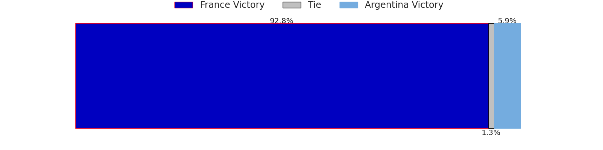
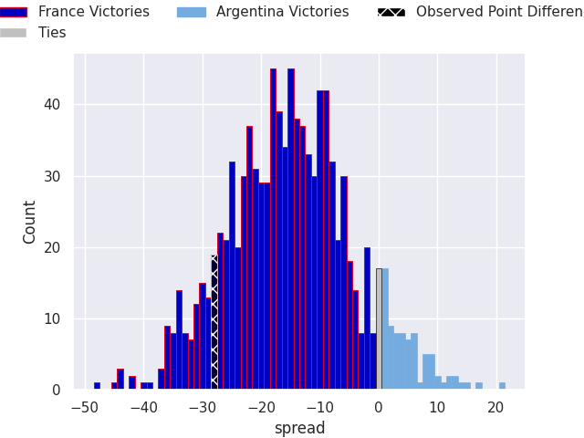

#### Wales V Australia on 2026/11/21

Average Margin: Wales by 2.0

#### Italy V Fiji on 2026/11/21

Average Margin: Italy by 5.4

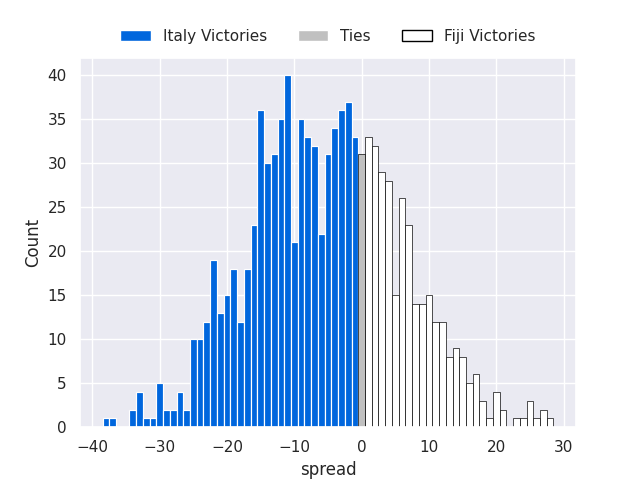

#### Scotland V Japan on 2026/11/21

Average Margin: Scotland by 14.7

#### Ireland V South Africa on 2026/11/21

Average Margin: South Africa by 0.2

#### England V New Zealand on 2026/11/21

Average Margin: England by 1.4

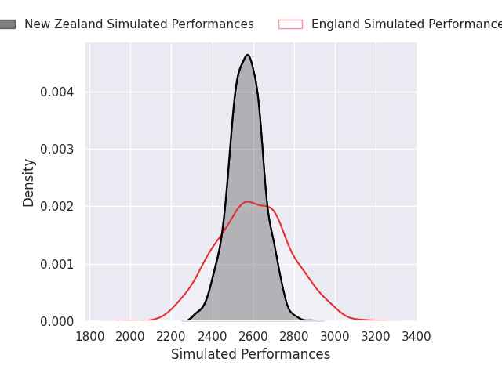

### Week 7
#### Scotland V Argentina on 2026-11-26

Average Margin: Scotland by 7.2

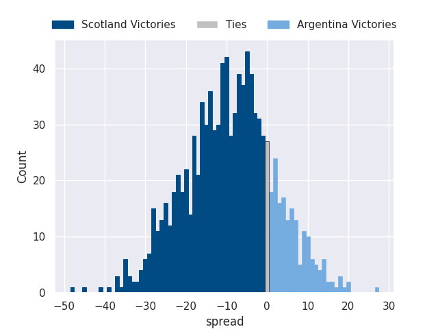

#### France V Argentina on 2026-11-26

Average Margin: France by 15.5

#### England V Argentina on 2026-11-26

Average Margin: England by 15.7

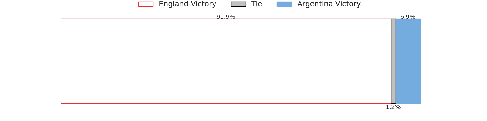

#### Ireland V Argentina on 2026-11-26

Average Margin: Ireland by 12.8

#### Ireland V Australia on 2026-11-26

Average Margin: Ireland by 11.8

#### Ireland V South Africa on 2026-11-26

Average Margin: Ireland by 0.7

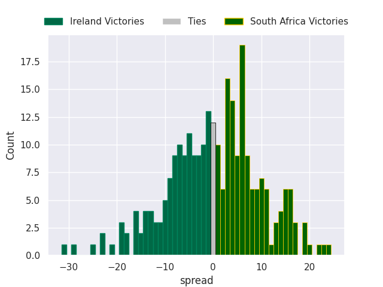

#### Ireland V New Zealand on 2026-11-26

Average Margin: Ireland by 0.4

#### England V South Africa on 2026-11-26

Average Margin: England by 2.6

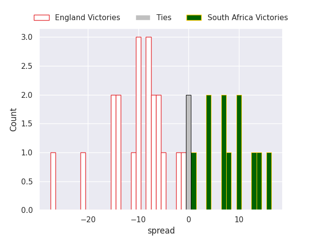

#### England V Australia on 2026-11-26

Average Margin: England by 11.7

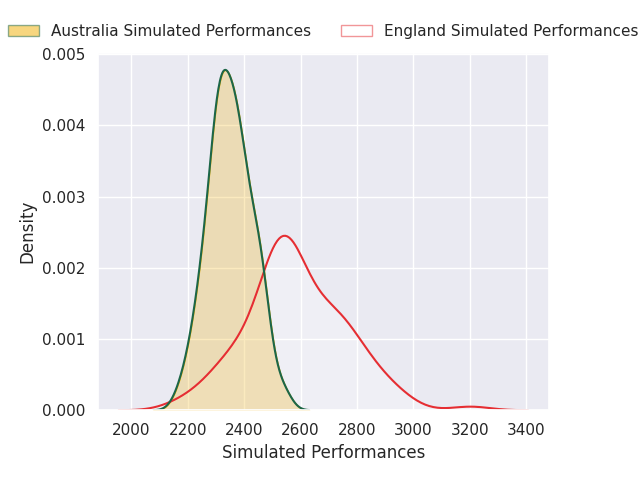

#### England V New Zealand on 2026-11-26

Average Margin: England by 3.1

#### France V South Africa on 2026-11-26

Average Margin: France by 2.5

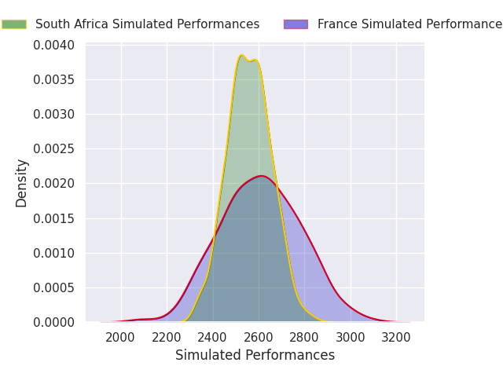

#### Italy V Fiji on 2026-11-26

Average Margin: Italy by 5.5

#### Scotland V Japan on 2026-11-26

Average Margin: Scotland by 17.3

#### Wales V Japan on 2026-11-26

Average Margin: Wales by 12.2

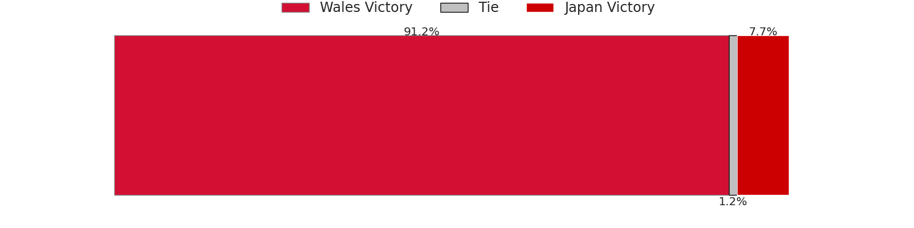

#### Wales V Argentina on 2026-11-26

Average Margin: Wales by 1.0

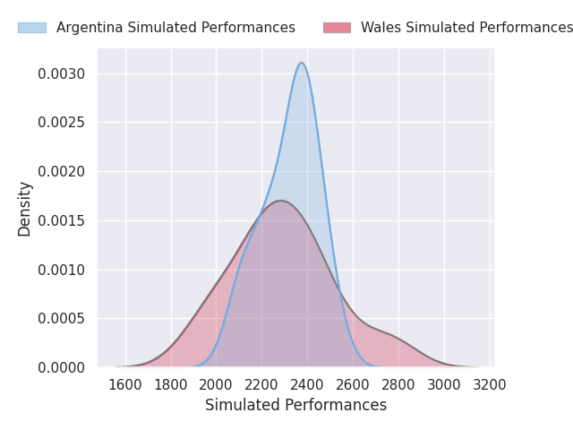

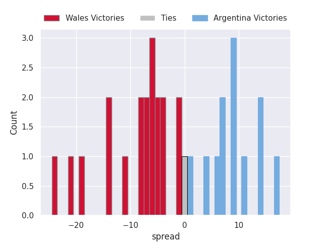

#### Wales V Australia on 2026-11-26

Average Margin: Wales by 1.9

#### Scotland V Australia on 2026-11-26

Average Margin: Scotland by 4.4

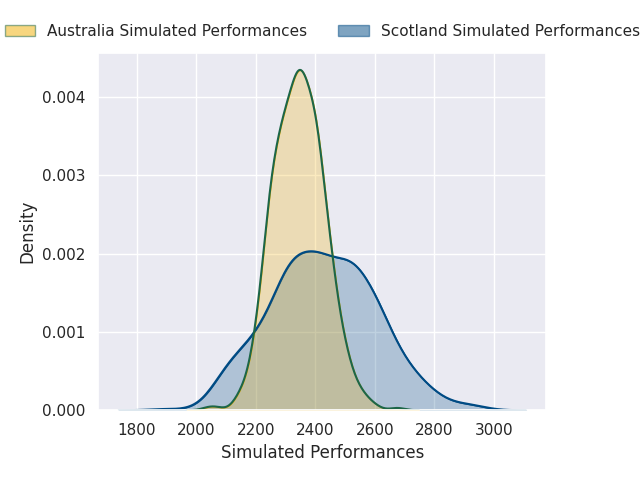

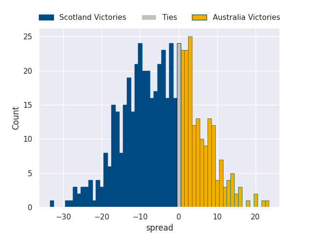

#### France V New Zealand on 2026-11-26

Average Margin: France by 1.9

#### France V Australia on 2026-11-26

Average Margin: France by 8.0

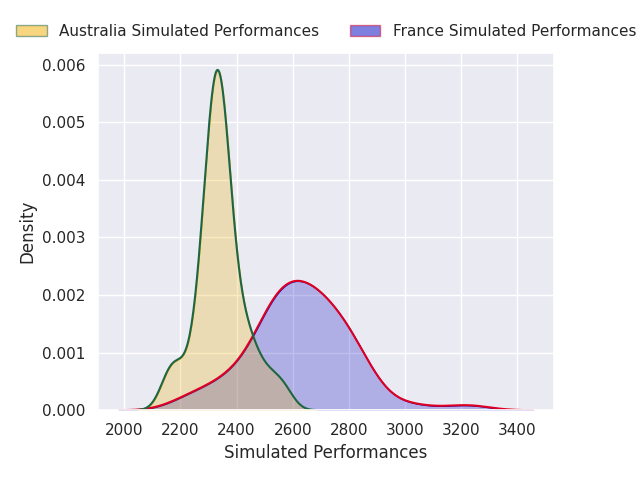

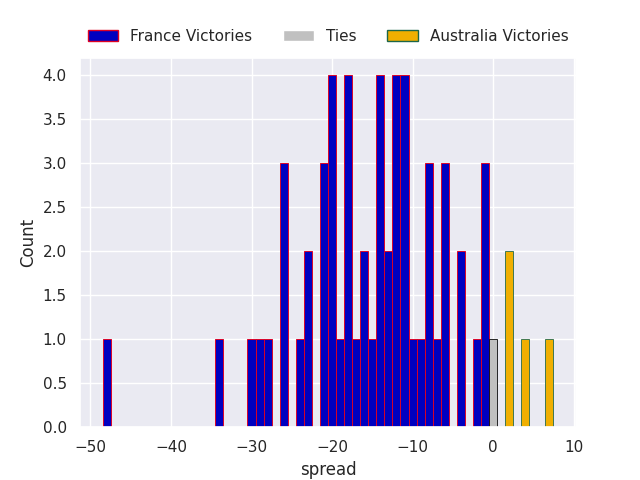

