## Team Rankings

## Standings
### Current Standings
#### North

| Club     |   Played |   Wins |   Point Differential |   Losing Bonus Points |   Try Bonus Points |   Competition Points |
|:---------|---------:|-------:|---------------------:|----------------------:|-------------------:|---------------------:|
| France   |        3 |      2 |                   41 |                     1 |                  3 |                   12 |
| Scotland |        3 |      2 |                   11 |                     0 |                  3 |                   11 |
| England  |        3 |      2 |                   48 |                     0 |                  2 |                   10 |
| Ireland  |        3 |      2 |                   -1 |                     0 |                  2 |                   10 |
| Wales    |        3 |      1 |                  -42 |                     0 |                  1 |                    5 |
| Italy    |        3 |      0 |                  -94 |                     0 |                    |                    0 |

#### South

| Club         |   Played |   Wins |   Point Differential |   Losing Bonus Points |   Try Bonus Points |   Competition Points |
|:-------------|---------:|-------:|---------------------:|----------------------:|-------------------:|---------------------:|
| South Africa |        3 |      3 |                   81 |                     0 |                  3 |                   15 |
| New Zealand  |        3 |      3 |                   51 |                     0 |                  3 |                   15 |
| Australia    |        3 |      1 |                   29 |                     1 |                  3 |                    8 |
| Argentina    |        3 |      1 |                   -2 |                     1 |                  2 |                    7 |
| Japan        |        3 |      1 |                  -26 |                     0 |                    |                    4 |
| Fiji         |        3 |      0 |                  -96 |                     0 |                    |                    0 |

### Projected Remaining Table
#### North

| Club     |   To Play |   Projected Wins |   Projected Differential |   Projected Losing Bonus Points | Projected Try Bonus Points   |   Projected Competition Points |
|:---------|----------:|-----------------:|-------------------------:|--------------------------------:|:-----------------------------|-------------------------------:|
| France   |         3 |            2.514 |                   45.493 |                           0.277 |                              |                         10.467 |
| Ireland  |         3 |            2.26  |                   32.036 |                           0.363 |                              |                          9.555 |
| England  |         3 |            2.236 |                   29.224 |                           0.366 |                              |                          9.44  |
| Scotland |         3 |            2.046 |                   21.028 |                           0.438 |                              |                          8.766 |
| Wales    |         3 |            1.297 |                   -4.504 |                           0.63  |                              |                          6.01  |
| Italy    |         3 |            1.055 |                  -15.794 |                           0.576 |                              |                          4.92  |

#### South

| Club         |   To Play |   Projected Wins |   Projected Differential |   Projected Losing Bonus Points | Projected Try Bonus Points   |   Projected Competition Points |
|:-------------|----------:|-----------------:|-------------------------:|--------------------------------:|:-----------------------------|-------------------------------:|
| New Zealand  |         3 |            2.013 |                   17.691 |                           0.525 |                              |                          8.771 |
| South Africa |         3 |            1.75  |                   12.952 |                           0.564 |                              |                          7.75  |
| Australia    |         3 |            0.88  |                  -17.248 |                           0.69  |                              |                          4.412 |
| Argentina    |         3 |            0.923 |                  -19.815 |                           0.517 |                              |                          4.361 |
| Japan        |         3 |            0.295 |                  -46.191 |                           0.423 |                              |                          1.673 |
| Fiji         |         3 |            0.293 |                  -54.872 |                           0.363 |                              |                          1.607 |

### Projected Total Table
#### North

| Club     |   Played |   Wins |   Point Differential |   Losing Bonus Points |   Try Bonus Points |   Competition Points |
|:---------|---------:|-------:|---------------------:|----------------------:|-------------------:|---------------------:|
| France   |        6 |  4.514 |               86.493 |                 1.277 |                  3 |               22.467 |
| Scotland |        6 |  4.046 |               32.028 |                 0.438 |                  3 |               19.766 |
| Ireland  |        6 |  4.26  |               31.036 |                 0.363 |                  2 |               19.555 |
| England  |        6 |  4.236 |               77.224 |                 0.366 |                  2 |               19.44  |
| Wales    |        6 |  2.297 |              -46.504 |                 0.63  |                  1 |               11.01  |
| Italy    |        6 |  1.055 |             -109.794 |                 0.576 |                    |                4.92  |

#### South

| Club         |   Played |   Wins |   Point Differential |   Losing Bonus Points |   Try Bonus Points |   Competition Points |
|:-------------|---------:|-------:|---------------------:|----------------------:|-------------------:|---------------------:|
| New Zealand  |        6 |  5.013 |               68.691 |                 0.525 |                  3 |               23.771 |
| South Africa |        6 |  4.75  |               93.952 |                 0.564 |                  3 |               22.75  |
| Australia    |        6 |  1.88  |               11.752 |                 1.69  |                  3 |               12.412 |
| Argentina    |        6 |  1.923 |              -21.815 |                 1.517 |                  2 |               11.361 |
| Japan        |        6 |  1.295 |              -72.191 |                 0.423 |                    |                5.673 |
| Fiji         |        6 |  0.293 |             -150.872 |                 0.363 |                    |                1.607 |

### Projected Playoff Results

|              | Reach Final   | Win Final   |
|:-------------|:--------------|:------------|
| Wales        | 100.0 %       | 77.6 %      |
| England      | 100.0 %       | 69.4 %      |
| Italy        | 100.0 %       | 67.3 %      |
| Ireland      | 100.0 %       | 66.9 %      |
| France       | 100.0 %       | 60.9 %      |
| Scotland     | 100.0 %       | 59.0 %      |
| New Zealand  | 100.0 %       | 55.2 %      |
| South Africa | 100.0 %       | 49.8 %      |
| Fiji         | 100.0 %       | 31.1 %      |
| Australia    | 100.0 %       | 23.3 %      |
| Japan        | 100.0 %       | 21.5 %      |
| Argentina    | 100.0 %       | 18.0 %      |

## Completed Match Review

| Model | Percent Correct Predictions | Spread Error |
| ------ | ------ | ------ |
| Club Level | 61.9% | 11.7 |
| Player Level: Lineup | nan% | nan |
| Player Level: Minutes | nan% | nan |

## Future Predictions
### Week 4
#### Ireland V Argentina on 2026/11/06

Average Margin: Ireland by 10.4

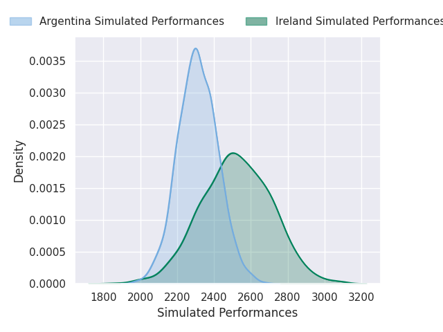
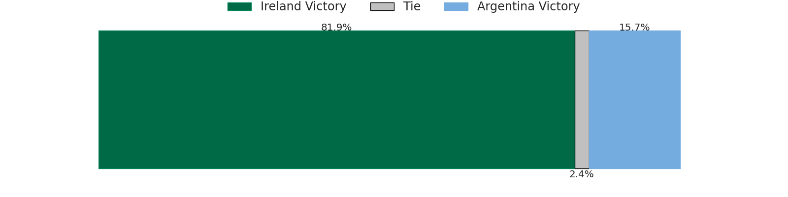
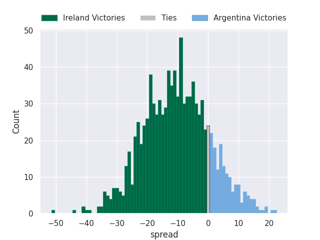

#### Scotland V New Zealand on 2026/11/07

Average Margin: New Zealand by 3.7

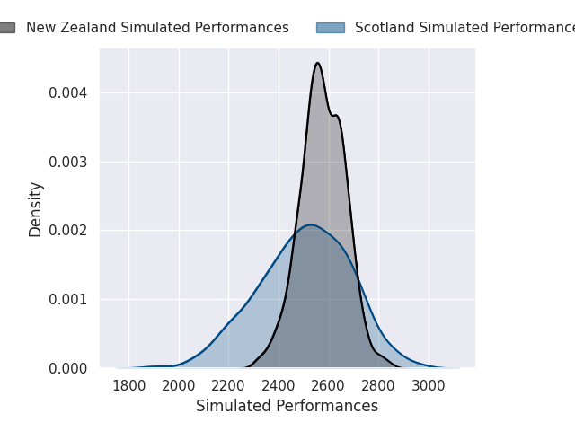
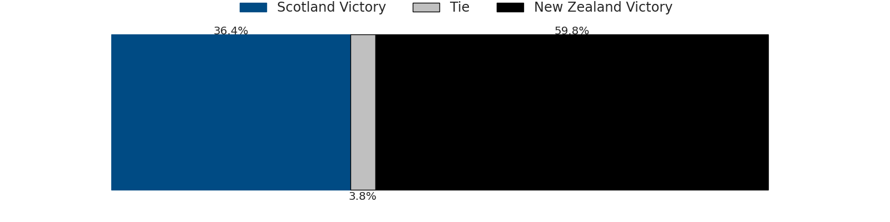
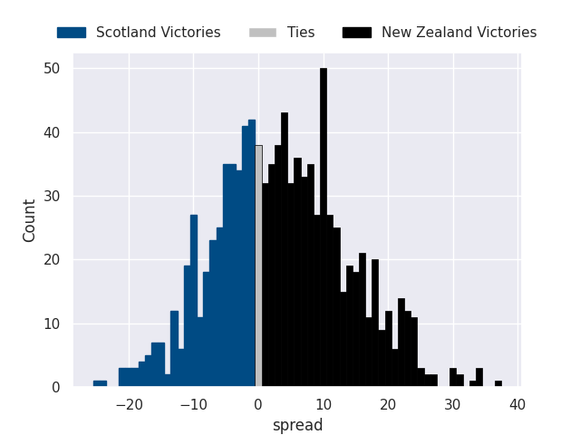

#### France V Fiji on 2026/11/07

Average Margin: France by 26.2

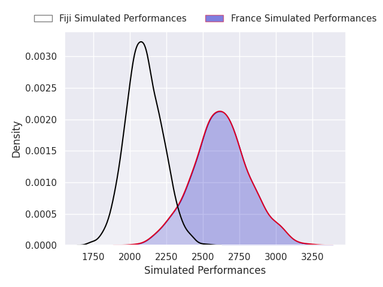
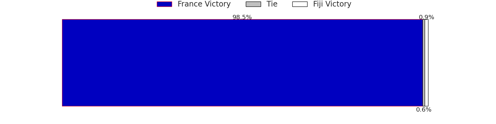
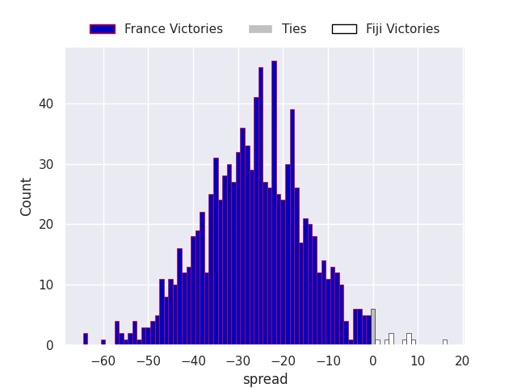

#### Wales V Japan on 2026/11/07

Average Margin: Wales by 8.6

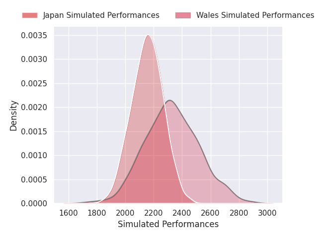
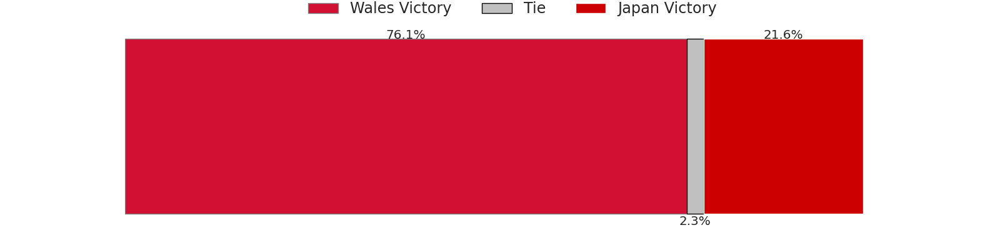
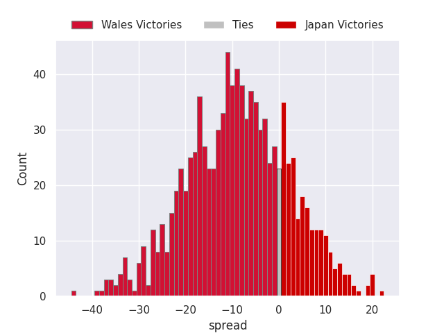

#### Italy V South Africa on 2026/11/07

Average Margin: South Africa by 16.4

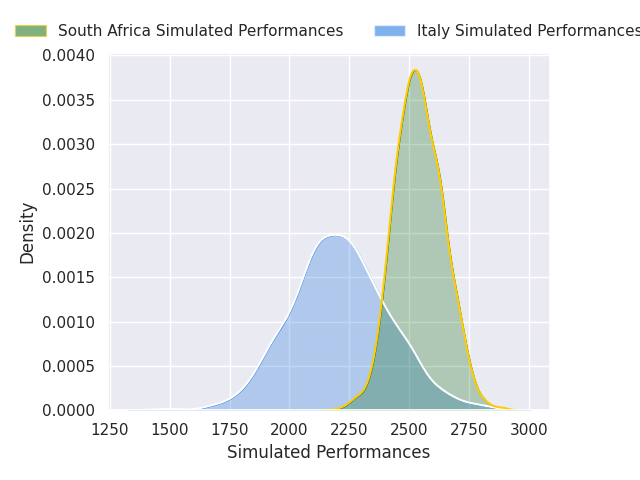

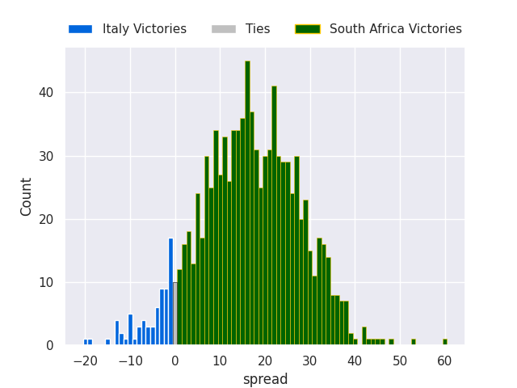

#### England V Australia on 2026/11/08

Average Margin: England by 10.6

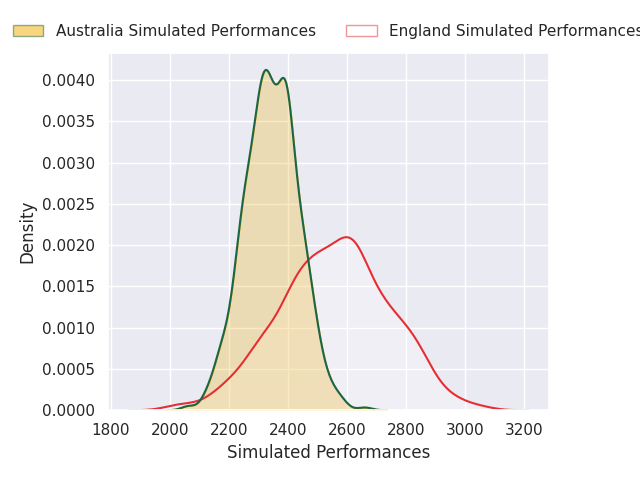
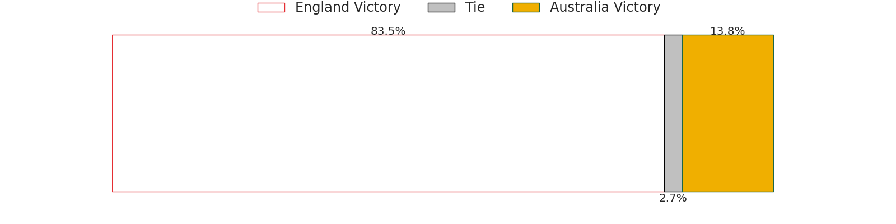
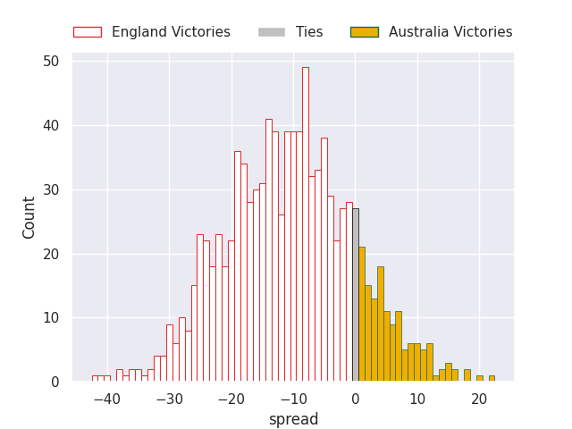

### Week 5
#### France V South Africa on 2026/11/13

Average Margin: France by 4.0

#### Wales V New Zealand on 2026/11/14

Average Margin: New Zealand by 12.4

#### Ireland V Fiji on 2026/11/14

Average Margin: Ireland by 22.2

#### England V Japan on 2026/11/14

Average Margin: England by 20.2

#### Italy V Argentina on 2026/11/14

Average Margin: Argentina by 5.8

#### Scotland V Australia on 2026/11/15

Average Margin: Scotland by 7.4

### Week 6
#### Italy V Fiji on 2026/11/21

Average Margin: Italy by 6.4

#### England V New Zealand on 2026/11/21

Average Margin: New Zealand by 1.6

#### Scotland V Japan on 2026/11/21

Average Margin: Scotland by 17.4

#### Wales V Australia on 2026/11/21

Average Margin: Australia by 0.7

#### France V Argentina on 2026/11/21

Average Margin: France by 15.2

#### Ireland V South Africa on 2026/11/21

Average Margin: South Africa by 0.5

### Week 7
#### France V New Zealand on 2026-11-26

Average Margin: France by 1.7

#### Wales V Fiji on 2026-11-26

Average Margin: Wales by 10.0

#### Italy V Japan on 2026-11-26

Average Margin: Italy by 4.2

#### Wales V Japan on 2026-11-26

Average Margin: Wales by 9.0

#### Wales V Australia on 2026-11-26

Average Margin: Wales by 4.0

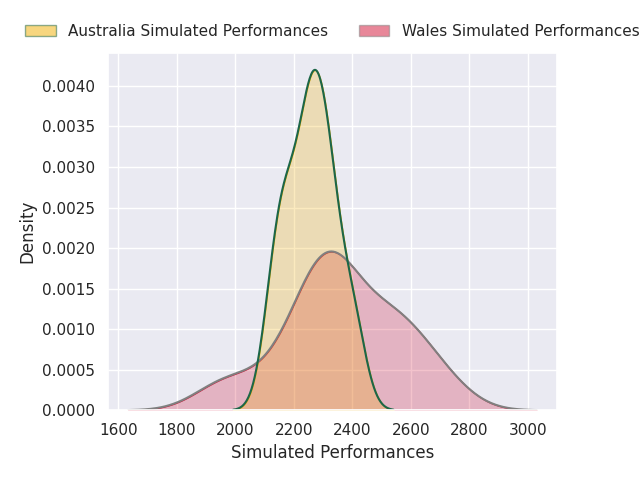

#### England V Japan on 2026-11-26

Average Margin: England by 20.8

#### France V Japan on 2026-11-26

Average Margin: France by 23.0

#### Scotland V Japan on 2026-11-26

Average Margin: Scotland by 27.0

#### Wales V Argentina on 2026-11-26

Average Margin: Wales by 10.0

#### Ireland V Japan on 2026-11-26

Average Margin: Ireland by 15.5

#### France V Argentina on 2026-11-26

Average Margin: France by 16.6

#### England V Australia on 2026-11-26

Average Margin: England by 11.3

#### Italy V Argentina on 2026-11-26

Average Margin: Argentina by 3.2

#### Scotland V Argentina on 2026-11-26

Average Margin: Scotland by 9.8

#### Scotland V Australia on 2026-11-26

Average Margin: Australia by 3.0

#### Ireland V Australia on 2026-11-26

Average Margin: Ireland by 10.3

#### France V Australia on 2026-11-26

Average Margin: France by 11.0

#### Ireland V Argentina on 2026-11-26

Average Margin: Ireland by 2.0

#### England V South Africa on 2026-11-26

Average Margin: England by 1.6

#### Scotland V New Zealand on 2026-11-26

Average Margin: New Zealand by 5.8

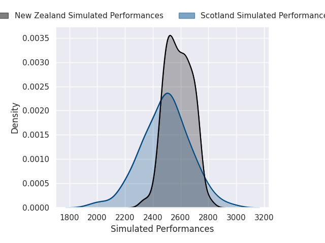
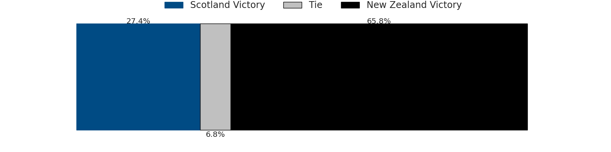
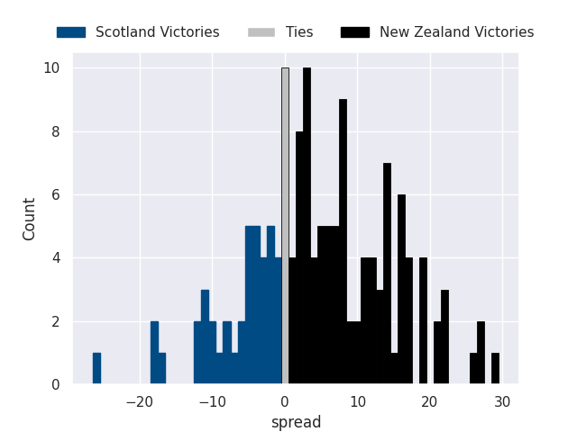

#### Scotland V South Africa on 2026-11-26

Average Margin: South Africa by 3.3

#### Ireland V New Zealand on 2026-11-26

Average Margin: New Zealand by 1.6

#### England V New Zealand on 2026-11-26

Average Margin: New Zealand by 5.0

#### Ireland V South Africa on 2026-11-26

Average Margin: South Africa by 1.5

#### France V South Africa on 2026-11-26

Average Margin: France by 2.8

#### England V Argentina on 2026-11-26

Average Margin: England by 13.7

#### Italy V Fiji on 2026-11-26

Average Margin: Italy by 5.8

