## Team Rankings

## Standings
### Current Standings
#### North

| Club     |   Played |   Wins |   Point Differential |   Losing Bonus Points |   Try Bonus Points |   Competition Points |
|:---------|---------:|-------:|---------------------:|----------------------:|-------------------:|---------------------:|
| France   |        5 |      4 |                   80 |                     1 |                  4 |                   21 |
| England  |        5 |      4 |                  134 |                     0 |                  4 |                   20 |
| Ireland  |        5 |      4 |                   57 |                     0 |                  4 |                   20 |
| Scotland |        5 |      3 |                   -8 |                     0 |                  3 |                   15 |
| Wales    |        5 |      3 |                  -28 |                     0 |                  3 |                   15 |
| Italy    |        5 |      0 |                 -158 |                     1 |                    |                    1 |

#### South

| Club         |   Played |   Wins |   Point Differential |   Losing Bonus Points |   Try Bonus Points |   Competition Points |
|:-------------|---------:|-------:|---------------------:|----------------------:|-------------------:|---------------------:|
| New Zealand  |        5 |      4 |                   66 |                     1 |                  5 |                   22 |
| South Africa |        5 |      4 |                  138 |                     1 |                  4 |                   21 |
| Argentina    |        5 |      2 |                  -27 |                     1 |                  2 |                   11 |
| Australia    |        5 |      1 |                    3 |                     2 |                  3 |                    9 |
| Japan        |        5 |      1 |                  -96 |                     1 |                    |                    5 |
| Fiji         |        5 |      0 |                 -161 |                     0 |                    |                    0 |

### Projected Remaining Table
#### North

| Club     |   To Play |   Projected Wins |   Projected Differential |   Projected Losing Bonus Points | Projected Try Bonus Points   |   Projected Competition Points |
|:---------|----------:|-----------------:|-------------------------:|--------------------------------:|:-----------------------------|-------------------------------:|
| France   |         1 |            0.914 |                   15.57  |                           0.056 |                              |                          3.742 |
| Scotland |         1 |            0.9   |                   14.245 |                           0.067 |                              |                          3.699 |
| Italy    |         1 |            0.671 |                    5.481 |                           0.172 |                              |                          2.94  |
| Wales    |         1 |            0.58  |                    2.549 |                           0.211 |                              |                          2.619 |
| England  |         1 |            0.559 |                    1.672 |                           0.234 |                              |                          2.538 |
| Ireland  |         1 |            0.465 |                   -0.037 |                           0.275 |                              |                          2.209 |

#### South

| Club         |   To Play |   Projected Wins |   Projected Differential |   Projected Losing Bonus Points | Projected Try Bonus Points   |   Projected Competition Points |
|:-------------|----------:|-----------------:|-------------------------:|--------------------------------:|:-----------------------------|-------------------------------:|
| South Africa |         1 |            0.498 |                    0.037 |                           0.231 |                              |                          2.297 |
| New Zealand  |         1 |            0.407 |                   -1.672 |                           0.276 |                              |                          1.972 |
| Australia    |         1 |            0.376 |                   -2.549 |                           0.263 |                              |                          1.855 |
| Fiji         |         1 |            0.287 |                   -5.481 |                           0.247 |                              |                          1.479 |
| Japan        |         1 |            0.084 |                  -14.245 |                           0.157 |                              |                          0.525 |
| Argentina    |         1 |            0.071 |                  -15.57  |                           0.133 |                              |                          0.447 |

### Projected Total Table
#### North

| Club     |   Played |   Wins |   Point Differential |   Losing Bonus Points |   Try Bonus Points |   Competition Points |
|:---------|---------:|-------:|---------------------:|----------------------:|-------------------:|---------------------:|
| France   |        6 |  4.914 |               95.57  |                 1.056 |                  4 |               24.742 |
| England  |        6 |  4.559 |              135.672 |                 0.234 |                  4 |               22.538 |
| Ireland  |        6 |  4.465 |               56.963 |                 0.275 |                  4 |               22.209 |
| Scotland |        6 |  3.9   |                6.245 |                 0.067 |                  3 |               18.699 |
| Wales    |        6 |  3.58  |              -25.451 |                 0.211 |                  3 |               17.619 |
| Italy    |        6 |  0.671 |             -152.519 |                 1.172 |                    |                3.94  |

#### South

| Club         |   Played |   Wins |   Point Differential |   Losing Bonus Points |   Try Bonus Points |   Competition Points |
|:-------------|---------:|-------:|---------------------:|----------------------:|-------------------:|---------------------:|
| New Zealand  |        6 |  4.407 |               64.328 |                 1.276 |                  5 |               23.972 |
| South Africa |        6 |  4.498 |              138.037 |                 1.231 |                  4 |               23.297 |
| Argentina    |        6 |  2.071 |              -42.57  |                 1.133 |                  2 |               11.447 |
| Australia    |        6 |  1.376 |                0.451 |                 2.263 |                  3 |               10.855 |
| Japan        |        6 |  1.084 |             -110.245 |                 1.157 |                    |                5.525 |
| Fiji         |        6 |  0.287 |             -166.481 |                 0.247 |                    |                1.479 |

### Projected Playoff Results

|              | Reach Final   | Win Final   |
|:-------------|:--------------|:------------|
| Wales        | 100.0 %       | 85.9 %      |
| Ireland      | 100.0 %       | 75.3 %      |
| Italy        | 100.0 %       | 70.6 %      |
| Scotland     | 100.0 %       | 69.6 %      |
| England      | 100.0 %       | 65.2 %      |
| France       | 100.0 %       | 60.0 %      |
| South Africa | 100.0 %       | 44.8 %      |
| New Zealand  | 100.0 %       | 43.4 %      |
| Fiji         | 100.0 %       | 29.4 %      |
| Australia    | 100.0 %       | 28.3 %      |
| Argentina    | 100.0 %       | 14.9 %      |
| Japan        | 100.0 %       | 12.6 %      |

## Completed Match Review

| Model | Percent Correct Predictions | Spread Error |
| ------ | ------ | ------ |
| Club Level | 72.7% | 13.0 |
| Player Level: Lineup | nan% | nan |
| Player Level: Minutes | nan% | nan |

## Future Predictions
### Week 6
#### Scotland V Japan on 2026/11/21

Average Margin: Scotland by 14.2

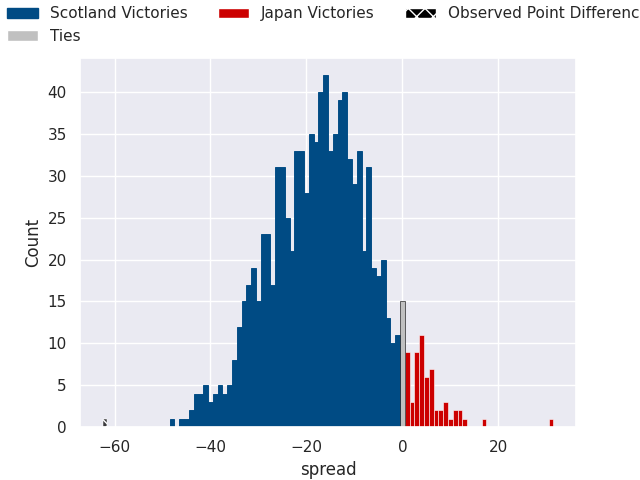

#### Wales V Australia on 2026/11/21

Average Margin: Wales by 2.5

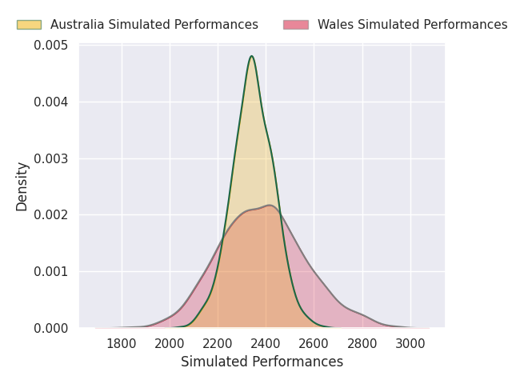

#### France V Argentina on 2026/11/21

Average Margin: France by 15.6

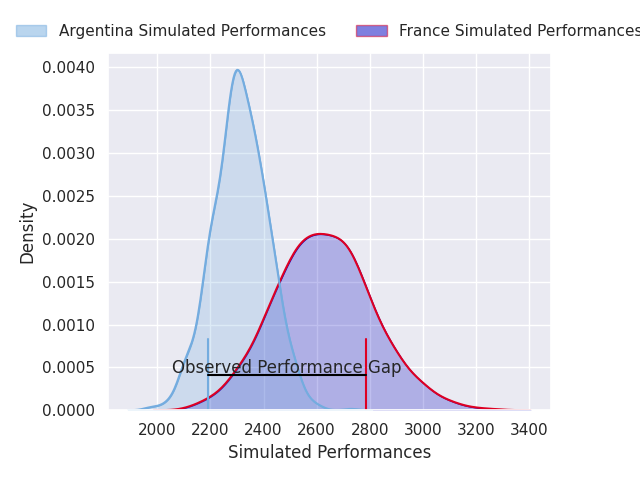

#### England V New Zealand on 2026/11/21

Average Margin: England by 1.7

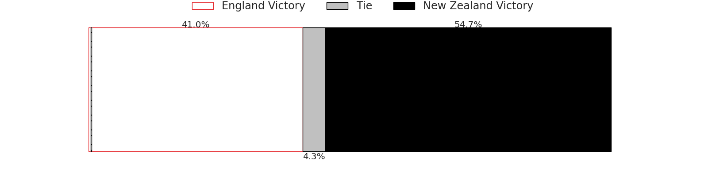

#### Ireland V South Africa on 2026/11/21

Average Margin: South Africa by 0.0

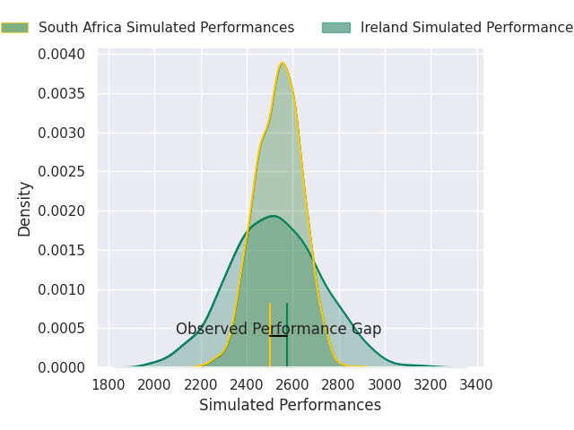

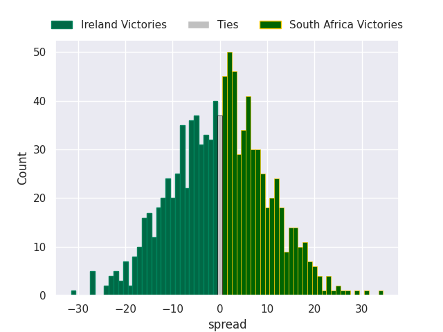

#### Italy V Fiji on 2026/11/21

Average Margin: Italy by 5.5

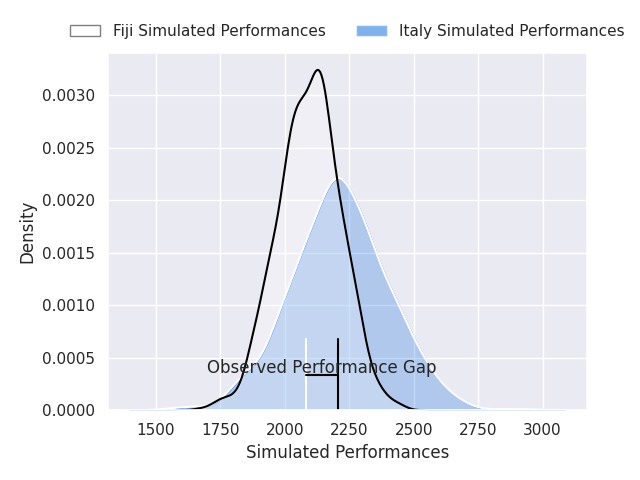

### Week 7
#### Italy V Fiji on 2026-11-26

Average Margin: Italy by 6.1

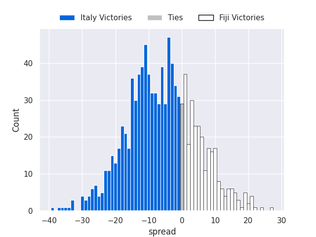

#### Scotland V Australia on 2026-11-26

Average Margin: Scotland by 4.1

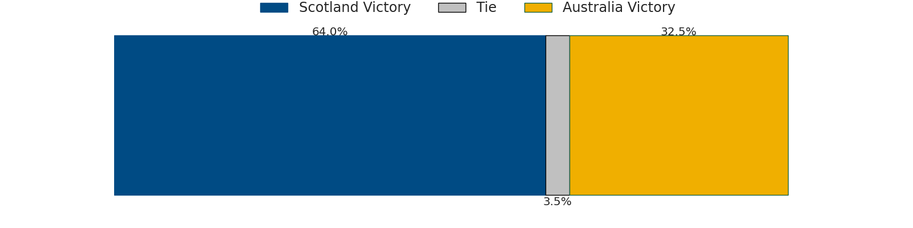

#### Scotland V Argentina on 2026-11-26

Average Margin: Scotland by 7.3

#### Scotland V Japan on 2026-11-26

Average Margin: Scotland by 13.7

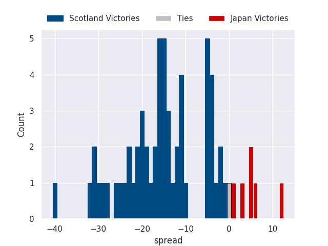

#### Wales V Japan on 2026-11-26

Average Margin: Wales by 12.0

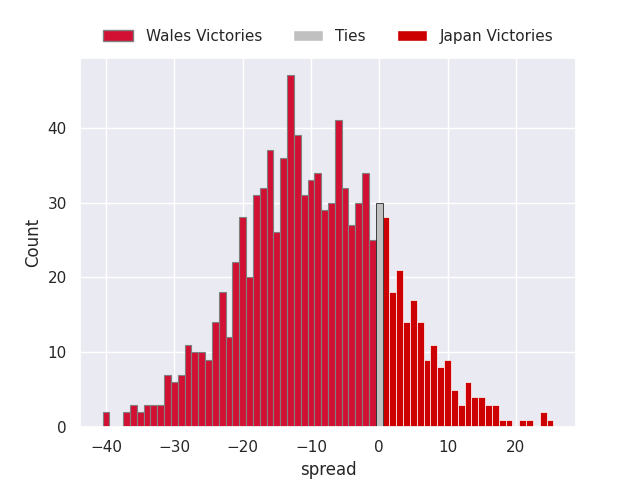

#### France V Australia on 2026-11-26

Average Margin: France by 22.0

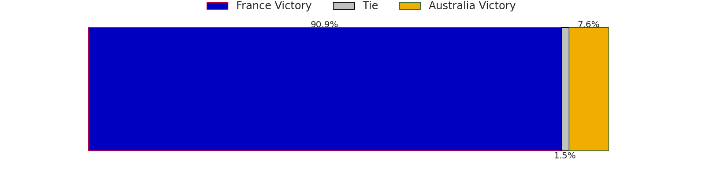

#### France V Argentina on 2026-11-26

Average Margin: France by 18.6

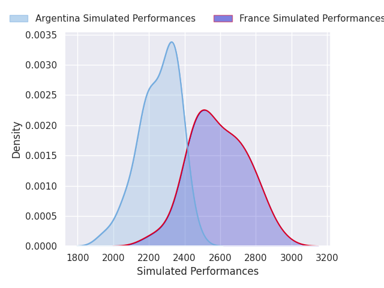

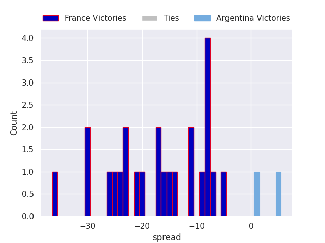

#### England V Australia on 2026-11-26

Average Margin: England by 11.1

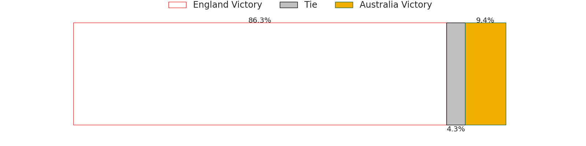
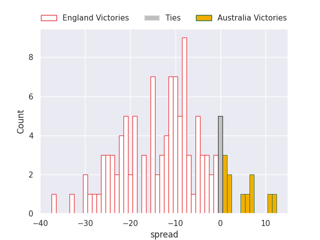

#### Wales V Australia on 2026-11-26

Average Margin: Wales by 1.6

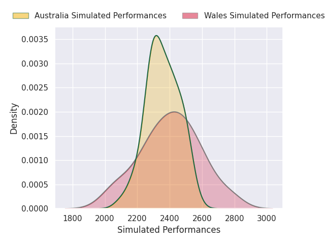

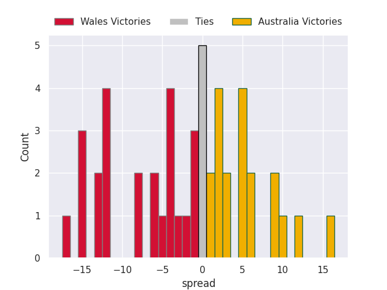

#### England V Argentina on 2026-11-26

Average Margin: England by 14.5

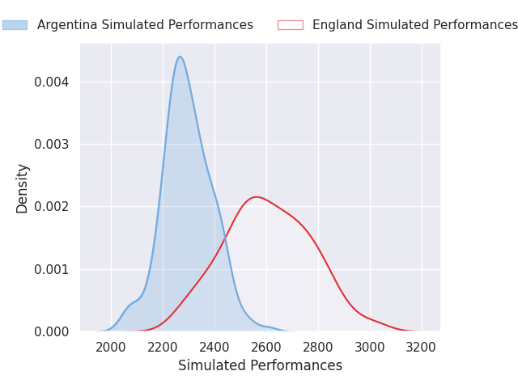

#### Ireland V Australia on 2026-11-26

Average Margin: Ireland by 10.4

#### France V New Zealand on 2026-11-26

Average Margin: France by 1.3

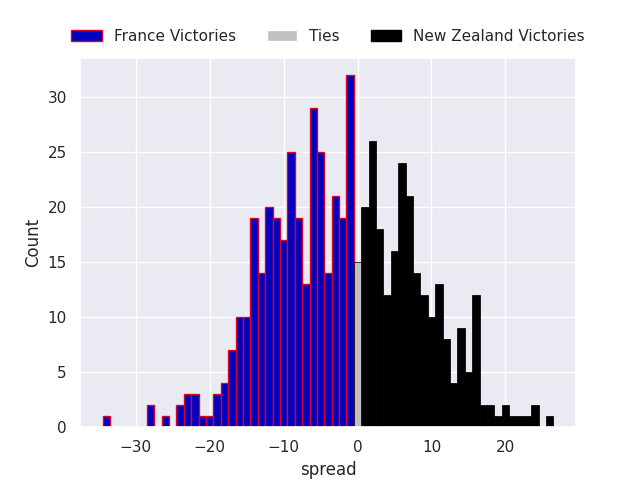

#### Ireland V New Zealand on 2026-11-26

Average Margin: Ireland by 11.1

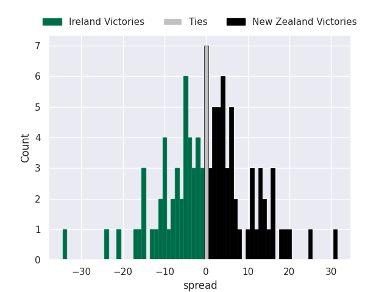

#### France V South Africa on 2026-11-26

Average Margin: France by 3.8

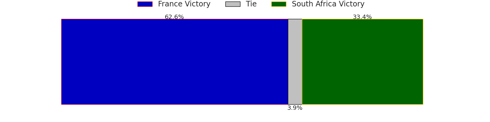
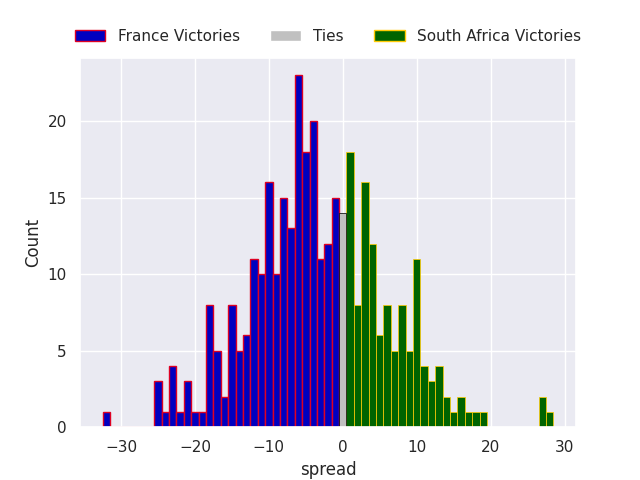

#### England V South Africa on 2026-11-26

Average Margin: England by 2.3

#### Ireland V South Africa on 2026-11-26

Average Margin: South Africa by 1.3

#### England V New Zealand on 2026-11-26

Average Margin: England by 1.2

#### Ireland V Argentina on 2026-11-26

Average Margin: Ireland by 13.0

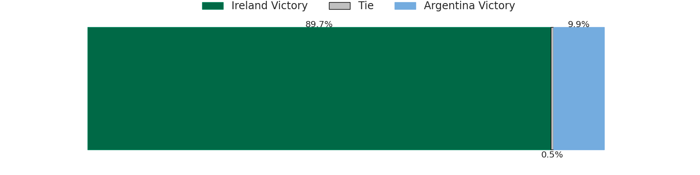
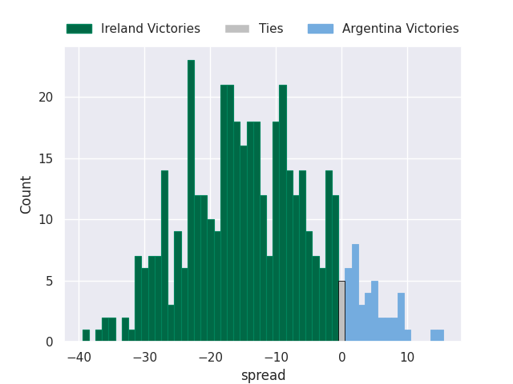

#### Wales V Argentina on 2026-11-26

Average Margin: Wales by 10.4

