## Team Rankings

## Standings
### Current Standings
#### North

| Club     |   Played |   Wins |   Point Differential |   Losing Bonus Points |   Try Bonus Points |   Competition Points |
|:---------|---------:|-------:|---------------------:|----------------------:|-------------------:|---------------------:|
| France   |        6 |      5 |                  108 |                     1 |                  5 |                   26 |
| England  |        6 |      5 |                  159 |                     0 |                  5 |                   25 |
| Ireland  |        6 |      5 |                   60 |                     0 |                  4 |                   24 |
| Scotland |        6 |      4 |                   54 |                     0 |                  4 |                   20 |
| Wales    |        6 |      3 |                  -31 |                     1 |                  4 |                   17 |
| Italy    |        6 |      0 |                 -163 |                     2 |                    |                    2 |

#### South

| Club         |   Played |   Wins |   Point Differential |   Losing Bonus Points |   Try Bonus Points |   Competition Points |
|:-------------|---------:|-------:|---------------------:|----------------------:|-------------------:|---------------------:|
| South Africa |        6 |      4 |                  135 |                     2 |                  4 |                   22 |
| New Zealand  |        6 |      4 |                   41 |                     1 |                  5 |                   22 |
| Australia    |        6 |      2 |                    6 |                     2 |                  4 |                   14 |
| Argentina    |        6 |      2 |                  -55 |                     1 |                  2 |                   11 |
| Japan        |        6 |      1 |                 -158 |                     1 |                    |                    5 |
| Fiji         |        6 |      1 |                 -156 |                     0 |                    |                    4 |

### Projected Remaining Table
#### North

| Club   | To Play   | Projected Wins   | Projected Differential   | Projected Losing Bonus Points   | Projected Try Bonus Points   | Projected Competition Points   |
|--------|-----------|------------------|--------------------------|---------------------------------|------------------------------|--------------------------------|

#### South

| Club   | To Play   | Projected Wins   | Projected Differential   | Projected Losing Bonus Points   | Projected Try Bonus Points   | Projected Competition Points   |
|--------|-----------|------------------|--------------------------|---------------------------------|------------------------------|--------------------------------|

### Projected Total Table
#### North

| Club     |   Played |   Wins |   Point Differential |   Losing Bonus Points |   Try Bonus Points |   Competition Points |
|:---------|---------:|-------:|---------------------:|----------------------:|-------------------:|---------------------:|
| France   |        6 |      5 |                  108 |                     1 |                  5 |                   26 |
| England  |        6 |      5 |                  159 |                     0 |                  5 |                   25 |
| Ireland  |        6 |      5 |                   60 |                     0 |                  4 |                   24 |
| Scotland |        6 |      4 |                   54 |                     0 |                  4 |                   20 |
| Wales    |        6 |      3 |                  -31 |                     1 |                  4 |                   17 |
| Italy    |        6 |      0 |                 -163 |                     2 |                    |                    2 |

#### South

| Club         |   Played |   Wins |   Point Differential |   Losing Bonus Points |   Try Bonus Points |   Competition Points |
|:-------------|---------:|-------:|---------------------:|----------------------:|-------------------:|---------------------:|
| South Africa |        6 |      4 |                  135 |                     2 |                  4 |                   22 |
| New Zealand  |        6 |      4 |                   41 |                     1 |                  5 |                   22 |
| Australia    |        6 |      2 |                    6 |                     2 |                  4 |                   14 |
| Argentina    |        6 |      2 |                  -55 |                     1 |                  2 |                   11 |
| Japan        |        6 |      1 |                 -158 |                     1 |                    |                    5 |
| Fiji         |        6 |      1 |                 -156 |                     0 |                    |                    4 |

### Projected Playoff Results

|              | Reach Final   | Win Final   |
|:-------------|:--------------|:------------|
| Wales        | 100.0 %       | 88.1 %      |
| Ireland      | 100.0 %       | 86.7 %      |
| Scotland     | 100.0 %       | 80.2 %      |
| England      | 100.0 %       | 72.6 %      |
| France       | 100.0 %       | 65.3 %      |
| Italy        | 100.0 %       | 57.0 %      |
| Fiji         | 100.0 %       | 43.0 %      |
| South Africa | 100.0 %       | 34.7 %      |
| New Zealand  | 100.0 %       | 27.4 %      |
| Argentina    | 100.0 %       | 19.8 %      |
| Australia    | 100.0 %       | 13.3 %      |
| Japan        | 100.0 %       | 11.9 %      |

## Completed Match Review

| Model | Percent Correct Predictions | Spread Error |
| ------ | ------ | ------ |
| Club Level | 75.0% | 14.4 |
| Player Level: Lineup | nan% | nan |
| Player Level: Minutes | nan% | nan |

## Future Predictions
### Week 7
#### England V New Zealand on 2026-11-26

Average Margin: England by 6.1

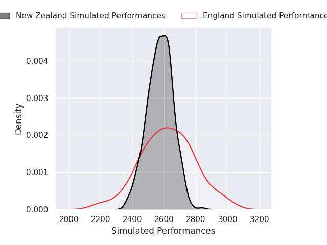
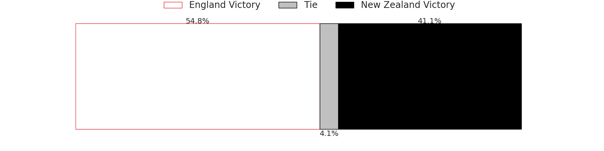
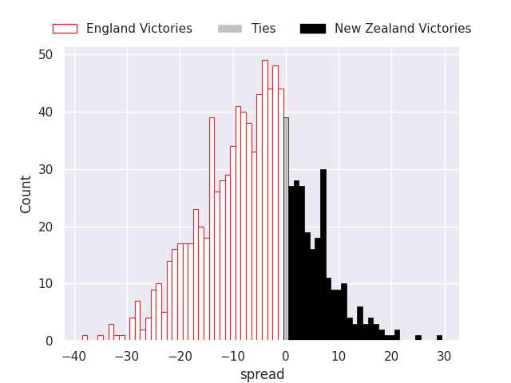

#### Wales V Japan on 2026-11-26

Average Margin: Wales by 12.4

#### Italy V Fiji on 2026-11-26

Average Margin: Italy by 1.8

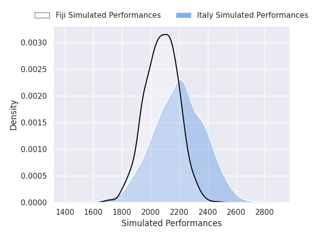

#### Scotland V Argentina on 2026-11-26

Average Margin: Scotland by 8.7

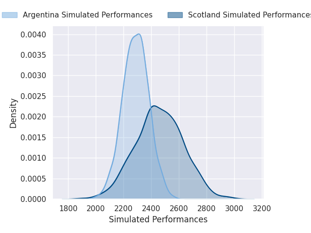

#### Ireland V Australia on 2026-11-26

Average Margin: Ireland by 11.0

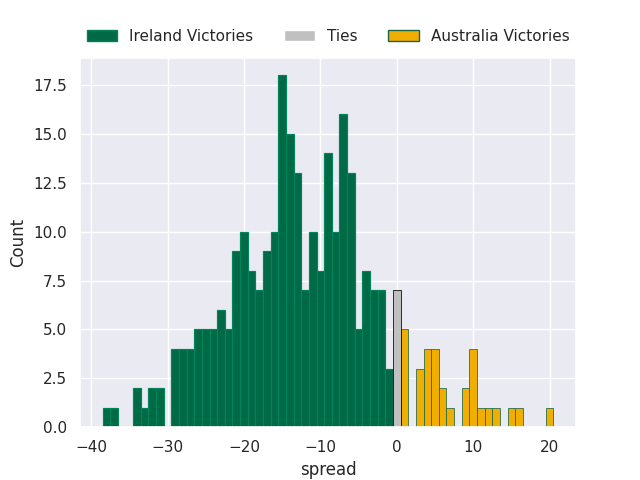

#### France V South Africa on 2026-11-26

Average Margin: France by 4.4

#### Ireland V Australia on 2026/11/27

Average Margin: Ireland by 11.3

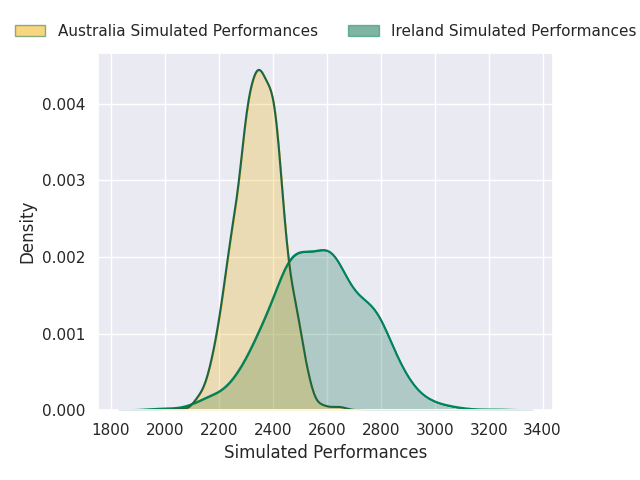
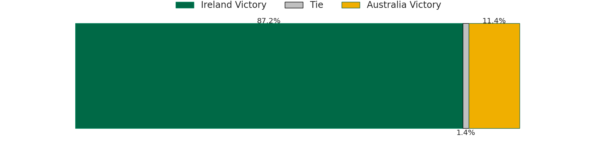
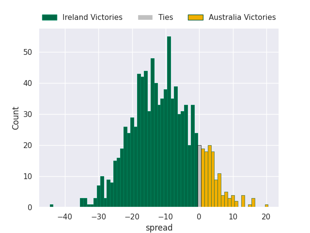

#### Italy V Fiji on 2026/11/27

Average Margin: Italy by 2.1

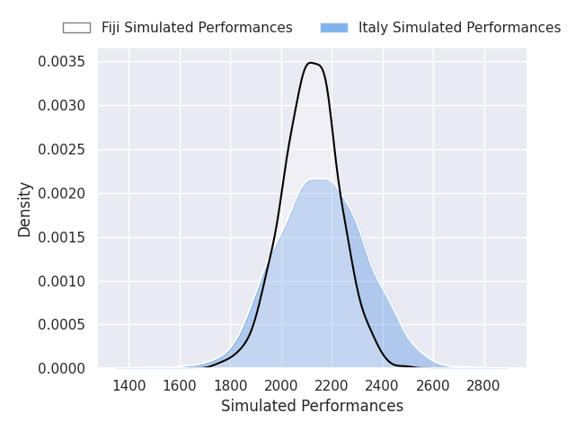

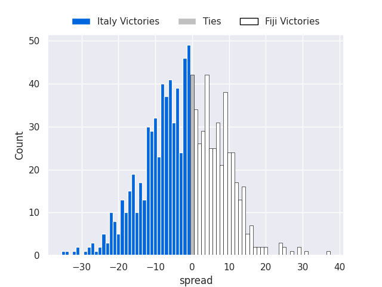

#### England V New Zealand on 2026/11/28

Average Margin: England by 6.1

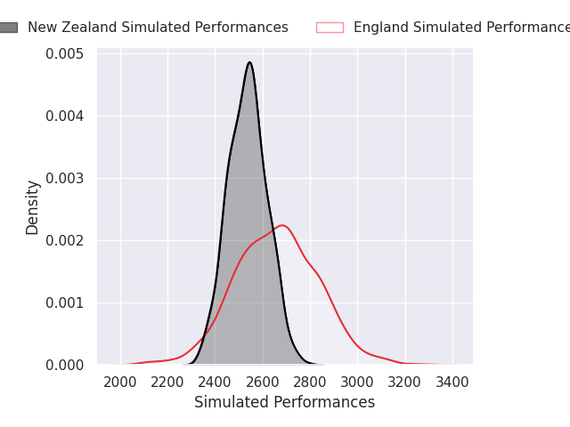
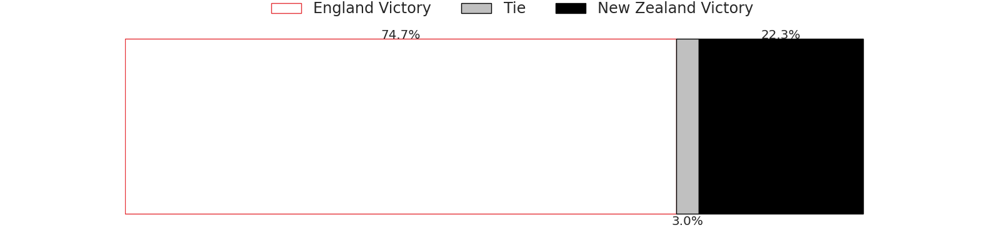
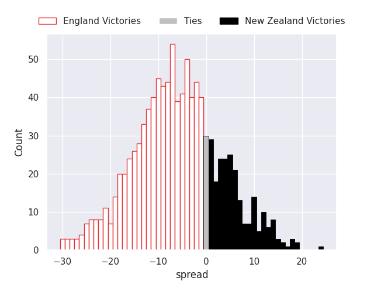

#### Wales V Japan on 2026/11/28

Average Margin: Wales by 12.8

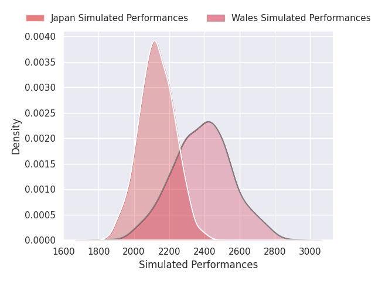
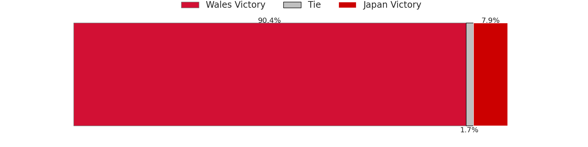
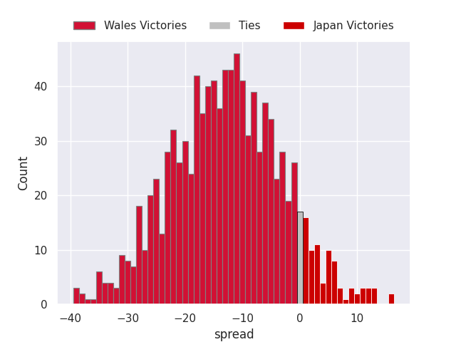

#### France V South Africa on 2026/11/29

Average Margin: France by 3.9

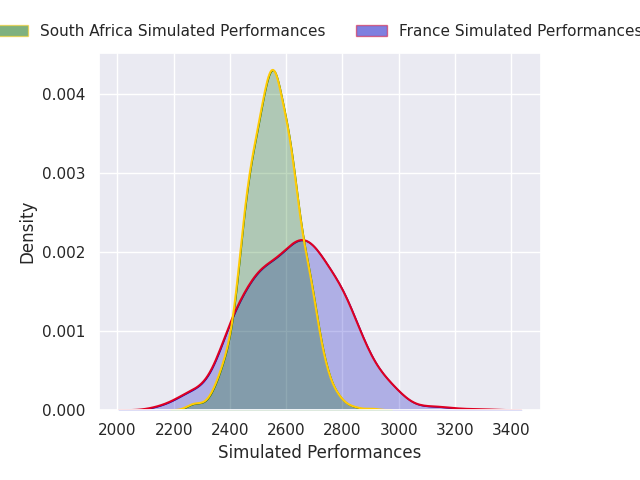

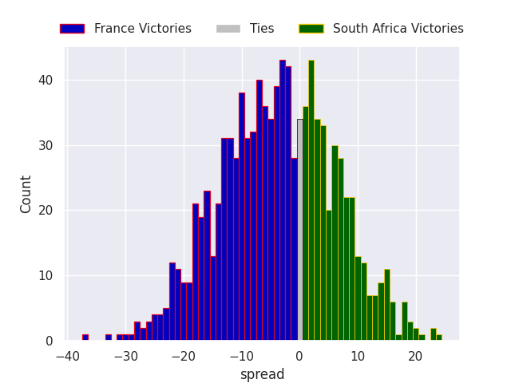

#### Scotland V Argentina on 2026/11/29

Average Margin: Scotland by 8.6

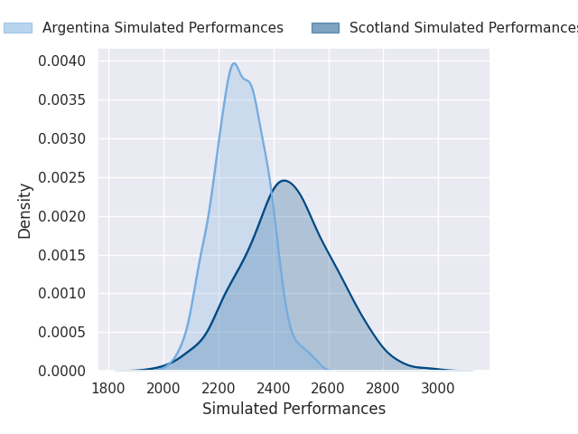

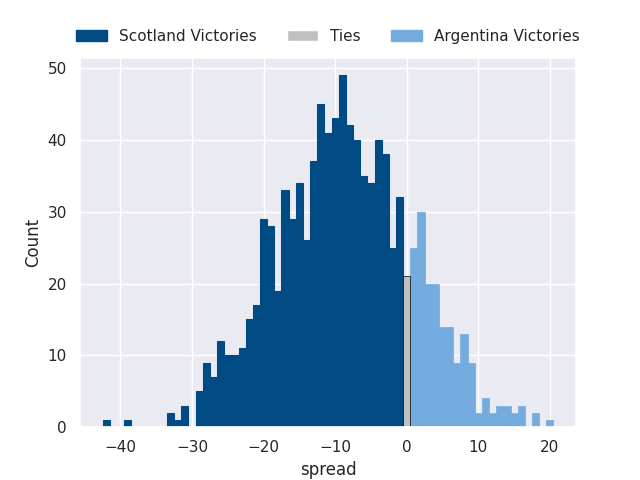

