## Team Rankings

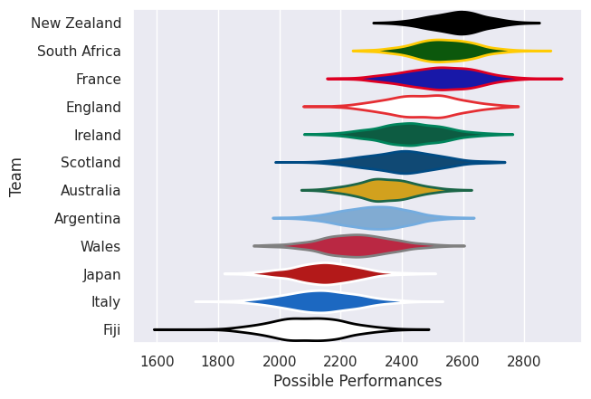
## Standings
### Current Standings
#### North

| Club     |   Played |   Wins |   Point Differential |   Losing Bonus Points |   Try Bonus Points |   Competition Points |
|:---------|---------:|-------:|---------------------:|----------------------:|-------------------:|---------------------:|
| France   |        5 |      4 |                   80 |                     1 |                  4 |                   21 |
| England  |        5 |      4 |                  134 |                     0 |                  4 |                   20 |
| Ireland  |        5 |      4 |                   57 |                     0 |                  4 |                   20 |
| Scotland |        5 |      3 |                   -8 |                     0 |                  3 |                   15 |
| Wales    |        5 |      3 |                  -28 |                     0 |                  3 |                   15 |
| Italy    |        5 |      0 |                 -158 |                     1 |                    |                    1 |

#### South

| Club         |   Played |   Wins |   Point Differential |   Losing Bonus Points |   Try Bonus Points |   Competition Points |
|:-------------|---------:|-------:|---------------------:|----------------------:|-------------------:|---------------------:|
| New Zealand  |        5 |      4 |                   66 |                     1 |                  5 |                   22 |
| South Africa |        5 |      4 |                  138 |                     1 |                  4 |                   21 |
| Argentina    |        5 |      2 |                  -27 |                     1 |                  2 |                   11 |
| Australia    |        5 |      1 |                    3 |                     2 |                  3 |                    9 |
| Japan        |        5 |      1 |                  -96 |                     1 |                    |                    5 |
| Fiji         |        5 |      0 |                 -161 |                     0 |                    |                    0 |

### Projected Remaining Table
#### North

| Club     |   To Play |   Projected Wins |   Projected Differential |   Projected Losing Bonus Points | Projected Try Bonus Points   |   Projected Competition Points |
|:---------|----------:|-----------------:|-------------------------:|--------------------------------:|:-----------------------------|-------------------------------:|
| France   |         1 |            0.933 |                   15.83  |                           0.035 |                              |                          3.789 |
| Scotland |         1 |            0.916 |                   14.527 |                           0.057 |                              |                          3.741 |
| Italy    |         1 |            0.661 |                    5.316 |                           0.186 |                              |                          2.892 |
| Wales    |         1 |            0.595 |                    2.425 |                           0.226 |                              |                          2.678 |
| England  |         1 |            0.573 |                    2.265 |                           0.218 |                              |                          2.59  |
| Ireland  |         1 |            0.486 |                    0.276 |                           0.235 |                              |                          2.269 |

#### South

| Club         |   To Play |   Projected Wins |   Projected Differential |   Projected Losing Bonus Points | Projected Try Bonus Points   |   Projected Competition Points |
|:-------------|----------:|-----------------:|-------------------------:|--------------------------------:|:-----------------------------|-------------------------------:|
| South Africa |         1 |            0.469 |                   -0.276 |                           0.24  |                              |                          2.206 |
| New Zealand  |         1 |            0.387 |                   -2.265 |                           0.262 |                              |                          1.89  |
| Australia    |         1 |            0.369 |                   -2.425 |                           0.309 |                              |                          1.857 |
| Fiji         |         1 |            0.308 |                   -5.316 |                           0.225 |                              |                          1.519 |
| Japan        |         1 |            0.074 |                  -14.527 |                           0.159 |                              |                          0.475 |
| Argentina    |         1 |            0.056 |                  -15.83  |                           0.143 |                              |                          0.389 |

### Projected Total Table
#### North

| Club     |   Played |   Wins |   Point Differential |   Losing Bonus Points |   Try Bonus Points |   Competition Points |
|:---------|---------:|-------:|---------------------:|----------------------:|-------------------:|---------------------:|
| France   |        6 |  4.933 |               95.83  |                 1.035 |                  4 |               24.789 |
| England  |        6 |  4.573 |              136.265 |                 0.218 |                  4 |               22.59  |
| Ireland  |        6 |  4.486 |               57.276 |                 0.235 |                  4 |               22.269 |
| Scotland |        6 |  3.916 |                6.527 |                 0.057 |                  3 |               18.741 |
| Wales    |        6 |  3.595 |              -25.575 |                 0.226 |                  3 |               17.678 |
| Italy    |        6 |  0.661 |             -152.684 |                 1.186 |                    |                3.892 |

#### South

| Club         |   Played |   Wins |   Point Differential |   Losing Bonus Points |   Try Bonus Points |   Competition Points |
|:-------------|---------:|-------:|---------------------:|----------------------:|-------------------:|---------------------:|
| New Zealand  |        6 |  4.387 |               63.735 |                 1.262 |                  5 |               23.89  |
| South Africa |        6 |  4.469 |              137.724 |                 1.24  |                  4 |               23.206 |
| Argentina    |        6 |  2.056 |              -42.83  |                 1.143 |                  2 |               11.389 |
| Australia    |        6 |  1.369 |                0.575 |                 2.309 |                  3 |               10.857 |
| Japan        |        6 |  1.074 |             -110.527 |                 1.159 |                    |                5.475 |
| Fiji         |        6 |  0.308 |             -166.316 |                 0.225 |                    |                1.519 |

### Projected Playoff Results

|              | Reach Final   | Win Final   |
|:-------------|:--------------|:------------|
| Wales        | 100.0 %       | 89.1 %      |
| Ireland      | 100.0 %       | 75.3 %      |
| Italy        | 100.0 %       | 70.6 %      |
| Scotland     | 100.0 %       | 68.0 %      |
| England      | 100.0 %       | 64.8 %      |
| France       | 100.0 %       | 60.3 %      |
| New Zealand  | 100.0 %       | 45.4 %      |
| South Africa | 100.0 %       | 43.2 %      |
| Australia    | 100.0 %       | 29.4 %      |
| Fiji         | 100.0 %       | 29.4 %      |
| Argentina    | 100.0 %       | 15.8 %      |
| Japan        | 100.0 %       | 8.7 %       |

## Completed Match Review

| Model | Percent Correct Predictions | Spread Error |
| ------ | ------ | ------ |
| Club Level | 74.5% | 11.8 |
| Player Level: Lineup | nan% | nan |
| Player Level: Minutes | nan% | nan |

## Future Predictions
### Week 6
#### France V Argentina on 2026/11/21

Average Margin: France by 15.8

#### Wales V Australia on 2026/11/21

Average Margin: Wales by 2.4

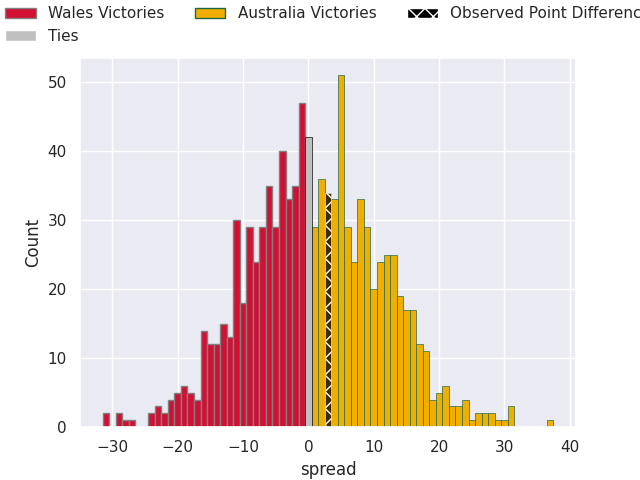

#### Italy V Fiji on 2026/11/21

Average Margin: Italy by 5.3

#### Ireland V South Africa on 2026/11/21

Average Margin: Ireland by 0.3

#### England V New Zealand on 2026/11/21

Average Margin: England by 2.3

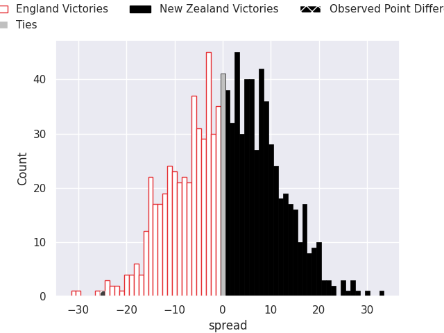

#### Scotland V Japan on 2026/11/21

Average Margin: Scotland by 14.5

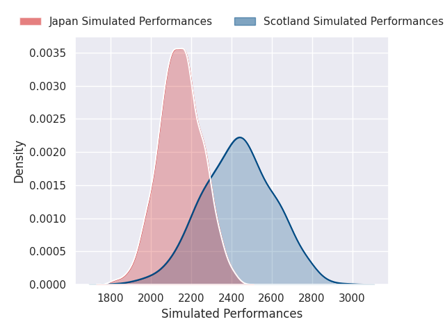

### Week 7
#### France V South Africa on 2026-11-26

Average Margin: France by 3.2

#### Wales V Japan on 2026-11-26

Average Margin: Wales by 13.5

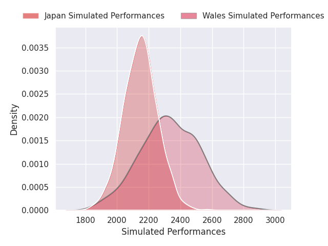

#### Wales V Australia on 2026-11-26

Average Margin: Wales by 2.3

#### Wales V Argentina on 2026-11-26

Average Margin: Argentina by 1.1

#### Scotland V Australia on 2026-11-26

Average Margin: Scotland by 3.9

#### Scotland V Argentina on 2026-11-26

Average Margin: Scotland by 6.8

#### France V Australia on 2026-11-26

Average Margin: France by 9.5

#### France V Argentina on 2026-11-26

Average Margin: France by 17.9

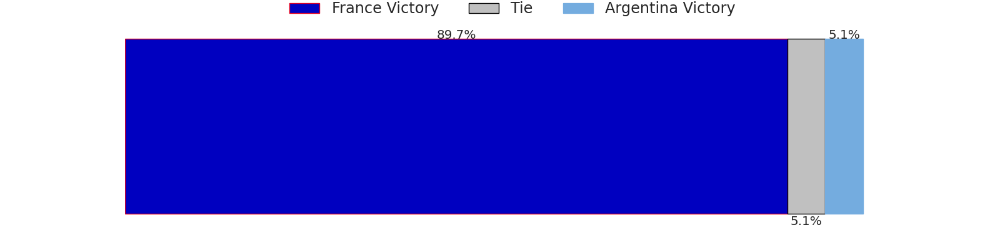

#### Scotland V Japan on 2026-11-26

Average Margin: Scotland by 14.9

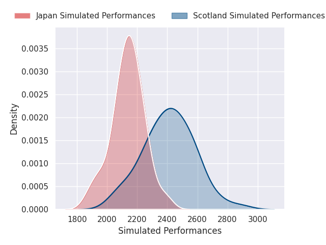

#### Ireland V Argentina on 2026-11-26

Average Margin: Ireland by 13.6

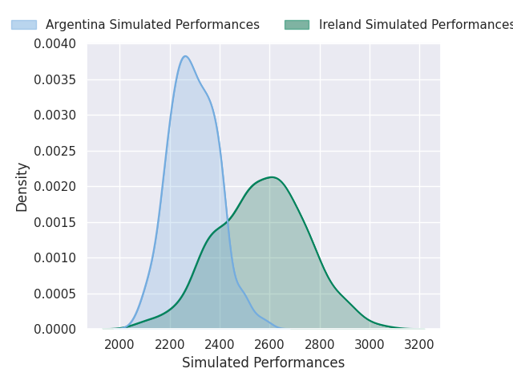

#### England V Argentina on 2026-11-26

Average Margin: England by 15.5

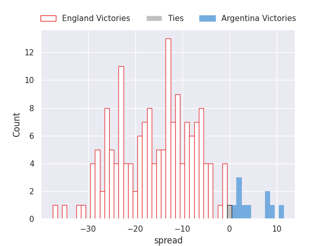

#### Ireland V Australia on 2026-11-26

Average Margin: Ireland by 10.7

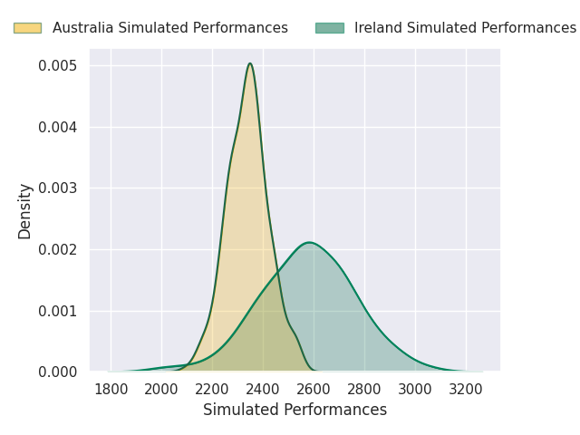
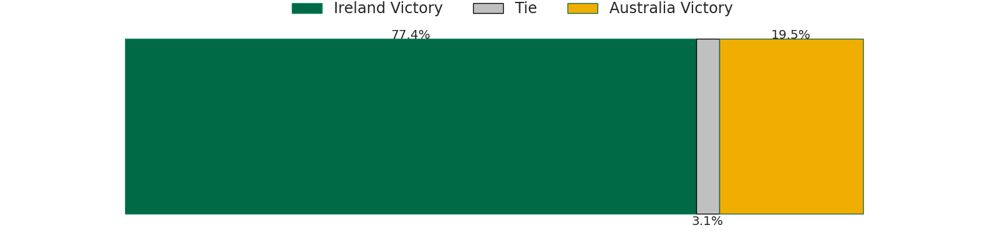

#### Ireland V South Africa on 2026-11-26

Average Margin: South Africa by 0.4

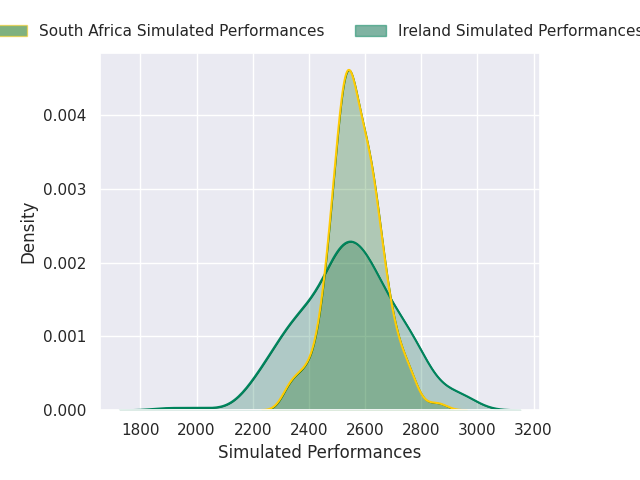

#### Ireland V New Zealand on 2026-11-26

Average Margin: Ireland by 0.5

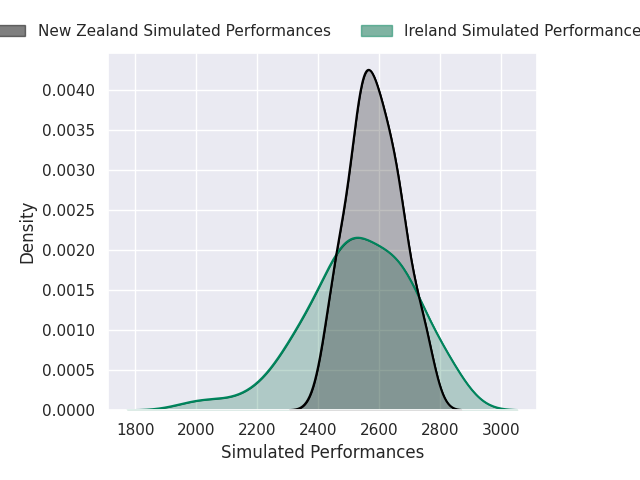

#### England V New Zealand on 2026-11-26

Average Margin: England by 6.9

#### England V South Africa on 2026-11-26

Average Margin: England by 3.4

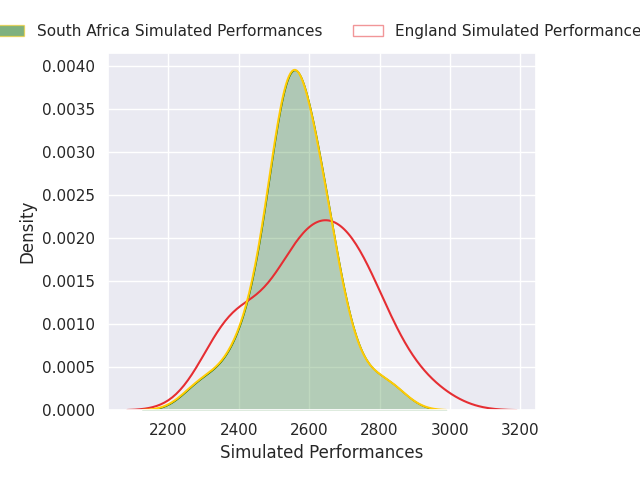

#### France V New Zealand on 2026-11-26

Average Margin: France by 1.9

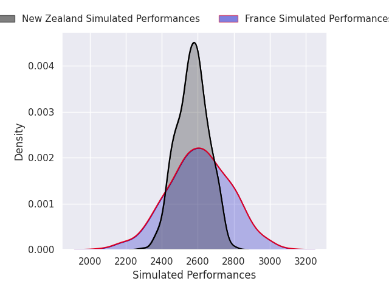

#### England V Australia on 2026-11-26

Average Margin: England by 12.8

#### Italy V Fiji on 2026-11-26

Average Margin: Italy by 5.6

