## Team Rankings

## Standings
### Current Standings
#### APAC

| Club                     |   Played |   Wins |   Point Differential |   Losing Bonus Points |   Try Bonus Points |   Competition Points |
|:-------------------------|---------:|-------:|---------------------:|----------------------:|-------------------:|---------------------:|
| United States of America |        3 |      3 |                   24 |                     0 |                  2 |                   14 |
| Chile                    |        3 |      2 |                   11 |                     0 |                  2 |                   10 |
| Samoa                    |        3 |      1 |                   25 |                     1 |                  2 |                    7 |
| Tonga                    |        3 |      1 |                   -7 |                     1 |                  2 |                    7 |
| Uruguay                  |        3 |      0 |                   -9 |                     2 |                  3 |                    7 |
| Canada                   |        3 |      1 |                  -20 |                     0 |                  1 |                    7 |

#### EMEA

| Club      |   Played |   Wins |   Point Differential |   Losing Bonus Points |   Try Bonus Points |   Competition Points |
|:----------|---------:|-------:|---------------------:|----------------------:|-------------------:|---------------------:|
| Georgia   |        3 |      3 |                   55 |                     0 |                  2 |                   14 |
| Portugal  |        3 |      2 |                   27 |                     1 |                  3 |                   12 |
| Spain     |        3 |      1 |                    6 |                     1 |                  2 |                    9 |
| Romania   |        3 |      1 |                  -16 |                     0 |                  3 |                    9 |
| Hong Kong |        3 |      1 |                  -66 |                     0 |                  1 |                    5 |
| Zimbabwe  |        3 |      0 |                  -30 |                     1 |                  1 |                    2 |

### Projected Remaining Table
#### APAC

| Club                     |   To Play |   Projected Wins |   Projected Differential |   Projected Losing Bonus Points | Projected Try Bonus Points   |   Projected Competition Points |
|:-------------------------|----------:|-----------------:|-------------------------:|--------------------------------:|:-----------------------------|-------------------------------:|
| United States of America |         5 |            2.397 |                   -4.012 |                           0.836 |                              |                         10.676 |
| Chile                    |         5 |            1.729 |                  -23.192 |                           0.939 |                              |                          8.137 |
| Uruguay                  |         5 |            1.465 |                  -37.131 |                           0.86  |                              |                          6.926 |
| Tonga                    |         5 |            1.45  |                  -45.982 |                           0.77  |                              |                          6.782 |
| Canada                   |         5 |            1.374 |                  -49.677 |                           0.746 |                              |                          6.45  |
| Samoa                    |         5 |            1.267 |                  -45.32  |                           0.822 |                              |                          6.082 |

#### EMEA

| Club      |   To Play |   Projected Wins |   Projected Differential |   Projected Losing Bonus Points | Projected Try Bonus Points   |   Projected Competition Points |
|:----------|----------:|-----------------:|-------------------------:|--------------------------------:|:-----------------------------|-------------------------------:|
| Georgia   |         5 |            4.809 |                  110.642 |                           0.116 |                              |                         19.43  |
| Portugal  |         5 |            4.093 |                   61.802 |                           0.511 |                              |                         17.043 |
| Spain     |         5 |            3.763 |                   46.479 |                           0.629 |                              |                         15.929 |
| Romania   |         5 |            2.606 |                    5.42  |                           1.005 |                              |                         11.747 |
| Zimbabwe  |         5 |            2.343 |                   -2.638 |                           0.861 |                              |                         10.505 |
| Hong Kong |         5 |            2.028 |                  -16.391 |                           0.891 |                              |                          9.279 |

### Projected Total Table
#### APAC

| Club                     |   Played |   Wins |   Point Differential |   Losing Bonus Points |   Try Bonus Points |   Competition Points |
|:-------------------------|---------:|-------:|---------------------:|----------------------:|-------------------:|---------------------:|
| United States of America |        8 |  5.397 |               19.988 |                 0.836 |                  2 |               24.676 |
| Chile                    |        8 |  3.729 |              -12.192 |                 0.939 |                  2 |               18.137 |
| Uruguay                  |        8 |  1.465 |              -46.131 |                 2.86  |                  3 |               13.926 |
| Tonga                    |        8 |  2.45  |              -52.982 |                 1.77  |                  2 |               13.782 |
| Canada                   |        8 |  2.374 |              -69.677 |                 0.746 |                  1 |               13.45  |
| Samoa                    |        8 |  2.267 |              -20.32  |                 1.822 |                  2 |               13.082 |

#### EMEA

| Club      |   Played |   Wins |   Point Differential |   Losing Bonus Points |   Try Bonus Points |   Competition Points |
|:----------|---------:|-------:|---------------------:|----------------------:|-------------------:|---------------------:|
| Georgia   |        8 |  7.809 |              165.642 |                 0.116 |                  2 |               33.43  |
| Portugal  |        8 |  6.093 |               88.802 |                 1.511 |                  3 |               29.043 |
| Spain     |        8 |  4.763 |               52.479 |                 1.629 |                  2 |               24.929 |
| Romania   |        8 |  3.606 |              -10.58  |                 1.005 |                  3 |               20.747 |
| Hong Kong |        8 |  3.028 |              -82.391 |                 0.891 |                  1 |               14.279 |
| Zimbabwe  |        8 |  2.343 |              -32.638 |                 1.861 |                  1 |               12.505 |

## Completed Match Review

| Model | Percent Correct Predictions | Spread Error |
| ------ | ------ | ------ |
| Club Level | 58.3% | 12.3 |
| Player Level: Lineup | nan% | nan |
| Player Level: Minutes | nan% | nan |

## Future Predictions
### Week 4
#### Romania V Tonga on 2026/11/06

Average Margin: Romania by 2.2

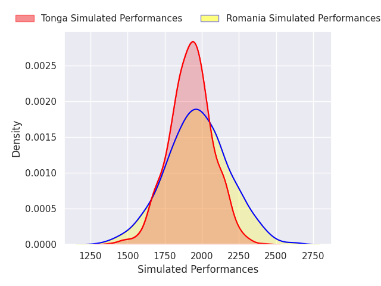

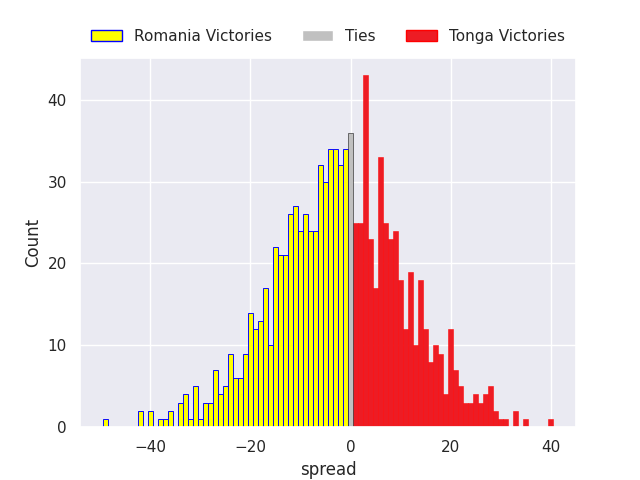

#### Zimbabwe V Uruguay on 2026/11/07

Average Margin: Zimbabwe by 0.7

#### Romania V United States of America on 2026/11/07

Average Margin: United States of America by 1.8

#### Hong Kong V Canada on 2026/11/07

Average Margin: Canada by 1.3

#### Georgia V Canada on 2026/11/07

Average Margin: Georgia by 23.6

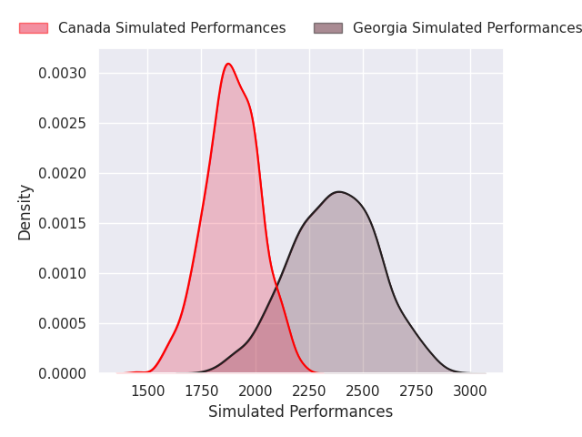
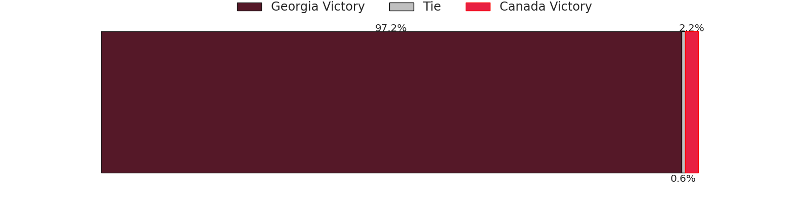
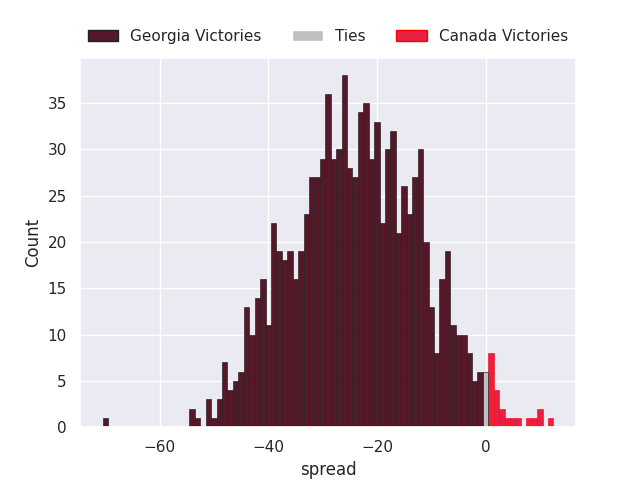

#### Spain V Uruguay on 2026/11/07

Average Margin: Spain by 11.3

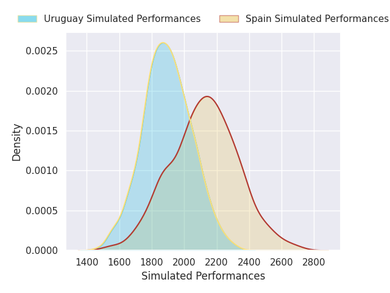

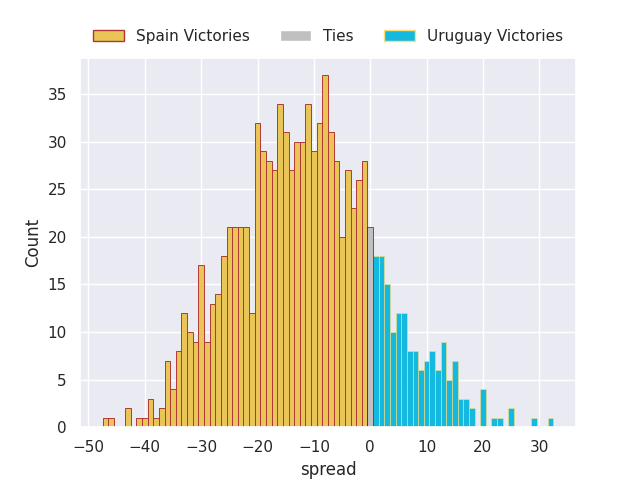

#### Spain V Chile on 2026/11/07

Average Margin: Spain by 6.0

#### Georgia V Tonga on 2026/11/07

Average Margin: Georgia by 22.1

#### Portugal V Chile on 2026/11/07

Average Margin: Portugal by 8.6

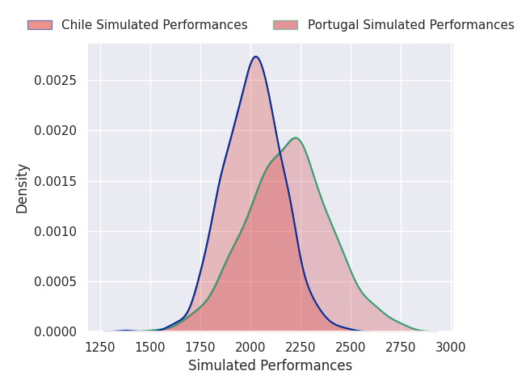
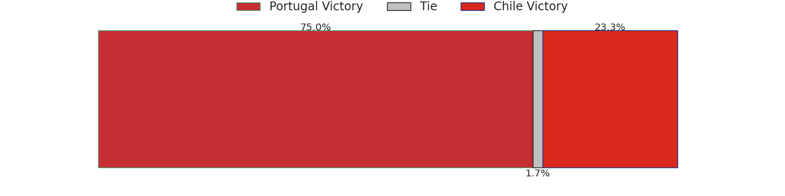
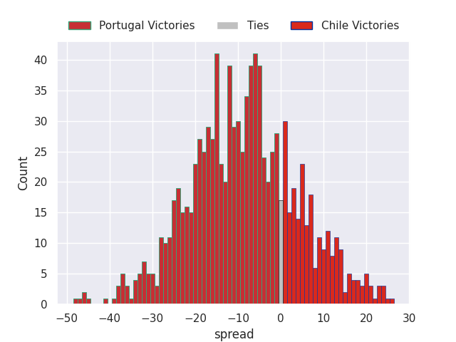

#### Portugal V Samoa on 2026/11/07

Average Margin: Portugal by 15.0

#### Zimbabwe V Samoa on 2026/11/07

Average Margin: Zimbabwe by 0.5

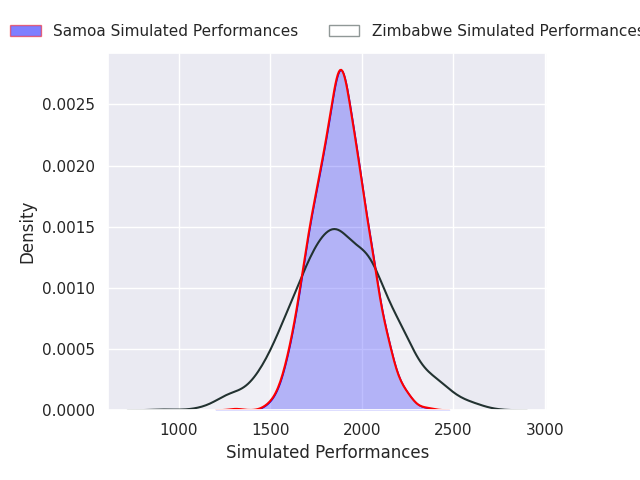

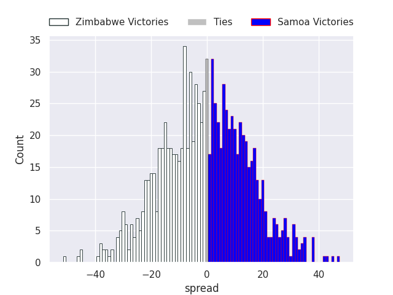

#### Hong Kong V United States of America on 2026/11/08

Average Margin: United States of America by 6.2

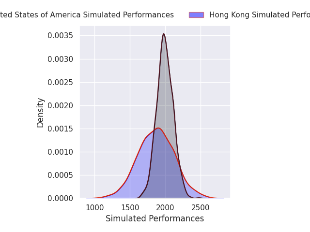
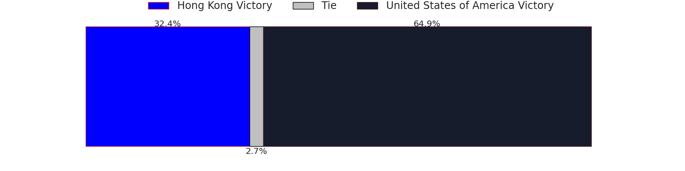
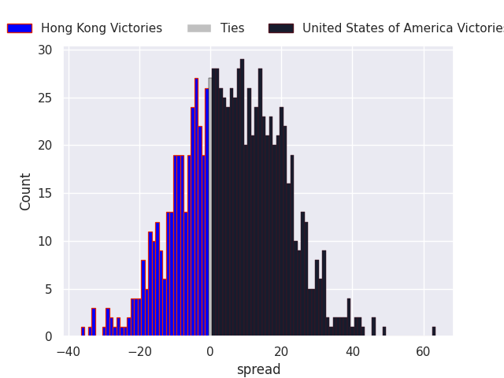

### Week 5
#### Romania V United States of America on 2026/11/14

Average Margin: United States of America by 1.3

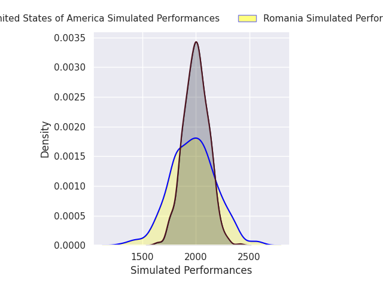
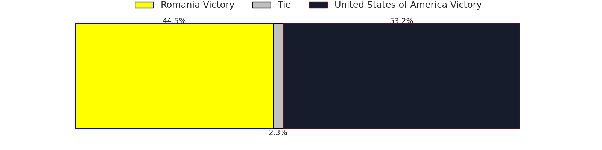
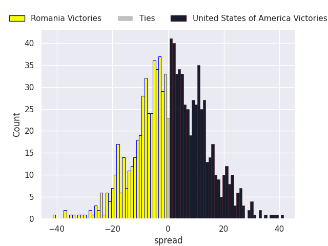

#### Portugal V Samoa on 2026/11/14

Average Margin: Portugal by 15.4

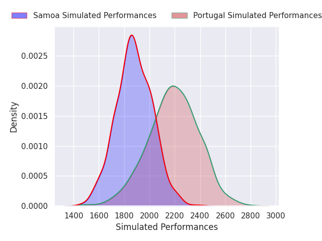
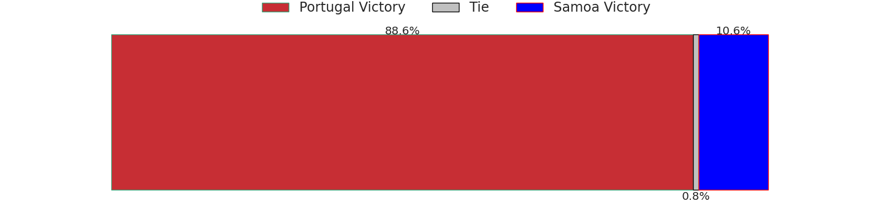
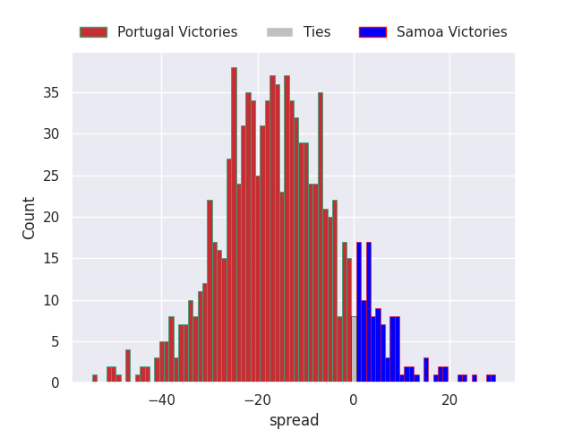

#### Zimbabwe V Uruguay on 2026/11/14

Average Margin: Uruguay by 0.3

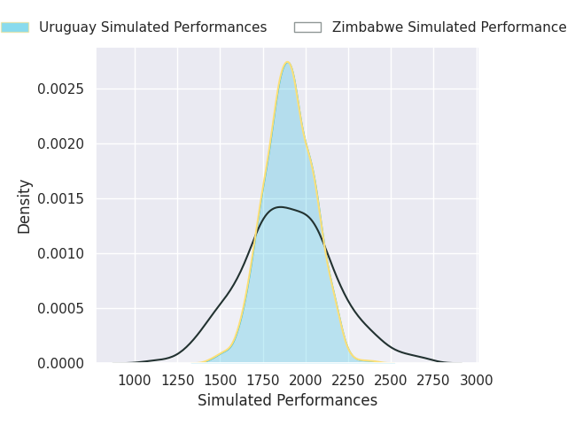

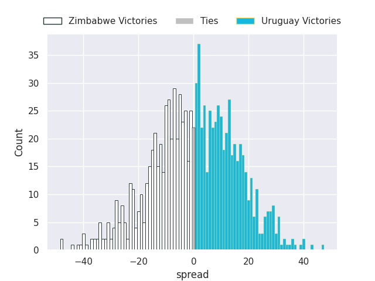

#### Hong Kong V United States of America on 2026/11/14

Average Margin: United States of America by 5.9

#### Romania V Tonga on 2026/11/14

Average Margin: Romania by 1.8

#### Spain V Uruguay on 2026/11/14

Average Margin: Spain by 11.3

#### Georgia V Canada on 2026/11/14

Average Margin: Georgia by 23.8

#### Spain V Chile on 2026/11/14

Average Margin: Spain by 5.5

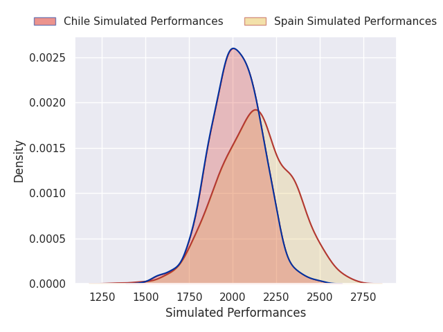
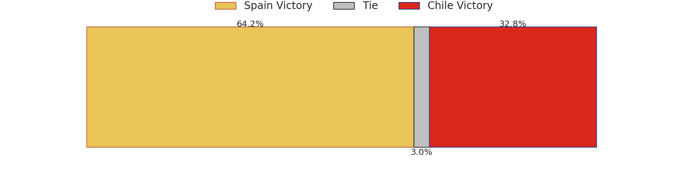
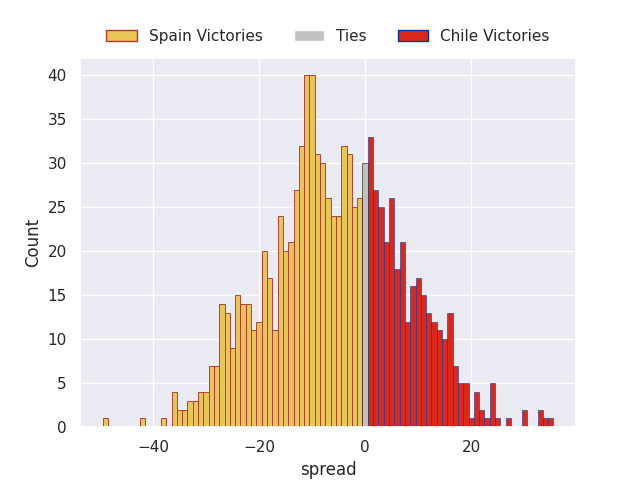

#### Portugal V Chile on 2026/11/14

Average Margin: Portugal by 8.6

#### Hong Kong V Canada on 2026/11/14

Average Margin: Canada by 0.9

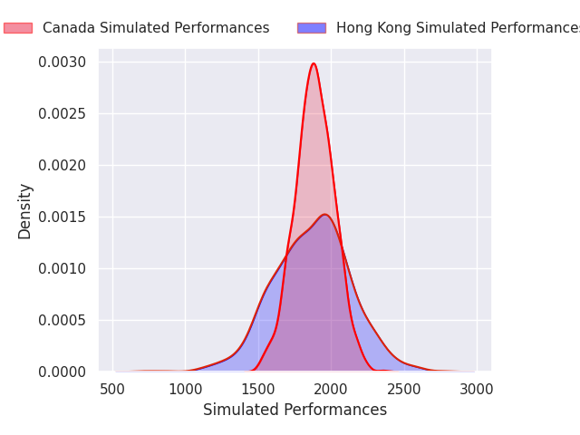

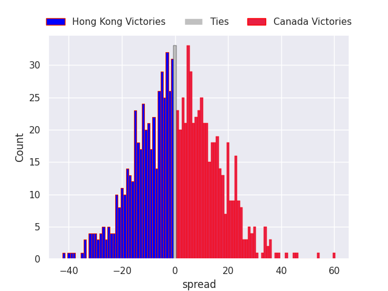

#### Georgia V Tonga on 2026/11/14

Average Margin: Georgia by 22.0

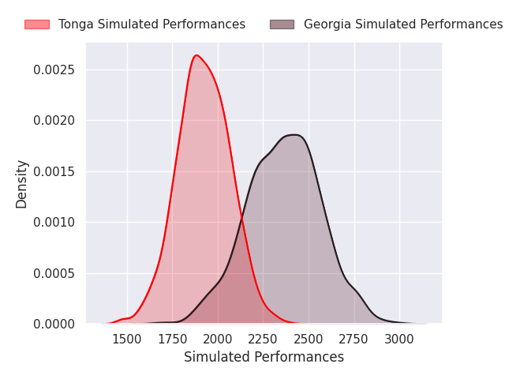
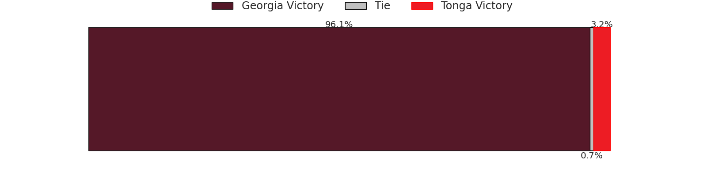
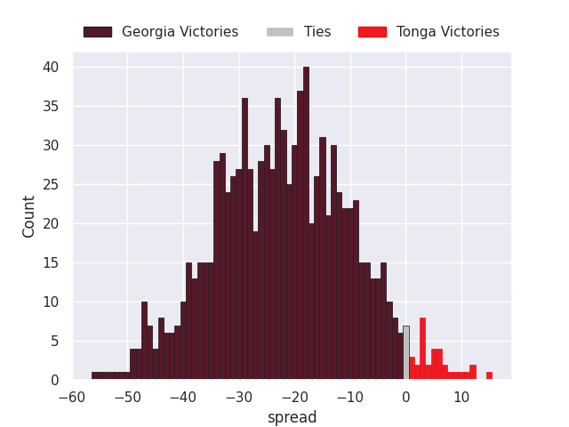

#### Zimbabwe V Samoa on 2026/11/14

Average Margin: Zimbabwe by 2.0

### Week 6
#### Portugal V Uruguay on 2026/11/21

Average Margin: Portugal by 14.2

#### Hong Kong V Tonga on 2026/11/21

Average Margin: Tonga by 2.1

#### Romania V Canada on 2026/11/21

Average Margin: Romania by 4.5

#### Spain V Samoa on 2026/11/21

Average Margin: Spain by 12.4

#### Zimbabwe V Chile on 2026/11/21

Average Margin: Chile by 5.4

#### Georgia V United States of America on 2026/11/21

Average Margin: Georgia by 19.2

