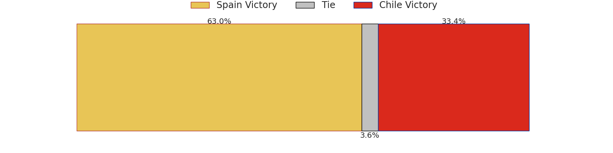
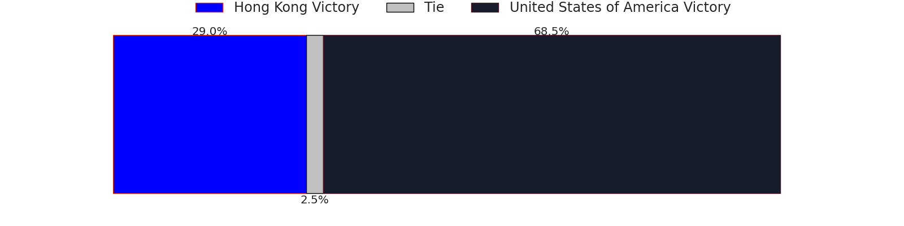
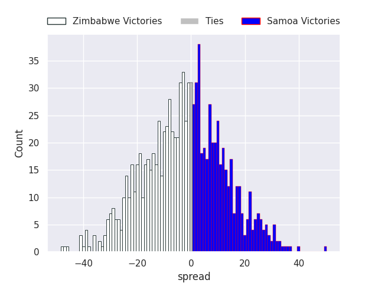
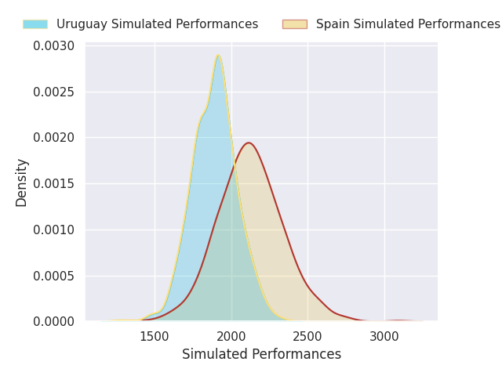
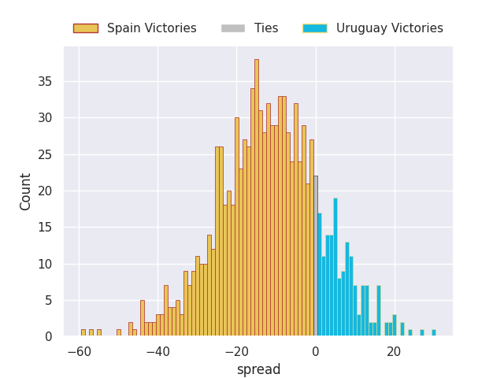
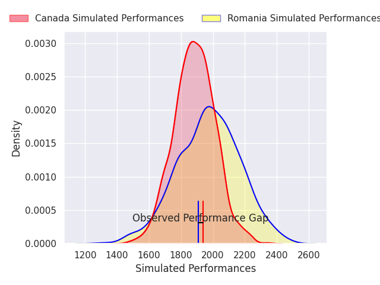
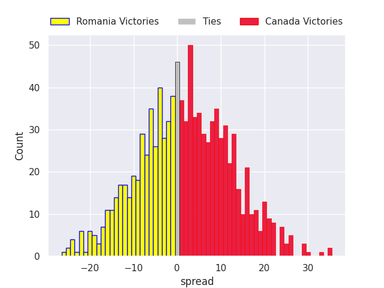
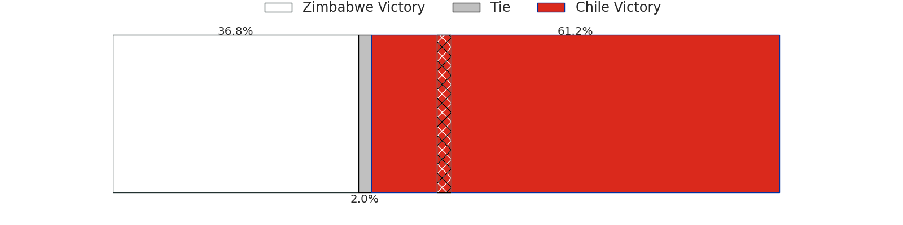
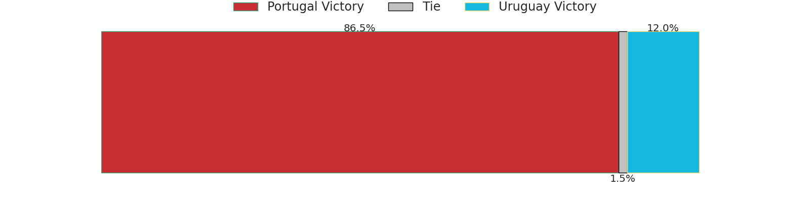
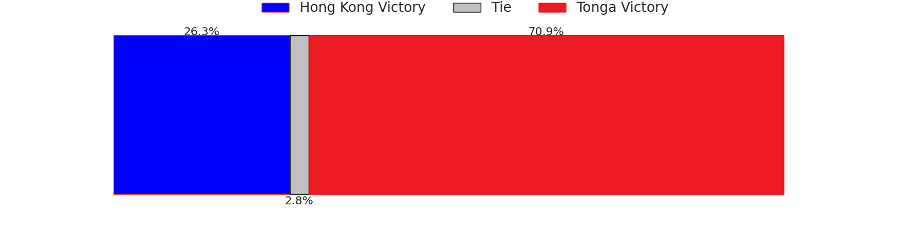

## Team Rankings

## Standings
### Current Standings
#### APAC

| Club                     |   Played |   Wins |   Point Differential |   Losing Bonus Points |   Try Bonus Points |   Competition Points |
|:-------------------------|---------:|-------:|---------------------:|----------------------:|-------------------:|---------------------:|
| United States of America |        5 |      5 |                   55 |                     0 |                  4 |                   24 |
| Samoa                    |        5 |      3 |                   92 |                     1 |                  4 |                   17 |
| Chile                    |        5 |      3 |                   -5 |                     0 |                  2 |                   14 |
| Tonga                    |        5 |      2 |                  -26 |                     1 |                  4 |                   13 |
| Uruguay                  |        5 |      1 |                  -10 |                     3 |                  3 |                   12 |
| Canada                   |        5 |      2 |                  -44 |                     0 |                  2 |                   12 |

#### EMEA

| Club      |   Played |   Wins |   Point Differential |   Losing Bonus Points |   Try Bonus Points |   Competition Points |
|:----------|---------:|-------:|---------------------:|----------------------:|-------------------:|---------------------:|
| Georgia   |        5 |      5 |                  124 |                     0 |                  4 |                   24 |
| Portugal  |        5 |      3 |                   17 |                     1 |                  4 |                   17 |
| Spain     |        5 |      2 |                    7 |                     2 |                  2 |                   14 |
| Romania   |        5 |      1 |                  -50 |                     1 |                  5 |                   12 |
| Hong Kong |        5 |      1 |                  -89 |                     1 |                  1 |                    6 |
| Zimbabwe  |        5 |      0 |                  -71 |                     2 |                  1 |                    3 |

### Projected Remaining Table
#### APAC

| Club                     |   To Play |   Projected Wins |   Projected Differential |   Projected Losing Bonus Points |   Projected Try Bonus Points |   Projected Competition Points |
|:-------------------------|----------:|-----------------:|-------------------------:|--------------------------------:|-----------------------------:|-------------------------------:|
| United States of America |         3 |            1.167 |                  -12.346 |                           0.491 |                            2 |                          7.287 |
| Tonga                    |         3 |            1.145 |                  -17.375 |                           0.465 |                            2 |                          7.145 |
| Samoa                    |         3 |            0.968 |                  -18.398 |                           0.567 |                            2 |                          6.635 |
| Chile                    |         3 |            1.419 |                   -0.604 |                           0.532 |                              |                          6.336 |
| Canada                   |         3 |            1.08  |                  -20.463 |                           0.47  |                            1 |                          5.954 |
| Uruguay                  |         3 |            0.835 |                  -20.623 |                           0.61  |                              |                          4.098 |

#### EMEA

| Club      |   To Play |   Projected Wins |   Projected Differential |   Projected Losing Bonus Points |   Projected Try Bonus Points |   Projected Competition Points |
|:----------|----------:|-----------------:|-------------------------:|--------------------------------:|-----------------------------:|-------------------------------:|
| Georgia   |         3 |            2.898 |                   64.411 |                           0.075 |                            2 |                         13.693 |
| Portugal  |         3 |            2.399 |                   31.331 |                           0.317 |                            1 |                         11.051 |
| Romania   |         3 |            1.464 |                    0.826 |                           0.653 |                            2 |                          8.725 |
| Spain     |         3 |            1.956 |                   17.325 |                           0.511 |                              |                          8.515 |
| Zimbabwe  |         3 |            1.187 |                   -9.031 |                           0.529 |                              |                          5.431 |
| Hong Kong |         3 |            1.05  |                  -15.053 |                           0.626 |                              |                          4.976 |

### Projected Total Table
#### APAC

| Club                     |   Played |   Wins |   Point Differential |   Losing Bonus Points |   Try Bonus Points |   Competition Points |
|:-------------------------|---------:|-------:|---------------------:|----------------------:|-------------------:|---------------------:|
| United States of America |        8 |  6.167 |               42.654 |                 0.491 |                  6 |               31.287 |
| Samoa                    |        8 |  3.968 |               73.602 |                 1.567 |                  6 |               23.635 |
| Chile                    |        8 |  4.419 |               -5.604 |                 0.532 |                  2 |               20.336 |
| Tonga                    |        8 |  3.145 |              -43.375 |                 1.465 |                  6 |               20.145 |
| Canada                   |        8 |  3.08  |              -64.463 |                 0.47  |                  3 |               17.954 |
| Uruguay                  |        8 |  1.835 |              -30.623 |                 3.61  |                  3 |               16.098 |

#### EMEA

| Club      |   Played |   Wins |   Point Differential |   Losing Bonus Points |   Try Bonus Points |   Competition Points |
|:----------|---------:|-------:|---------------------:|----------------------:|-------------------:|---------------------:|
| Georgia   |        8 |  7.898 |              188.411 |                 0.075 |                  6 |               37.693 |
| Portugal  |        8 |  5.399 |               48.331 |                 1.317 |                  5 |               28.051 |
| Spain     |        8 |  3.956 |               24.325 |                 2.511 |                  2 |               22.515 |
| Romania   |        8 |  2.464 |              -49.174 |                 1.653 |                  7 |               20.725 |
| Hong Kong |        8 |  2.05  |             -104.053 |                 1.626 |                  1 |               10.976 |
| Zimbabwe  |        8 |  1.187 |              -80.031 |                 2.529 |                  1 |                8.431 |

## Completed Match Review

| Model | Percent Correct Predictions | Spread Error |
| ------ | ------ | ------ |
| Club Level | 60.4% | 10.3 |
| Player Level: Lineup | nan% | nan |
| Player Level: Minutes | nan% | nan |

## Future Predictions
### Week 6
#### Romania V United States of America on 2026/11/07

Average Margin: Romania by 0.2

#### Hong Kong V Canada on 2026/11/07

Average Margin: Canada by 1.8

#### Spain V Chile on 2026/11/07

Average Margin: Spain by 4.8

#### Zimbabwe V Uruguay on 2026/11/07

Average Margin: Zimbabwe by 1.0

#### Georgia V Tonga on 2026/11/07

Average Margin: Georgia by 21.8

#### Portugal V Samoa on 2026/11/07

Average Margin: Portugal by 15.3

### Week 7
#### Portugal V Chile on 2026/11/14

Average Margin: Portugal by 8.1

#### Hong Kong V United States of America on 2026/11/14

Average Margin: United States of America by 6.2

#### Romania V Tonga on 2026/11/14

Average Margin: Romania by 2.5

#### Zimbabwe V Samoa on 2026/11/14

Average Margin: Zimbabwe by 2.3

#### Georgia V Canada on 2026/11/14

Average Margin: Georgia by 24.2

#### Spain V Uruguay on 2026/11/14

Average Margin: Spain by 11.7

### Week 8
#### Romania V Canada on 2026/11/20

Average Margin: Canada by 1.9

#### Zimbabwe V Chile on 2026/11/21

Average Margin: Chile by 12.3

#### Spain V Samoa on 2026/11/21

Average Margin: Spain by 0.8

#### Georgia V United States of America on 2026/11/21

Average Margin: Georgia by 18.4

#### Portugal V Uruguay on 2026/11/21

Average Margin: Portugal by 7.9

#### Hong Kong V Tonga on 2026/11/21

Average Margin: Tonga by 7.0

