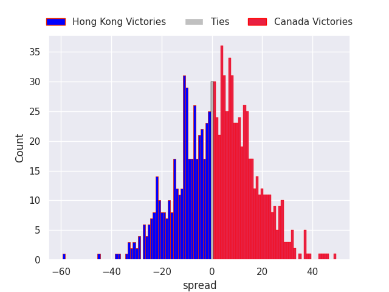
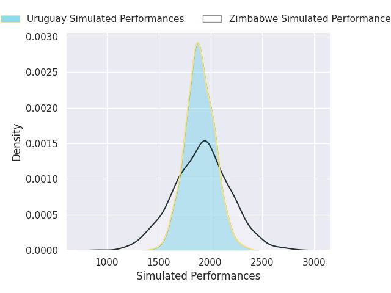
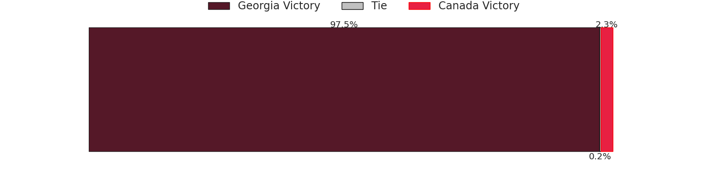
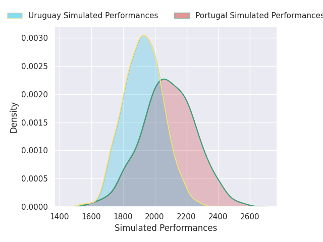
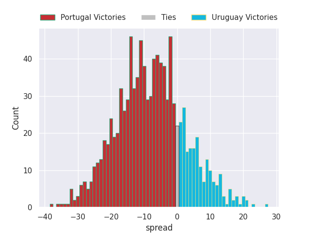
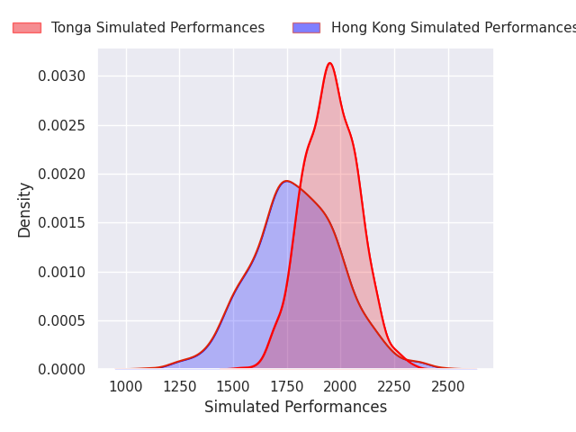
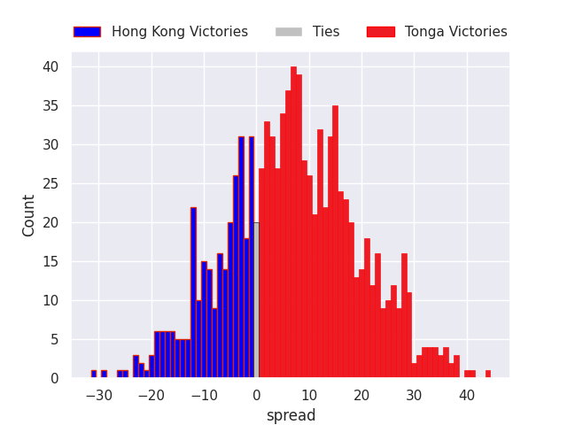
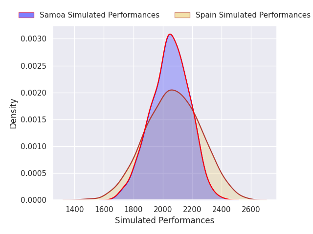
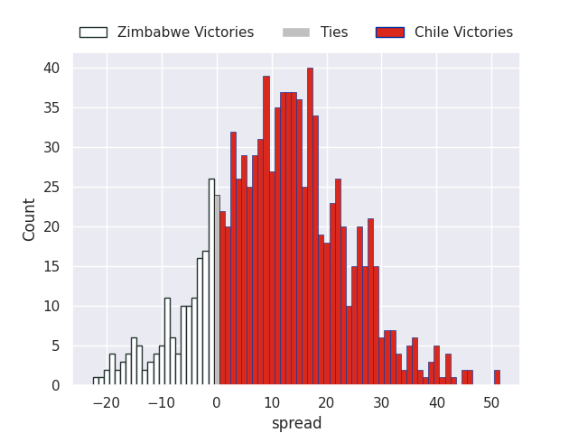

## Team Rankings

## Standings
### Current Standings
#### APAC

| Club                     |   Played |   Wins |   Point Differential |   Losing Bonus Points |   Try Bonus Points |   Competition Points |
|:-------------------------|---------:|-------:|---------------------:|----------------------:|-------------------:|---------------------:|
| United States of America |        5 |      5 |                   55 |                     0 |                  4 |                   24 |
| Samoa                    |        5 |      3 |                   92 |                     1 |                  4 |                   17 |
| Chile                    |        5 |      3 |                   -5 |                     0 |                  2 |                   14 |
| Tonga                    |        5 |      2 |                  -26 |                     1 |                  4 |                   13 |
| Uruguay                  |        5 |      1 |                  -10 |                     3 |                  3 |                   12 |
| Canada                   |        5 |      2 |                  -44 |                     0 |                  2 |                   12 |

#### EMEA

| Club      |   Played |   Wins |   Point Differential |   Losing Bonus Points |   Try Bonus Points |   Competition Points |
|:----------|---------:|-------:|---------------------:|----------------------:|-------------------:|---------------------:|
| Georgia   |        5 |      5 |                  124 |                     0 |                  4 |                   24 |
| Portugal  |        5 |      3 |                   17 |                     1 |                  4 |                   17 |
| Spain     |        5 |      2 |                    7 |                     2 |                  2 |                   14 |
| Romania   |        5 |      1 |                  -50 |                     1 |                  5 |                   12 |
| Hong Kong |        5 |      1 |                  -89 |                     1 |                  1 |                    6 |
| Zimbabwe  |        5 |      0 |                  -71 |                     2 |                  1 |                    3 |

### Projected Remaining Table
#### APAC

| Club                     |   To Play |   Projected Wins |   Projected Differential |   Projected Losing Bonus Points |   Projected Try Bonus Points |   Projected Competition Points |
|:-------------------------|----------:|-----------------:|-------------------------:|--------------------------------:|-----------------------------:|-------------------------------:|
| United States of America |         3 |            1.196 |                  -11.846 |                           0.459 |                            2 |                          7.395 |
| Tonga                    |         3 |            1.157 |                  -16.738 |                           0.444 |                            2 |                          7.196 |
| Samoa                    |         3 |            0.961 |                  -19.78  |                           0.578 |                            2 |                          6.562 |
| Chile                    |         3 |            1.359 |                   -2.781 |                           0.515 |                              |                          6.103 |
| Canada                   |         3 |            1.111 |                  -20.729 |                           0.437 |                            1 |                          6.061 |
| Uruguay                  |         3 |            0.838 |                  -19.999 |                           0.606 |                              |                          4.102 |

#### EMEA

| Club      |   To Play |   Projected Wins |   Projected Differential |   Projected Losing Bonus Points |   Projected Try Bonus Points |   Projected Competition Points |
|:----------|----------:|-----------------:|-------------------------:|--------------------------------:|-----------------------------:|-------------------------------:|
| Georgia   |         3 |            2.887 |                   63.72  |                           0.07  |                            2 |                         13.64  |
| Portugal  |         3 |            2.373 |                   31.602 |                           0.348 |                            1 |                         10.982 |
| Romania   |         3 |            1.47  |                    2.218 |                           0.712 |                            2 |                          8.842 |
| Spain     |         3 |            2.022 |                   18.35  |                           0.496 |                              |                          8.736 |
| Zimbabwe  |         3 |            1.229 |                   -7.392 |                           0.562 |                              |                          5.62  |
| Hong Kong |         3 |            0.951 |                  -16.625 |                           0.66  |                              |                          4.648 |

### Projected Total Table
#### APAC

| Club                     |   Played |   Wins |   Point Differential |   Losing Bonus Points |   Try Bonus Points |   Competition Points |
|:-------------------------|---------:|-------:|---------------------:|----------------------:|-------------------:|---------------------:|
| United States of America |        8 |  6.196 |               43.154 |                 0.459 |                  6 |               31.395 |
| Samoa                    |        8 |  3.961 |               72.22  |                 1.578 |                  6 |               23.562 |
| Tonga                    |        8 |  3.157 |              -42.738 |                 1.444 |                  6 |               20.196 |
| Chile                    |        8 |  4.359 |               -7.781 |                 0.515 |                  2 |               20.103 |
| Canada                   |        8 |  3.111 |              -64.729 |                 0.437 |                  3 |               18.061 |
| Uruguay                  |        8 |  1.838 |              -29.999 |                 3.606 |                  3 |               16.102 |

#### EMEA

| Club      |   Played |   Wins |   Point Differential |   Losing Bonus Points |   Try Bonus Points |   Competition Points |
|:----------|---------:|-------:|---------------------:|----------------------:|-------------------:|---------------------:|
| Georgia   |        8 |  7.887 |              187.72  |                 0.07  |                  6 |               37.64  |
| Portugal  |        8 |  5.373 |               48.602 |                 1.348 |                  5 |               27.982 |
| Spain     |        8 |  4.022 |               25.35  |                 2.496 |                  2 |               22.736 |
| Romania   |        8 |  2.47  |              -47.782 |                 1.712 |                  7 |               20.842 |
| Hong Kong |        8 |  1.951 |             -105.625 |                 1.66  |                  1 |               10.648 |
| Zimbabwe  |        8 |  1.229 |              -78.392 |                 2.562 |                  1 |                8.62  |

## Completed Match Review

| Model | Percent Correct Predictions | Spread Error |
| ------ | ------ | ------ |
| Club Level | 64.6% | 10.2 |
| Player Level: Lineup | nan% | nan |
| Player Level: Minutes | nan% | nan |

## Future Predictions
### Week 6
#### Hong Kong V Canada on 2026/11/07

Average Margin: Canada by 1.8

#### Spain V Chile on 2026/11/07

Average Margin: Spain by 6.3

#### Zimbabwe V Uruguay on 2026/11/07

Average Margin: Zimbabwe by 0.9

#### Georgia V Tonga on 2026/11/07

Average Margin: Georgia by 21.6

#### Romania V United States of America on 2026/11/07

Average Margin: Romania by 0.6

#### Portugal V Samoa on 2026/11/07

Average Margin: Portugal by 15.4

### Week 7
#### Zimbabwe V Samoa on 2026/11/14

Average Margin: Zimbabwe by 3.3

#### Spain V Uruguay on 2026/11/14

Average Margin: Spain by 11.0

#### Portugal V Chile on 2026/11/14

Average Margin: Portugal by 8.1

#### Romania V Tonga on 2026/11/14

Average Margin: Romania by 3.1

#### Hong Kong V United States of America on 2026/11/14

Average Margin: United States of America by 6.8

#### Georgia V Canada on 2026/11/14

Average Margin: Georgia by 24.1

### Week 8
#### Romania V Canada on 2026/11/20

Average Margin: Canada by 1.5

#### Portugal V Uruguay on 2026/11/21

Average Margin: Portugal by 8.1

#### Georgia V United States of America on 2026/11/21

Average Margin: Georgia by 18.1

#### Hong Kong V Tonga on 2026/11/21

Average Margin: Tonga by 8.0

#### Spain V Samoa on 2026/11/21

Average Margin: Spain by 1.1

#### Zimbabwe V Chile on 2026/11/21

Average Margin: Chile by 11.6

