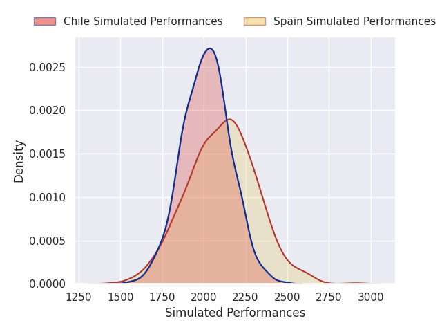
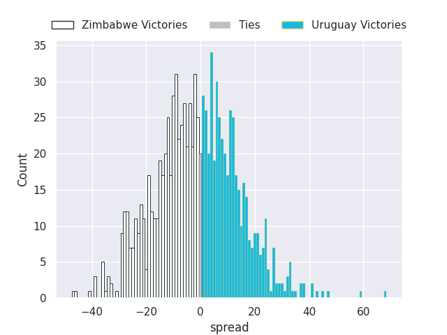
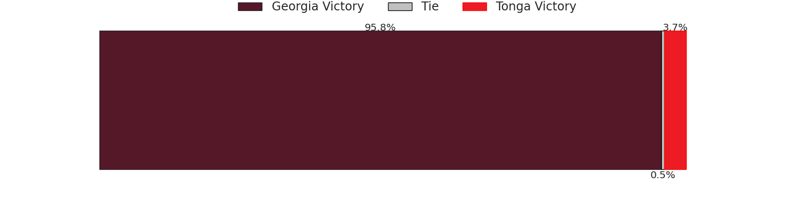
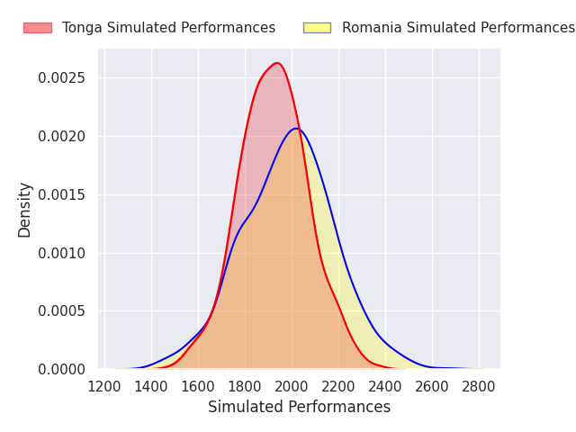

## Team Rankings

## Standings
### Current Standings
#### APAC

| Club                     |   Played |   Wins |   Point Differential |   Losing Bonus Points |   Try Bonus Points |   Competition Points |
|:-------------------------|---------:|-------:|---------------------:|----------------------:|-------------------:|---------------------:|
| United States of America |        6 |      5 |                   27 |                     0 |                  4 |                   24 |
| Samoa                    |        6 |      4 |                  160 |                     1 |                  4 |                   21 |
| Chile                    |        6 |      4 |                    0 |                     0 |                  2 |                   18 |
| Tonga                    |        6 |      3 |                   10 |                     1 |                  4 |                   17 |
| Canada                   |        6 |      3 |                  -43 |                     0 |                  2 |                   16 |
| Uruguay                  |        5 |      1 |                  -10 |                     3 |                  3 |                   12 |

#### EMEA

| Club      |   Played |   Wins |   Point Differential |   Losing Bonus Points |   Try Bonus Points |   Competition Points |
|:----------|---------:|-------:|---------------------:|----------------------:|-------------------:|---------------------:|
| Georgia   |        6 |      6 |                  152 |                     0 |                  4 |                   28 |
| Portugal  |        5 |      3 |                   17 |                     1 |                  4 |                   17 |
| Spain     |        6 |      2 |                  -61 |                     2 |                  2 |                   14 |
| Romania   |        6 |      1 |                  -51 |                     2 |                  5 |                   13 |
| Hong Kong |        6 |      1 |                 -125 |                     1 |                  1 |                    6 |
| Zimbabwe  |        6 |      0 |                  -76 |                     3 |                  1 |                    4 |

### Projected Remaining Table
#### APAC

| Club                     |   To Play |   Projected Wins |   Projected Differential |   Projected Losing Bonus Points |   Projected Try Bonus Points |   Projected Competition Points |
|:-------------------------|----------:|-----------------:|-------------------------:|--------------------------------:|-----------------------------:|-------------------------------:|
| United States of America |         2 |            1.153 |                    6.898 |                           0.379 |                            2 |                          7.121 |
| Samoa                    |         2 |            0.535 |                  -17.468 |                           0.333 |                            2 |                          4.537 |
| Tonga                    |         2 |            0.441 |                  -24.417 |                           0.288 |                            2 |                          4.142 |
| Uruguay                  |         3 |            0.767 |                  -25.052 |                           0.528 |                              |                          3.736 |
| Canada                   |         2 |            0.552 |                  -21.817 |                           0.229 |                            1 |                          3.491 |
| Chile                    |         2 |            0.562 |                  -13.504 |                           0.44  |                              |                          2.794 |

#### EMEA

| Club      |   To Play |   Projected Wins |   Projected Differential |   Projected Losing Bonus Points |   Projected Try Bonus Points |   Projected Competition Points |
|:----------|----------:|-----------------:|-------------------------:|--------------------------------:|-----------------------------:|-------------------------------:|
| Portugal  |         3 |            2.463 |                   36.617 |                           0.309 |                            1 |                         11.273 |
| Georgia   |         2 |            1.923 |                   45.68  |                           0.055 |                            2 |                          9.775 |
| Romania   |         2 |            1.048 |                    2.223 |                           0.412 |                            2 |                          6.744 |
| Spain     |         2 |            1.443 |                   16.169 |                           0.294 |                              |                          6.164 |
| Zimbabwe  |         2 |            1.075 |                    3.238 |                           0.33  |                              |                          4.73  |
| Hong Kong |         2 |            0.746 |                   -8.567 |                           0.387 |                              |                          3.477 |

### Projected Total Table
#### APAC

| Club                     |   Played |   Wins |   Point Differential |   Losing Bonus Points |   Try Bonus Points |   Competition Points |
|:-------------------------|---------:|-------:|---------------------:|----------------------:|-------------------:|---------------------:|
| United States of America |        8 |  6.153 |               33.898 |                 0.379 |                  6 |               31.121 |
| Samoa                    |        8 |  4.535 |              142.532 |                 1.333 |                  6 |               25.537 |
| Tonga                    |        8 |  3.441 |              -14.417 |                 1.288 |                  6 |               21.142 |
| Chile                    |        8 |  4.562 |              -13.504 |                 0.44  |                  2 |               20.794 |
| Canada                   |        8 |  3.552 |              -64.817 |                 0.229 |                  3 |               19.491 |
| Uruguay                  |        8 |  1.767 |              -35.052 |                 3.528 |                  3 |               15.736 |

#### EMEA

| Club      |   Played |   Wins |   Point Differential |   Losing Bonus Points |   Try Bonus Points |   Competition Points |
|:----------|---------:|-------:|---------------------:|----------------------:|-------------------:|---------------------:|
| Georgia   |        8 |  7.923 |              197.68  |                 0.055 |                  6 |               37.775 |
| Portugal  |        8 |  5.463 |               53.617 |                 1.309 |                  5 |               28.273 |
| Spain     |        8 |  3.443 |              -44.831 |                 2.294 |                  2 |               20.164 |
| Romania   |        8 |  2.048 |              -48.777 |                 2.412 |                  7 |               19.744 |
| Hong Kong |        8 |  1.746 |             -133.567 |                 1.387 |                  1 |                9.477 |
| Zimbabwe  |        8 |  1.075 |              -72.762 |                 3.33  |                  1 |                8.73  |

## Completed Match Review

| Model | Percent Correct Predictions | Spread Error |
| ------ | ------ | ------ |
| Club Level | 62.5% | 11.9 |
| Player Level: Lineup | nan% | nan |
| Player Level: Minutes | nan% | nan |

## Future Predictions
### Week 7
#### Spain V Chile on 2026/11/07

Average Margin: Spain by 5.4

#### Romania V United States of America on 2026/11/07

Average Margin: United States of America by 0.1

#### Hong Kong V Canada on 2026/11/07

Average Margin: Canada by 1.8

#### Portugal V Samoa on 2026/11/07

Average Margin: Portugal by 15.0

#### Zimbabwe V Uruguay on 2026/11/07

Average Margin: Zimbabwe by 0.7

#### Georgia V Tonga on 2026/11/07

Average Margin: Georgia by 22.0

### Week 8
#### Portugal V Chile on 2026/11/14

Average Margin: Portugal by 8.1

#### Hong Kong V United States of America on 2026/11/14

Average Margin: United States of America by 6.7

#### Romania V Tonga on 2026/11/14

Average Margin: Romania by 2.4

#### Spain V Uruguay on 2026/11/14

Average Margin: Spain by 10.7

#### Zimbabwe V Samoa on 2026/11/14

Average Margin: Zimbabwe by 2.5

#### Georgia V Canada on 2026/11/14

Average Margin: Georgia by 23.6

### Week 9
#### Portugal V Uruguay on 2026/11/21

Average Margin: Portugal by 13.6

