## Team Rankings

## Standings
### Current Standings
#### APAC

| Club                     |   Played |   Wins |   Point Differential |   Losing Bonus Points |   Try Bonus Points |   Competition Points |
|:-------------------------|---------:|-------:|---------------------:|----------------------:|-------------------:|---------------------:|
| United States of America |        5 |      5 |                   55 |                     0 |                  4 |                   24 |
| Samoa                    |        5 |      3 |                   92 |                     1 |                  4 |                   17 |
| Chile                    |        5 |      3 |                   -5 |                     0 |                  2 |                   14 |
| Tonga                    |        5 |      2 |                  -26 |                     1 |                  4 |                   13 |
| Uruguay                  |        5 |      1 |                  -10 |                     3 |                  3 |                   12 |
| Canada                   |        5 |      2 |                  -44 |                     0 |                  2 |                   12 |

#### EMEA

| Club      |   Played |   Wins |   Point Differential |   Losing Bonus Points |   Try Bonus Points |   Competition Points |
|:----------|---------:|-------:|---------------------:|----------------------:|-------------------:|---------------------:|
| Georgia   |        5 |      5 |                  124 |                     0 |                  4 |                   24 |
| Portugal  |        5 |      3 |                   17 |                     1 |                  4 |                   17 |
| Spain     |        5 |      2 |                    7 |                     2 |                  2 |                   14 |
| Romania   |        5 |      1 |                  -50 |                     1 |                  5 |                   12 |
| Hong Kong |        5 |      1 |                  -89 |                     1 |                  1 |                    6 |
| Zimbabwe  |        5 |      0 |                  -71 |                     2 |                  1 |                    3 |

### Projected Remaining Table
#### APAC

| Club                     |   To Play |   Projected Wins |   Projected Differential |   Projected Losing Bonus Points |   Projected Try Bonus Points |   Projected Competition Points |
|:-------------------------|----------:|-----------------:|-------------------------:|--------------------------------:|-----------------------------:|-------------------------------:|
| United States of America |         3 |            1.22  |                  -11.328 |                           0.488 |                            2 |                          7.512 |
| Tonga                    |         3 |            1.127 |                  -17.79  |                           0.464 |                            2 |                          7.092 |
| Samoa                    |         3 |            0.965 |                  -19.064 |                           0.568 |                            2 |                          6.588 |
| Chile                    |         3 |            1.404 |                   -0.63  |                           0.531 |                              |                          6.307 |
| Canada                   |         3 |            1.077 |                  -20.44  |                           0.487 |                            1 |                          5.919 |
| Uruguay                  |         3 |            0.873 |                  -20.381 |                           0.606 |                              |                          4.244 |

#### EMEA

| Club      |   To Play |   Projected Wins |   Projected Differential |   Projected Losing Bonus Points |   Projected Try Bonus Points |   Projected Competition Points |
|:----------|----------:|-----------------:|-------------------------:|--------------------------------:|-----------------------------:|-------------------------------:|
| Georgia   |         3 |            2.885 |                   64.027 |                           0.07  |                            2 |                         13.666 |
| Portugal  |         3 |            2.346 |                   31.353 |                           0.354 |                            1 |                         10.858 |
| Romania   |         3 |            1.522 |                    1.464 |                           0.711 |                            2 |                          8.967 |
| Spain     |         3 |            1.971 |                   17.291 |                           0.494 |                              |                          8.558 |
| Zimbabwe  |         3 |            1.208 |                   -8.569 |                           0.523 |                              |                          5.521 |
| Hong Kong |         3 |            0.975 |                  -15.933 |                           0.61  |                              |                          4.674 |

### Projected Total Table
#### APAC

| Club                     |   Played |   Wins |   Point Differential |   Losing Bonus Points |   Try Bonus Points |   Competition Points |
|:-------------------------|---------:|-------:|---------------------:|----------------------:|-------------------:|---------------------:|
| United States of America |        8 |  6.22  |               43.672 |                 0.488 |                  6 |               31.512 |
| Samoa                    |        8 |  3.965 |               72.936 |                 1.568 |                  6 |               23.588 |
| Chile                    |        8 |  4.404 |               -5.63  |                 0.531 |                  2 |               20.307 |
| Tonga                    |        8 |  3.127 |              -43.79  |                 1.464 |                  6 |               20.092 |
| Canada                   |        8 |  3.077 |              -64.44  |                 0.487 |                  3 |               17.919 |
| Uruguay                  |        8 |  1.873 |              -30.381 |                 3.606 |                  3 |               16.244 |

#### EMEA

| Club      |   Played |   Wins |   Point Differential |   Losing Bonus Points |   Try Bonus Points |   Competition Points |
|:----------|---------:|-------:|---------------------:|----------------------:|-------------------:|---------------------:|
| Georgia   |        8 |  7.885 |              188.027 |                 0.07  |                  6 |               37.666 |
| Portugal  |        8 |  5.346 |               48.353 |                 1.354 |                  5 |               27.858 |
| Spain     |        8 |  3.971 |               24.291 |                 2.494 |                  2 |               22.558 |
| Romania   |        8 |  2.522 |              -48.536 |                 1.711 |                  7 |               20.967 |
| Hong Kong |        8 |  1.975 |             -104.933 |                 1.61  |                  1 |               10.674 |
| Zimbabwe  |        8 |  1.208 |              -79.569 |                 2.523 |                  1 |                8.521 |

## Completed Match Review

| Model | Percent Correct Predictions | Spread Error |
| ------ | ------ | ------ |
| Club Level | 62.5% | 10.3 |
| Player Level: Lineup | nan% | nan |
| Player Level: Minutes | nan% | nan |

## Future Predictions
### Week 6
#### Spain V Chile on 2026/11/07

Average Margin: Spain by 5.3

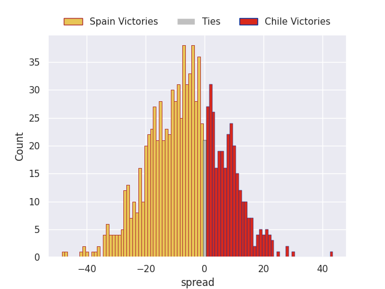

#### Romania V United States of America on 2026/11/07

Average Margin: United States of America by 0.1

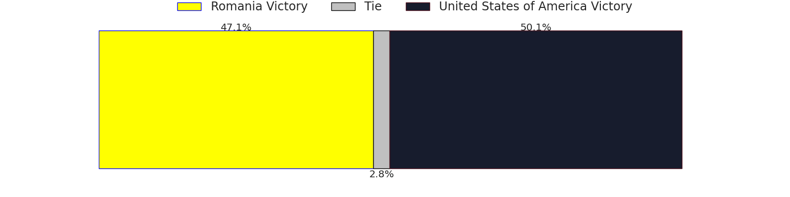
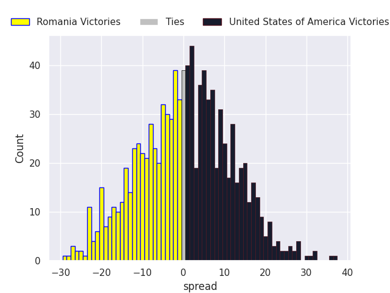

#### Portugal V Samoa on 2026/11/07

Average Margin: Portugal by 16.0

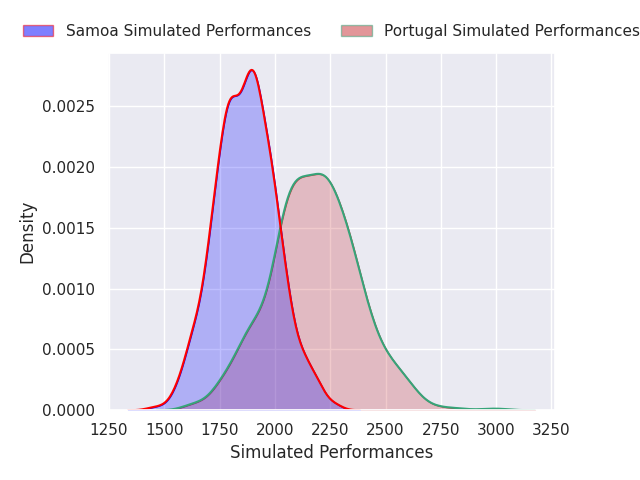

#### Hong Kong V Canada on 2026/11/07

Average Margin: Canada by 2.1

#### Zimbabwe V Uruguay on 2026/11/07

Average Margin: Zimbabwe by 1.5

#### Georgia V Tonga on 2026/11/07

Average Margin: Georgia by 22.1

### Week 7
#### Zimbabwe V Samoa on 2026/11/14

Average Margin: Zimbabwe by 2.3

#### Hong Kong V United States of America on 2026/11/14

Average Margin: United States of America by 6.8

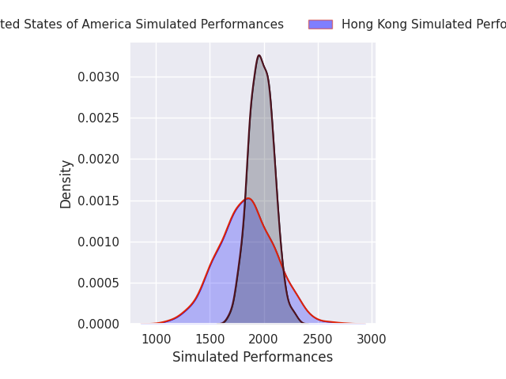

#### Portugal V Chile on 2026/11/14

Average Margin: Portugal by 7.7

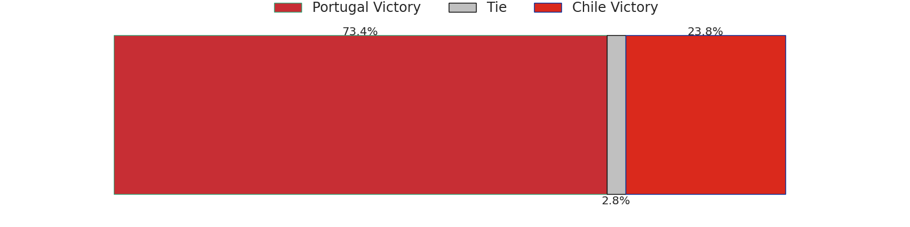
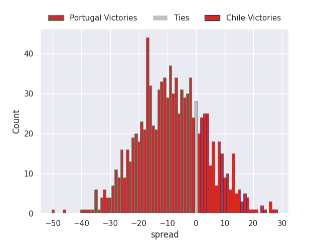

#### Georgia V Canada on 2026/11/14

Average Margin: Georgia by 23.6

#### Romania V Tonga on 2026/11/14

Average Margin: Romania by 2.7

#### Spain V Uruguay on 2026/11/14

Average Margin: Spain by 11.2

### Week 8
#### Romania V Canada on 2026/11/20

Average Margin: Canada by 1.1

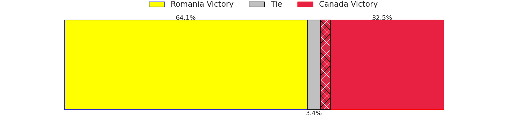

#### Georgia V United States of America on 2026/11/21

Average Margin: Georgia by 18.3

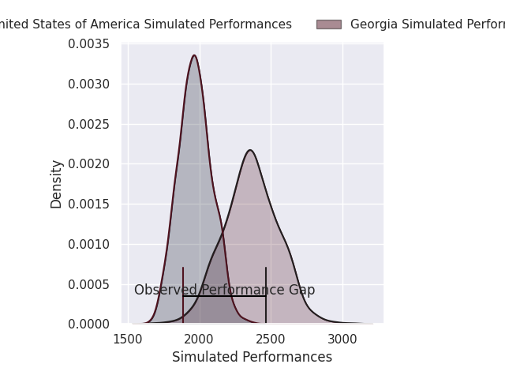
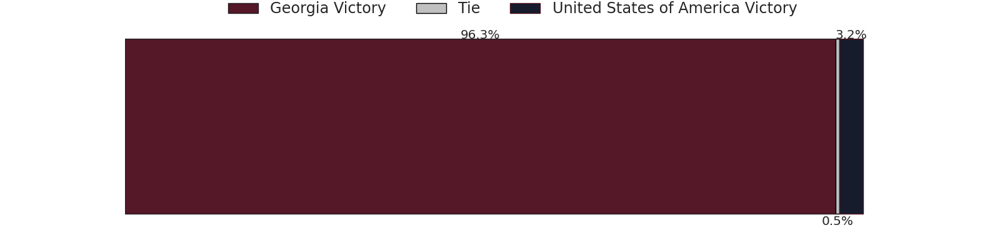
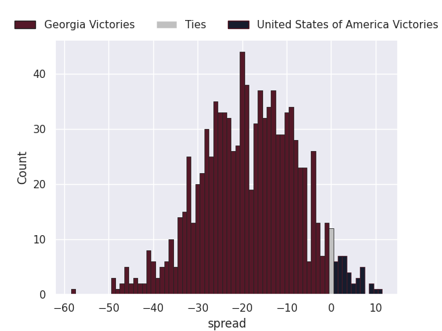

#### Hong Kong V Tonga on 2026/11/21

Average Margin: Tonga by 7.0

#### Spain V Samoa on 2026/11/21

Average Margin: Spain by 0.8

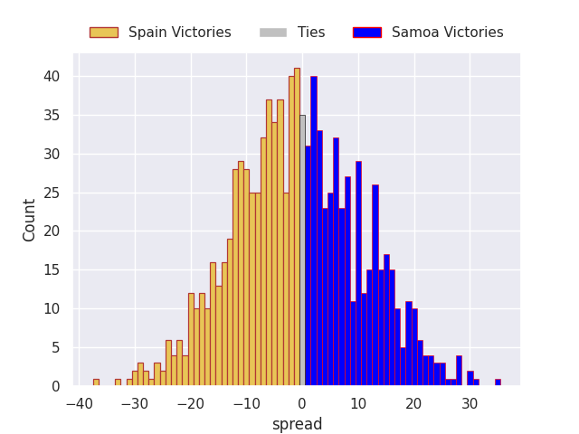

#### Zimbabwe V Chile on 2026/11/21

Average Margin: Chile by 12.3

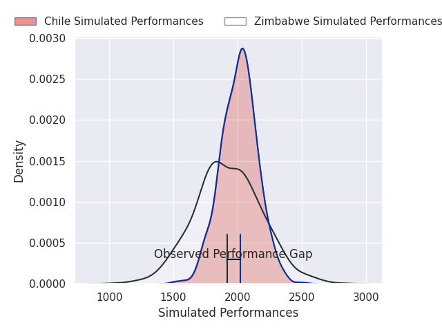

#### Portugal V Uruguay on 2026/11/21

Average Margin: Portugal by 7.7

