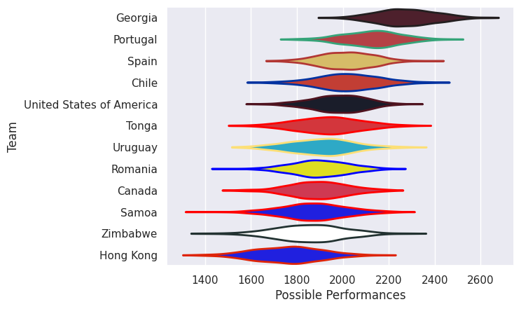
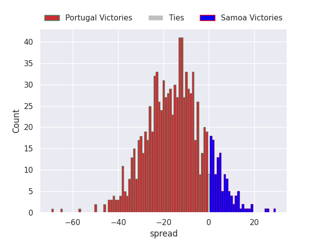
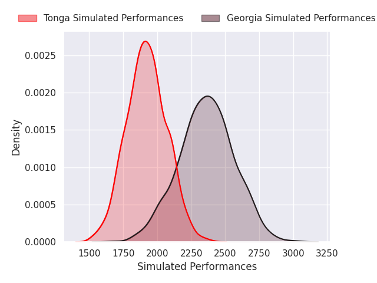
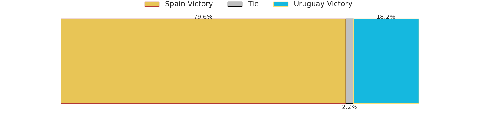
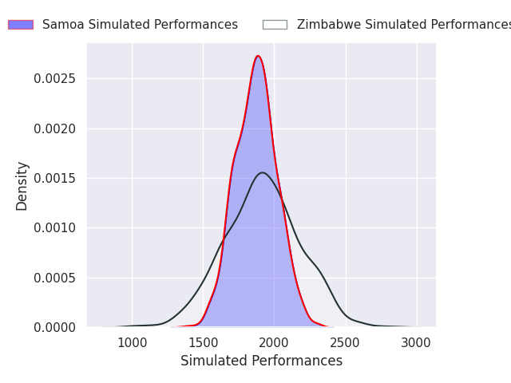
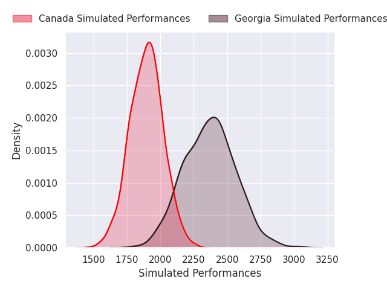
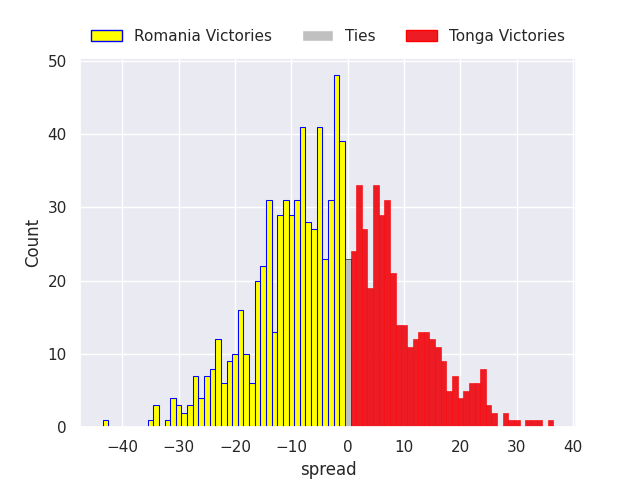
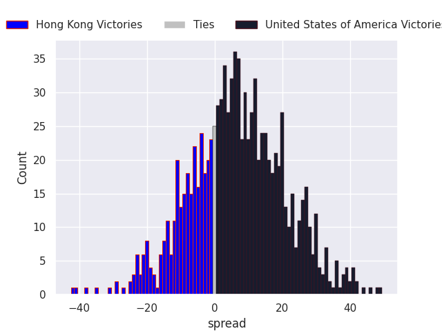

## Team Rankings

## Standings
### Current Standings
#### APAC

| Club                     |   Played |   Wins |   Point Differential |   Losing Bonus Points |   Try Bonus Points |   Competition Points |
|:-------------------------|---------:|-------:|---------------------:|----------------------:|-------------------:|---------------------:|
| United States of America |        6 |      5 |                   27 |                     0 |                  4 |                   24 |
| Samoa                    |        6 |      4 |                  160 |                     1 |                  4 |                   21 |
| Chile                    |        6 |      4 |                    0 |                     0 |                  2 |                   18 |
| Tonga                    |        6 |      3 |                   10 |                     1 |                  4 |                   17 |
| Canada                   |        6 |      3 |                  -43 |                     0 |                  2 |                   16 |
| Uruguay                  |        5 |      1 |                  -10 |                     3 |                  3 |                   12 |

#### EMEA

| Club      |   Played |   Wins |   Point Differential |   Losing Bonus Points |   Try Bonus Points |   Competition Points |
|:----------|---------:|-------:|---------------------:|----------------------:|-------------------:|---------------------:|
| Georgia   |        6 |      6 |                  152 |                     0 |                  4 |                   28 |
| Portugal  |        5 |      3 |                   17 |                     1 |                  4 |                   17 |
| Spain     |        6 |      2 |                  -61 |                     2 |                  2 |                   14 |
| Romania   |        6 |      1 |                  -51 |                     2 |                  5 |                   13 |
| Hong Kong |        6 |      1 |                 -125 |                     1 |                  1 |                    6 |
| Zimbabwe  |        6 |      0 |                  -76 |                     3 |                  1 |                    4 |

### Projected Remaining Table
#### APAC

| Club                     |   To Play |   Projected Wins |   Projected Differential |   Projected Losing Bonus Points |   Projected Try Bonus Points |   Projected Competition Points |
|:-------------------------|----------:|-----------------:|-------------------------:|--------------------------------:|-----------------------------:|-------------------------------:|
| United States of America |         2 |            1.125 |                    6.502 |                           0.354 |                            2 |                          6.998 |
| Samoa                    |         2 |            0.528 |                  -17.13  |                           0.348 |                            2 |                          4.538 |
| Tonga                    |         2 |            0.433 |                  -25.02  |                           0.298 |                            2 |                          4.098 |
| Canada                   |         2 |            0.583 |                  -21.344 |                           0.222 |                            1 |                          3.608 |
| Uruguay                  |         3 |            0.699 |                  -27.436 |                           0.551 |                              |                          3.477 |
| Chile                    |         2 |            0.574 |                  -13.588 |                           0.432 |                              |                          2.85  |

#### EMEA

| Club      |   To Play |   Projected Wins |   Projected Differential |   Projected Losing Bonus Points |   Projected Try Bonus Points |   Projected Competition Points |
|:----------|----------:|-----------------:|-------------------------:|--------------------------------:|-----------------------------:|-------------------------------:|
| Portugal  |         3 |            2.466 |                   36.666 |                           0.323 |                            1 |                         11.309 |
| Georgia   |         2 |            1.938 |                   46.188 |                           0.044 |                            2 |                          9.808 |
| Romania   |         2 |            1.074 |                    2.837 |                           0.384 |                            2 |                          6.838 |
| Spain     |         2 |            1.477 |                   17.339 |                           0.277 |                              |                          6.285 |
| Zimbabwe  |         2 |            1.091 |                    4.149 |                           0.355 |                              |                          4.827 |
| Hong Kong |         2 |            0.714 |                   -9.163 |                           0.37  |                              |                          3.322 |

### Projected Total Table
#### APAC

| Club                     |   Played |   Wins |   Point Differential |   Losing Bonus Points |   Try Bonus Points |   Competition Points |
|:-------------------------|---------:|-------:|---------------------:|----------------------:|-------------------:|---------------------:|
| United States of America |        8 |  6.125 |               33.502 |                 0.354 |                  6 |               30.998 |
| Samoa                    |        8 |  4.528 |              142.87  |                 1.348 |                  6 |               25.538 |
| Tonga                    |        8 |  3.433 |              -15.02  |                 1.298 |                  6 |               21.098 |
| Chile                    |        8 |  4.574 |              -13.588 |                 0.432 |                  2 |               20.85  |
| Canada                   |        8 |  3.583 |              -64.344 |                 0.222 |                  3 |               19.608 |
| Uruguay                  |        8 |  1.699 |              -37.436 |                 3.551 |                  3 |               15.477 |

#### EMEA

| Club      |   Played |   Wins |   Point Differential |   Losing Bonus Points |   Try Bonus Points |   Competition Points |
|:----------|---------:|-------:|---------------------:|----------------------:|-------------------:|---------------------:|
| Georgia   |        8 |  7.938 |              198.188 |                 0.044 |                  6 |               37.808 |
| Portugal  |        8 |  5.466 |               53.666 |                 1.323 |                  5 |               28.309 |
| Spain     |        8 |  3.477 |              -43.661 |                 2.277 |                  2 |               20.285 |
| Romania   |        8 |  2.074 |              -48.163 |                 2.384 |                  7 |               19.838 |
| Hong Kong |        8 |  1.714 |             -134.163 |                 1.37  |                  1 |                9.322 |
| Zimbabwe  |        8 |  1.091 |              -71.851 |                 3.355 |                  1 |                8.827 |

## Completed Match Review

| Model | Percent Correct Predictions | Spread Error |
| ------ | ------ | ------ |
| Club Level | 62.5% | 11.9 |
| Player Level: Lineup | nan% | nan |
| Player Level: Minutes | nan% | nan |

## Future Predictions
### Week 7
#### Zimbabwe V Uruguay on 2026/11/07

Average Margin: Zimbabwe by 2.0

#### Portugal V Samoa on 2026/11/07

Average Margin: Portugal by 14.9

#### Georgia V Tonga on 2026/11/07

Average Margin: Georgia by 22.4

#### Spain V Chile on 2026/11/07

Average Margin: Spain by 5.8

#### Hong Kong V Canada on 2026/11/07

Average Margin: Canada by 2.5

#### Romania V United States of America on 2026/11/07

Average Margin: Romania by 0.2

### Week 8
#### Spain V Uruguay on 2026/11/14

Average Margin: Spain by 11.6

#### Zimbabwe V Samoa on 2026/11/14

Average Margin: Zimbabwe by 2.2

#### Georgia V Canada on 2026/11/14

Average Margin: Georgia by 23.8

#### Romania V Tonga on 2026/11/14

Average Margin: Romania by 2.7

#### Hong Kong V United States of America on 2026/11/14

Average Margin: United States of America by 6.7

#### Portugal V Chile on 2026/11/14

Average Margin: Portugal by 7.8

### Week 9
#### Portugal V Uruguay on 2026/11/21

Average Margin: Portugal by 13.9

