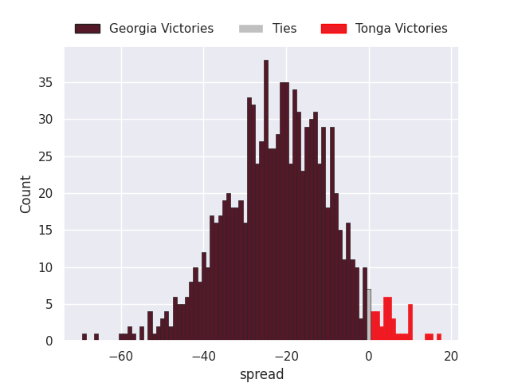
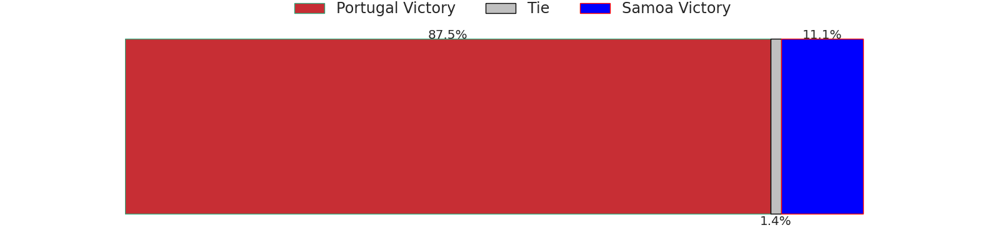
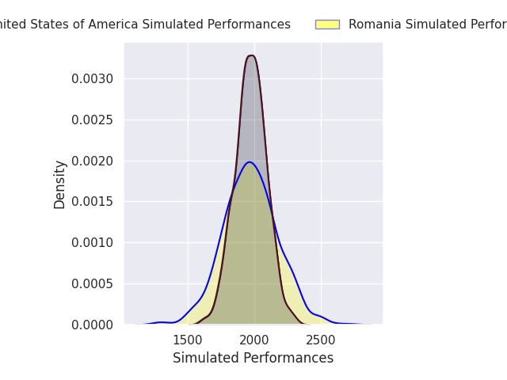
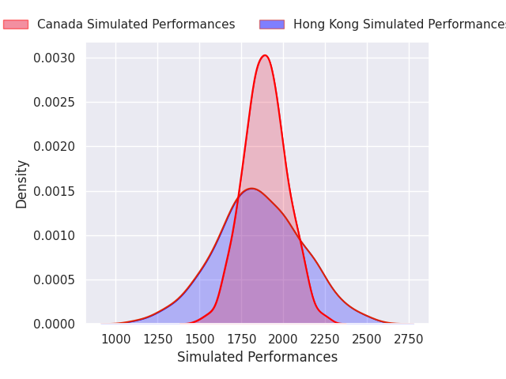
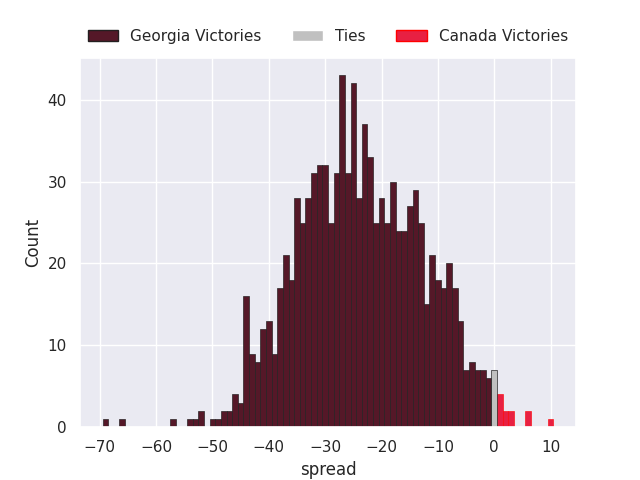
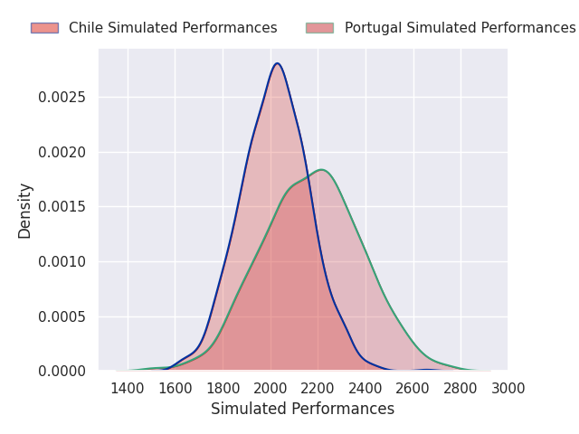

## Team Rankings

## Standings
### Current Standings
#### APAC

| Club                     |   Played |   Wins |   Point Differential |   Losing Bonus Points |   Try Bonus Points |   Competition Points |
|:-------------------------|---------:|-------:|---------------------:|----------------------:|-------------------:|---------------------:|
| United States of America |        6 |      5 |                   27 |                     0 |                  4 |                   24 |
| Samoa                    |        6 |      4 |                  160 |                     1 |                  4 |                   21 |
| Chile                    |        6 |      4 |                    0 |                     0 |                  2 |                   18 |
| Tonga                    |        6 |      3 |                   10 |                     1 |                  4 |                   17 |
| Canada                   |        6 |      3 |                  -43 |                     0 |                  2 |                   16 |
| Uruguay                  |        5 |      1 |                  -10 |                     3 |                  3 |                   12 |

#### EMEA

| Club      |   Played |   Wins |   Point Differential |   Losing Bonus Points |   Try Bonus Points |   Competition Points |
|:----------|---------:|-------:|---------------------:|----------------------:|-------------------:|---------------------:|
| Georgia   |        6 |      6 |                  152 |                     0 |                  4 |                   28 |
| Portugal  |        5 |      3 |                   17 |                     1 |                  4 |                   17 |
| Spain     |        6 |      2 |                  -61 |                     2 |                  2 |                   14 |
| Romania   |        6 |      1 |                  -51 |                     2 |                  5 |                   13 |
| Hong Kong |        6 |      1 |                 -125 |                     1 |                  1 |                    6 |
| Zimbabwe  |        6 |      0 |                  -76 |                     3 |                  1 |                    4 |

### Projected Remaining Table
#### APAC

| Club                     |   To Play |   Projected Wins |   Projected Differential |   Projected Losing Bonus Points |   Projected Try Bonus Points |   Projected Competition Points |
|:-------------------------|----------:|-----------------:|-------------------------:|--------------------------------:|-----------------------------:|-------------------------------:|
| United States of America |         2 |            1.128 |                    6.798 |                           0.393 |                            2 |                          7.035 |
| Samoa                    |         2 |            0.494 |                  -18.385 |                           0.355 |                            2 |                          4.419 |
| Tonga                    |         2 |            0.429 |                  -23.707 |                           0.328 |                            2 |                          4.142 |
| Uruguay                  |         3 |            0.731 |                  -26.196 |                           0.537 |                              |                          3.625 |
| Canada                   |         2 |            0.554 |                  -21.895 |                           0.227 |                            1 |                          3.509 |
| Chile                    |         2 |            0.569 |                  -13.223 |                           0.427 |                              |                          2.829 |

#### EMEA

| Club      |   To Play |   Projected Wins |   Projected Differential |   Projected Losing Bonus Points |   Projected Try Bonus Points |   Projected Competition Points |
|:----------|----------:|-----------------:|-------------------------:|--------------------------------:|-----------------------------:|-------------------------------:|
| Portugal  |         3 |            2.462 |                   37.155 |                           0.284 |                            1 |                         11.274 |
| Georgia   |         2 |            1.951 |                   45.464 |                           0.027 |                            2 |                          9.861 |
| Romania   |         2 |            1.06  |                    2.409 |                           0.391 |                            2 |                          6.785 |
| Spain     |         2 |            1.465 |                   17.319 |                           0.267 |                              |                          6.253 |
| Zimbabwe  |         2 |            1.09  |                    3.33  |                           0.33  |                              |                          4.8   |
| Hong Kong |         2 |            0.731 |                   -9.069 |                           0.368 |                              |                          3.402 |

### Projected Total Table
#### APAC

| Club                     |   Played |   Wins |   Point Differential |   Losing Bonus Points |   Try Bonus Points |   Competition Points |
|:-------------------------|---------:|-------:|---------------------:|----------------------:|-------------------:|---------------------:|
| United States of America |        8 |  6.128 |               33.798 |                 0.393 |                  6 |               31.035 |
| Samoa                    |        8 |  4.494 |              141.615 |                 1.355 |                  6 |               25.419 |
| Tonga                    |        8 |  3.429 |              -13.707 |                 1.328 |                  6 |               21.142 |
| Chile                    |        8 |  4.569 |              -13.223 |                 0.427 |                  2 |               20.829 |
| Canada                   |        8 |  3.554 |              -64.895 |                 0.227 |                  3 |               19.509 |
| Uruguay                  |        8 |  1.731 |              -36.196 |                 3.537 |                  3 |               15.625 |

#### EMEA

| Club      |   Played |   Wins |   Point Differential |   Losing Bonus Points |   Try Bonus Points |   Competition Points |
|:----------|---------:|-------:|---------------------:|----------------------:|-------------------:|---------------------:|
| Georgia   |        8 |  7.951 |              197.464 |                 0.027 |                  6 |               37.861 |
| Portugal  |        8 |  5.462 |               54.155 |                 1.284 |                  5 |               28.274 |
| Spain     |        8 |  3.465 |              -43.681 |                 2.267 |                  2 |               20.253 |
| Romania   |        8 |  2.06  |              -48.591 |                 2.391 |                  7 |               19.785 |
| Hong Kong |        8 |  1.731 |             -134.069 |                 1.368 |                  1 |                9.402 |
| Zimbabwe  |        8 |  1.09  |              -72.67  |                 3.33  |                  1 |                8.8   |

## Completed Match Review

| Model | Percent Correct Predictions | Spread Error |
| ------ | ------ | ------ |
| Club Level | 60.4% | 11.9 |
| Player Level: Lineup | nan% | nan |
| Player Level: Minutes | nan% | nan |

## Future Predictions
### Week 7
#### Zimbabwe V Uruguay on 2026/11/07

Average Margin: Zimbabwe by 0.5

#### Spain V Chile on 2026/11/07

Average Margin: Spain by 5.6

#### Georgia V Tonga on 2026/11/07

Average Margin: Georgia by 21.4

#### Portugal V Samoa on 2026/11/07

Average Margin: Portugal by 15.5

#### Romania V United States of America on 2026/11/07

Average Margin: Romania by 0.1

#### Hong Kong V Canada on 2026/11/07

Average Margin: Canada by 2.1

### Week 8
#### Georgia V Canada on 2026/11/14

Average Margin: Georgia by 24.0

#### Romania V Tonga on 2026/11/14

Average Margin: Romania by 2.3

#### Zimbabwe V Samoa on 2026/11/14

Average Margin: Zimbabwe by 2.9

#### Hong Kong V United States of America on 2026/11/14

Average Margin: United States of America by 6.9

#### Portugal V Chile on 2026/11/14

Average Margin: Portugal by 7.6

#### Spain V Uruguay on 2026/11/14

Average Margin: Spain by 11.7

### Week 9
#### Portugal V Uruguay on 2026/11/21

Average Margin: Portugal by 14.0

