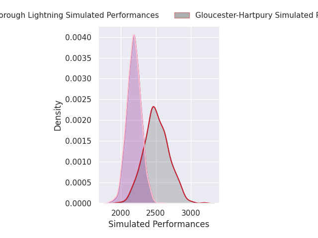
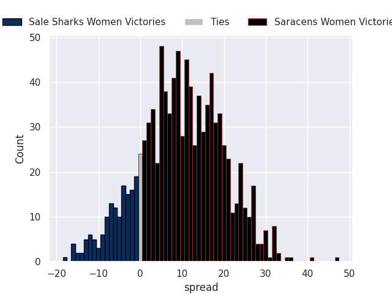
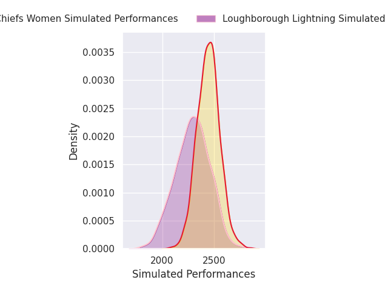
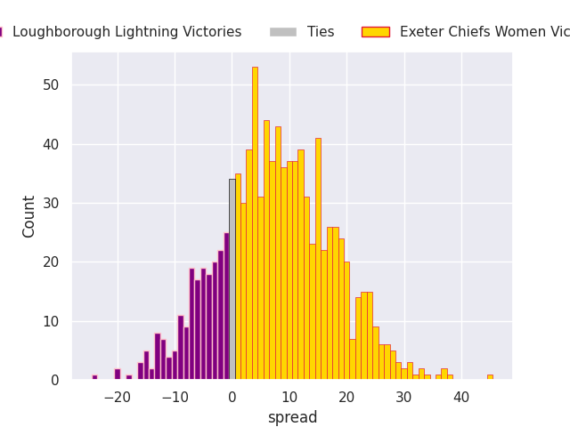
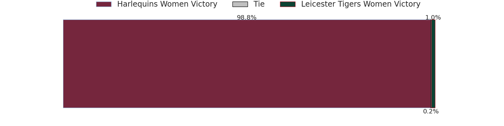
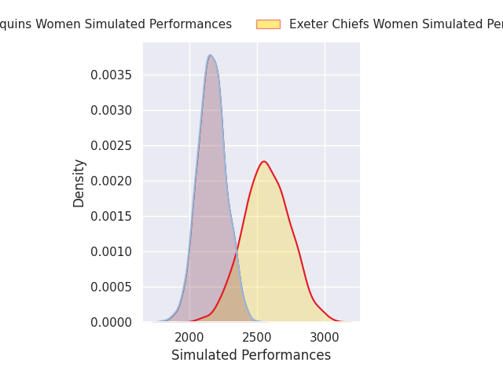

## Team Rankings

## Standings
### Current Standings

| Club                   |   Played |   Wins |   Point Differential |   Losing Bonus Points | Try Bonus Points   |   Competition Points |
|:-----------------------|---------:|-------:|---------------------:|----------------------:|:-------------------|---------------------:|
| Saracens Women         |        1 |      1 |                   86 |                     0 |                    |                    4 |
| Bristol Bears Women    |        1 |      1 |                   27 |                     0 |                    |                    4 |
| Trailfinders Women     |        1 |      1 |                   15 |                     0 |                    |                    4 |
| Sale Sharks Women      |        1 |      1 |                   14 |                     0 |                    |                    4 |
| Gloucester-Hartpury    |        1 |      0 |                  -14 |                     0 |                    |                    0 |
| Loughborough Lightning |        1 |      0 |                  -15 |                     0 |                    |                    0 |
| Harlequins Women       |        1 |      0 |                  -27 |                     0 |                    |                    0 |
| Leicester Tigers Women |        1 |      0 |                  -86 |                     0 |                    |                    0 |

### Projected Remaining Table

| Club                   |   To Play |   Projected Wins |   Projected Differential |   Projected Losing Bonus Points | Projected Try Bonus Points   |   Projected Competition Points |
|:-----------------------|----------:|-----------------:|-------------------------:|--------------------------------:|:-----------------------------|-------------------------------:|
| Exeter Chiefs Women    |         3 |            2.394 |                   31.819 |                           0.341 |                              |                         10.073 |
| Trailfinders Women     |         2 |            1.75  |                   24.479 |                           0.165 |                              |                          7.231 |
| Gloucester-Hartpury    |         2 |            1.471 |                   17.197 |                           0.271 |                              |                          6.283 |
| Sale Sharks Women      |         2 |            1.105 |                    9.388 |                           0.261 |                              |                          4.741 |
| Harlequins Women       |         3 |            1.068 |                  -12.262 |                           0.269 |                              |                          4.583 |
| Bristol Bears Women    |         3 |            0.883 |                  -14.948 |                           0.818 |                              |                          4.572 |
| Saracens Women         |         1 |            0.83  |                    9.89  |                           0.102 |                              |                          3.47  |
| Loughborough Lightning |         2 |            0.247 |                  -23.611 |                           0.404 |                              |                          1.482 |
| Leicester Tigers Women |         2 |            0.045 |                  -41.952 |                           0.161 |                              |                          0.357 |

### Projected Total Table

| Club                   |   Played |   Wins |   Point Differential |   Losing Bonus Points | Try Bonus Points   |   Competition Points |
|:-----------------------|---------:|-------:|---------------------:|----------------------:|:-------------------|---------------------:|
| Trailfinders Women     |        3 |  2.75  |               39.479 |                 0.165 |                    |               11.231 |
| Exeter Chiefs Women    |        3 |  2.394 |               31.819 |                 0.341 |                    |               10.073 |
| Sale Sharks Women      |        3 |  2.105 |               23.388 |                 0.261 |                    |                8.741 |
| Bristol Bears Women    |        4 |  1.883 |               12.052 |                 0.818 |                    |                8.572 |
| Saracens Women         |        2 |  1.83  |               95.89  |                 0.102 |                    |                7.47  |
| Gloucester-Hartpury    |        3 |  1.471 |                3.197 |                 0.271 |                    |                6.283 |
| Harlequins Women       |        4 |  1.068 |              -39.262 |                 0.269 |                    |                4.583 |
| Loughborough Lightning |        3 |  0.247 |              -38.611 |                 0.404 |                    |                1.482 |
| Leicester Tigers Women |        3 |  0.045 |             -127.952 |                 0.161 |                    |                0.357 |

## Completed Match Review

| Model | Percent Correct Predictions | Spread Error |
| ------ | ------ | ------ |
| Club Level | 71.4% | 13.9 |
| Player Level: Lineup | nan% | nan |
| Player Level: Minutes | nan% | nan |

## Future Predictions
### Week 2
#### Gloucester-Hartpury V Loughborough Lightning on 2026/11/28

Average Margin: Gloucester-Hartpury by 15.9

#### Bristol Bears Women V Exeter Chiefs Women on 2026/11/28

Average Margin: Exeter Chiefs Women by 3.8

#### Trailfinders Women V Harlequins Ladies on 2026/11/28

Average Margin: Trailfinders Women by 14.6

#### Leicester Tigers Women V Sale Sharks Women on 2026/11/29

Average Margin: Sale Sharks Women by 19.3

### Week 3
#### Trailfinders Women V Bristol Bears Women on 2026/12/04

Average Margin: Trailfinders Women by 9.9

#### Sale Sharks Women V Saracens Women on 2026/12/05

Average Margin: Saracens Women by 9.9

#### Loughborough Lightning V Exeter Chiefs Women on 2026/12/06

Average Margin: Exeter Chiefs Women by 7.7

#### Harlequins Women V Leicester Tigers Women on 2026/12/06

Average Margin: Harlequins Women by 22.7

### Week 4
#### Bristol Bears Women V Gloucester-Hartpury on 2026/12/11

Average Margin: Gloucester-Hartpury by 1.2

#### Exeter Chiefs Women V Harlequins Women on 2026/12/12

Average Margin: Exeter Chiefs Women by 20.3

