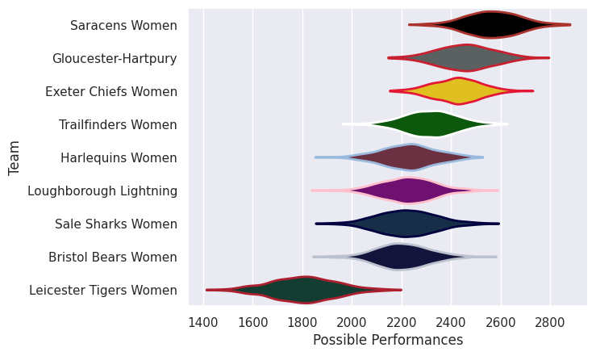
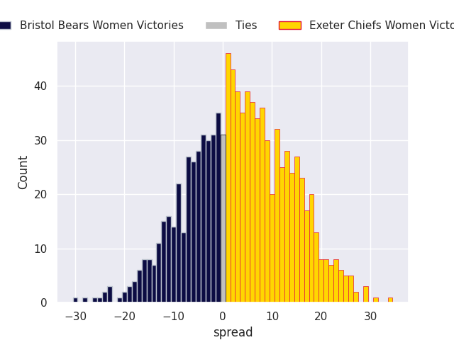
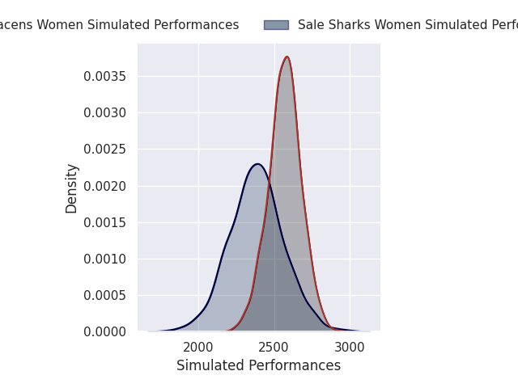
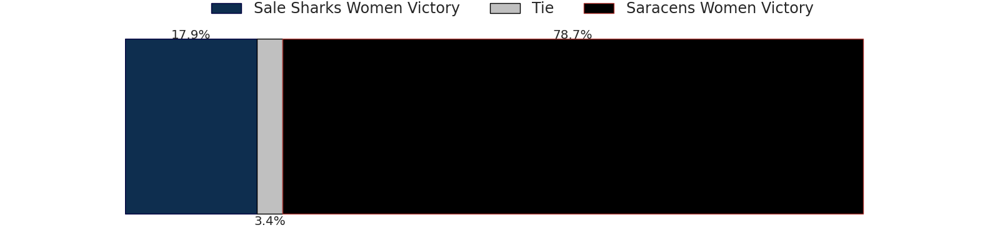
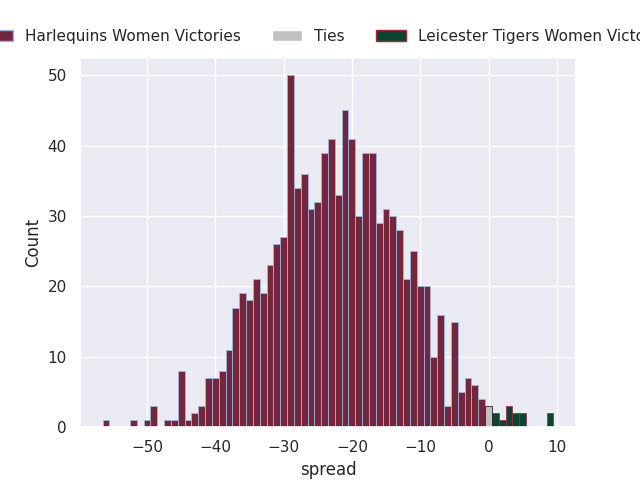
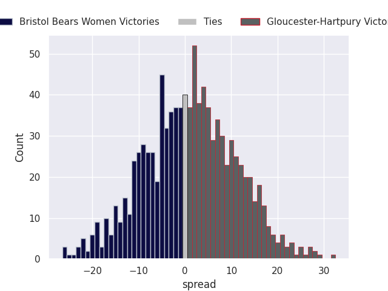
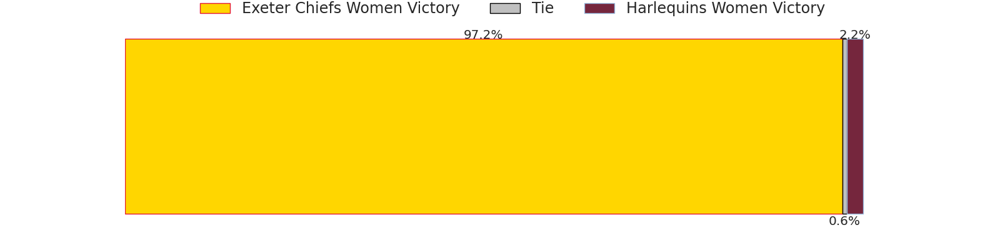

## Team Rankings

## Standings
### Current Standings

| Club                   |   Played |   Wins |   Point Differential |   Losing Bonus Points | Try Bonus Points   |   Competition Points |
|:-----------------------|---------:|-------:|---------------------:|----------------------:|:-------------------|---------------------:|
| Saracens Women         |        1 |      1 |                   86 |                     0 |                    |                    4 |
| Bristol Bears Women    |        1 |      1 |                   27 |                     0 |                    |                    4 |
| Trailfinders Women     |        1 |      1 |                   15 |                     0 |                    |                    4 |
| Sale Sharks Women      |        1 |      1 |                   14 |                     0 |                    |                    4 |
| Gloucester-Hartpury    |        1 |      0 |                  -14 |                     0 |                    |                    0 |
| Loughborough Lightning |        1 |      0 |                  -15 |                     0 |                    |                    0 |
| Harlequins Women       |        1 |      0 |                  -27 |                     0 |                    |                    0 |
| Leicester Tigers Women |        1 |      0 |                  -86 |                     0 |                    |                    0 |

### Projected Remaining Table

| Club                   |   To Play |   Projected Wins |   Projected Differential |   Projected Losing Bonus Points | Projected Try Bonus Points   |   Projected Competition Points |
|:-----------------------|----------:|-----------------:|-------------------------:|--------------------------------:|:-----------------------------|-------------------------------:|
| Exeter Chiefs Women    |         3 |            2.348 |                   31.404 |                           0.377 |                              |                          9.899 |
| Trailfinders Women     |         2 |            1.75  |                   25.092 |                           0.153 |                              |                          7.245 |
| Gloucester-Hartpury    |         2 |            1.468 |                   17.66  |                           0.274 |                              |                          6.244 |
| Sale Sharks Women      |         2 |            1.116 |                   10.62  |                           0.262 |                              |                          4.818 |
| Bristol Bears Women    |         3 |            0.936 |                  -13.94  |                           0.778 |                              |                          4.73  |
| Harlequins Women       |         3 |            1.055 |                  -13.839 |                           0.239 |                              |                          4.503 |
| Saracens Women         |         1 |            0.787 |                    9.256 |                           0.126 |                              |                          3.342 |
| Loughborough Lightning |         2 |            0.268 |                  -24.232 |                           0.37  |                              |                          1.516 |
| Leicester Tigers Women |         2 |            0.063 |                  -42.021 |                           0.144 |                              |                          0.426 |

### Projected Total Table

| Club                   |   Played |   Wins |   Point Differential |   Losing Bonus Points | Try Bonus Points   |   Competition Points |
|:-----------------------|---------:|-------:|---------------------:|----------------------:|:-------------------|---------------------:|
| Trailfinders Women     |        3 |  2.75  |               40.092 |                 0.153 |                    |               11.245 |
| Exeter Chiefs Women    |        3 |  2.348 |               31.404 |                 0.377 |                    |                9.899 |
| Sale Sharks Women      |        3 |  2.116 |               24.62  |                 0.262 |                    |                8.818 |
| Bristol Bears Women    |        4 |  1.936 |               13.06  |                 0.778 |                    |                8.73  |
| Saracens Women         |        2 |  1.787 |               95.256 |                 0.126 |                    |                7.342 |
| Gloucester-Hartpury    |        3 |  1.468 |                3.66  |                 0.274 |                    |                6.244 |
| Harlequins Women       |        4 |  1.055 |              -40.839 |                 0.239 |                    |                4.503 |
| Loughborough Lightning |        3 |  0.268 |              -39.232 |                 0.37  |                    |                1.516 |
| Leicester Tigers Women |        3 |  0.063 |             -128.021 |                 0.144 |                    |                0.426 |

## Completed Match Review

| Model | Percent Correct Predictions | Spread Error |
| ------ | ------ | ------ |
| Club Level | 78.6% | 12.0 |
| Player Level: Lineup | nan% | nan |
| Player Level: Minutes | nan% | nan |

## Future Predictions
### Week 2
#### Trailfinders Women V Harlequins Ladies on 2026/11/28

Average Margin: Trailfinders Women by 15.7

#### Bristol Bears Women V Exeter Chiefs Women on 2026/11/28

Average Margin: Exeter Chiefs Women by 3.5

#### Gloucester-Hartpury V Loughborough Lightning on 2026/11/28

Average Margin: Gloucester-Hartpury by 16.6

#### Leicester Tigers Women V Sale Sharks Women on 2026/11/29

Average Margin: Sale Sharks Women by 19.9

### Week 3
#### Trailfinders Women V Bristol Bears Women on 2026/12/04

Average Margin: Trailfinders Women by 9.4

#### Sale Sharks Women V Saracens Women on 2026/12/05

Average Margin: Saracens Women by 9.3

#### Loughborough Lightning V Exeter Chiefs Women on 2026/12/06

Average Margin: Exeter Chiefs Women by 7.6

#### Harlequins Women V Leicester Tigers Women on 2026/12/06

Average Margin: Harlequins Women by 22.1

### Week 4
#### Bristol Bears Women V Gloucester-Hartpury on 2026/12/11

Average Margin: Gloucester-Hartpury by 1.1

#### Exeter Chiefs Women V Harlequins Women on 2026/12/12

Average Margin: Exeter Chiefs Women by 20.3

