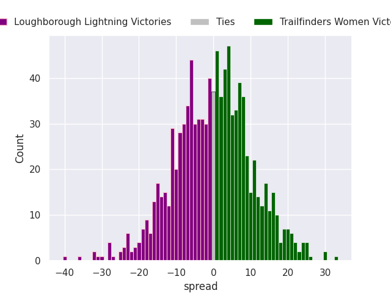
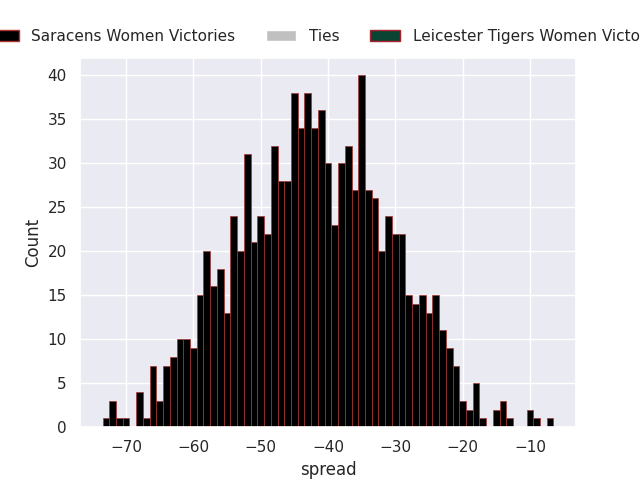
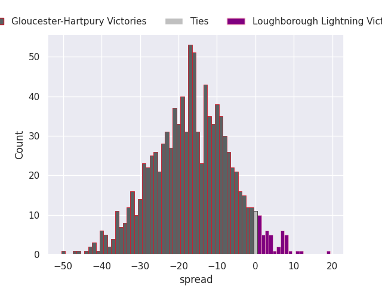
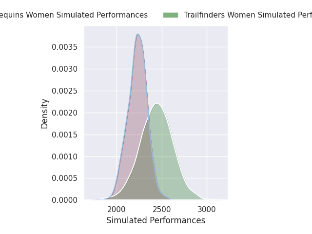
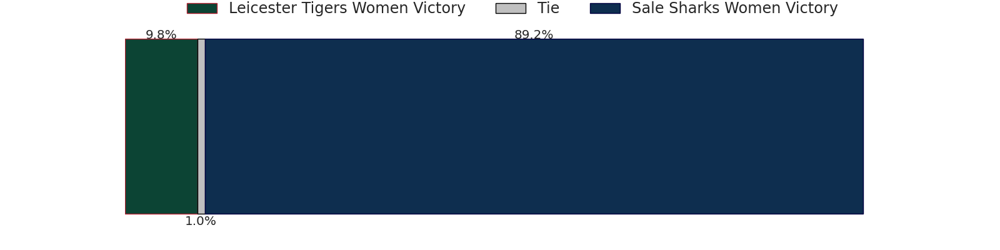

## Team Rankings

## Standings
### Projected Remaining Table

| Club                   |   To Play |   Projected Wins |   Projected Differential |   Projected Losing Bonus Points | Projected Try Bonus Points   |   Projected Competition Points |
|:-----------------------|----------:|-----------------:|-------------------------:|--------------------------------:|:-----------------------------|-------------------------------:|
| Trailfinders Women     |         3 |            2.17  |                   21.459 |                           0.425 |                              |                          9.287 |
| Saracens Women         |         2 |            1.876 |                   54.612 |                           0.076 |                              |                          7.62  |
| Gloucester-Hartpury    |         2 |            1.679 |                   23.966 |                           0.187 |                              |                          6.993 |
| Sale Sharks Women      |         3 |            1.228 |                   -3.409 |                           0.48  |                              |                          5.52  |
| Harlequins Women       |         2 |            0.85  |                   -4.462 |                           0.382 |                              |                          3.9   |
| Bristol Bears Women    |         3 |            0.626 |                  -23.488 |                           0.786 |                              |                          3.446 |
| Exeter Chiefs Women    |         1 |            0.738 |                    6.336 |                           0.163 |                              |                          3.165 |
| Loughborough Lightning |         2 |            0.515 |                  -16.525 |                           0.399 |                              |                          2.555 |
| Leicester Tigers Women |         2 |            0.098 |                  -58.489 |                           0.127 |                              |                          0.539 |

### Projected Total Table

| Club                   |   Played |   Wins |   Point Differential |   Losing Bonus Points | Try Bonus Points   |   Competition Points |
|:-----------------------|---------:|-------:|---------------------:|----------------------:|:-------------------|---------------------:|
| Trailfinders Women     |        3 |  2.17  |               21.459 |                 0.425 |                    |                9.287 |
| Saracens Women         |        2 |  1.876 |               54.612 |                 0.076 |                    |                7.62  |
| Gloucester-Hartpury    |        2 |  1.679 |               23.966 |                 0.187 |                    |                6.993 |
| Sale Sharks Women      |        3 |  1.228 |               -3.409 |                 0.48  |                    |                5.52  |
| Harlequins Women       |        2 |  0.85  |               -4.462 |                 0.382 |                    |                3.9   |
| Bristol Bears Women    |        3 |  0.626 |              -23.488 |                 0.786 |                    |                3.446 |
| Exeter Chiefs Women    |        1 |  0.738 |                6.336 |                 0.163 |                    |                3.165 |
| Loughborough Lightning |        2 |  0.515 |              -16.525 |                 0.399 |                    |                2.555 |
| Leicester Tigers Women |        2 |  0.098 |              -58.489 |                 0.127 |                    |                0.539 |

## Future Predictions
### Week 1
#### Loughborough Lightning V Trailfinders Women on 2026/11/20

Average Margin: Loughborough Lightning by 0.2

#### Sale Sharks Women V Gloucester-Hartpury on 2026/11/21

Average Margin: Gloucester-Hartpury by 7.3

#### Harlequins Ladies V Bristol Bears Women on 2026/11/22

Average Margin: Harlequins Women by 6.1

#### Saracens Women V Leicester Tigers Women on 2026/11/22

Average Margin: Saracens Women by 42.1

### Week 2
#### Gloucester-Hartpury V Loughborough Lightning on 2026/11/28

Average Margin: Gloucester-Hartpury by 16.7

#### Bristol Bears Women V Exeter Chiefs Women on 2026/11/28

Average Margin: Exeter Chiefs Women by 6.3

#### Trailfinders Women V Harlequins Women on 2026/11/28

Average Margin: Trailfinders Women by 10.6

#### Leicester Tigers Women V Sale Sharks Women on 2026/11/29

Average Margin: Sale Sharks Women by 16.4

### Week 3
#### Trailfinders Women V Bristol Bears Women on 2026/12/04

Average Margin: Trailfinders Women by 11.0

#### Sale Sharks Women V Saracens Women on 2026/12/05

Average Margin: Saracens Women by 12.5

