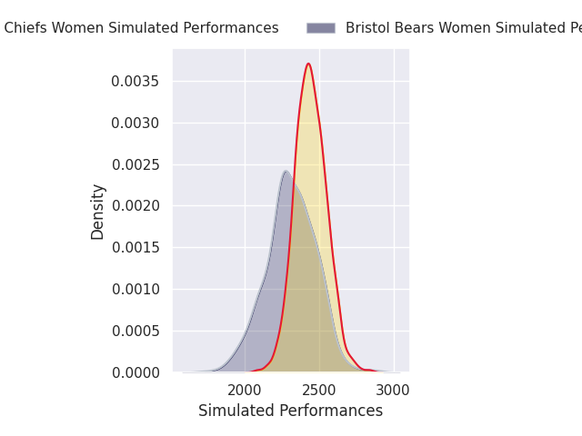
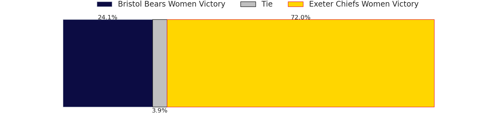
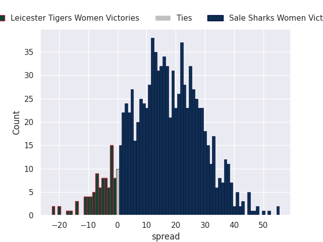
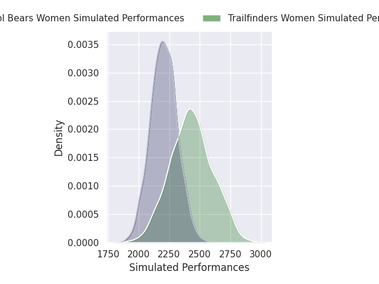

## Team Rankings

## Standings
### Projected Remaining Table

| Club                   |   To Play |   Projected Wins |   Projected Differential |   Projected Losing Bonus Points | Projected Try Bonus Points   |   Projected Competition Points |
|:-----------------------|----------:|-----------------:|-------------------------:|--------------------------------:|:-----------------------------|-------------------------------:|
| Trailfinders Women     |         3 |            2.205 |                   22.384 |                           0.427 |                              |                          9.389 |
| Saracens Women         |         2 |            1.866 |                   55.587 |                           0.081 |                              |                          7.599 |
| Gloucester-Hartpury    |         2 |            1.676 |                   23.653 |                           0.192 |                              |                          6.982 |
| Sale Sharks Women      |         3 |            1.24  |                   -3.466 |                           0.495 |                              |                          5.603 |
| Harlequins Women       |         2 |            0.837 |                   -4.77  |                           0.386 |                              |                          3.84  |
| Bristol Bears Women    |         3 |            0.61  |                  -24.334 |                           0.71  |                              |                          3.346 |
| Exeter Chiefs Women    |         1 |            0.72  |                    6.631 |                           0.165 |                              |                          3.123 |
| Loughborough Lightning |         2 |            0.535 |                  -16.289 |                           0.388 |                              |                          2.598 |
| Leicester Tigers Women |         2 |            0.086 |                  -59.396 |                           0.146 |                              |                          0.51  |

### Projected Total Table

| Club                   |   Played |   Wins |   Point Differential |   Losing Bonus Points | Try Bonus Points   |   Competition Points |
|:-----------------------|---------:|-------:|---------------------:|----------------------:|:-------------------|---------------------:|
| Trailfinders Women     |        3 |  2.205 |               22.384 |                 0.427 |                    |                9.389 |
| Saracens Women         |        2 |  1.866 |               55.587 |                 0.081 |                    |                7.599 |
| Gloucester-Hartpury    |        2 |  1.676 |               23.653 |                 0.192 |                    |                6.982 |
| Sale Sharks Women      |        3 |  1.24  |               -3.466 |                 0.495 |                    |                5.603 |
| Harlequins Women       |        2 |  0.837 |               -4.77  |                 0.386 |                    |                3.84  |
| Bristol Bears Women    |        3 |  0.61  |              -24.334 |                 0.71  |                    |                3.346 |
| Exeter Chiefs Women    |        1 |  0.72  |                6.631 |                 0.165 |                    |                3.123 |
| Loughborough Lightning |        2 |  0.535 |              -16.289 |                 0.388 |                    |                2.598 |
| Leicester Tigers Women |        2 |  0.086 |              -59.396 |                 0.146 |                    |                0.51  |

## Future Predictions
### Week 1
#### Loughborough Lightning V Trailfinders Women on 2026/11/20

Average Margin: Loughborough Lightning by 0.1

#### Sale Sharks Women V Gloucester-Hartpury on 2026/11/21

Average Margin: Gloucester-Hartpury by 7.3

#### Harlequins Ladies V Bristol Bears Women on 2026/11/22

Average Margin: Harlequins Women by 6.4

#### Saracens Women V Leicester Tigers Women on 2026/11/22

Average Margin: Saracens Women by 43.1

### Week 2
#### Bristol Bears Women V Exeter Chiefs Women on 2026/11/28

Average Margin: Exeter Chiefs Women by 6.6

#### Gloucester-Hartpury V Loughborough Lightning on 2026/11/28

Average Margin: Gloucester-Hartpury by 16.4

#### Trailfinders Women V Harlequins Women on 2026/11/28

Average Margin: Trailfinders Women by 11.2

#### Leicester Tigers Women V Sale Sharks Women on 2026/11/29

Average Margin: Sale Sharks Women by 16.3

### Week 3
#### Trailfinders Women V Bristol Bears Women on 2026/12/04

Average Margin: Trailfinders Women by 11.3

#### Sale Sharks Women V Saracens Women on 2026/12/05

Average Margin: Saracens Women by 12.5

