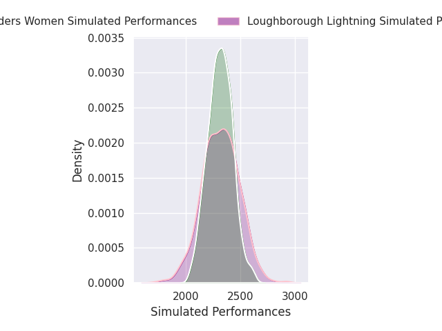
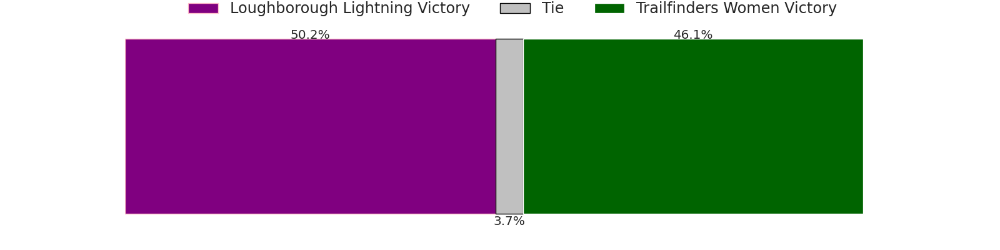
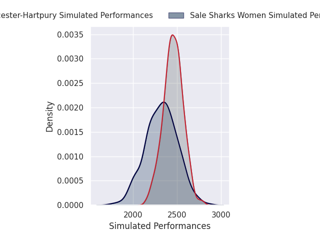
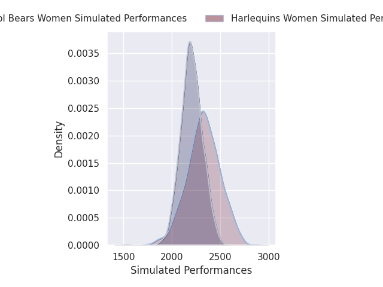
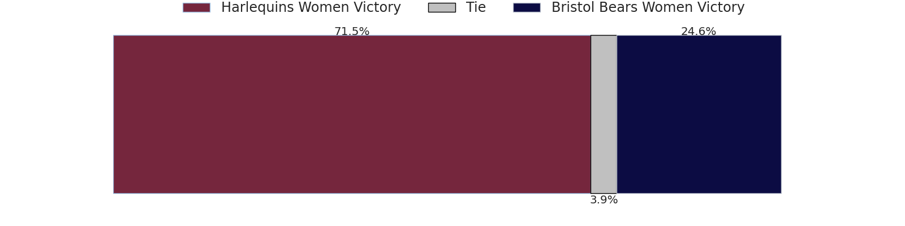
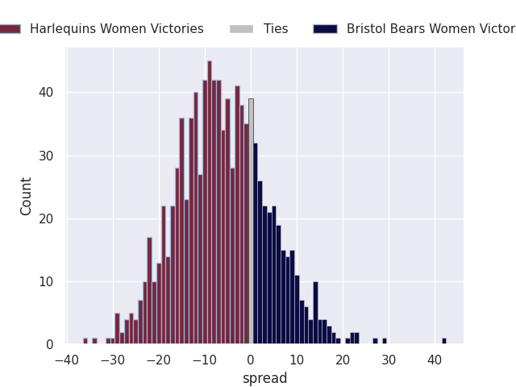

## Team Rankings

## Standings
### Projected Remaining Table

| Club                   |   To Play |   Projected Wins |   Projected Differential |   Projected Losing Bonus Points | Projected Try Bonus Points   |   Projected Competition Points |
|:-----------------------|----------:|-----------------:|-------------------------:|--------------------------------:|:-----------------------------|-------------------------------:|
| Saracens Women         |         1 |            1     |                   43.061 |                           0     |                              |                          4     |
| Gloucester-Hartpury    |         1 |            0.725 |                    6.678 |                           0.158 |                              |                          3.11  |
| Harlequins Women       |         1 |            0.715 |                    6.011 |                           0.157 |                              |                          3.095 |
| Loughborough Lightning |         1 |            0.502 |                    0.171 |                           0.242 |                              |                          2.324 |
| Trailfinders Women     |         1 |            0.461 |                   -0.171 |                           0.269 |                              |                          2.187 |
| Bristol Bears Women    |         1 |            0.246 |                   -6.011 |                           0.257 |                              |                          1.319 |
| Sale Sharks Women      |         1 |            0.249 |                   -6.678 |                           0.242 |                              |                          1.29  |
| Leicester Tigers Women |         1 |            0     |                  -43.061 |                           0     |                              |                          0     |

### Projected Total Table

| Club                   |   Played |   Wins |   Point Differential |   Losing Bonus Points | Try Bonus Points   |   Competition Points |
|:-----------------------|---------:|-------:|---------------------:|----------------------:|:-------------------|---------------------:|
| Saracens Women         |        1 |  1     |               43.061 |                 0     |                    |                4     |
| Gloucester-Hartpury    |        1 |  0.725 |                6.678 |                 0.158 |                    |                3.11  |
| Harlequins Women       |        1 |  0.715 |                6.011 |                 0.157 |                    |                3.095 |
| Loughborough Lightning |        1 |  0.502 |                0.171 |                 0.242 |                    |                2.324 |
| Trailfinders Women     |        1 |  0.461 |               -0.171 |                 0.269 |                    |                2.187 |
| Bristol Bears Women    |        1 |  0.246 |               -6.011 |                 0.257 |                    |                1.319 |
| Sale Sharks Women      |        1 |  0.249 |               -6.678 |                 0.242 |                    |                1.29  |
| Leicester Tigers Women |        1 |  0     |              -43.061 |                 0     |                    |                0     |

## Future Predictions
### Week 1
#### Loughborough Lightning V Trailfinders Women on 2026/11/20

Average Margin: Loughborough Lightning by 0.2

#### Sale Sharks Women V Gloucester-Hartpury on 2026/11/21

Average Margin: Gloucester-Hartpury by 6.7

#### Harlequins Ladies V Bristol Bears Women on 2026/11/22

Average Margin: Harlequins Women by 6.0

#### Saracens Women V Leicester Tigers Women on 2026/11/22

Average Margin: Saracens Women by 43.1

