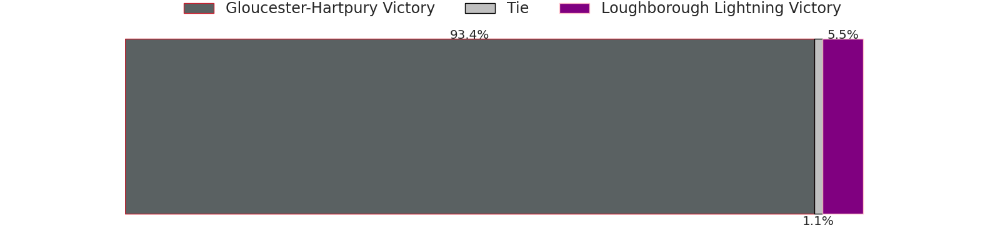
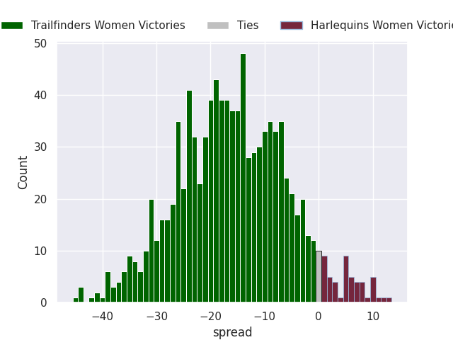
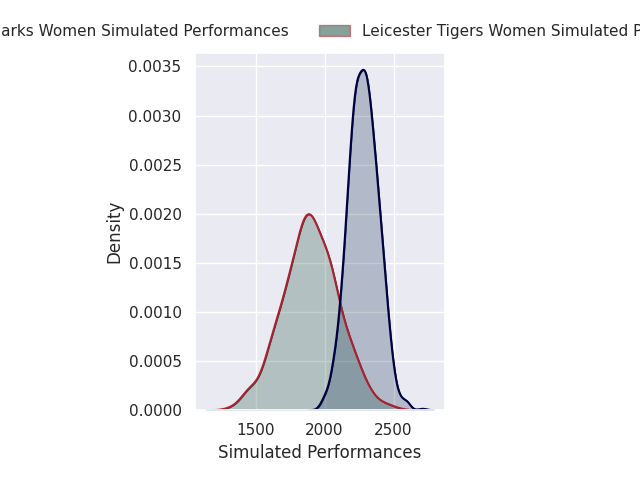
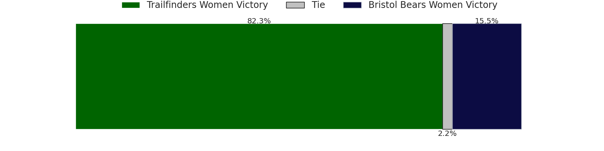
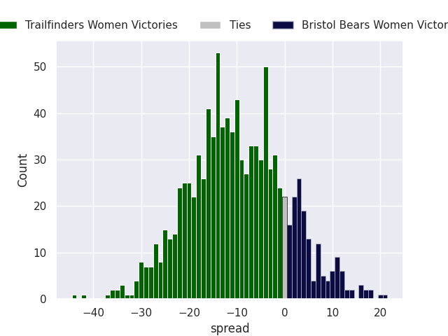
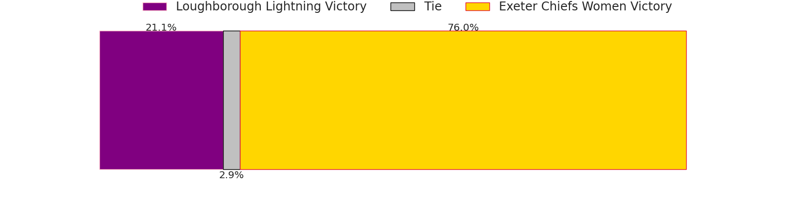
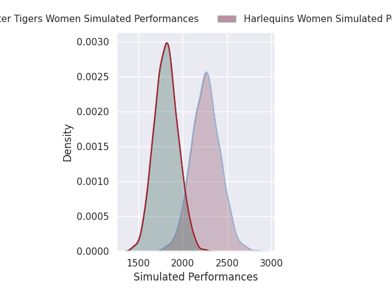
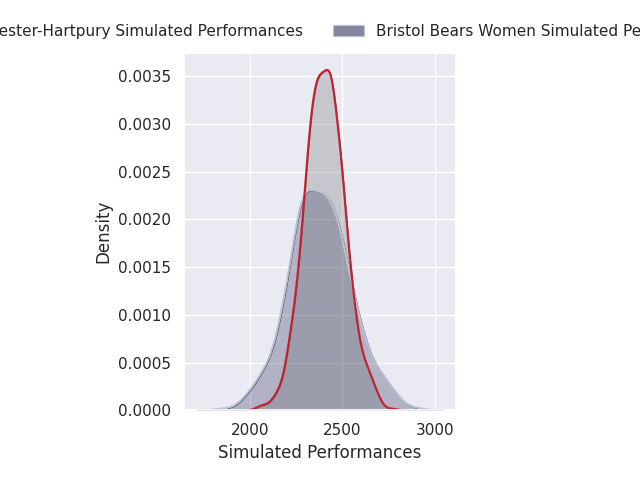
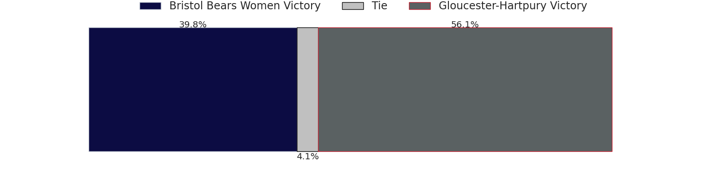
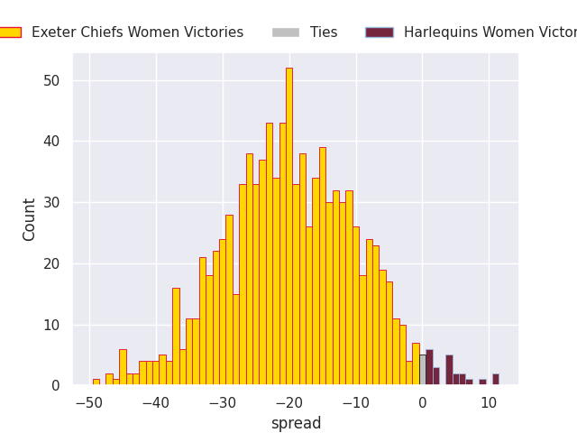

## Team Rankings

## Standings
### Current Standings

| Club                   |   Played |   Wins |   Point Differential |   Losing Bonus Points | Try Bonus Points   |   Competition Points |
|:-----------------------|---------:|-------:|---------------------:|----------------------:|:-------------------|---------------------:|
| Saracens Women         |        1 |      1 |                   86 |                     0 |                    |                    4 |
| Bristol Bears Women    |        1 |      1 |                   27 |                     0 |                    |                    4 |
| Trailfinders Women     |        1 |      1 |                   15 |                     0 |                    |                    4 |
| Sale Sharks Women      |        1 |      1 |                   14 |                     0 |                    |                    4 |
| Gloucester-Hartpury    |        1 |      0 |                  -14 |                     0 |                    |                    0 |
| Loughborough Lightning |        1 |      0 |                  -15 |                     0 |                    |                    0 |
| Harlequins Women       |        1 |      0 |                  -27 |                     0 |                    |                    0 |
| Leicester Tigers Women |        1 |      0 |                  -86 |                     0 |                    |                    0 |

### Projected Remaining Table

| Club                   |   To Play |   Projected Wins |   Projected Differential |   Projected Losing Bonus Points | Projected Try Bonus Points   |   Projected Competition Points |
|:-----------------------|----------:|-----------------:|-------------------------:|--------------------------------:|:-----------------------------|-------------------------------:|
| Exeter Chiefs Women    |         3 |            2.337 |                   31.068 |                           0.385 |                              |                          9.891 |
| Trailfinders Women     |         2 |            1.763 |                   25.981 |                           0.149 |                              |                          7.265 |
| Gloucester-Hartpury    |         2 |            1.495 |                   17.753 |                           0.266 |                              |                          6.35  |
| Sale Sharks Women      |         2 |            1.11  |                    9.547 |                           0.272 |                              |                          4.786 |
| Bristol Bears Women    |         3 |            0.904 |                  -14.69  |                           0.793 |                              |                          4.625 |
| Harlequins Women       |         3 |            1.057 |                  -13.504 |                           0.242 |                              |                          4.506 |
| Saracens Women         |         1 |            0.814 |                    9.488 |                           0.113 |                              |                          3.411 |
| Loughborough Lightning |         2 |            0.266 |                  -24.449 |                           0.372 |                              |                          1.516 |
| Leicester Tigers Women |         2 |            0.051 |                  -41.194 |                           0.165 |                              |                          0.407 |

### Projected Total Table

| Club                   |   Played |   Wins |   Point Differential |   Losing Bonus Points | Try Bonus Points   |   Competition Points |
|:-----------------------|---------:|-------:|---------------------:|----------------------:|:-------------------|---------------------:|
| Trailfinders Women     |        3 |  2.763 |               40.981 |                 0.149 |                    |               11.265 |
| Exeter Chiefs Women    |        3 |  2.337 |               31.068 |                 0.385 |                    |                9.891 |
| Sale Sharks Women      |        3 |  2.11  |               23.547 |                 0.272 |                    |                8.786 |
| Bristol Bears Women    |        4 |  1.904 |               12.31  |                 0.793 |                    |                8.625 |
| Saracens Women         |        2 |  1.814 |               95.488 |                 0.113 |                    |                7.411 |
| Gloucester-Hartpury    |        3 |  1.495 |                3.753 |                 0.266 |                    |                6.35  |
| Harlequins Women       |        4 |  1.057 |              -40.504 |                 0.242 |                    |                4.506 |
| Loughborough Lightning |        3 |  0.266 |              -39.449 |                 0.372 |                    |                1.516 |
| Leicester Tigers Women |        3 |  0.051 |             -127.194 |                 0.165 |                    |                0.407 |

## Completed Match Review

| Model | Percent Correct Predictions | Spread Error |
| ------ | ------ | ------ |
| Club Level | 71.4% | 12.6 |
| Player Level: Lineup | nan% | nan |
| Player Level: Minutes | nan% | nan |

## Future Predictions
### Week 2
#### Bristol Bears Women V Exeter Chiefs Women on 2026/11/28

Average Margin: Exeter Chiefs Women by 3.5

#### Gloucester-Hartpury V Loughborough Lightning on 2026/11/28

Average Margin: Gloucester-Hartpury by 16.5

#### Trailfinders Women V Harlequins Ladies on 2026/11/28

Average Margin: Trailfinders Women by 16.0

#### Leicester Tigers Women V Sale Sharks Women on 2026/11/29

Average Margin: Sale Sharks Women by 19.0

### Week 3
#### Trailfinders Women V Bristol Bears Women on 2026/12/04

Average Margin: Trailfinders Women by 9.9

#### Sale Sharks Women V Saracens Women on 2026/12/05

Average Margin: Saracens Women by 9.5

#### Loughborough Lightning V Exeter Chiefs Women on 2026/12/06

Average Margin: Exeter Chiefs Women by 8.0

#### Harlequins Women V Leicester Tigers Women on 2026/12/06

Average Margin: Harlequins Women by 22.2

### Week 4
#### Bristol Bears Women V Gloucester-Hartpury on 2026/12/11

Average Margin: Gloucester-Hartpury by 1.3

#### Exeter Chiefs Women V Harlequins Women on 2026/12/12

Average Margin: Exeter Chiefs Women by 19.6

