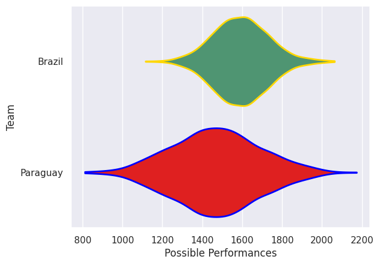
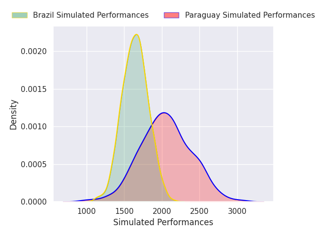
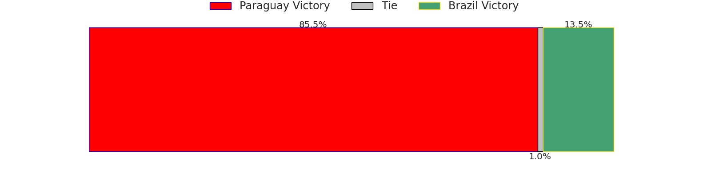
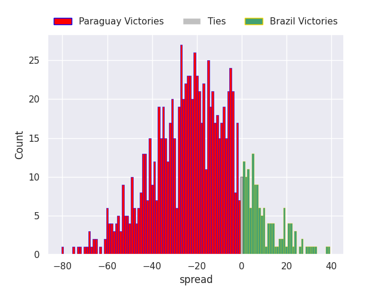

## Team Rankings

## Standings
### Projected Remaining Table

| Club     |   To Play |   Projected Wins |   Projected Differential |   Projected Losing Bonus Points | Projected Try Bonus Points   |   Projected Competition Points |
|:---------|----------:|-----------------:|-------------------------:|--------------------------------:|:-----------------------------|-------------------------------:|
| Paraguay |         1 |            0.855 |                   20.326 |                           0.07  |                              |                          3.51  |
| Brazil   |         1 |            0.135 |                  -20.326 |                           0.113 |                              |                          0.673 |

### Projected Total Table

| Club     |   Played |   Wins |   Point Differential |   Losing Bonus Points | Try Bonus Points   |   Competition Points |
|:---------|---------:|-------:|---------------------:|----------------------:|:-------------------|---------------------:|
| Paraguay |        1 |  0.855 |               20.326 |                 0.07  |                    |                3.51  |
| Brazil   |        1 |  0.135 |              -20.326 |                 0.113 |                    |                0.673 |

## Future Predictions
### Week 1
#### Paraguay V Brazil on 2026/11/14

Average Margin: Paraguay by 20.3

