## Team Rankings

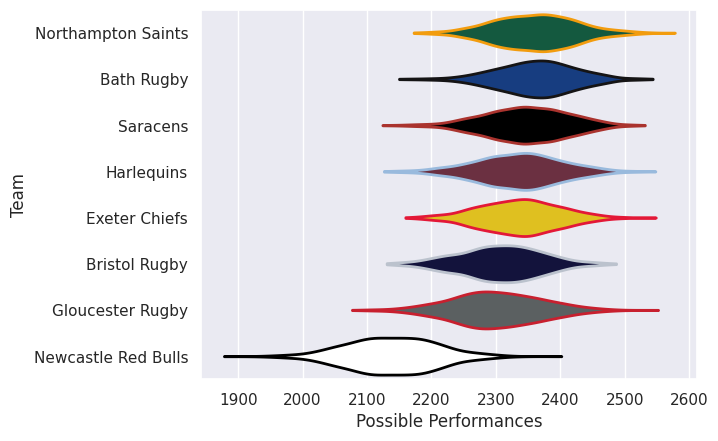
## Standings
### Projected Remaining Table

| Club                |   To Play |   Projected Wins |   Projected Differential |   Projected Losing Bonus Points | Projected Try Bonus Points   |   Projected Competition Points |
|:--------------------|----------:|-----------------:|-------------------------:|--------------------------------:|:-----------------------------|-------------------------------:|
| Exeter Chiefs       |         2 |            1.206 |                    4.709 |                           0.541 |                              |                          5.557 |
| Bath Rugby          |         2 |            1.181 |                    4.316 |                           0.553 |                              |                          5.463 |
| Saracens            |         2 |            1.037 |                    1.738 |                           0.568 |                              |                          4.892 |
| Harlequins          |         2 |            0.941 |                   -0.408 |                           0.565 |                              |                          4.487 |
| Northampton Saints  |         1 |            0.828 |                    7.049 |                           0.128 |                              |                          3.498 |
| Leicester Tigers    |         1 |            0.683 |                    3.765 |                           0.224 |                              |                          3.058 |
| Sale Sharks         |         1 |            0.549 |                    1.18  |                           0.324 |                              |                          2.636 |
| Bristol Rugby       |         1 |            0.536 |                    1.141 |                           0.332 |                              |                          2.596 |
| Gloucester Rugby    |         2 |            0.339 |                  -11.346 |                           0.819 |                              |                          2.317 |
| Newcastle Red Bulls |         2 |            0.352 |                  -12.144 |                           0.738 |                              |                          2.288 |

### Projected Total Table

| Club                |   Played |   Wins |   Point Differential |   Losing Bonus Points | Try Bonus Points   |   Competition Points |
|:--------------------|---------:|-------:|---------------------:|----------------------:|:-------------------|---------------------:|
| Exeter Chiefs       |        2 |  1.206 |                4.709 |                 0.541 |                    |                5.557 |
| Bath Rugby          |        2 |  1.181 |                4.316 |                 0.553 |                    |                5.463 |
| Saracens            |        2 |  1.037 |                1.738 |                 0.568 |                    |                4.892 |
| Harlequins          |        2 |  0.941 |               -0.408 |                 0.565 |                    |                4.487 |
| Northampton Saints  |        1 |  0.828 |                7.049 |                 0.128 |                    |                3.498 |
| Leicester Tigers    |        1 |  0.683 |                3.765 |                 0.224 |                    |                3.058 |
| Sale Sharks         |        1 |  0.549 |                1.18  |                 0.324 |                    |                2.636 |
| Bristol Rugby       |        1 |  0.536 |                1.141 |                 0.332 |                    |                2.596 |
| Gloucester Rugby    |        2 |  0.339 |              -11.346 |                 0.819 |                    |                2.317 |
| Newcastle Red Bulls |        2 |  0.352 |              -12.144 |                 0.738 |                    |                2.288 |

## Future Predictions
### Week 1
#### Sale Sharks V Exeter Chiefs on 2026/11/13

Average Margin: Sale Sharks by 1.2

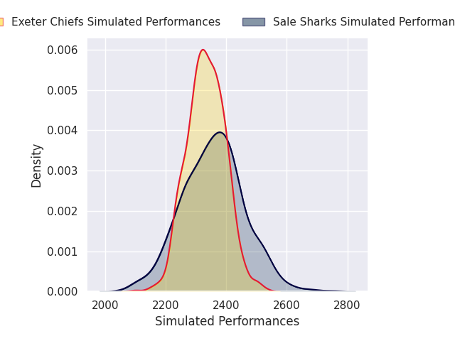

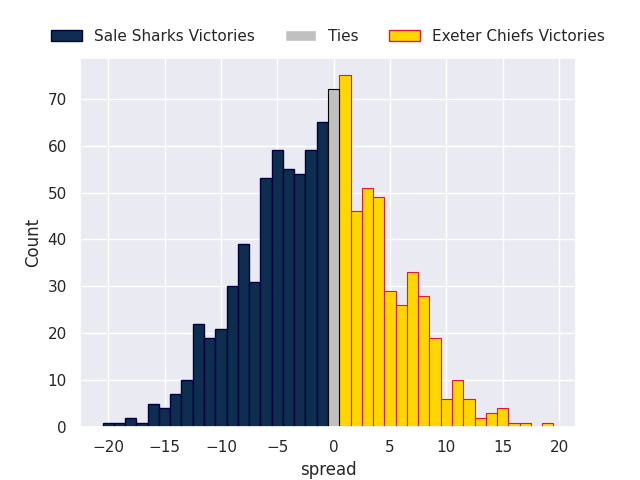

#### Newcastle Red Bulls V Harlequins on 2026/11/14

Average Margin: Harlequins by 5.1

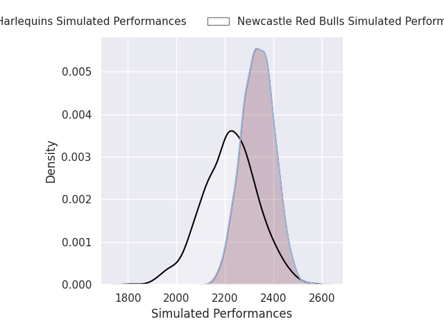
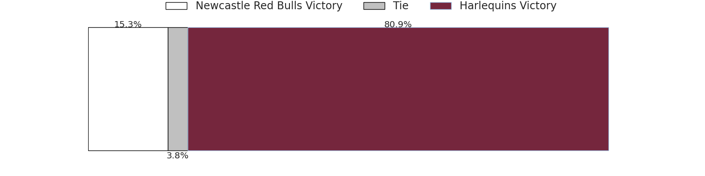
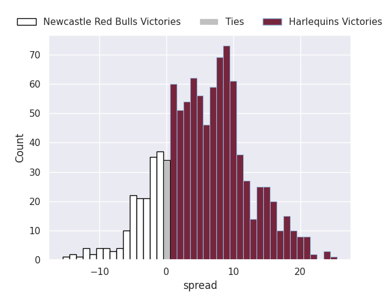

#### Bath Rugby V Gloucester Rugby on 2026/11/14

Average Margin: Bath Rugby by 5.5

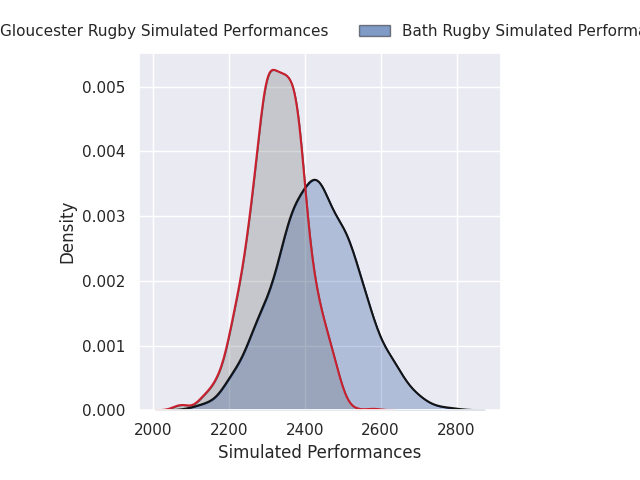
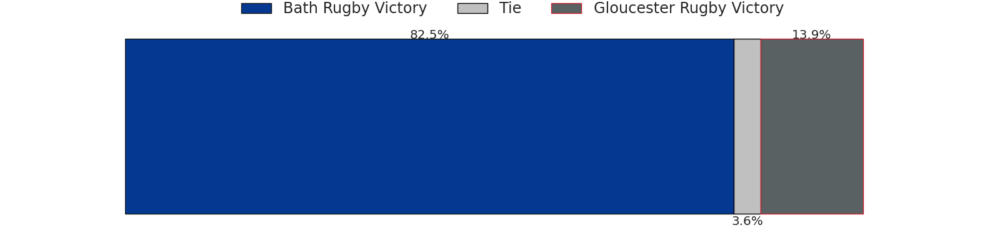
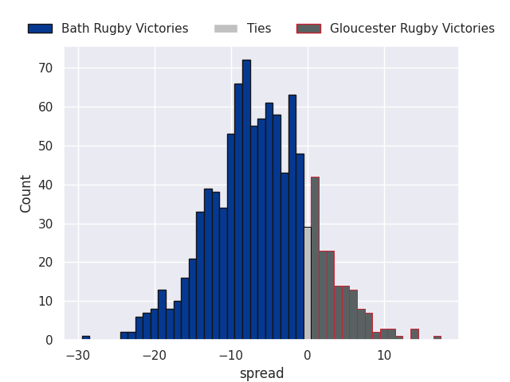

#### Leicester Tigers V Saracens on 2026/11/15

Average Margin: Leicester Tigers by 3.8

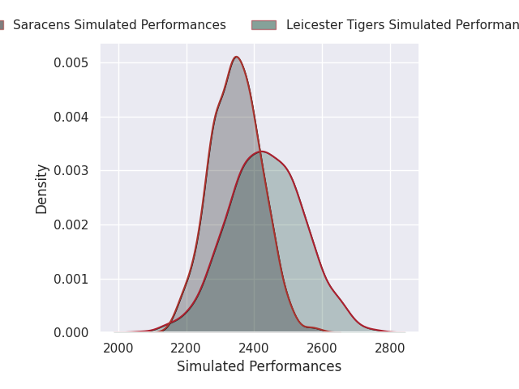

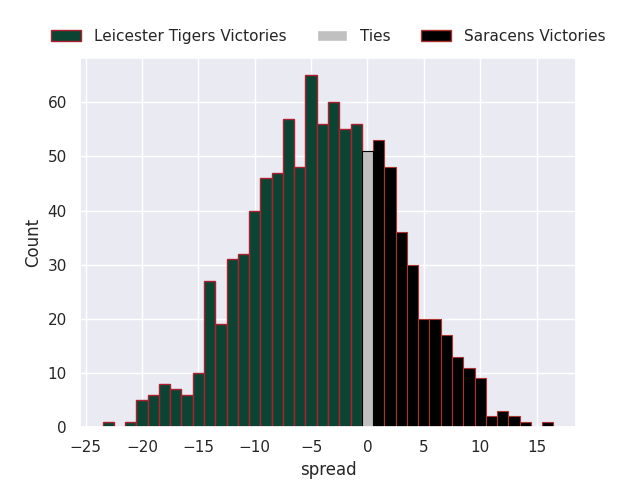

### Week 2
#### Bristol Rugby V Bath Rugby on 2026/11/20

Average Margin: Bristol Rugby by 1.1

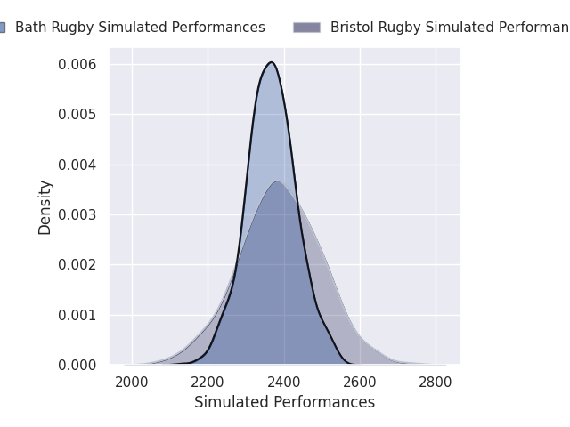

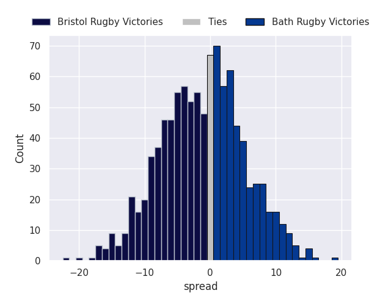

#### Exeter Chiefs V Gloucester Rugby on 2026/11/21

Average Margin: Exeter Chiefs by 5.9

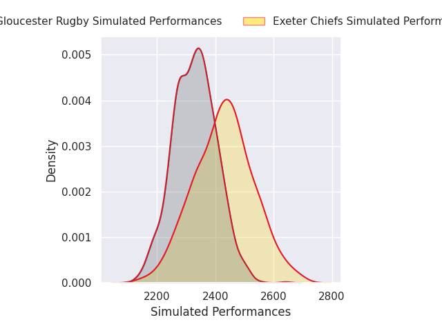
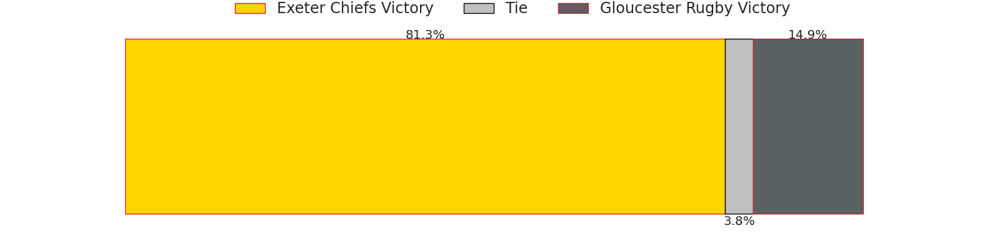
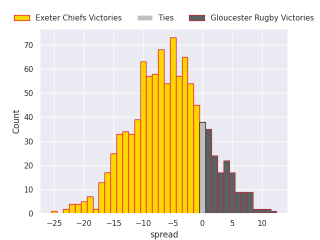

#### Newcastle Red Bulls V Northampton Saints on 2026/11/21

Average Margin: Northampton Saints by 7.0

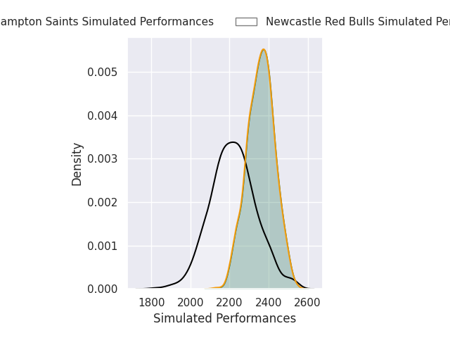
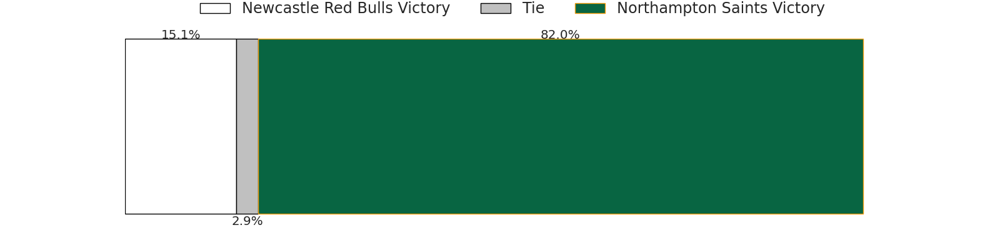
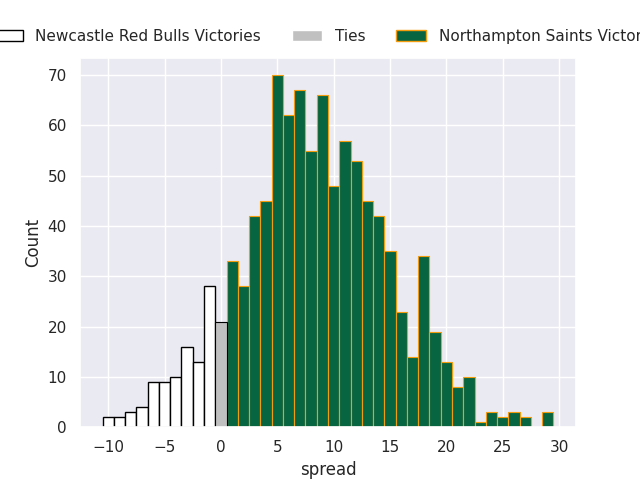

#### Saracens V Harlequins on 2026/11/21

Average Margin: Saracens by 5.5

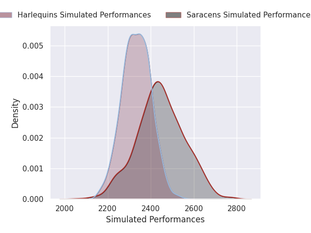

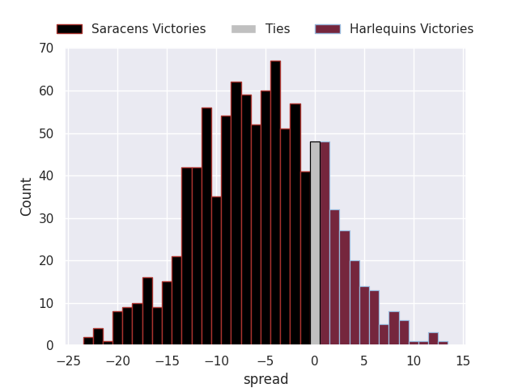

