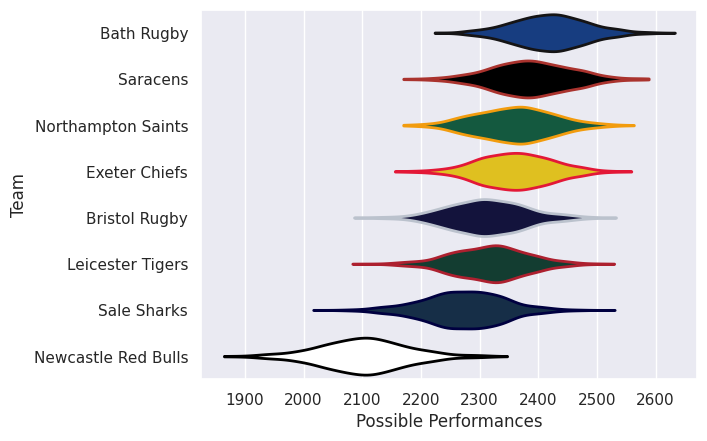
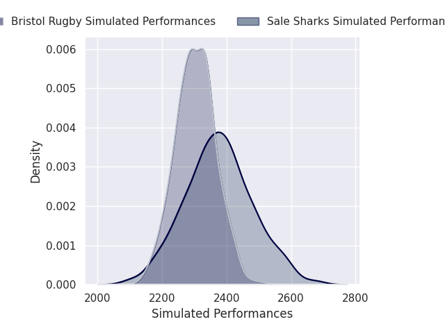
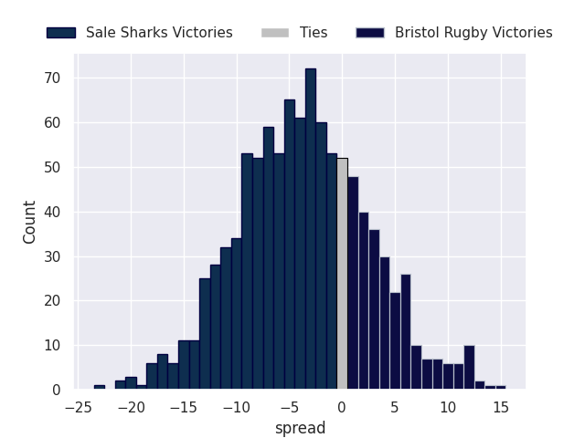
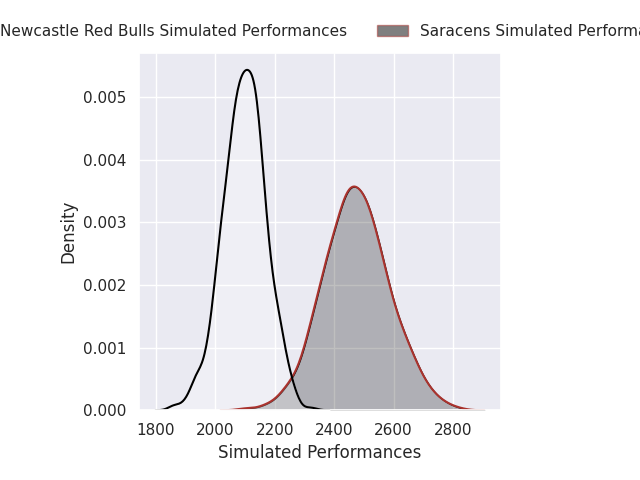
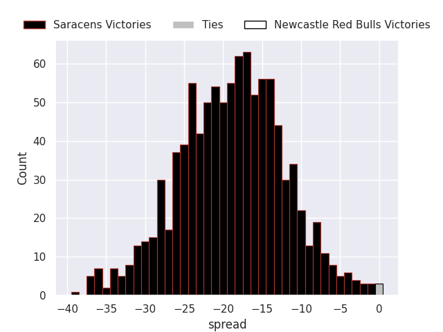
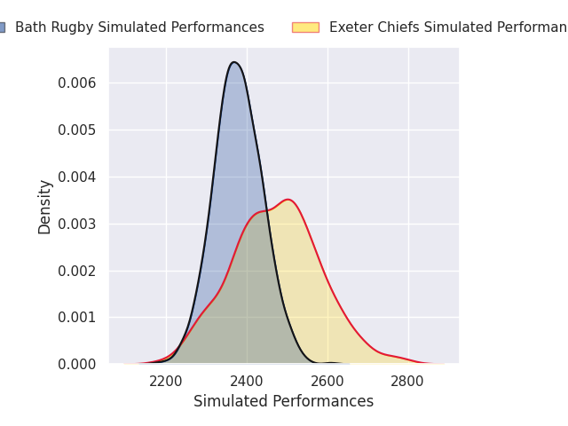
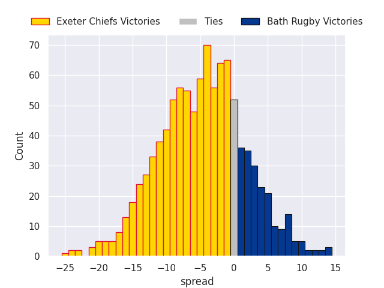

## Team Rankings

## Standings
### Projected Remaining Table

| Club                |   To Play |   Projected Wins |   Projected Differential |   Projected Losing Bonus Points | Projected Try Bonus Points   |   Projected Competition Points |
|:--------------------|----------:|-----------------:|-------------------------:|--------------------------------:|:-----------------------------|-------------------------------:|
| Saracens            |         1 |            0.997 |                   18.897 |                           0     |                              |                          3.994 |
| Northampton Saints  |         1 |            0.887 |                    7.614 |                           0.073 |                              |                          3.687 |
| Exeter Chiefs       |         1 |            0.751 |                    4.69  |                           0.164 |                              |                          3.272 |
| Sale Sharks         |         1 |            0.696 |                    3.626 |                           0.212 |                              |                          3.1   |
| Bristol Rugby       |         1 |            0.252 |                   -3.626 |                           0.423 |                              |                          1.535 |
| Bath Rugby          |         1 |            0.197 |                   -4.69  |                           0.417 |                              |                          1.309 |
| Leicester Tigers    |         1 |            0.08  |                   -7.614 |                           0.379 |                              |                          0.765 |
| Newcastle Red Bulls |         1 |            0     |                  -18.897 |                           0.04  |                              |                          0.046 |

### Projected Total Table

| Club                |   Played |   Wins |   Point Differential |   Losing Bonus Points | Try Bonus Points   |   Competition Points |
|:--------------------|---------:|-------:|---------------------:|----------------------:|:-------------------|---------------------:|
| Saracens            |        1 |  0.997 |               18.897 |                 0     |                    |                3.994 |
| Northampton Saints  |        1 |  0.887 |                7.614 |                 0.073 |                    |                3.687 |
| Exeter Chiefs       |        1 |  0.751 |                4.69  |                 0.164 |                    |                3.272 |
| Sale Sharks         |        1 |  0.696 |                3.626 |                 0.212 |                    |                3.1   |
| Bristol Rugby       |        1 |  0.252 |               -3.626 |                 0.423 |                    |                1.535 |
| Bath Rugby          |        1 |  0.197 |               -4.69  |                 0.417 |                    |                1.309 |
| Leicester Tigers    |        1 |  0.08  |               -7.614 |                 0.379 |                    |                0.765 |
| Newcastle Red Bulls |        1 |  0     |              -18.897 |                 0.04  |                    |                0.046 |

## Future Predictions
### Week 1
#### Northampton Saints V Leicester Tigers on 2026/11/06

Average Margin: Northampton Saints by 7.6

#### Sale Sharks V Bristol Rugby on 2026/11/06

Average Margin: Sale Sharks by 3.6

#### Saracens V Newcastle Red Bulls on 2026/11/07

Average Margin: Saracens by 18.9

#### Exeter Chiefs V Bath Rugby on 2026/11/07

Average Margin: Exeter Chiefs by 4.7

