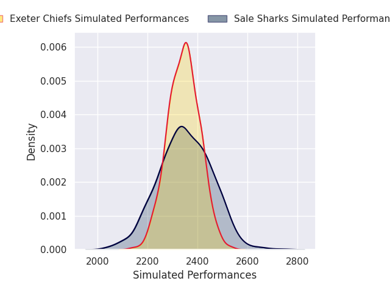
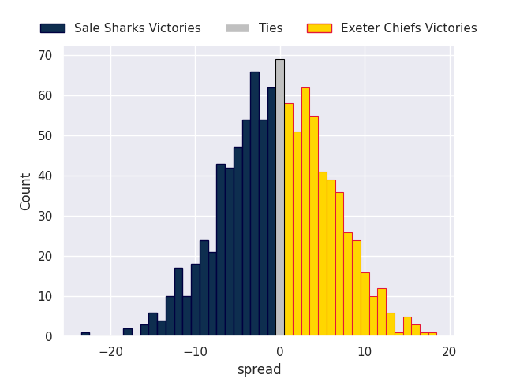
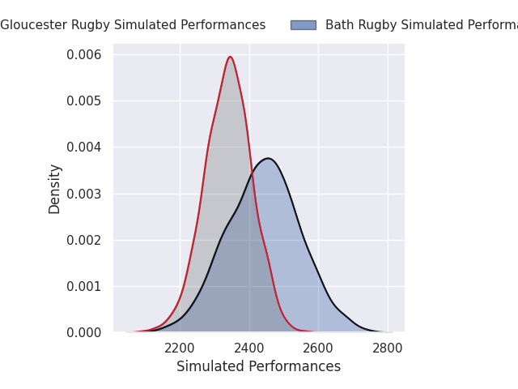
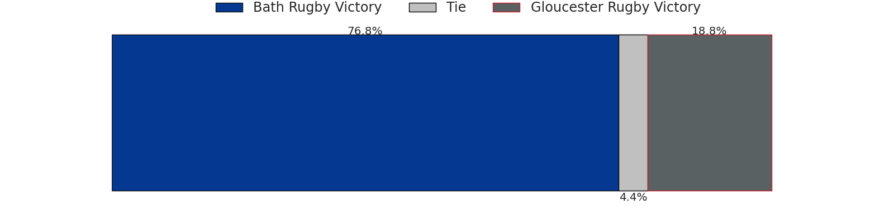
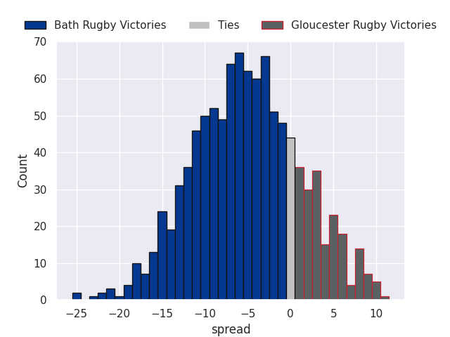
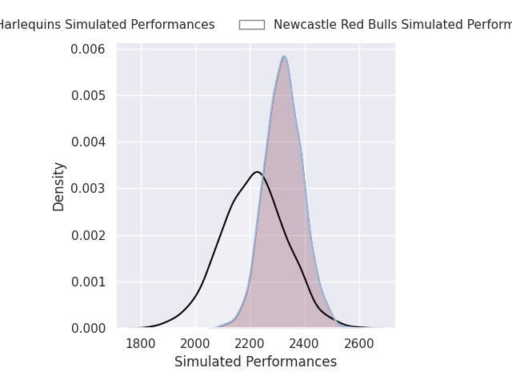
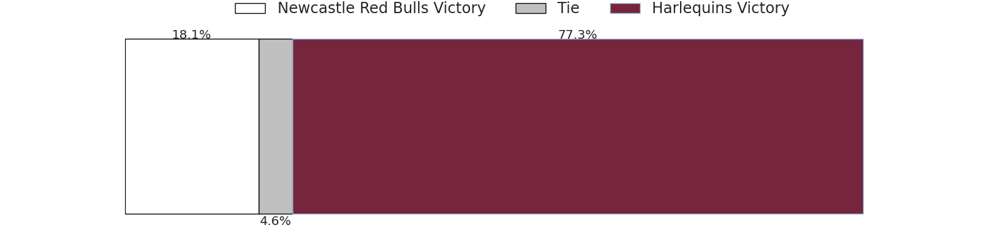
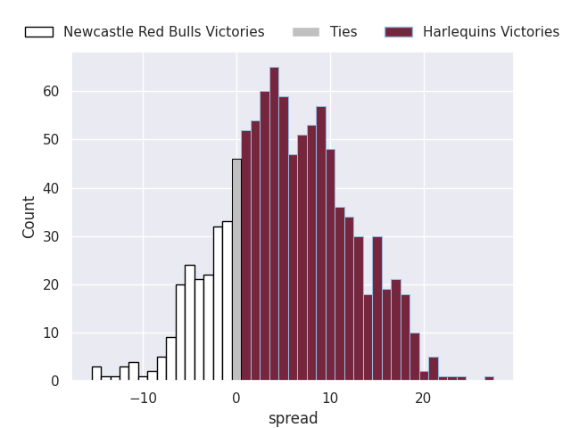
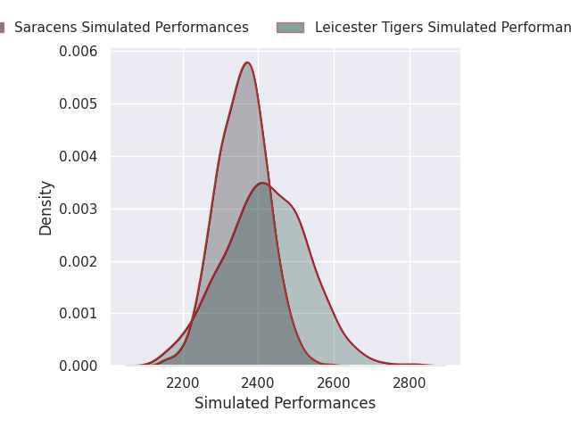
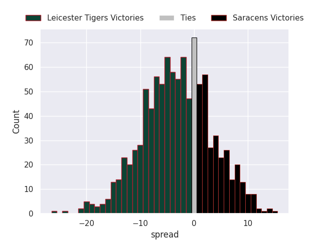

## Team Rankings

## Standings
### Projected Remaining Table

| Club                |   To Play |   Projected Wins |   Projected Differential |   Projected Losing Bonus Points | Projected Try Bonus Points   |   Projected Competition Points |
|:--------------------|----------:|-----------------:|-------------------------:|--------------------------------:|:-----------------------------|-------------------------------:|
| Saracens            |         2 |            1.278 |                   13.321 |                           0.404 |                              |                          5.664 |
| Exeter Chiefs       |         2 |            1.207 |                    4.825 |                           0.543 |                              |                          5.597 |
| Sale Sharks         |         2 |            1.038 |                    2.019 |                           0.646 |                              |                          5.07  |
| Bath Rugby          |         2 |            0.964 |                   -0.003 |                           0.556 |                              |                          4.588 |
| Leicester Tigers    |         2 |            0.767 |                   -3.011 |                           0.643 |                              |                          3.939 |
| Northampton Saints  |         1 |            0.832 |                    6.128 |                           0.109 |                              |                          3.521 |
| Harlequins          |         1 |            0.773 |                    5.493 |                           0.161 |                              |                          3.345 |
| Bristol Rugby       |         1 |            0.379 |                   -1.731 |                           0.35  |                              |                          2     |
| Newcastle Red Bulls |         2 |            0.188 |                  -21.931 |                           0.458 |                              |                          1.306 |
| Gloucester Rugby    |         1 |            0.188 |                   -5.11  |                           0.418 |                              |                          1.258 |

### Projected Total Table

| Club                |   Played |   Wins |   Point Differential |   Losing Bonus Points | Try Bonus Points   |   Competition Points |
|:--------------------|---------:|-------:|---------------------:|----------------------:|:-------------------|---------------------:|
| Saracens            |        2 |  1.278 |               13.321 |                 0.404 |                    |                5.664 |
| Exeter Chiefs       |        2 |  1.207 |                4.825 |                 0.543 |                    |                5.597 |
| Sale Sharks         |        2 |  1.038 |                2.019 |                 0.646 |                    |                5.07  |
| Bath Rugby          |        2 |  0.964 |               -0.003 |                 0.556 |                    |                4.588 |
| Leicester Tigers    |        2 |  0.767 |               -3.011 |                 0.643 |                    |                3.939 |
| Northampton Saints  |        1 |  0.832 |                6.128 |                 0.109 |                    |                3.521 |
| Harlequins          |        1 |  0.773 |                5.493 |                 0.161 |                    |                3.345 |
| Bristol Rugby       |        1 |  0.379 |               -1.731 |                 0.35  |                    |                2     |
| Newcastle Red Bulls |        2 |  0.188 |              -21.931 |                 0.458 |                    |                1.306 |
| Gloucester Rugby    |        1 |  0.188 |               -5.11  |                 0.418 |                    |                1.258 |

## Future Predictions
### Week 1
#### Northampton Saints V Leicester Tigers on 2026/11/06

Average Margin: Northampton Saints by 6.1

#### Sale Sharks V Bristol Rugby on 2026/11/06

Average Margin: Sale Sharks by 1.7

#### Exeter Chiefs V Bath Rugby on 2026/11/07

Average Margin: Exeter Chiefs by 5.1

#### Saracens V Newcastle Red Bulls on 2026/11/07

Average Margin: Saracens by 16.4

### Week 2
#### Sale Sharks V Exeter Chiefs on 2026/11/13

Average Margin: Sale Sharks by 0.3

#### Bath Rugby V Gloucester Rugby on 2026/11/14

Average Margin: Bath Rugby by 5.1

#### Newcastle Red Bulls V Harlequins on 2026/11/14

Average Margin: Harlequins by 5.5

#### Leicester Tigers V Saracens on 2026/11/15

Average Margin: Leicester Tigers by 3.1

