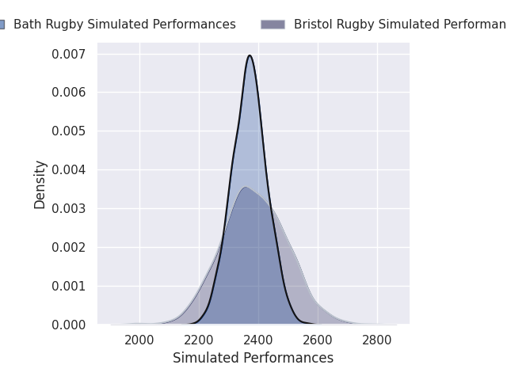
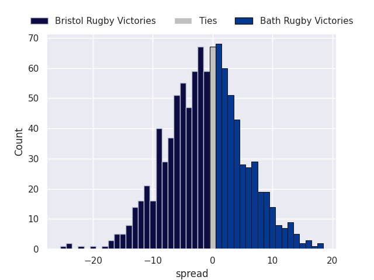
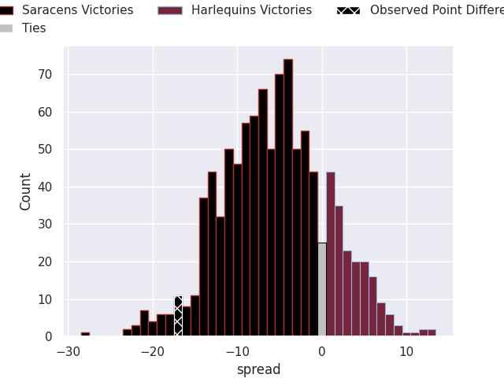
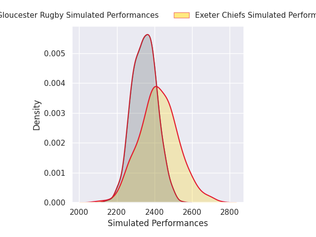

## Team Rankings

## Standings
### Current Standings

| Club                |   Played |   Wins |   Point Differential |   Losing Bonus Points | Try Bonus Points   |   Competition Points |
|:--------------------|---------:|-------:|---------------------:|----------------------:|:-------------------|---------------------:|
| Saracens            |        3 |      3 |                   91 |                     0 |                    |                   12 |
| Harlequins          |        3 |      3 |                   51 |                     0 |                    |                   12 |
| Sale Sharks         |        4 |      3 |                   21 |                     0 |                    |                   12 |
| Gloucester Rugby    |        3 |      2 |                   22 |                     1 |                    |                    9 |
| Bristol Rugby       |        3 |      1 |                  -23 |                     1 |                    |                    5 |
| Exeter Chiefs       |        3 |      1 |                   -6 |                     0 |                    |                    4 |
| Bath Rugby          |        3 |      1 |                  -14 |                     0 |                    |                    4 |
| Newcastle Red Bulls |        3 |      1 |                  -35 |                     0 |                    |                    4 |
| Northampton Saints  |        3 |      1 |                  -49 |                     0 |                    |                    4 |
| Leicester Tigers    |        4 |      0 |                  -58 |                     1 |                    |                    1 |

### Projected Remaining Table

| Club                |   To Play |   Projected Wins |   Projected Differential |   Projected Losing Bonus Points | Projected Try Bonus Points   |   Projected Competition Points |
|:--------------------|----------:|-----------------:|-------------------------:|--------------------------------:|:-----------------------------|-------------------------------:|
| Northampton Saints  |         1 |            0.886 |                    8.295 |                           0.084 |                              |                          3.668 |
| Saracens            |         1 |            0.803 |                    5.892 |                           0.132 |                              |                          3.43  |
| Exeter Chiefs       |         1 |            0.723 |                    3.797 |                           0.202 |                              |                          3.184 |
| Bristol Rugby       |         1 |            0.539 |                    1.047 |                           0.329 |                              |                          2.595 |
| Bath Rugby          |         1 |            0.406 |                   -1.047 |                           0.386 |                              |                          2.12  |
| Gloucester Rugby    |         1 |            0.232 |                   -3.797 |                           0.471 |                              |                          1.489 |
| Harlequins          |         1 |            0.154 |                   -5.892 |                           0.413 |                              |                          1.115 |
| Newcastle Red Bulls |         1 |            0.094 |                   -8.295 |                           0.339 |                              |                          0.755 |

### Projected Total Table

| Club                |   Played |   Wins |   Point Differential |   Losing Bonus Points | Try Bonus Points   |   Competition Points |
|:--------------------|---------:|-------:|---------------------:|----------------------:|:-------------------|---------------------:|
| Saracens            |        4 |  3.803 |               96.892 |                 0.132 |                    |               15.43  |
| Harlequins          |        4 |  3.154 |               45.108 |                 0.413 |                    |               13.115 |
| Sale Sharks         |        4 |  3     |               21     |                 0     |                    |               12     |
| Gloucester Rugby    |        4 |  2.232 |               18.203 |                 1.471 |                    |               10.489 |
| Northampton Saints  |        4 |  1.886 |              -40.705 |                 0.084 |                    |                7.668 |
| Bristol Rugby       |        4 |  1.539 |              -21.953 |                 1.329 |                    |                7.595 |
| Exeter Chiefs       |        4 |  1.723 |               -2.203 |                 0.202 |                    |                7.184 |
| Bath Rugby          |        4 |  1.406 |              -15.047 |                 0.386 |                    |                6.12  |
| Newcastle Red Bulls |        4 |  1.094 |              -43.295 |                 0.339 |                    |                4.755 |
| Leicester Tigers    |        4 |  0     |              -58     |                 1     |                    |                1     |

## Completed Match Review

| Model | Percent Correct Predictions | Spread Error |
| ------ | ------ | ------ |
| Club Level | 60.0% | 15.0 |
| Player Level: Lineup | nan% | nan |
| Player Level: Minutes | nan% | nan |

## Future Predictions
### Week 5
#### Bristol Rugby V Bath Rugby on 2026/11/20

Average Margin: Bristol Rugby by 1.0

#### Newcastle Red Bulls V Northampton Saints on 2026/11/21

Average Margin: Northampton Saints by 8.3

#### Saracens V Harlequins on 2026/11/21

Average Margin: Saracens by 5.9

#### Exeter Chiefs V Gloucester Rugby on 2026/11/21

Average Margin: Exeter Chiefs by 3.8

