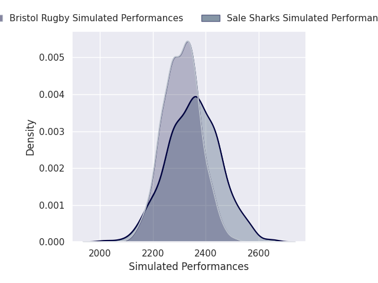
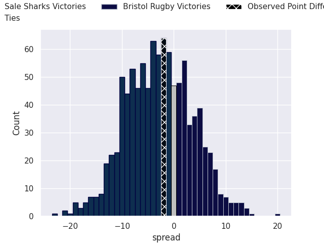
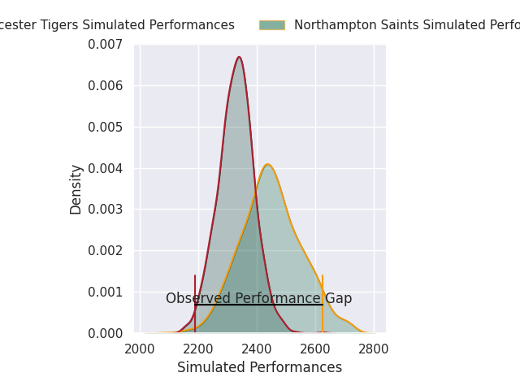
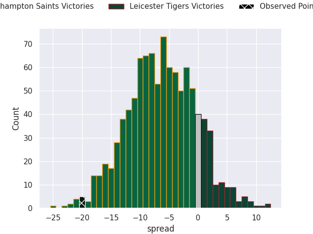
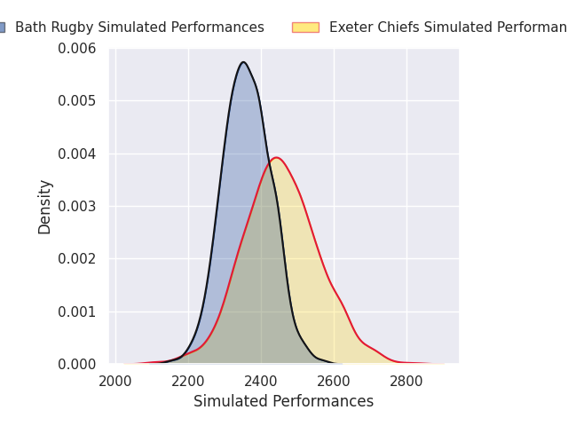
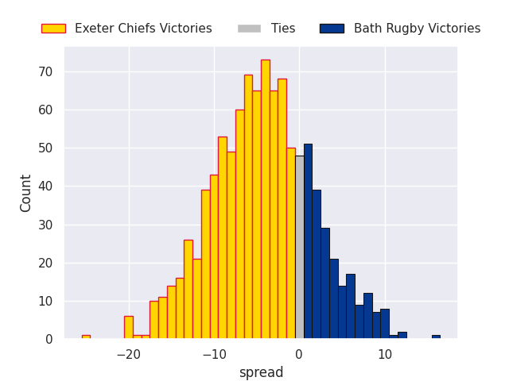
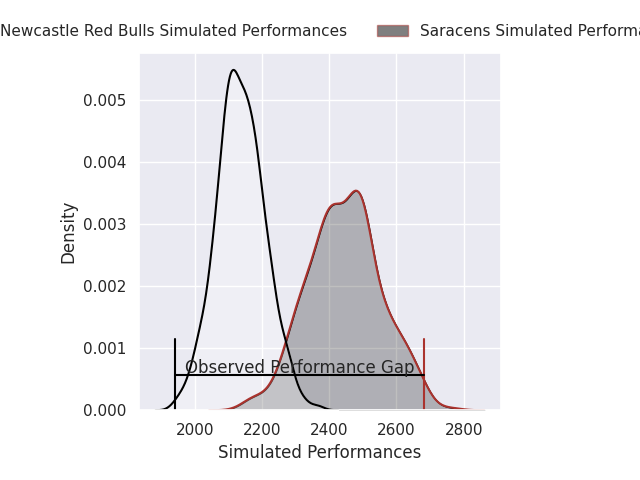
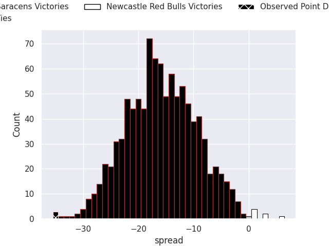

## Team Rankings

## Standings
### Current Standings

| Club                |   Played |   Wins |   Point Differential |   Losing Bonus Points | Try Bonus Points   |   Competition Points |
|:--------------------|---------:|-------:|---------------------:|----------------------:|:-------------------|---------------------:|
| Harlequins          |        2 |      2 |                   39 |                     0 |                    |                    8 |
| Gloucester Rugby    |        2 |      1 |                   14 |                     1 |                    |                    5 |
| Saracens            |        1 |      1 |                   54 |                     0 |                    |                    4 |
| Exeter Chiefs       |        1 |      1 |                   24 |                     0 |                    |                    4 |
| Newcastle Red Bulls |        1 |      1 |                   12 |                     0 |                    |                    4 |
| Sale Sharks         |        2 |      1 |                    5 |                     0 |                    |                    4 |
| Bristol Rugby       |        2 |      1 |                  -21 |                     0 |                    |                    4 |
| Bath Rugby          |        1 |      0 |                  -22 |                     0 |                    |                    0 |
| Leicester Tigers    |        2 |      0 |                  -36 |                     0 |                    |                    0 |
| Northampton Saints  |        2 |      0 |                  -69 |                     0 |                    |                    0 |

### Projected Remaining Table

| Club                |   To Play |   Projected Wins |   Projected Differential |   Projected Losing Bonus Points | Projected Try Bonus Points   |   Projected Competition Points |
|:--------------------|----------:|-----------------:|-------------------------:|--------------------------------:|:-----------------------------|-------------------------------:|
| Saracens            |         1 |            0.981 |                   15.191 |                           0.014 |                              |                          3.948 |
| Northampton Saints  |         1 |            0.814 |                    6.272 |                           0.131 |                              |                          3.459 |
| Exeter Chiefs       |         1 |            0.729 |                    4.183 |                           0.189 |                              |                          3.217 |
| Sale Sharks         |         1 |            0.637 |                    2.488 |                           0.244 |                              |                          2.902 |
| Bristol Rugby       |         1 |            0.308 |                   -2.488 |                           0.423 |                              |                          1.765 |
| Bath Rugby          |         1 |            0.215 |                   -4.183 |                           0.452 |                              |                          1.424 |
| Leicester Tigers    |         1 |            0.15  |                   -6.272 |                           0.386 |                              |                          1.058 |
| Newcastle Red Bulls |         1 |            0.014 |                  -15.191 |                           0.113 |                              |                          0.179 |

### Projected Total Table

| Club                |   Played |   Wins |   Point Differential |   Losing Bonus Points | Try Bonus Points   |   Competition Points |
|:--------------------|---------:|-------:|---------------------:|----------------------:|:-------------------|---------------------:|
| Harlequins          |        2 |  2     |               39     |                 0     |                    |                8     |
| Saracens            |        2 |  1.981 |               69.191 |                 0.014 |                    |                7.948 |
| Exeter Chiefs       |        2 |  1.729 |               28.183 |                 0.189 |                    |                7.217 |
| Sale Sharks         |        3 |  1.637 |                7.488 |                 0.244 |                    |                6.902 |
| Bristol Rugby       |        3 |  1.308 |              -23.488 |                 0.423 |                    |                5.765 |
| Gloucester Rugby    |        2 |  1     |               14     |                 1     |                    |                5     |
| Newcastle Red Bulls |        2 |  1.014 |               -3.191 |                 0.113 |                    |                4.179 |
| Northampton Saints  |        3 |  0.814 |              -62.728 |                 0.131 |                    |                3.459 |
| Bath Rugby          |        2 |  0.215 |              -26.183 |                 0.452 |                    |                1.424 |
| Leicester Tigers    |        3 |  0.15  |              -42.272 |                 0.386 |                    |                1.058 |

## Completed Match Review

| Model | Percent Correct Predictions | Spread Error |
| ------ | ------ | ------ |
| Club Level | 58.3% | 17.2 |
| Player Level: Lineup | nan% | nan |
| Player Level: Minutes | nan% | nan |

## Future Predictions
### Week 3
#### Sale Sharks V Bristol Rugby on 2026/11/06

Average Margin: Sale Sharks by 2.5

#### Northampton Saints V Leicester Tigers on 2026/11/06

Average Margin: Northampton Saints by 6.3

#### Exeter Chiefs V Bath Rugby on 2026/11/07

Average Margin: Exeter Chiefs by 4.2

#### Saracens V Newcastle Red Bulls on 2026/11/07

Average Margin: Saracens by 15.2

