## Team Rankings

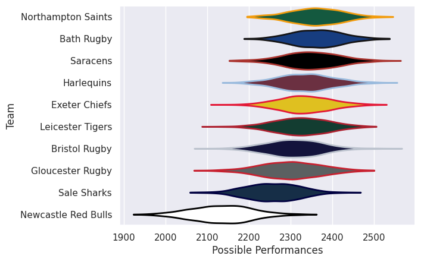
## Standings
### Current Standings

| Club                |   Played |   Wins |   Point Differential |   Losing Bonus Points | Try Bonus Points   |   Competition Points |
|:--------------------|---------:|-------:|---------------------:|----------------------:|:-------------------|---------------------:|
| Saracens            |        2 |      2 |                   89 |                     0 |                    |                    8 |
| Harlequins          |        2 |      2 |                   39 |                     0 |                    |                    8 |
| Sale Sharks         |        3 |      2 |                    7 |                     0 |                    |                    8 |
| Gloucester Rugby    |        2 |      1 |                   14 |                     1 |                    |                    5 |
| Bristol Rugby       |        3 |      1 |                  -23 |                     1 |                    |                    5 |
| Exeter Chiefs       |        2 |      1 |                    8 |                     0 |                    |                    4 |
| Bath Rugby          |        2 |      1 |                   -6 |                     0 |                    |                    4 |
| Newcastle Red Bulls |        2 |      1 |                  -23 |                     0 |                    |                    4 |
| Northampton Saints  |        3 |      1 |                  -49 |                     0 |                    |                    4 |
| Leicester Tigers    |        3 |      0 |                  -56 |                     0 |                    |                    0 |

### Projected Remaining Table

| Club                |   To Play |   Projected Wins |   Projected Differential |   Projected Losing Bonus Points | Projected Try Bonus Points   |   Projected Competition Points |
|:--------------------|----------:|-----------------:|-------------------------:|--------------------------------:|:-----------------------------|-------------------------------:|
| Bath Rugby          |         1 |            0.822 |                    6.171 |                           0.124 |                              |                          3.5   |
| Harlequins          |         1 |            0.796 |                    5.94  |                           0.152 |                              |                          3.406 |
| Leicester Tigers    |         1 |            0.677 |                    3.378 |                           0.22  |                              |                          3.056 |
| Sale Sharks         |         1 |            0.607 |                    2.129 |                           0.274 |                              |                          2.838 |
| Exeter Chiefs       |         1 |            0.325 |                   -2.129 |                           0.439 |                              |                          1.875 |
| Saracens            |         1 |            0.259 |                   -3.378 |                           0.428 |                              |                          1.592 |
| Newcastle Red Bulls |         1 |            0.169 |                   -5.94  |                           0.391 |                              |                          1.137 |
| Gloucester Rugby    |         1 |            0.134 |                   -6.171 |                           0.408 |                              |                          1.032 |

### Projected Total Table

| Club                |   Played |   Wins |   Point Differential |   Losing Bonus Points | Try Bonus Points   |   Competition Points |
|:--------------------|---------:|-------:|---------------------:|----------------------:|:-------------------|---------------------:|
| Harlequins          |        3 |  2.796 |               44.94  |                 0.152 |                    |               11.406 |
| Sale Sharks         |        4 |  2.607 |                9.129 |                 0.274 |                    |               10.838 |
| Saracens            |        3 |  2.259 |               85.622 |                 0.428 |                    |                9.592 |
| Bath Rugby          |        3 |  1.822 |                0.171 |                 0.124 |                    |                7.5   |
| Gloucester Rugby    |        3 |  1.134 |                7.829 |                 1.408 |                    |                6.032 |
| Exeter Chiefs       |        3 |  1.325 |                5.871 |                 0.439 |                    |                5.875 |
| Newcastle Red Bulls |        3 |  1.169 |              -28.94  |                 0.391 |                    |                5.137 |
| Bristol Rugby       |        3 |  1     |              -23     |                 1     |                    |                5     |
| Northampton Saints  |        3 |  1     |              -49     |                 0     |                    |                4     |
| Leicester Tigers    |        4 |  0.677 |              -52.622 |                 0.22  |                    |                3.056 |

## Completed Match Review

| Model | Percent Correct Predictions | Spread Error |
| ------ | ------ | ------ |
| Club Level | 68.8% | 15.7 |
| Player Level: Lineup | nan% | nan |
| Player Level: Minutes | nan% | nan |

## Future Predictions
### Week 4
#### Sale Sharks V Exeter Chiefs on 2026/11/13

Average Margin: Sale Sharks by 2.1

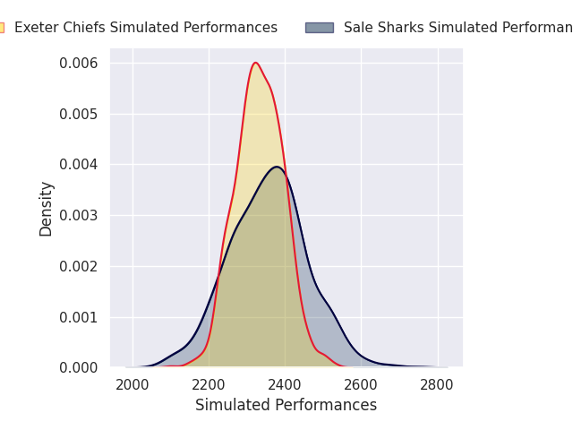

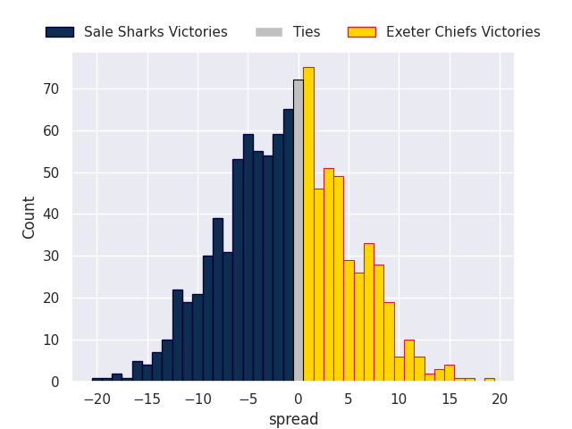

#### Bath Rugby V Gloucester Rugby on 2026/11/14

Average Margin: Bath Rugby by 6.2

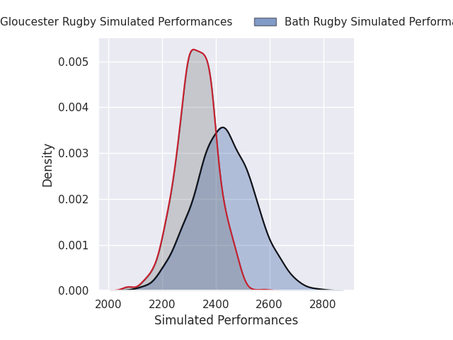
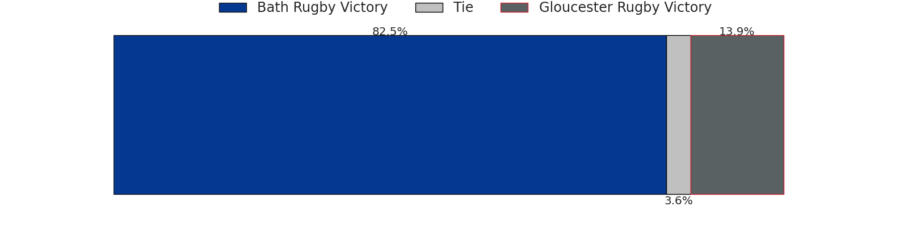
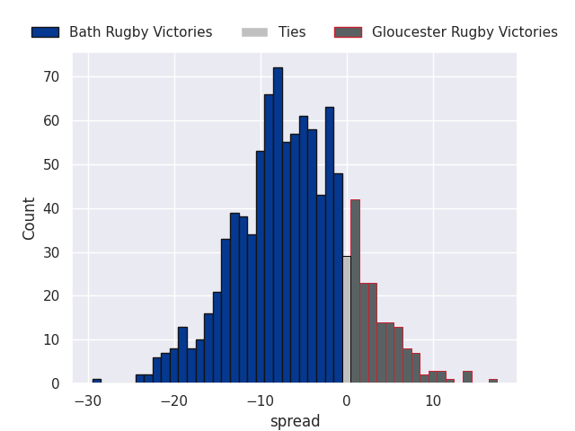

#### Newcastle Red Bulls V Harlequins on 2026/11/14

Average Margin: Harlequins by 5.9

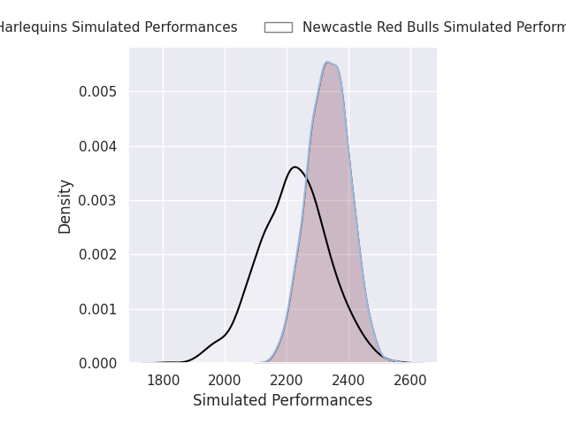
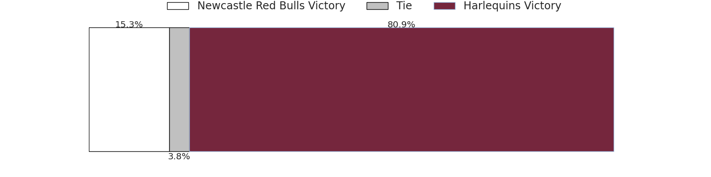
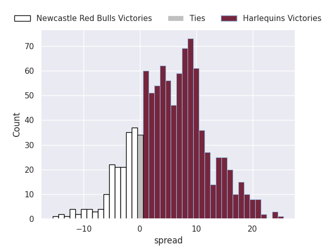

#### Leicester Tigers V Saracens on 2026/11/15

Average Margin: Leicester Tigers by 3.4

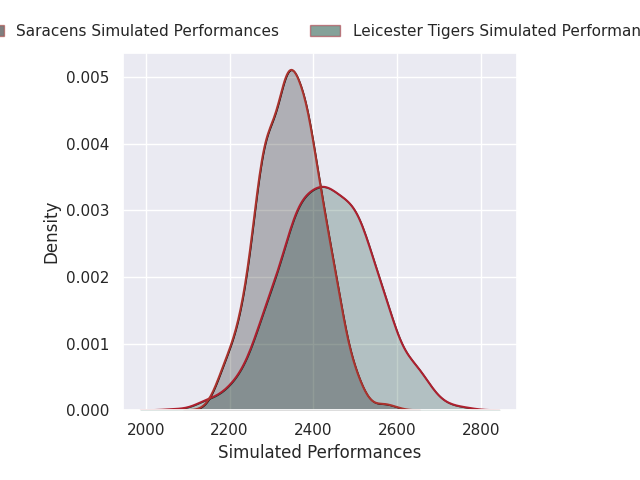

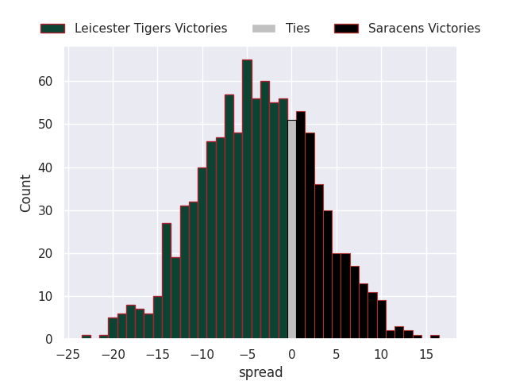

