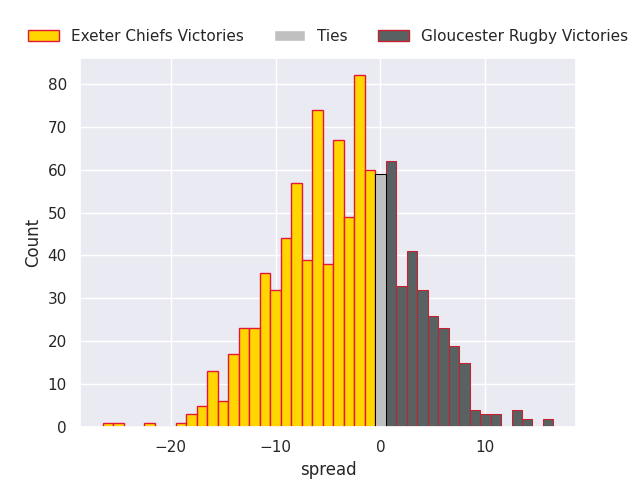
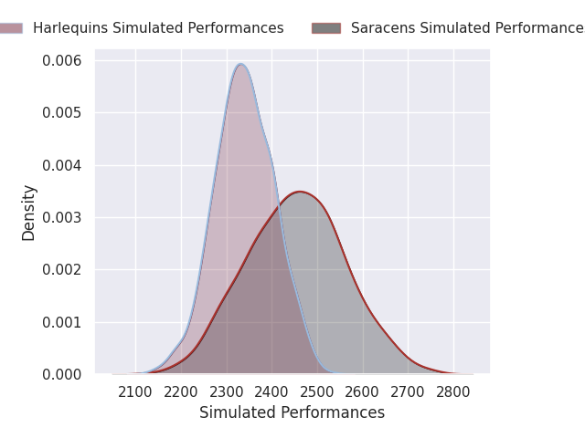
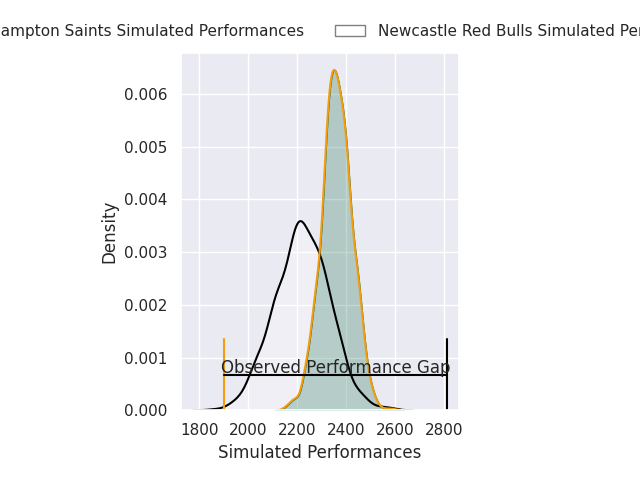
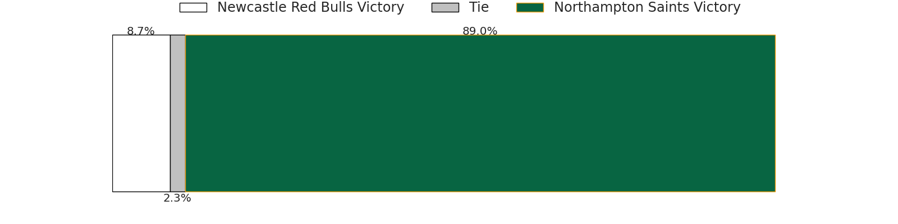
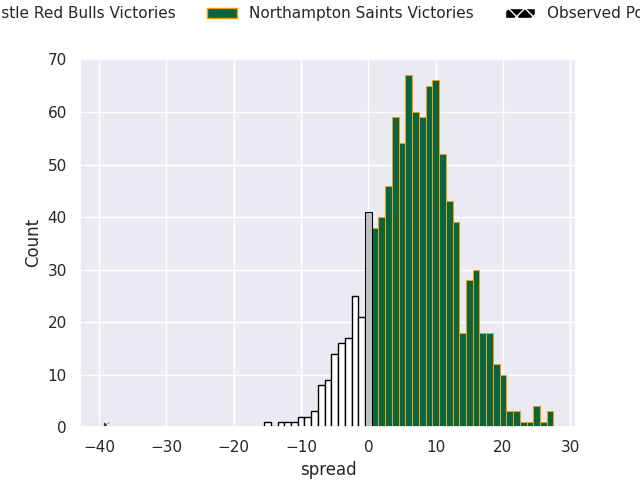

## Team Rankings

## Standings
### Current Standings

| Club                |   Played |   Wins |   Point Differential |   Losing Bonus Points | Try Bonus Points   |   Competition Points |
|:--------------------|---------:|-------:|---------------------:|----------------------:|:-------------------|---------------------:|
| Saracens            |        3 |      3 |                   91 |                     0 |                    |                   12 |
| Harlequins          |        3 |      3 |                   51 |                     0 |                    |                   12 |
| Sale Sharks         |        4 |      3 |                   21 |                     0 |                    |                   12 |
| Gloucester Rugby    |        3 |      2 |                   22 |                     1 |                    |                    9 |
| Bristol Rugby       |        3 |      1 |                  -23 |                     1 |                    |                    5 |
| Exeter Chiefs       |        3 |      1 |                   -6 |                     0 |                    |                    4 |
| Bath Rugby          |        3 |      1 |                  -14 |                     0 |                    |                    4 |
| Newcastle Red Bulls |        3 |      1 |                  -35 |                     0 |                    |                    4 |
| Northampton Saints  |        3 |      1 |                  -49 |                     0 |                    |                    4 |
| Leicester Tigers    |        4 |      0 |                  -58 |                     1 |                    |                    1 |

### Projected Remaining Table

| Club                |   To Play |   Projected Wins |   Projected Differential |   Projected Losing Bonus Points | Projected Try Bonus Points   |   Projected Competition Points |
|:--------------------|----------:|-----------------:|-------------------------:|--------------------------------:|:-----------------------------|-------------------------------:|
| Northampton Saints  |         1 |            0.89  |                    8.139 |                           0.081 |                              |                          3.687 |
| Saracens            |         1 |            0.802 |                    5.86  |                           0.144 |                              |                          3.428 |
| Exeter Chiefs       |         1 |            0.672 |                    3.345 |                           0.236 |                              |                          3.042 |
| Bristol Rugby       |         1 |            0.526 |                    0.84  |                           0.336 |                              |                          2.548 |
| Bath Rugby          |         1 |            0.42  |                   -0.84  |                           0.381 |                              |                          2.169 |
| Gloucester Rugby    |         1 |            0.269 |                   -3.345 |                           0.409 |                              |                          1.603 |
| Harlequins          |         1 |            0.16  |                   -5.86  |                           0.393 |                              |                          1.109 |
| Newcastle Red Bulls |         1 |            0.087 |                   -8.139 |                           0.364 |                              |                          0.758 |

### Projected Total Table

| Club                |   Played |   Wins |   Point Differential |   Losing Bonus Points | Try Bonus Points   |   Competition Points |
|:--------------------|---------:|-------:|---------------------:|----------------------:|:-------------------|---------------------:|
| Saracens            |        4 |  3.802 |               96.86  |                 0.144 |                    |               15.428 |
| Harlequins          |        4 |  3.16  |               45.14  |                 0.393 |                    |               13.109 |
| Sale Sharks         |        4 |  3     |               21     |                 0     |                    |               12     |
| Gloucester Rugby    |        4 |  2.269 |               18.655 |                 1.409 |                    |               10.603 |
| Northampton Saints  |        4 |  1.89  |              -40.861 |                 0.081 |                    |                7.687 |
| Bristol Rugby       |        4 |  1.526 |              -22.16  |                 1.336 |                    |                7.548 |
| Exeter Chiefs       |        4 |  1.672 |               -2.655 |                 0.236 |                    |                7.042 |
| Bath Rugby          |        4 |  1.42  |              -14.84  |                 0.381 |                    |                6.169 |
| Newcastle Red Bulls |        4 |  1.087 |              -43.139 |                 0.364 |                    |                4.758 |
| Leicester Tigers    |        4 |  0     |              -58     |                 1     |                    |                1     |

## Completed Match Review

| Model | Percent Correct Predictions | Spread Error |
| ------ | ------ | ------ |
| Club Level | 65.0% | 15.4 |
| Player Level: Lineup | nan% | nan |
| Player Level: Minutes | nan% | nan |

## Future Predictions
### Week 5
#### Bristol Rugby V Bath Rugby on 2026/11/20

Average Margin: Bristol Rugby by 0.8

#### Exeter Chiefs V Gloucester Rugby on 2026/11/21

Average Margin: Exeter Chiefs by 3.3

#### Saracens V Harlequins on 2026/11/21

Average Margin: Saracens by 5.9

#### Newcastle Red Bulls V Northampton Saints on 2026/11/21

Average Margin: Northampton Saints by 8.1

