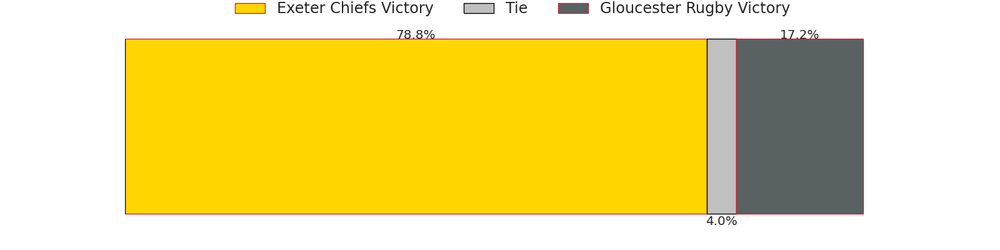

## Team Rankings

## Standings
### Current Standings

| Club                |   Played |   Wins |   Point Differential |   Losing Bonus Points | Try Bonus Points   |   Competition Points |
|:--------------------|---------:|-------:|---------------------:|----------------------:|:-------------------|---------------------:|
| Saracens            |        3 |      3 |                   91 |                     0 |                    |                   12 |
| Harlequins          |        3 |      3 |                   51 |                     0 |                    |                   12 |
| Sale Sharks         |        4 |      3 |                   21 |                     0 |                    |                   12 |
| Gloucester Rugby    |        3 |      2 |                   22 |                     1 |                    |                    9 |
| Bristol Rugby       |        3 |      1 |                  -23 |                     1 |                    |                    5 |
| Exeter Chiefs       |        3 |      1 |                   -6 |                     0 |                    |                    4 |
| Bath Rugby          |        3 |      1 |                  -14 |                     0 |                    |                    4 |
| Newcastle Red Bulls |        3 |      1 |                  -35 |                     0 |                    |                    4 |
| Northampton Saints  |        3 |      1 |                  -49 |                     0 |                    |                    4 |
| Leicester Tigers    |        4 |      0 |                  -58 |                     1 |                    |                    1 |

### Projected Remaining Table

| Club                |   To Play |   Projected Wins |   Projected Differential |   Projected Losing Bonus Points | Projected Try Bonus Points   |   Projected Competition Points |
|:--------------------|----------:|-----------------:|-------------------------:|--------------------------------:|:-----------------------------|-------------------------------:|
| Northampton Saints  |         1 |            0.881 |                    8.251 |                           0.073 |                              |                          3.669 |
| Saracens            |         1 |            0.803 |                    5.912 |                           0.157 |                              |                          3.425 |
| Exeter Chiefs       |         1 |            0.68  |                    3.488 |                           0.224 |                              |                          3.08  |
| Bristol Rugby       |         1 |            0.554 |                    1.315 |                           0.293 |                              |                          2.645 |
| Bath Rugby          |         1 |            0.378 |                   -1.315 |                           0.4   |                              |                          2.048 |
| Gloucester Rugby    |         1 |            0.252 |                   -3.488 |                           0.429 |                              |                          1.573 |
| Harlequins          |         1 |            0.169 |                   -5.912 |                           0.386 |                              |                          1.118 |
| Newcastle Red Bulls |         1 |            0.083 |                   -8.251 |                           0.318 |                              |                          0.722 |

### Projected Total Table

| Club                |   Played |   Wins |   Point Differential |   Losing Bonus Points | Try Bonus Points   |   Competition Points |
|:--------------------|---------:|-------:|---------------------:|----------------------:|:-------------------|---------------------:|
| Saracens            |        4 |  3.803 |               96.912 |                 0.157 |                    |               15.425 |
| Harlequins          |        4 |  3.169 |               45.088 |                 0.386 |                    |               13.118 |
| Sale Sharks         |        4 |  3     |               21     |                 0     |                    |               12     |
| Gloucester Rugby    |        4 |  2.252 |               18.512 |                 1.429 |                    |               10.573 |
| Northampton Saints  |        4 |  1.881 |              -40.749 |                 0.073 |                    |                7.669 |
| Bristol Rugby       |        4 |  1.554 |              -21.685 |                 1.293 |                    |                7.645 |
| Exeter Chiefs       |        4 |  1.68  |               -2.512 |                 0.224 |                    |                7.08  |
| Bath Rugby          |        4 |  1.378 |              -15.315 |                 0.4   |                    |                6.048 |
| Newcastle Red Bulls |        4 |  1.083 |              -43.251 |                 0.318 |                    |                4.722 |
| Leicester Tigers    |        4 |  0     |              -58     |                 1     |                    |                1     |

## Completed Match Review

| Model | Percent Correct Predictions | Spread Error |
| ------ | ------ | ------ |
| Club Level | 58.8% | 16.8 |
| Player Level: Lineup | nan% | nan |
| Player Level: Minutes | nan% | nan |

## Future Predictions
### Week 5
#### Exeter Chiefs V Gloucester Rugby on 2026/11/21

Average Margin: Exeter Chiefs by 3.5

