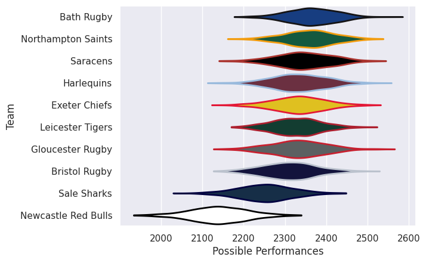

## Team Rankings

## Standings
### Current Standings

| Club                |   Played |   Wins |   Point Differential |   Losing Bonus Points | Try Bonus Points   |   Competition Points |
|:--------------------|---------:|-------:|---------------------:|----------------------:|:-------------------|---------------------:|
| Saracens            |        4 |      4 |                  108 |                     0 |                    |                   16 |
| Harlequins          |        4 |      3 |                   34 |                     0 |                    |                   12 |
| Sale Sharks         |        4 |      3 |                   21 |                     0 |                    |                   12 |
| Gloucester Rugby    |        4 |      2 |                  -25 |                     1 |                    |                    9 |
| Exeter Chiefs       |        4 |      2 |                   41 |                     0 |                    |                    8 |
| Bath Rugby          |        4 |      2 |                   11 |                     0 |                    |                    8 |
| Newcastle Red Bulls |        4 |      2 |                    4 |                     0 |                    |                    8 |
| Bristol Rugby       |        4 |      1 |                  -48 |                     1 |                    |                    5 |
| Northampton Saints  |        4 |      1 |                  -88 |                     0 |                    |                    4 |
| Leicester Tigers    |        4 |      0 |                  -58 |                     1 |                    |                    1 |

## Completed Match Review

| Model | Percent Correct Predictions | Spread Error |
| ------ | ------ | ------ |
| Club Level | 55.0% | 20.3 |
| Player Level: Lineup | nan% | nan |
| Player Level: Minutes | nan% | nan |

