## Team Rankings

## Standings
### Current Standings

| Club                       |   Played |   Wins |   Point Differential |   Losing Bonus Points |   Try Bonus Points |   Competition Points |
|:---------------------------|---------:|-------:|---------------------:|----------------------:|-------------------:|---------------------:|
| Oyonnax                    |       11 |      9 |                  168 |                     1 |                  6 |                   43 |
| Provence Rugby             |       11 |      9 |                  113 |                     0 |                  4 |                   42 |
| Brive                      |       13 |      8 |                  118 |                     0 |                  7 |                   39 |
| Grenoble                   |       11 |      8 |                   58 |                     3 |                  4 |                   39 |
| US Montauban               |       12 |      8 |                  -69 |                     0 |                  4 |                   36 |
| Aurillac                   |       11 |      6 |                   78 |                     2 |                  6 |                   32 |
| Biarritz Olympique         |       12 |      6 |                  -60 |                     0 |                  4 |                   30 |
| Soyaux-Angouleme           |       11 |      5 |                   63 |                     2 |                  5 |                   29 |
| Valence Romans Drome Rugby |       11 |      5 |                   39 |                     5 |                  4 |                   29 |
| Agen                       |       11 |      5 |                    3 |                     2 |                  5 |                   27 |
| Dax                        |       11 |      5 |                  -75 |                     0 |                  5 |                   27 |
| Nice                       |       11 |      4 |                  -36 |                     3 |                  6 |                   25 |
| Colomiers                  |       11 |      4 |                   36 |                     3 |                  5 |                   24 |
| Narbonne                   |       11 |      3 |                 -111 |                     4 |                  4 |                   20 |
| Beziers                    |       11 |      2 |                 -185 |                     3 |                  1 |                   12 |
| USON Nevers                |       11 |      1 |                 -140 |                     4 |                  2 |                   10 |

### Projected Remaining Table

| Club                       |   To Play |   Projected Wins |   Projected Differential |   Projected Losing Bonus Points | Projected Try Bonus Points   |   Projected Competition Points |
|:---------------------------|----------:|-----------------:|-------------------------:|--------------------------------:|:-----------------------------|-------------------------------:|
| Provence Rugby             |        20 |           14.971 |                  134.369 |                           3.011 |                              |                         64.201 |
| Oyonnax                    |        20 |           14.437 |                  145.621 |                           3.723 |                              |                         62.871 |
| Valence Romans Drome Rugby |        20 |           12.831 |                   73.478 |                           4.072 |                              |                         56.866 |
| Colomiers                  |        20 |           12.773 |                   75.083 |                           4.06  |                              |                         56.664 |
| Agen                       |        20 |           11.162 |                   35.644 |                           4.473 |                              |                         50.623 |
| Brive                      |        18 |           11.263 |                   81.608 |                           3.958 |                              |                         50.382 |
| Grenoble                   |        20 |           10.118 |                   16.992 |                           4.863 |                              |                         46.757 |
| Aurillac                   |        20 |            9.275 |                   -8.136 |                           5.164 |                              |                         43.924 |
| Dax                        |        20 |            9.318 |                  -11.527 |                           5.033 |                              |                         43.881 |
| Soyaux-Angouleme           |        20 |            8.966 |                  -13.193 |                           5.044 |                              |                         42.404 |
| Nice                       |        20 |            8.65  |                  -27.998 |                           5.118 |                              |                         41.268 |
| Narbonne                   |        20 |            7.926 |                  -45.752 |                           5.296 |                              |                         38.66  |
| Biarritz Olympique         |        19 |            6.98  |                  -48.398 |                           5.447 |                              |                         34.935 |
| US Montauban               |        19 |            5.003 |                 -120.703 |                           4.666 |                              |                         25.956 |
| Beziers                    |        20 |            4.362 |                 -136.576 |                           5.592 |                              |                         24.36  |
| USON Nevers                |        20 |            4.105 |                 -150.512 |                           5.091 |                              |                         22.859 |

### Projected Total Table

| Club                       |   Played |   Wins |   Point Differential |   Losing Bonus Points |   Try Bonus Points |   Competition Points |
|:---------------------------|---------:|-------:|---------------------:|----------------------:|-------------------:|---------------------:|
| Provence Rugby             |       31 | 23.971 |              247.369 |                 3.011 |                  4 |              106.201 |
| Oyonnax                    |       31 | 23.437 |              313.621 |                 4.723 |                  6 |              105.871 |
| Brive                      |       31 | 19.263 |              199.608 |                 3.958 |                  7 |               89.382 |
| Valence Romans Drome Rugby |       31 | 17.831 |              112.478 |                 9.072 |                  4 |               85.866 |
| Grenoble                   |       31 | 18.118 |               74.992 |                 7.863 |                  4 |               85.757 |
| Colomiers                  |       31 | 16.773 |              111.083 |                 7.06  |                  5 |               80.664 |
| Agen                       |       31 | 16.162 |               38.644 |                 6.473 |                  5 |               77.623 |
| Aurillac                   |       31 | 15.275 |               69.864 |                 7.164 |                  6 |               75.924 |
| Soyaux-Angouleme           |       31 | 13.966 |               49.807 |                 7.044 |                  5 |               71.404 |
| Dax                        |       31 | 14.318 |              -86.527 |                 5.033 |                  5 |               70.881 |
| Nice                       |       31 | 12.65  |              -63.998 |                 8.118 |                  6 |               66.268 |
| Biarritz Olympique         |       31 | 12.98  |             -108.398 |                 5.447 |                  4 |               64.935 |
| US Montauban               |       31 | 13.003 |             -189.703 |                 4.666 |                  4 |               61.956 |
| Narbonne                   |       31 | 10.926 |             -156.752 |                 9.296 |                  4 |               58.66  |
| Beziers                    |       31 |  6.362 |             -321.576 |                 8.592 |                  1 |               36.36  |
| USON Nevers                |       31 |  5.105 |             -290.512 |                 9.091 |                  2 |               32.859 |

## Completed Match Review

| Model | Percent Correct Predictions | Spread Error |
| ------ | ------ | ------ |
| Club Level | 77.4% | 7.5 |
| Player Level: Lineup | nan% | nan |
| Player Level: Minutes | nan% | nan |

## Future Predictions
### Week 14
#### Narbonne V Oyonnax on 2026/09/01

Average Margin: Oyonnax by 0.7

#### Aurillac V Biarritz Olympique on 2026/09/01

Average Margin: Aurillac by 2.7

#### Agen V Dax on 2026/09/01

Average Margin: Agen by 5.4

#### Valence Romans Drome Rugby V Beziers on 2026/09/01

Average Margin: Valence Romans Drome Rugby by 10.2

#### Soyaux-Angouleme V Provence Rugby on 2026/09/01

Average Margin: Provence Rugby by 1.5

#### Grenoble V Colomiers on 2026/09/01

Average Margin: Grenoble by 0.2

#### Nice V USON Nevers on 2026/09/01

Average Margin: Nice by 10.9

### Week 15
#### Soyaux-Angouleme V Nice on 2026/11/27

Average Margin: Soyaux-Angouleme by 6.7

#### Colomiers V USON Nevers on 2026/11/27

Average Margin: Colomiers by 16.6

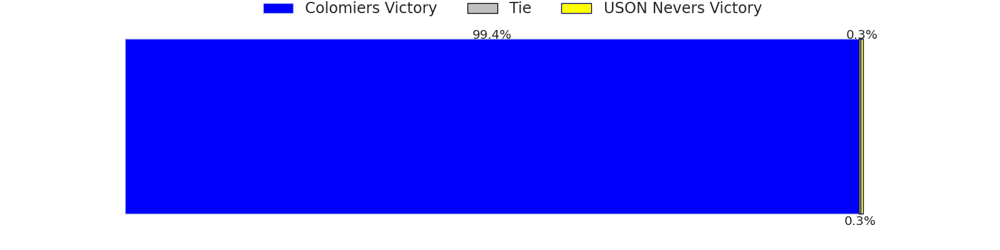

#### Agen V Beziers on 2026/11/27

Average Margin: Agen by 13.0

#### Valence Romans Drome Rugby V Aurillac on 2026/11/27

Average Margin: Valence Romans Drome Rugby by 9.8

#### Provence Rugby V US Montauban on 2026/11/27

Average Margin: Provence Rugby by 17.3

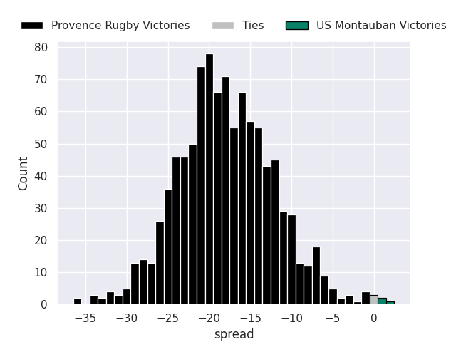

#### Narbonne V Grenoble on 2026/11/27

Average Margin: Narbonne by 2.2

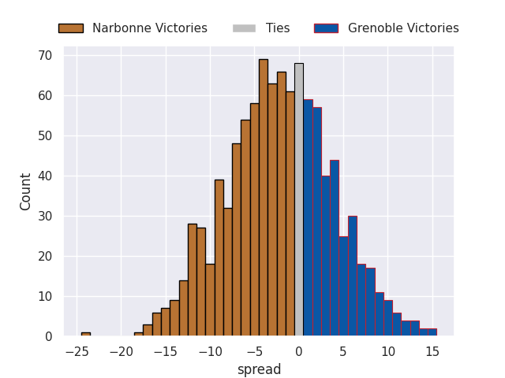

#### Dax V Oyonnax on 2026/11/27

Average Margin: Oyonnax by 1.2

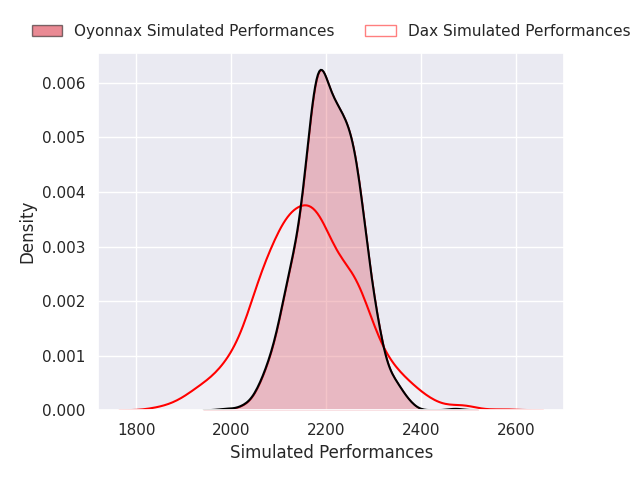

### Week 16
#### Biarritz Olympique V Provence Rugby on 2026/12/03

Average Margin: Provence Rugby by 2.6

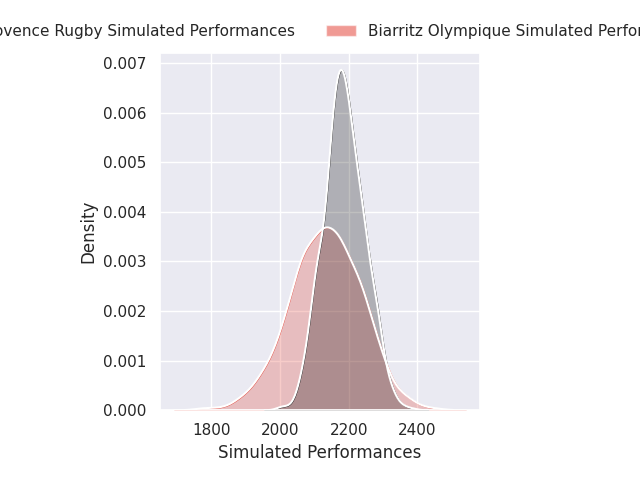

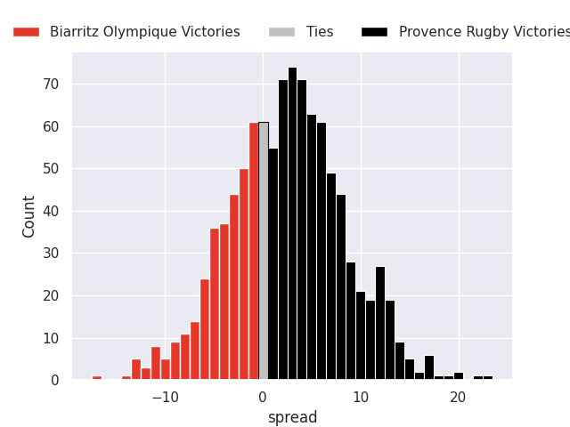

#### USON Nevers V Dax on 2026/12/04

Average Margin: USON Nevers by 0.1

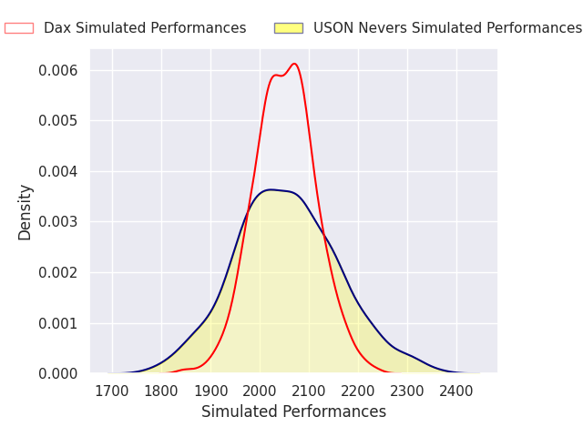

#### Beziers V Brive on 2026/12/04

Average Margin: Brive by 3.5

#### Narbonne V Agen on 2026/12/04

Average Margin: Narbonne by 2.6

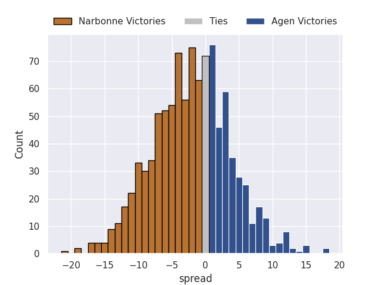

#### Oyonnax V Grenoble on 2026/12/04

Average Margin: Oyonnax by 13.4

#### Aurillac V Soyaux-Angouleme on 2026/12/04

Average Margin: Aurillac by 7.6

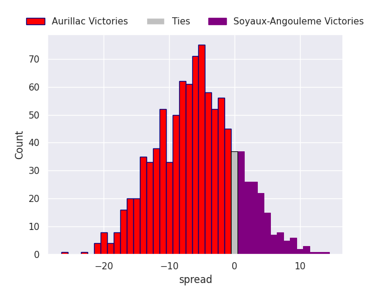

#### US Montauban V Valence Romans Drome Rugby on 2026/12/04

Average Margin: Valence Romans Drome Rugby by 1.9

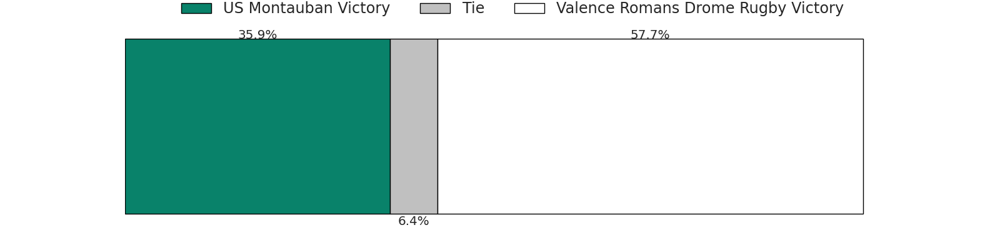

#### Nice V Colomiers on 2026/12/04

Average Margin: Nice by 0.9

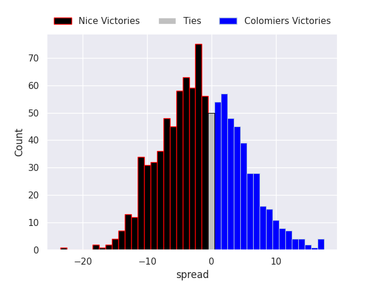

### Week 17
#### Colomiers V US Montauban on 2026/12/11

Average Margin: Colomiers by 14.7

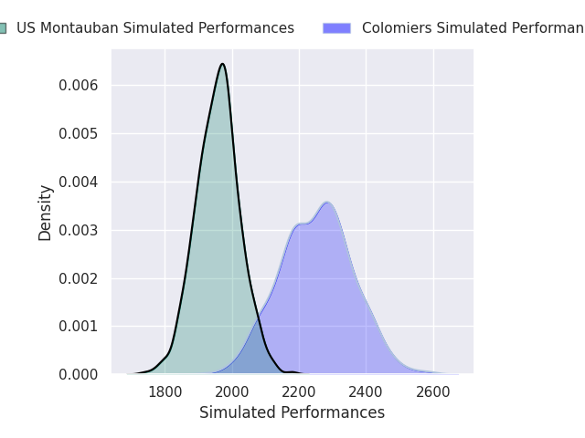

#### Nice V Oyonnax on 2026/12/11

Average Margin: Oyonnax by 3.2

#### Soyaux-Angouleme V Beziers on 2026/12/11

Average Margin: Soyaux-Angouleme by 11.9

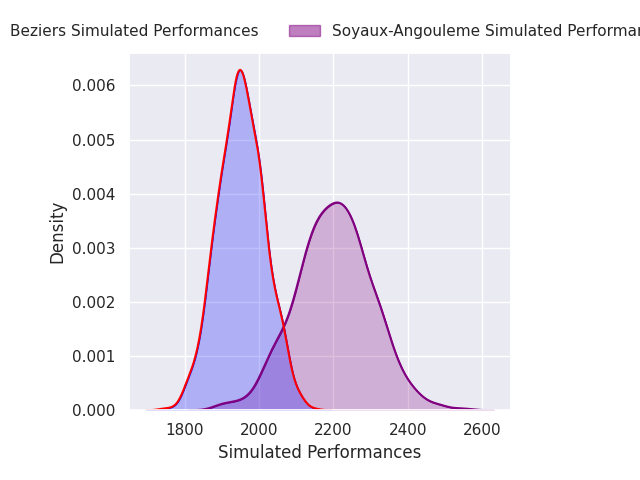
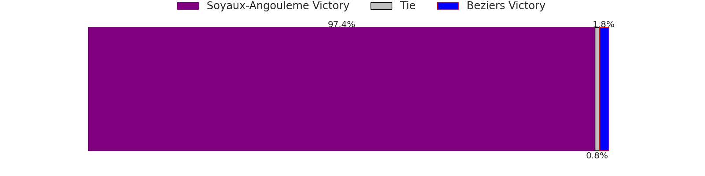

#### Grenoble V USON Nevers on 2026/12/11

Average Margin: Grenoble by 14.4

#### Valence Romans Drome Rugby V Narbonne on 2026/12/11

Average Margin: Valence Romans Drome Rugby by 11.0

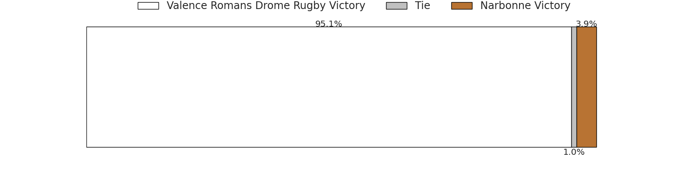

#### Dax V Biarritz Olympique on 2026/12/11

Average Margin: Dax by 8.1

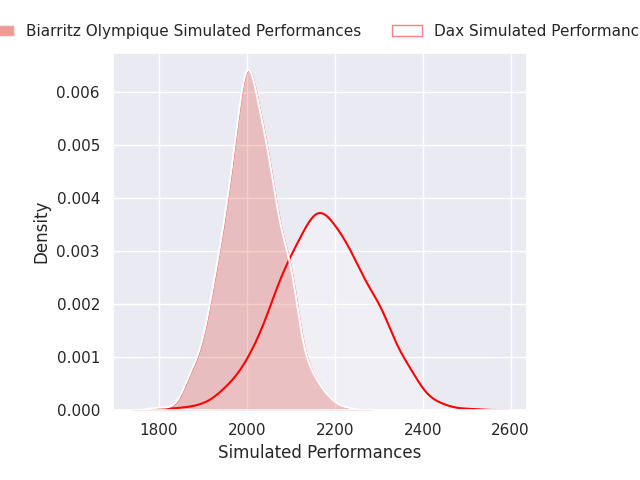
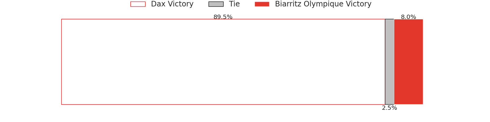
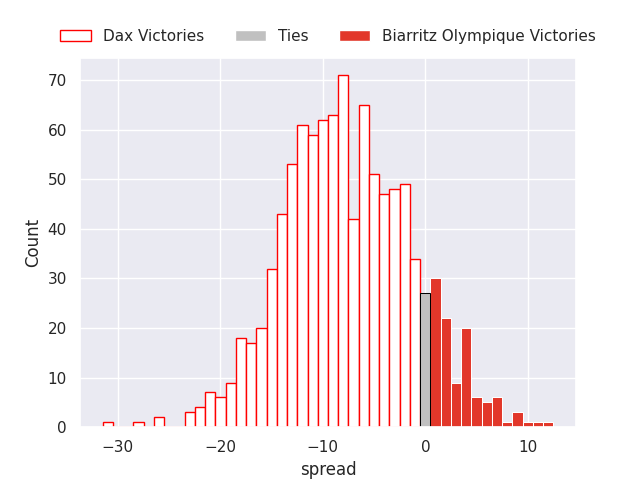

#### Provence Rugby V Brive on 2026/12/11

Average Margin: Provence Rugby by 8.3

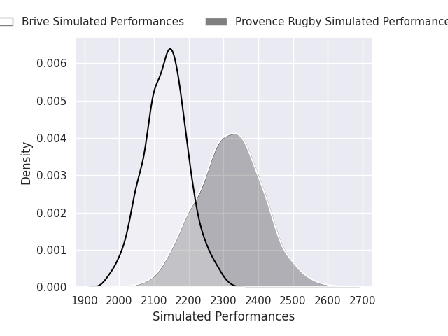

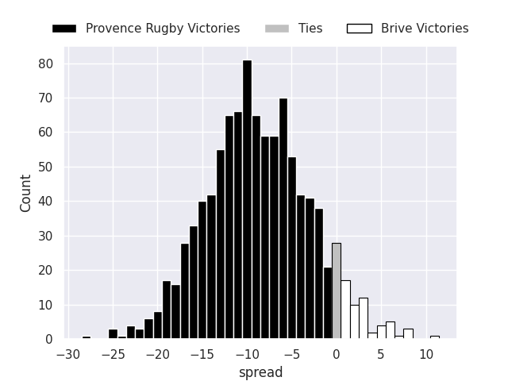

#### Agen V Aurillac on 2026/12/11

Average Margin: Agen by 8.1

### Week 18
#### Beziers V Biarritz Olympique on 2026/12/18

Average Margin: Beziers by 2.5

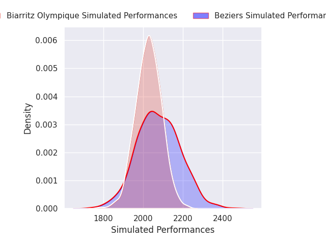

#### US Montauban V Nice on 2026/12/18

Average Margin: US Montauban by 1.4

#### Dax V Grenoble on 2026/12/18

Average Margin: Dax by 4.2

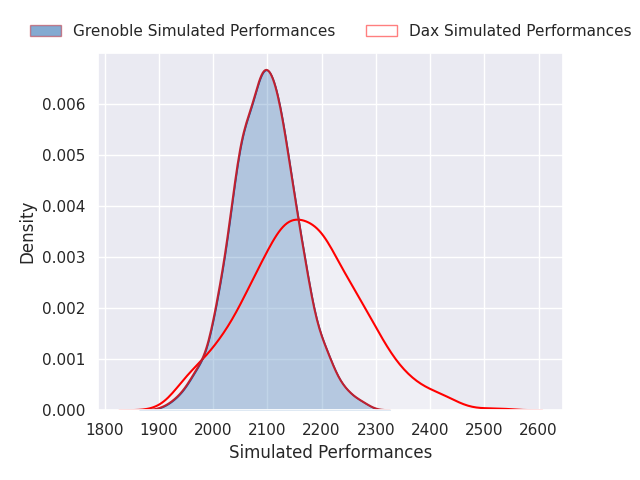
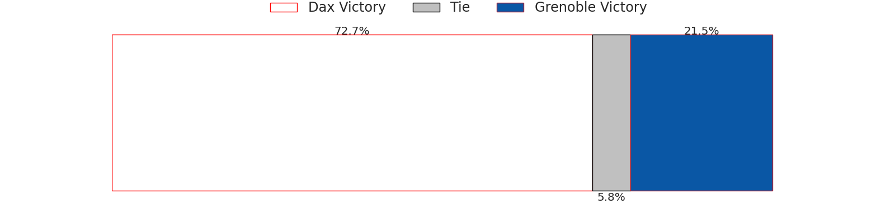
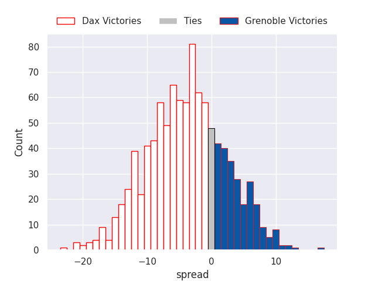

#### Brive V Soyaux-Angouleme on 2026/12/18

Average Margin: Brive by 11.8

#### Oyonnax V Colomiers on 2026/12/18

Average Margin: Oyonnax by 12.0

#### Valence Romans Drome Rugby V Agen on 2026/12/18

Average Margin: Valence Romans Drome Rugby by 7.7

#### Aurillac V Narbonne on 2026/12/18

Average Margin: Aurillac by 8.9

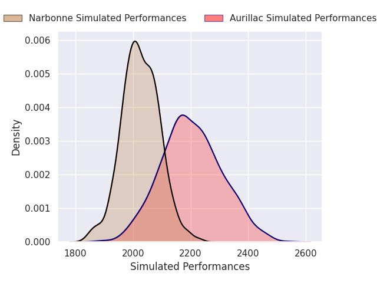

#### USON Nevers V Provence Rugby on 2026/12/18

Average Margin: Provence Rugby by 6.8

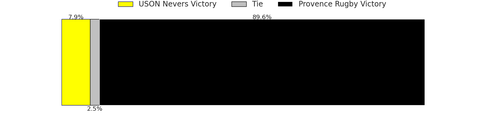

### Week 19
#### Nice V Dax on 2027/01/08

Average Margin: Nice by 5.2

#### Colomiers V Brive on 2027/01/08

Average Margin: Colomiers by 5.3

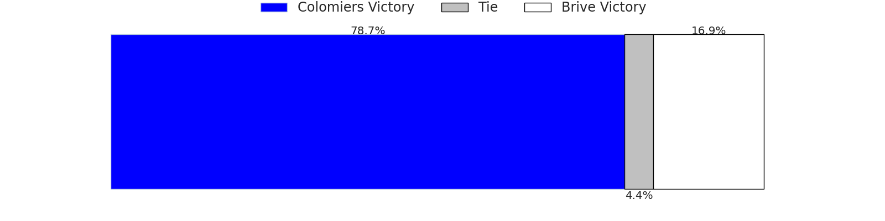

#### Provence Rugby V Valence Romans Drome Rugby on 2027/01/08

Average Margin: Provence Rugby by 9.6

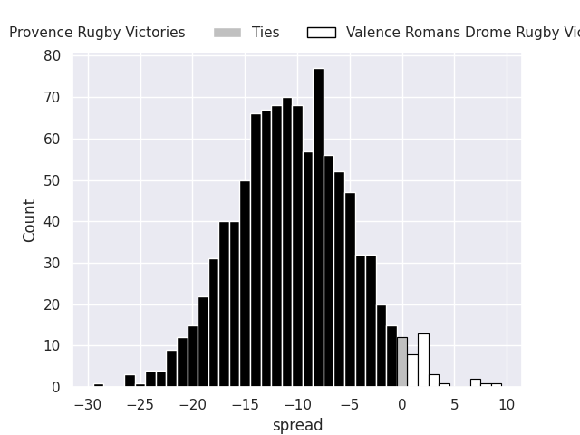

#### Biarritz Olympique V Aurillac on 2027/01/08

Average Margin: Biarritz Olympique by 4.5

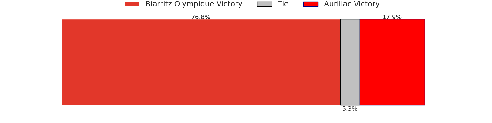

#### Agen V USON Nevers on 2027/01/08

Average Margin: Agen by 13.9

#### Grenoble V Beziers on 2027/01/08

Average Margin: Grenoble by 12.7

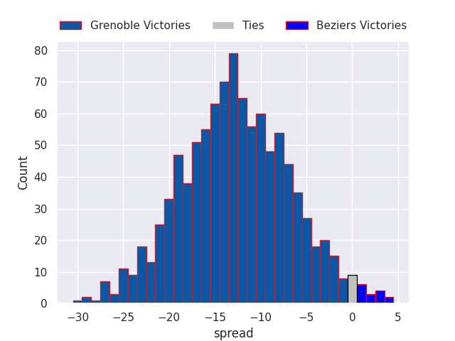

#### Narbonne V US Montauban on 2027/01/08

Average Margin: Narbonne by 9.0

#### Soyaux-Angouleme V Oyonnax on 2027/01/08

Average Margin: Oyonnax by 1.3

### Week 20
#### US Montauban V Biarritz Olympique on 2027/01/15

Average Margin: US Montauban by 3.5

#### Dax V Soyaux-Angouleme on 2027/01/15

Average Margin: Dax by 6.5

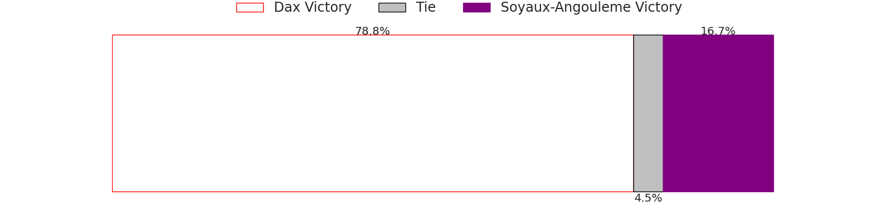

#### Beziers V Colomiers on 2027/01/15

Average Margin: Colomiers by 2.6

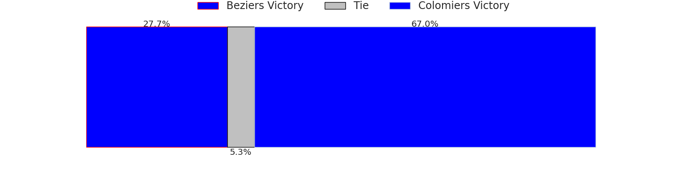
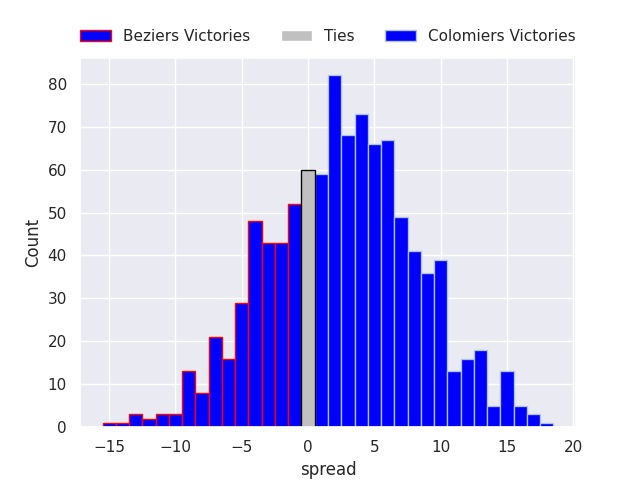

#### USON Nevers V Nice on 2027/01/15

Average Margin: USON Nevers by 0.2

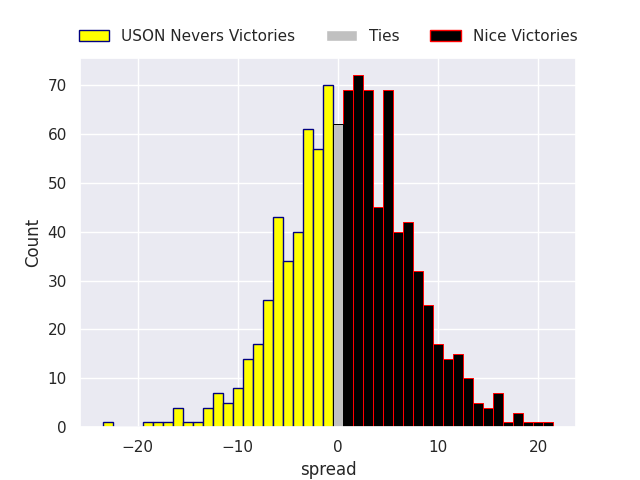

#### Brive V Agen on 2027/01/15

Average Margin: Brive by 9.6

#### Aurillac V Provence Rugby on 2027/01/15

Average Margin: Aurillac by 1.0

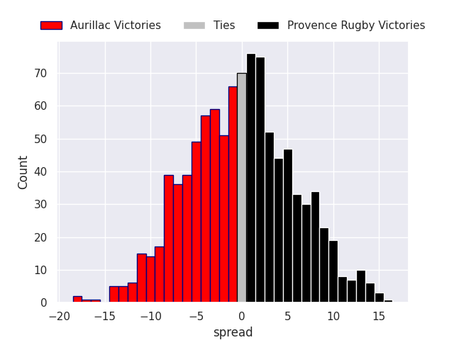

#### Oyonnax V Narbonne on 2027/01/15

Average Margin: Oyonnax by 16.7

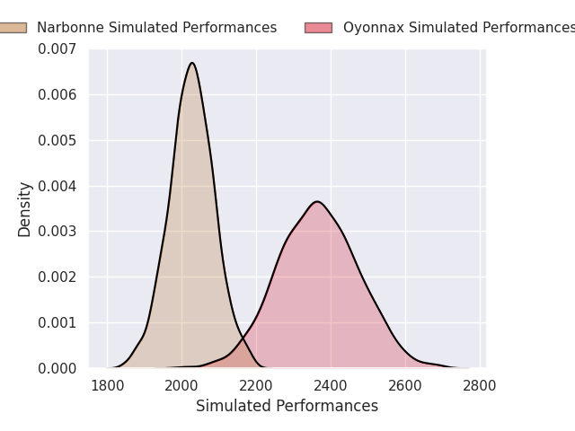
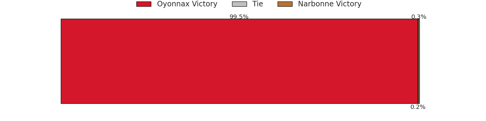

#### Valence Romans Drome Rugby V Grenoble on 2027/01/15

Average Margin: Valence Romans Drome Rugby by 7.8

### Week 21
#### Biarritz Olympique V USON Nevers on 2027/01/22

Average Margin: Biarritz Olympique by 10.7

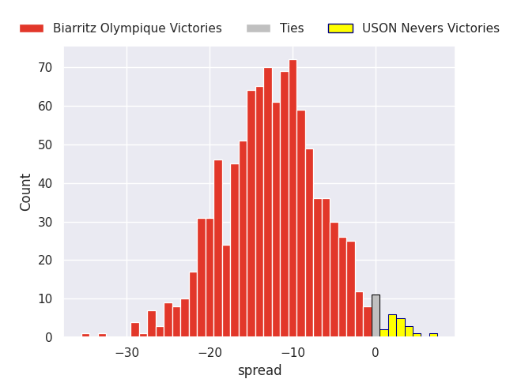

#### Nice V Brive on 2027/01/22

Average Margin: Nice by 0.1

#### Narbonne V Dax on 2027/01/22

Average Margin: Narbonne by 4.5

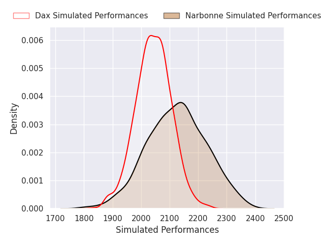

#### Soyaux-Angouleme V Valence Romans Drome Rugby on 2027/01/22

Average Margin: Soyaux-Angouleme by 3.6

#### Provence Rugby V Grenoble on 2027/01/22

Average Margin: Provence Rugby by 10.7

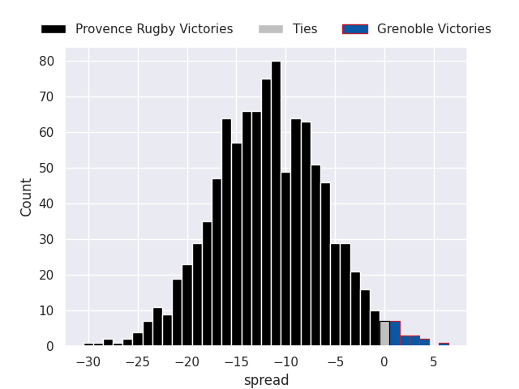

#### Oyonnax V Beziers on 2027/01/22

Average Margin: Oyonnax by 20.7

#### Agen V US Montauban on 2027/01/22

Average Margin: Agen by 12.4

#### Colomiers V Aurillac on 2027/01/22

Average Margin: Colomiers by 10.3

### Week 22
#### Valence Romans Drome Rugby V Biarritz Olympique on 2027/01/29

Average Margin: Valence Romans Drome Rugby by 11.5

#### Brive V Narbonne on 2027/01/29

Average Margin: Brive by 12.8

#### USON Nevers V Colomiers on 2027/01/29

Average Margin: Colomiers by 3.5

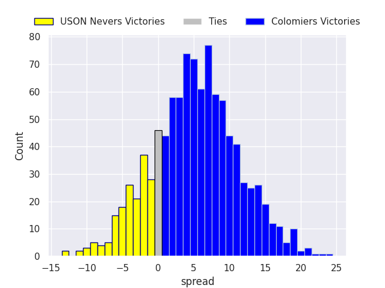

#### Beziers V Provence Rugby on 2027/01/29

Average Margin: Provence Rugby by 5.7

#### Dax V Agen on 2027/01/29

Average Margin: Dax by 4.8

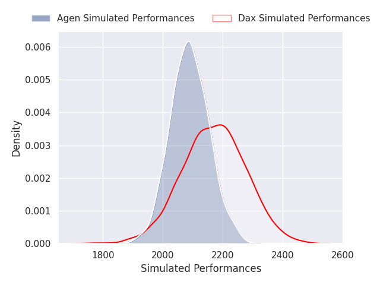

#### Aurillac V Oyonnax on 2027/01/29

Average Margin: Oyonnax by 0.1

#### Grenoble V Nice on 2027/01/29

Average Margin: Grenoble by 7.8

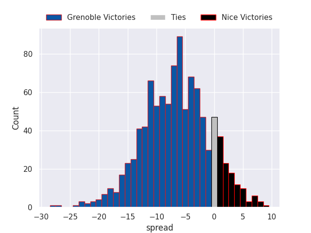

#### US Montauban V Soyaux-Angouleme on 2027/01/29

Average Margin: US Montauban by 1.4

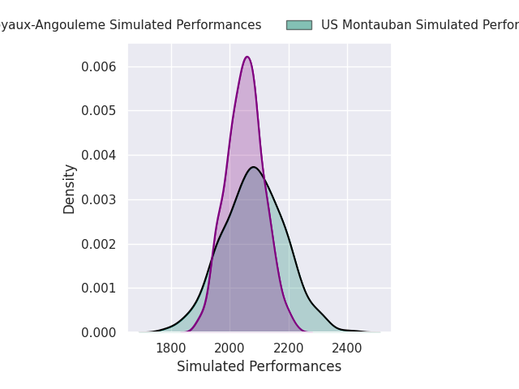
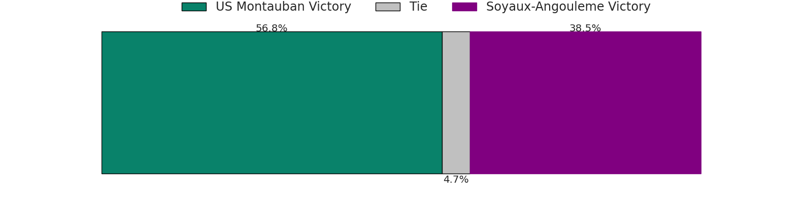
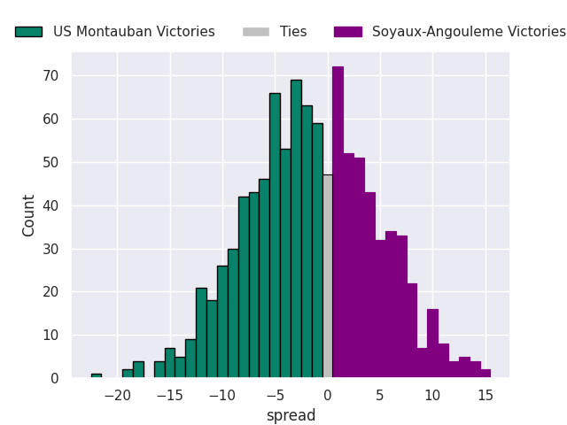

### Week 23
#### Grenoble V Brive on 2027/02/12

Average Margin: Grenoble by 3.0

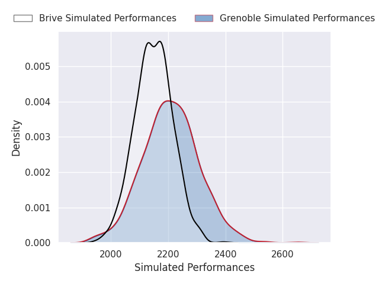

#### Narbonne V Biarritz Olympique on 2027/02/12

Average Margin: Narbonne by 5.9

#### Soyaux-Angouleme V USON Nevers on 2027/02/12

Average Margin: Soyaux-Angouleme by 12.8

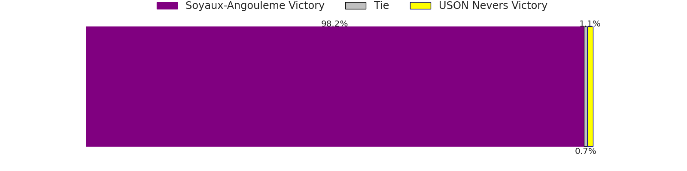

#### Colomiers V Valence Romans Drome Rugby on 2027/02/12

Average Margin: Colomiers by 7.2

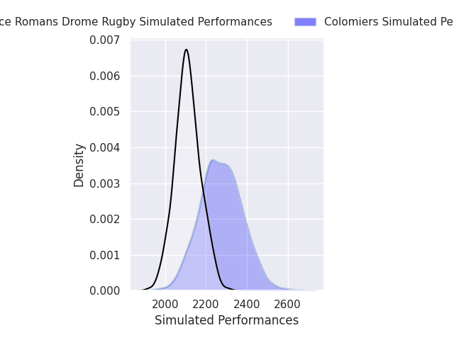
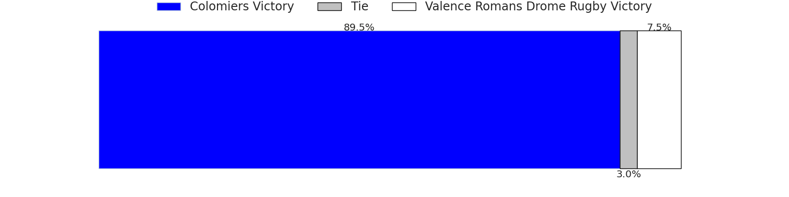

#### Provence Rugby V Dax on 2027/02/12

Average Margin: Provence Rugby by 13.0

#### Oyonnax V US Montauban on 2027/02/12

Average Margin: Oyonnax by 20.0

#### Aurillac V Beziers on 2027/02/12

Average Margin: Aurillac by 12.5

#### Nice V Agen on 2027/02/12

Average Margin: Nice by 3.2

### Week 24
#### Brive V Provence Rugby on 2027/02/19

Average Margin: Brive by 4.7

#### USON Nevers V Grenoble on 2027/02/19

Average Margin: Grenoble by 1.9

#### Agen V Narbonne on 2027/02/19

Average Margin: Agen by 9.2

#### Biarritz Olympique V Oyonnax on 2027/02/19

Average Margin: Oyonnax by 3.5

#### Valence Romans Drome Rugby V Nice on 2027/02/19

Average Margin: Valence Romans Drome Rugby by 9.2

#### US Montauban V Aurillac on 2027/02/19

Average Margin: US Montauban by 1.9

#### Beziers V Soyaux-Angouleme on 2027/02/19

Average Margin: Beziers by 1.1

#### Dax V Colomiers on 2027/02/19

Average Margin: Dax by 2.7

### Week 25
#### Aurillac V Agen on 2027/02/26

Average Margin: Aurillac by 6.3

#### Brive V Beziers on 2027/02/26

Average Margin: Brive by 16.5

#### Nice V Biarritz Olympique on 2027/02/26

Average Margin: Nice by 6.9

#### Colomiers V Soyaux-Angouleme on 2027/02/26

Average Margin: Colomiers by 10.2

#### Grenoble V US Montauban on 2027/02/26

Average Margin: Grenoble by 12.1

#### Narbonne V Valence Romans Drome Rugby on 2027/02/26

Average Margin: Narbonne by 1.1

#### Provence Rugby V USON Nevers on 2027/02/26

Average Margin: Provence Rugby by 18.6

#### Oyonnax V Dax on 2027/02/26

Average Margin: Oyonnax by 15.8

### Week 26
#### Dax V Aurillac on 2027/03/05

Average Margin: Dax by 6.6

#### Agen V Colomiers on 2027/03/05

Average Margin: Agen by 4.3

#### Beziers V Nice on 2027/03/05

Average Margin: Beziers by 1.4

#### Soyaux-Angouleme V Narbonne on 2027/03/05

Average Margin: Soyaux-Angouleme by 7.9

#### Biarritz Olympique V Grenoble on 2027/03/05

Average Margin: Biarritz Olympique by 2.5

#### USON Nevers V Oyonnax on 2027/03/05

Average Margin: Oyonnax by 7.3

#### US Montauban V Provence Rugby on 2027/03/05

Average Margin: Provence Rugby by 5.3

#### Valence Romans Drome Rugby V Brive on 2027/03/05

Average Margin: Valence Romans Drome Rugby by 4.9

### Week 27
#### Provence Rugby V Soyaux-Angouleme on 2027/03/26

Average Margin: Provence Rugby by 12.6

#### Colomiers V Oyonnax on 2027/03/26

Average Margin: Colomiers by 2.4

#### Aurillac V Valence Romans Drome Rugby on 2027/03/26

Average Margin: Aurillac by 4.5

#### Nice V US Montauban on 2027/03/26

Average Margin: Nice by 9.5

#### Dax V Beziers on 2027/03/26

Average Margin: Dax by 11.3

#### Grenoble V Narbonne on 2027/03/26

Average Margin: Grenoble by 8.6

#### Biarritz Olympique V Agen on 2027/03/26

Average Margin: Biarritz Olympique by 2.9

#### Brive V USON Nevers on 2027/03/26

Average Margin: Brive by 17.4

### Week 28
#### Beziers V US Montauban on 2027/04/02

Average Margin: Beziers by 5.3

#### Agen V Grenoble on 2027/04/02

Average Margin: Agen by 5.5

#### Valence Romans Drome Rugby V Dax on 2027/04/02

Average Margin: Valence Romans Drome Rugby by 9.8

#### Oyonnax V Nice on 2027/04/02

Average Margin: Oyonnax by 15.4

#### Colomiers V Biarritz Olympique on 2027/04/02

Average Margin: Colomiers by 11.7

#### Soyaux-Angouleme V Brive on 2027/04/02

Average Margin: Soyaux-Angouleme by 2.4

#### Narbonne V Provence Rugby on 2027/04/02

Average Margin: Provence Rugby by 2.5

#### USON Nevers V Aurillac on 2027/04/02

Average Margin: USON Nevers by 0.4

### Week 29
#### Biarritz Olympique V Beziers on 2027/04/09

Average Margin: Biarritz Olympique by 9.0

#### US Montauban V USON Nevers on 2027/04/09

Average Margin: US Montauban by 7.9

#### Narbonne V Aurillac on 2027/04/09

Average Margin: Narbonne by 4.5

#### Grenoble V Dax on 2027/04/09

Average Margin: Grenoble by 8.2

#### Provence Rugby V Colomiers on 2027/04/09

Average Margin: Provence Rugby by 8.8

#### Nice V Soyaux-Angouleme on 2027/04/09

Average Margin: Nice by 4.6

#### Agen V Valence Romans Drome Rugby on 2027/04/09

Average Margin: Agen by 4.8

#### Brive V Oyonnax on 2027/04/09

Average Margin: Brive by 3.7

### Week 30
#### Valence Romans Drome Rugby V US Montauban on 2027/04/16

Average Margin: Valence Romans Drome Rugby by 13.8

#### Oyonnax V Provence Rugby on 2027/04/16

Average Margin: Oyonnax by 8.9

#### Aurillac V Grenoble on 2027/04/16

Average Margin: Aurillac by 5.5

#### USON Nevers V Narbonne on 2027/04/16

Average Margin: USON Nevers by 1.3

#### Dax V Brive on 2027/04/16

Average Margin: Dax by 1.7

#### Beziers V Agen on 2027/04/16

Average Margin: Agen by 0.5

#### Soyaux-Angouleme V Biarritz Olympique on 2027/04/16

Average Margin: Soyaux-Angouleme by 8.6

#### Colomiers V Nice on 2027/04/16

Average Margin: Colomiers by 9.9

### Week 31
#### Agen V Soyaux-Angouleme on 2027/04/23

Average Margin: Agen by 7.8

#### Biarritz Olympique V Dax on 2027/04/23

Average Margin: Biarritz Olympique by 4.6

#### Narbonne V Beziers on 2027/04/23

Average Margin: Narbonne by 9.4

#### USON Nevers V Valence Romans Drome Rugby on 2027/04/23

Average Margin: Valence Romans Drome Rugby by 2.8

#### Brive V Aurillac on 2027/04/23

Average Margin: Brive by 11.7

#### US Montauban V Colomiers on 2027/04/23

Average Margin: Colomiers by 2.2

#### Grenoble V Oyonnax on 2027/04/23

Average Margin: Grenoble by 0.4

#### Provence Rugby V Nice on 2027/04/23

Average Margin: Provence Rugby by 12.5

### Week 32
#### Dax V USON Nevers on 2027/05/07

Average Margin: Dax by 12.1

#### Oyonnax V Agen on 2027/05/07

Average Margin: Oyonnax by 13.9

#### Beziers V Valence Romans Drome Rugby on 2027/05/07

Average Margin: Valence Romans Drome Rugby by 2.0

#### Provence Rugby V Biarritz Olympique on 2027/05/07

Average Margin: Provence Rugby by 14.6

#### Colomiers V Grenoble on 2027/05/07

Average Margin: Colomiers by 7.9

#### Nice V Narbonne on 2027/05/07

Average Margin: Nice by 5.9

#### Brive V US Montauban on 2027/05/07

Average Margin: Brive by 15.3

#### Soyaux-Angouleme V Aurillac on 2027/05/07

Average Margin: Soyaux-Angouleme by 6.8

### Week 33
#### Biarritz Olympique V Brive on 2027/05/14

Average Margin: Brive by 0.3

#### USON Nevers V Beziers on 2027/05/14

Average Margin: USON Nevers by 5.3

#### US Montauban V Dax on 2027/05/14

Average Margin: US Montauban by 1.8

#### Valence Romans Drome Rugby V Oyonnax on 2027/05/14

Average Margin: Valence Romans Drome Rugby by 2.0

#### Aurillac V Nice on 2027/05/14

Average Margin: Aurillac by 7.5

#### Narbonne V Colomiers on 2027/05/14

Average Margin: Narbonne by 0.6

#### Agen V Provence Rugby on 2027/05/14

Average Margin: Agen by 1.5

#### Grenoble V Soyaux-Angouleme on 2027/05/14

Average Margin: Grenoble by 7.4

