## Team Rankings

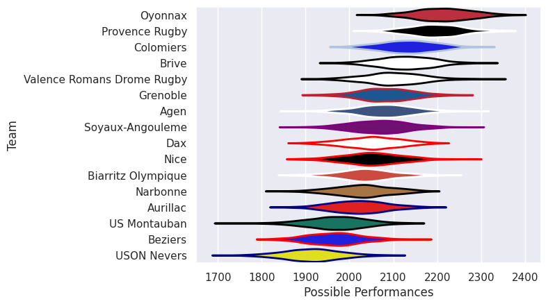
## Standings
### Current Standings

| Club                       |   Played |   Wins |   Point Differential |   Losing Bonus Points |   Try Bonus Points |   Competition Points |
|:---------------------------|---------:|-------:|---------------------:|----------------------:|-------------------:|---------------------:|
| Oyonnax                    |       11 |      9 |                  168 |                     1 |                  6 |                   43 |
| Provence Rugby             |       11 |      9 |                  113 |                     0 |                  4 |                   42 |
| Grenoble                   |       11 |      8 |                   58 |                     3 |                  4 |                   39 |
| US Montauban               |       12 |      8 |                  -69 |                     0 |                  4 |                   36 |
| Brive                      |       12 |      7 |                   80 |                     0 |                  6 |                   34 |
| Aurillac                   |       11 |      6 |                   78 |                     2 |                  6 |                   32 |
| Soyaux-Angouleme           |       11 |      5 |                   63 |                     2 |                  5 |                   29 |
| Valence Romans Drome Rugby |       11 |      5 |                   39 |                     5 |                  4 |                   29 |
| Biarritz Olympique         |       11 |      6 |                  -22 |                     0 |                  3 |                   29 |
| Agen                       |       11 |      5 |                    3 |                     2 |                  5 |                   27 |
| Dax                        |       11 |      5 |                  -75 |                     0 |                  5 |                   27 |
| Nice                       |       11 |      4 |                  -36 |                     3 |                  6 |                   25 |
| Colomiers                  |       11 |      4 |                   36 |                     3 |                  5 |                   24 |
| Narbonne                   |       11 |      3 |                 -111 |                     4 |                  4 |                   20 |
| Beziers                    |       11 |      2 |                 -185 |                     3 |                  1 |                   12 |
| USON Nevers                |       11 |      1 |                 -140 |                     4 |                  2 |                   10 |

### Projected Remaining Table

| Club                       |   To Play |   Projected Wins |   Projected Differential |   Projected Losing Bonus Points | Projected Try Bonus Points   |   Projected Competition Points |
|:---------------------------|----------:|-----------------:|-------------------------:|--------------------------------:|:-----------------------------|-------------------------------:|
| Provence Rugby             |        20 |           15.001 |                  134.5   |                           3.058 |                              |                         64.288 |
| Oyonnax                    |        20 |           14.439 |                  144.743 |                           3.699 |                              |                         62.901 |
| Valence Romans Drome Rugby |        20 |           12.733 |                   73.212 |                           4.154 |                              |                         56.63  |
| Colomiers                  |        20 |           12.63  |                   70.577 |                           4.085 |                              |                         56.111 |
| Brive                      |        19 |           12.033 |                   87.958 |                           4.107 |                              |                         53.563 |
| Agen                       |        20 |           11.278 |                   39.966 |                           4.446 |                              |                         51     |
| Grenoble                   |        20 |           10.129 |                   17.64  |                           4.86  |                              |                         46.844 |
| Aurillac                   |        20 |            9.245 |                   -8.071 |                           5.242 |                              |                         43.784 |
| Dax                        |        20 |            9.191 |                  -13.431 |                           5.114 |                              |                         43.432 |
| Soyaux-Angouleme           |        20 |            8.991 |                  -12.539 |                           5.153 |                              |                         42.551 |
| Nice                       |        20 |            8.734 |                  -25.287 |                           5.161 |                              |                         41.697 |
| Narbonne                   |        20 |            7.908 |                  -48.354 |                           5.315 |                              |                         38.481 |
| Biarritz Olympique         |        20 |            7.335 |                  -52.675 |                           5.618 |                              |                         36.46  |
| US Montauban               |        19 |            4.966 |                 -122.66  |                           4.59  |                              |                         25.718 |
| Beziers                    |        20 |            4.423 |                 -136.459 |                           5.402 |                              |                         24.47  |
| USON Nevers                |        20 |            4.196 |                 -149.12  |                           5.164 |                              |                         23.238 |

### Projected Total Table

| Club                       |   Played |   Wins |   Point Differential |   Losing Bonus Points |   Try Bonus Points |   Competition Points |
|:---------------------------|---------:|-------:|---------------------:|----------------------:|-------------------:|---------------------:|
| Provence Rugby             |       31 | 24.001 |              247.5   |                 3.058 |                  4 |              106.288 |
| Oyonnax                    |       31 | 23.439 |              312.743 |                 4.699 |                  6 |              105.901 |
| Brive                      |       31 | 19.033 |              167.958 |                 4.107 |                  6 |               87.563 |
| Grenoble                   |       31 | 18.129 |               75.64  |                 7.86  |                  4 |               85.844 |
| Valence Romans Drome Rugby |       31 | 17.733 |              112.212 |                 9.154 |                  4 |               85.63  |
| Colomiers                  |       31 | 16.63  |              106.577 |                 7.085 |                  5 |               80.111 |
| Agen                       |       31 | 16.278 |               42.966 |                 6.446 |                  5 |               78     |
| Aurillac                   |       31 | 15.245 |               69.929 |                 7.242 |                  6 |               75.784 |
| Soyaux-Angouleme           |       31 | 13.991 |               50.461 |                 7.153 |                  5 |               71.551 |
| Dax                        |       31 | 14.191 |              -88.431 |                 5.114 |                  5 |               70.432 |
| Nice                       |       31 | 12.734 |              -61.287 |                 8.161 |                  6 |               66.697 |
| Biarritz Olympique         |       31 | 13.335 |              -74.675 |                 5.618 |                  3 |               65.46  |
| US Montauban               |       31 | 12.966 |             -191.66  |                 4.59  |                  4 |               61.718 |
| Narbonne                   |       31 | 10.908 |             -159.354 |                 9.315 |                  4 |               58.481 |
| Beziers                    |       31 |  6.423 |             -321.459 |                 8.402 |                  1 |               36.47  |
| USON Nevers                |       31 |  5.196 |             -289.12  |                 9.164 |                  2 |               33.238 |

## Completed Match Review

| Model | Percent Correct Predictions | Spread Error |
| ------ | ------ | ------ |
| Club Level | 77.8% | 7.5 |
| Player Level: Lineup | nan% | nan |
| Player Level: Minutes | nan% | nan |

## Future Predictions
### Week 13
#### Narbonne V Oyonnax on 2026/09/01

Average Margin: Oyonnax by 1.2

#### Nice V USON Nevers on 2026/09/01

Average Margin: Nice by 10.7

#### Valence Romans Drome Rugby V Beziers on 2026/09/01

Average Margin: Valence Romans Drome Rugby by 10.5

#### Agen V Dax on 2026/09/01

Average Margin: Agen by 5.5

#### Soyaux-Angouleme V Provence Rugby on 2026/09/01

Average Margin: Provence Rugby by 1.4

#### Grenoble V Colomiers on 2026/09/01

Average Margin: Grenoble by 0.3

#### Aurillac V Biarritz Olympique on 2026/09/01

Average Margin: Aurillac by 2.7

### Week 14
#### Brive V Biarritz Olympique on 2026/11/26

Average Margin: Brive by 12.8

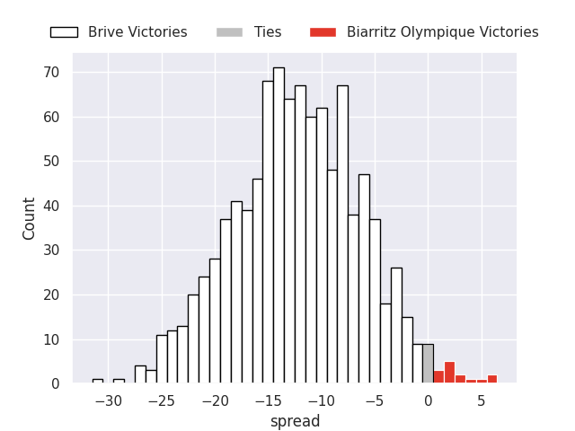

#### Agen V Beziers on 2026/11/27

Average Margin: Agen by 13.3

#### Provence Rugby V US Montauban on 2026/11/27

Average Margin: Provence Rugby by 17.5

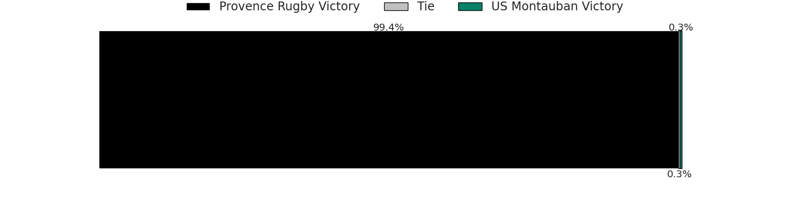

#### Soyaux-Angouleme V Nice on 2026/11/27

Average Margin: Soyaux-Angouleme by 6.4

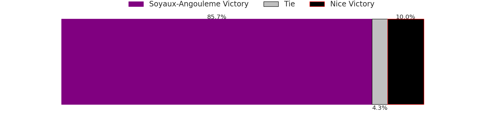

#### Valence Romans Drome Rugby V Aurillac on 2026/11/27

Average Margin: Valence Romans Drome Rugby by 10.0

#### Colomiers V USON Nevers on 2026/11/27

Average Margin: Colomiers by 16.3

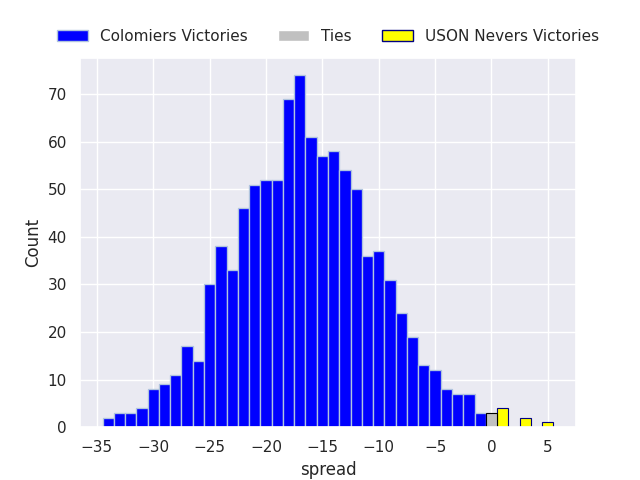

#### Dax V Oyonnax on 2026/11/27

Average Margin: Oyonnax by 1.7

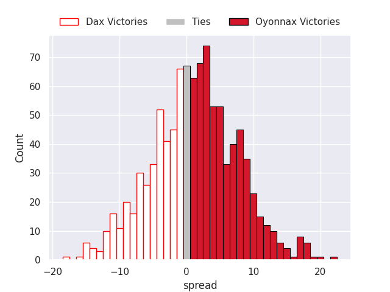

#### Narbonne V Grenoble on 2026/11/27

Average Margin: Narbonne by 1.8

### Week 15
#### Biarritz Olympique V Provence Rugby on 2026/12/03

Average Margin: Provence Rugby by 2.5

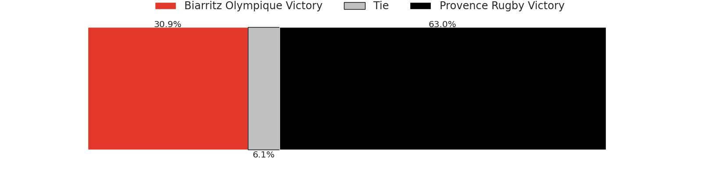

#### USON Nevers V Dax on 2026/12/04

Average Margin: USON Nevers by 0.2

#### US Montauban V Valence Romans Drome Rugby on 2026/12/04

Average Margin: Valence Romans Drome Rugby by 1.9

#### Nice V Colomiers on 2026/12/04

Average Margin: Nice by 1.6

#### Oyonnax V Grenoble on 2026/12/04

Average Margin: Oyonnax by 13.5

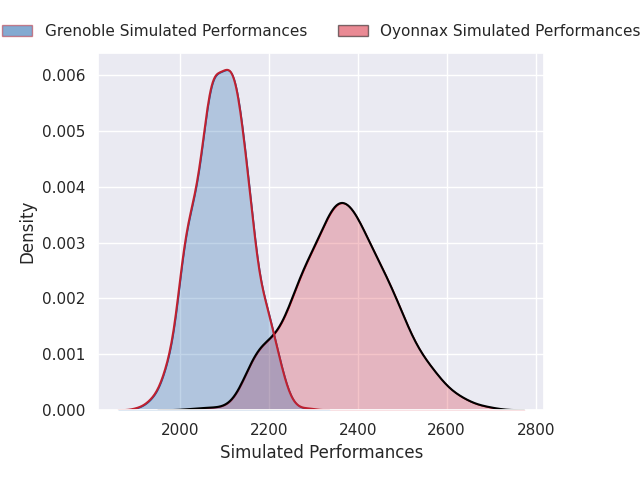
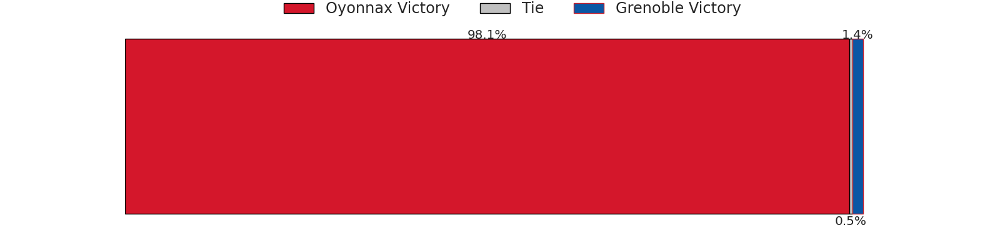
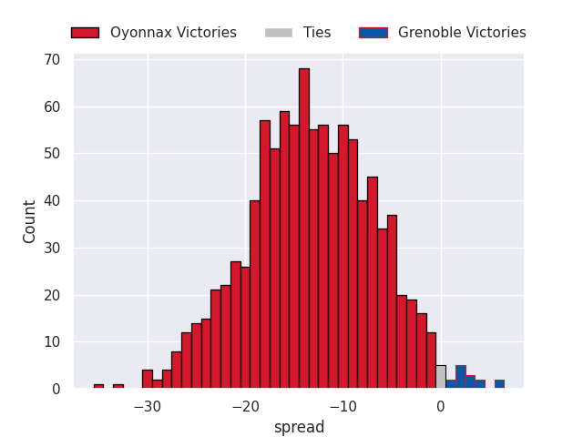

#### Narbonne V Agen on 2026/12/04

Average Margin: Narbonne by 2.5

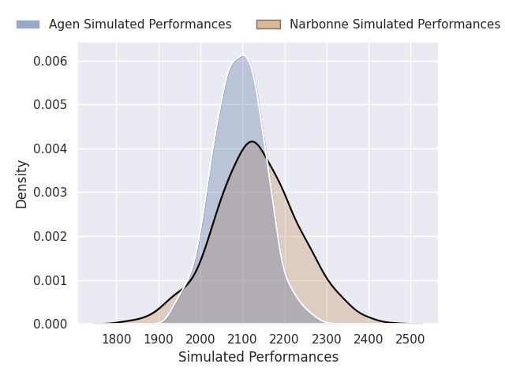
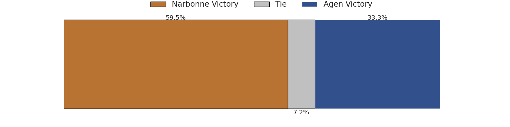

#### Aurillac V Soyaux-Angouleme on 2026/12/04

Average Margin: Aurillac by 7.7

#### Beziers V Brive on 2026/12/04

Average Margin: Brive by 3.3

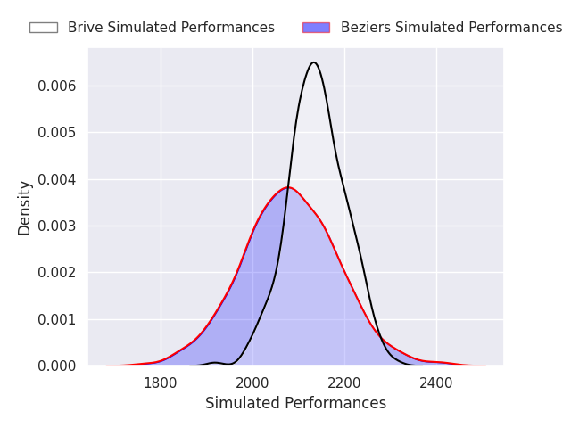
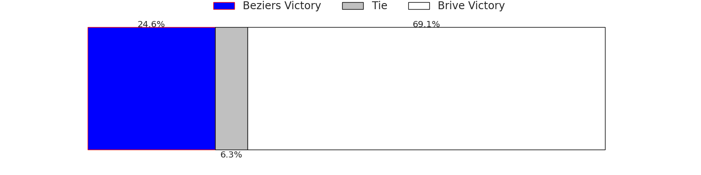
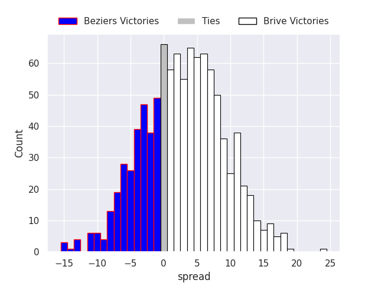

### Week 16
#### Agen V Aurillac on 2026/12/11

Average Margin: Agen by 8.2

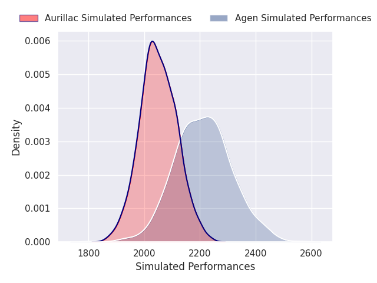

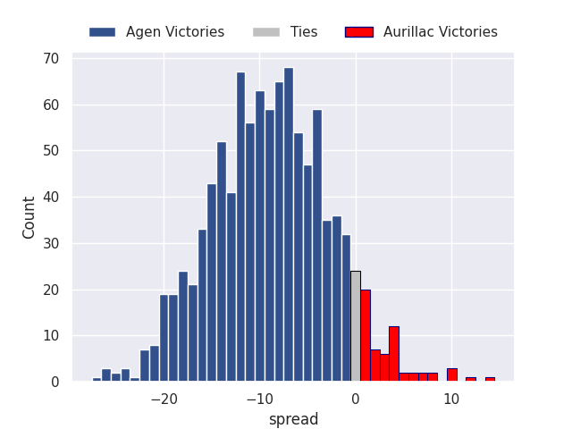

#### Provence Rugby V Brive on 2026/12/11

Average Margin: Provence Rugby by 8.3

#### Grenoble V USON Nevers on 2026/12/11

Average Margin: Grenoble by 14.3

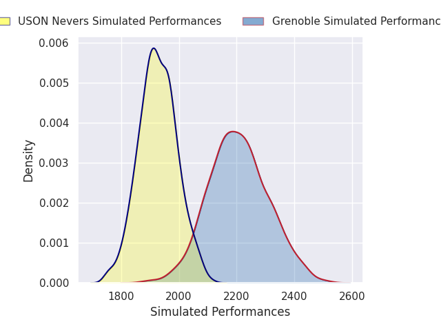

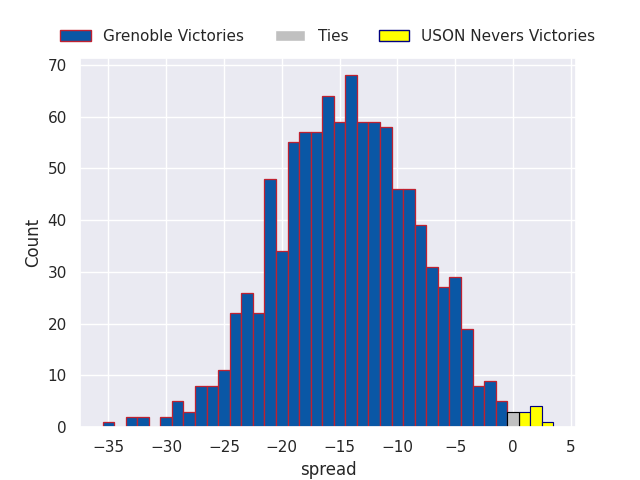

#### Colomiers V US Montauban on 2026/12/11

Average Margin: Colomiers by 14.6

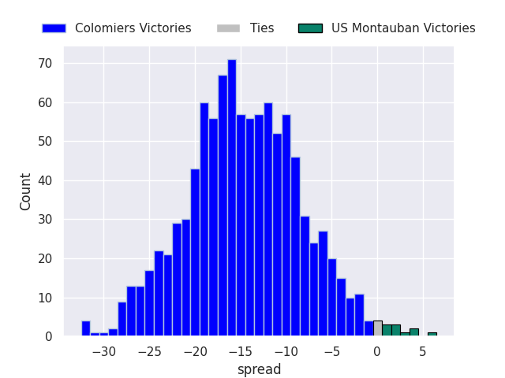

#### Nice V Oyonnax on 2026/12/11

Average Margin: Oyonnax by 3.1

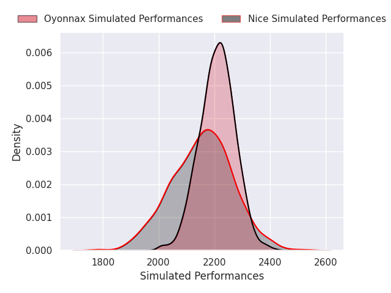

#### Soyaux-Angouleme V Beziers on 2026/12/11

Average Margin: Soyaux-Angouleme by 11.7

#### Dax V Biarritz Olympique on 2026/12/11

Average Margin: Dax by 7.6

#### Valence Romans Drome Rugby V Narbonne on 2026/12/11

Average Margin: Valence Romans Drome Rugby by 10.7

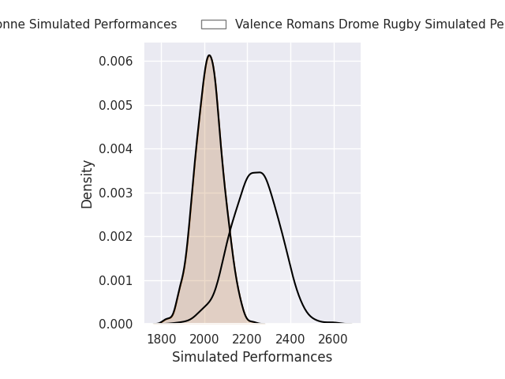

### Week 17
#### US Montauban V Nice on 2026/12/18

Average Margin: US Montauban by 1.1

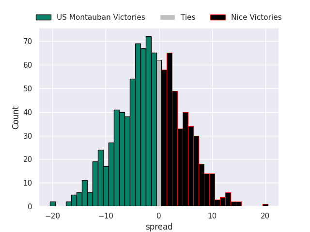

#### Valence Romans Drome Rugby V Agen on 2026/12/18

Average Margin: Valence Romans Drome Rugby by 8.0

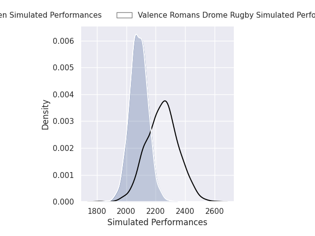

#### USON Nevers V Provence Rugby on 2026/12/18

Average Margin: Provence Rugby by 6.6

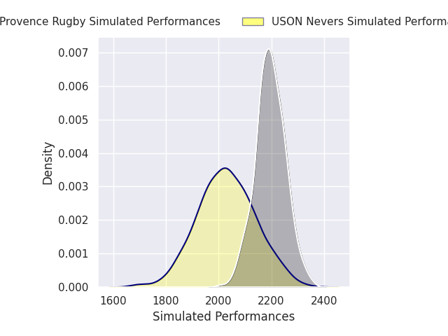

#### Brive V Soyaux-Angouleme on 2026/12/18

Average Margin: Brive by 11.0

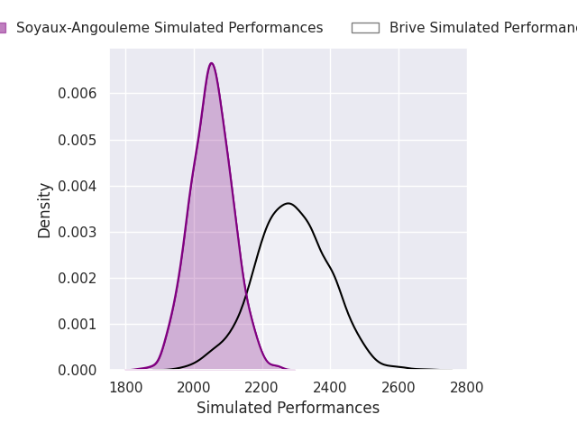

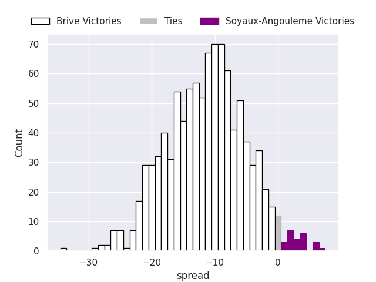

#### Oyonnax V Colomiers on 2026/12/18

Average Margin: Oyonnax by 11.8

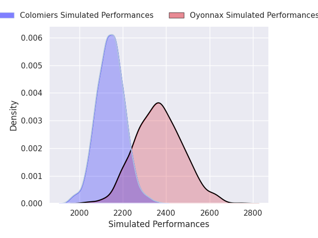
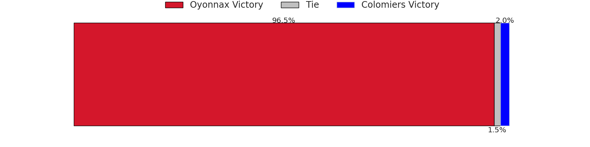

#### Dax V Grenoble on 2026/12/18

Average Margin: Dax by 4.3

#### Aurillac V Narbonne on 2026/12/18

Average Margin: Aurillac by 8.8

#### Beziers V Biarritz Olympique on 2026/12/18

Average Margin: Beziers by 2.5

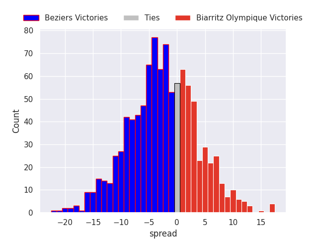

### Week 18
#### Nice V Dax on 2027/01/08

Average Margin: Nice by 5.2

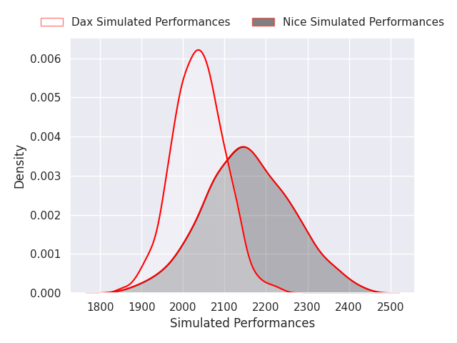
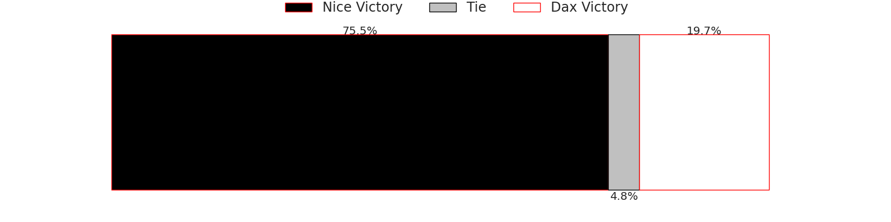

#### Provence Rugby V Valence Romans Drome Rugby on 2027/01/08

Average Margin: Provence Rugby by 9.5

#### Grenoble V Beziers on 2027/01/08

Average Margin: Grenoble by 12.7

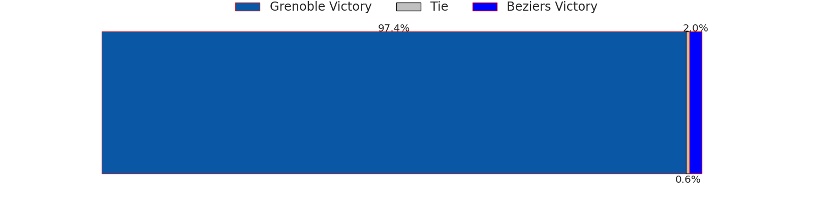

#### Soyaux-Angouleme V Oyonnax on 2027/01/08

Average Margin: Oyonnax by 0.9

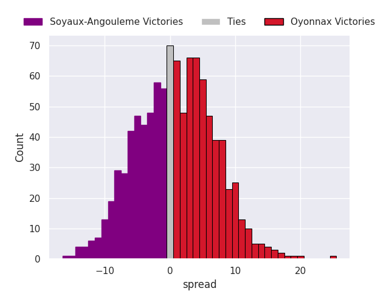

#### Agen V USON Nevers on 2027/01/08

Average Margin: Agen by 14.3

#### Narbonne V US Montauban on 2027/01/08

Average Margin: Narbonne by 8.7

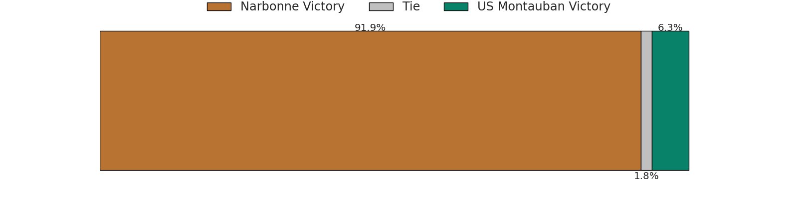

#### Biarritz Olympique V Aurillac on 2027/01/08

Average Margin: Biarritz Olympique by 4.8

#### Colomiers V Brive on 2027/01/08

Average Margin: Colomiers by 5.7

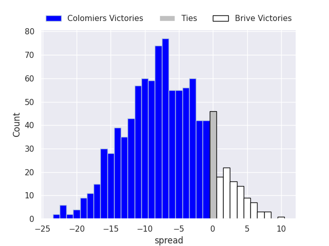

### Week 19
#### USON Nevers V Nice on 2027/01/15

Average Margin: Nice by 0.0

#### Oyonnax V Narbonne on 2027/01/15

Average Margin: Oyonnax by 16.8

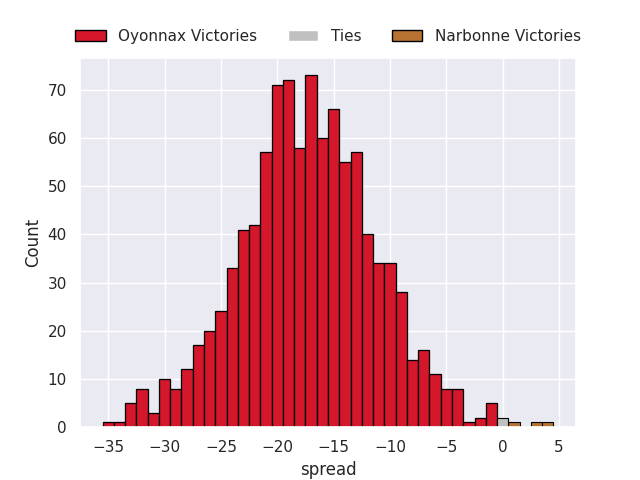

#### US Montauban V Biarritz Olympique on 2027/01/15

Average Margin: US Montauban by 2.9

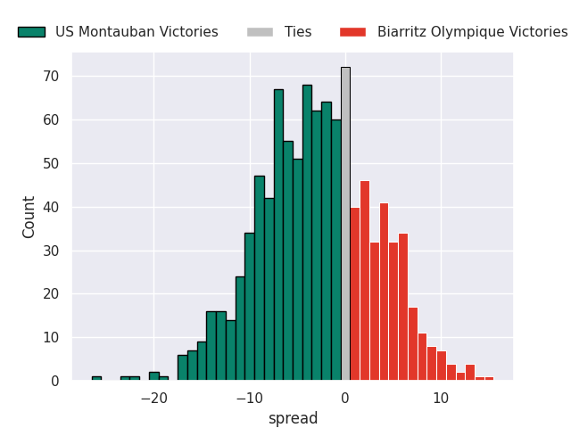

#### Brive V Agen on 2027/01/15

Average Margin: Brive by 9.2

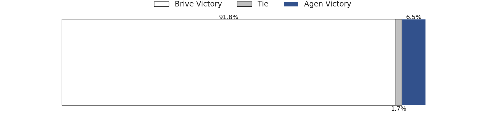
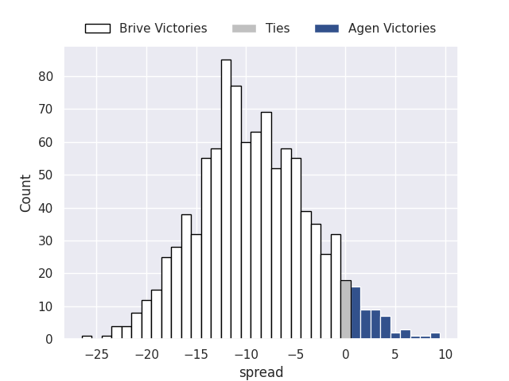

#### Valence Romans Drome Rugby V Grenoble on 2027/01/15

Average Margin: Valence Romans Drome Rugby by 7.5

#### Beziers V Colomiers on 2027/01/15

Average Margin: Colomiers by 2.4

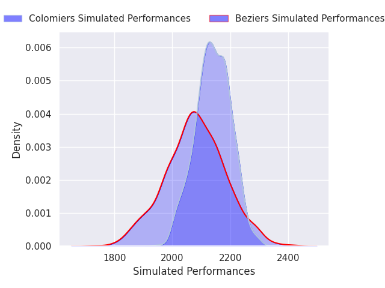

#### Aurillac V Provence Rugby on 2027/01/15

Average Margin: Aurillac by 1.2

#### Dax V Soyaux-Angouleme on 2027/01/15

Average Margin: Dax by 6.5

### Week 20
#### Nice V Brive on 2027/01/22

Average Margin: Nice by 0.8

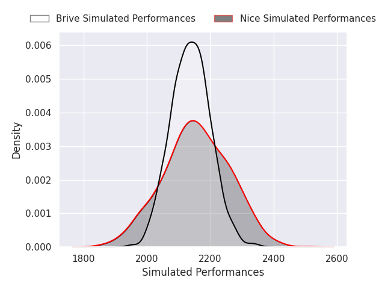

#### Oyonnax V Beziers on 2027/01/22

Average Margin: Oyonnax by 20.6

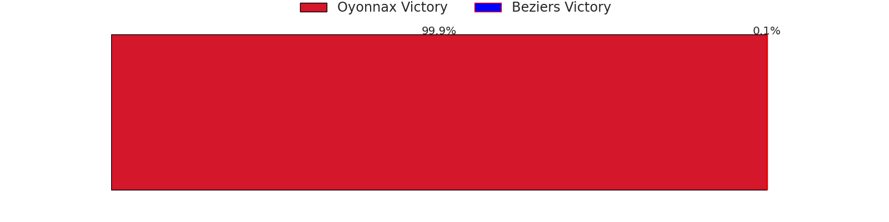

#### Colomiers V Aurillac on 2027/01/22

Average Margin: Colomiers by 10.5

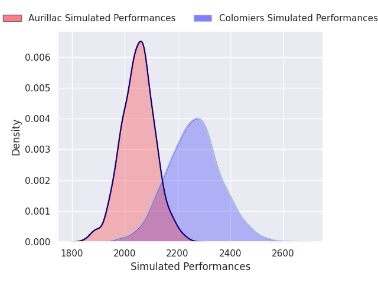
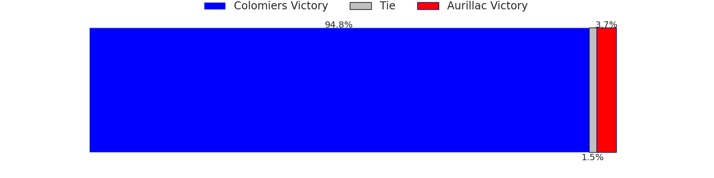

#### Soyaux-Angouleme V Valence Romans Drome Rugby on 2027/01/22

Average Margin: Soyaux-Angouleme by 3.6

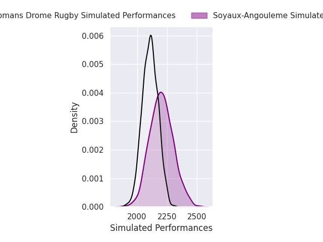
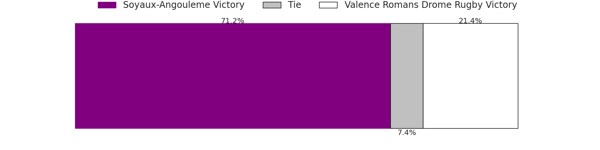

#### Provence Rugby V Grenoble on 2027/01/22

Average Margin: Provence Rugby by 10.7

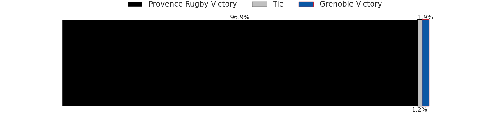

#### Biarritz Olympique V USON Nevers on 2027/01/22

Average Margin: Biarritz Olympique by 11.2

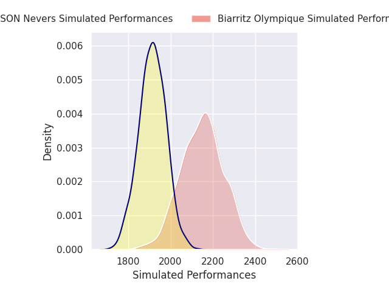

#### Narbonne V Dax on 2027/01/22

Average Margin: Narbonne by 4.3

#### Agen V US Montauban on 2027/01/22

Average Margin: Agen by 12.8

### Week 21
#### US Montauban V Soyaux-Angouleme on 2027/01/29

Average Margin: US Montauban by 1.5

#### Valence Romans Drome Rugby V Biarritz Olympique on 2027/01/29

Average Margin: Valence Romans Drome Rugby by 10.7

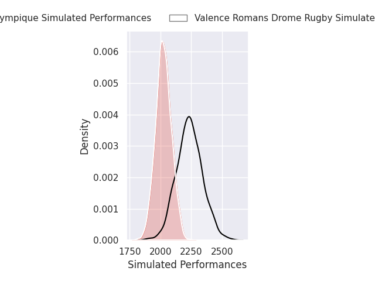

#### Grenoble V Nice on 2027/01/29

Average Margin: Grenoble by 7.6

#### USON Nevers V Colomiers on 2027/01/29

Average Margin: Colomiers by 3.4

#### Beziers V Provence Rugby on 2027/01/29

Average Margin: Provence Rugby by 6.0

#### Dax V Agen on 2027/01/29

Average Margin: Dax by 4.0

#### Brive V Narbonne on 2027/01/29

Average Margin: Brive by 12.4

#### Aurillac V Oyonnax on 2027/01/29

Average Margin: Aurillac by 0.1

### Week 22
#### Soyaux-Angouleme V USON Nevers on 2027/02/12

Average Margin: Soyaux-Angouleme by 13.0

#### Oyonnax V US Montauban on 2027/02/12

Average Margin: Oyonnax by 20.3

#### Nice V Agen on 2027/02/12

Average Margin: Nice by 3.1

#### Grenoble V Brive on 2027/02/12

Average Margin: Grenoble by 3.7

#### Colomiers V Valence Romans Drome Rugby on 2027/02/12

Average Margin: Colomiers by 6.5

#### Provence Rugby V Dax on 2027/02/12

Average Margin: Provence Rugby by 13.0

#### Aurillac V Beziers on 2027/02/12

Average Margin: Aurillac by 12.8

#### Narbonne V Biarritz Olympique on 2027/02/12

Average Margin: Narbonne by 5.5

### Week 23
#### Agen V Narbonne on 2027/02/19

Average Margin: Agen by 9.3

#### Dax V Colomiers on 2027/02/19

Average Margin: Dax by 2.5

#### USON Nevers V Grenoble on 2027/02/19

Average Margin: Grenoble by 1.8

#### Valence Romans Drome Rugby V Nice on 2027/02/19

Average Margin: Valence Romans Drome Rugby by 9.2

#### Beziers V Soyaux-Angouleme on 2027/02/19

Average Margin: Beziers by 1.0

#### Biarritz Olympique V Oyonnax on 2027/02/19

Average Margin: Oyonnax by 2.7

#### Brive V Provence Rugby on 2027/02/19

Average Margin: Brive by 4.5

#### US Montauban V Aurillac on 2027/02/19

Average Margin: US Montauban by 2.1

### Week 24
#### Grenoble V US Montauban on 2027/02/26

Average Margin: Grenoble by 12.3

#### Provence Rugby V USON Nevers on 2027/02/26

Average Margin: Provence Rugby by 18.8

#### Narbonne V Valence Romans Drome Rugby on 2027/02/26

Average Margin: Narbonne by 1.0

#### Oyonnax V Dax on 2027/02/26

Average Margin: Oyonnax by 15.7

#### Nice V Biarritz Olympique on 2027/02/26

Average Margin: Nice by 6.5

#### Colomiers V Soyaux-Angouleme on 2027/02/26

Average Margin: Colomiers by 9.7

#### Aurillac V Agen on 2027/02/26

Average Margin: Aurillac by 5.7

#### Brive V Beziers on 2027/02/26

Average Margin: Brive by 16.1

### Week 25
#### US Montauban V Provence Rugby on 2027/03/05

Average Margin: Provence Rugby by 5.2

#### USON Nevers V Oyonnax on 2027/03/05

Average Margin: Oyonnax by 7.3

#### Dax V Aurillac on 2027/03/05

Average Margin: Dax by 6.3

#### Valence Romans Drome Rugby V Brive on 2027/03/05

Average Margin: Valence Romans Drome Rugby by 5.3

#### Beziers V Nice on 2027/03/05

Average Margin: Beziers by 1.0

#### Soyaux-Angouleme V Narbonne on 2027/03/05

Average Margin: Soyaux-Angouleme by 8.1

#### Agen V Colomiers on 2027/03/05

Average Margin: Agen by 4.7

#### Biarritz Olympique V Grenoble on 2027/03/05

Average Margin: Biarritz Olympique by 2.8

### Week 26
#### Provence Rugby V Soyaux-Angouleme on 2027/03/26

Average Margin: Provence Rugby by 12.2

#### Grenoble V Narbonne on 2027/03/26

Average Margin: Grenoble by 9.3

#### Biarritz Olympique V Agen on 2027/03/26

Average Margin: Biarritz Olympique by 3.0

#### Aurillac V Valence Romans Drome Rugby on 2027/03/26

Average Margin: Aurillac by 4.4

#### Brive V USON Nevers on 2027/03/26

Average Margin: Brive by 17.2

#### Colomiers V Oyonnax on 2027/03/26

Average Margin: Colomiers by 2.2

#### Dax V Beziers on 2027/03/26

Average Margin: Dax by 11.0

#### Nice V US Montauban on 2027/03/26

Average Margin: Nice by 9.7

### Week 27
#### Narbonne V Provence Rugby on 2027/04/02

Average Margin: Provence Rugby by 2.3

#### Valence Romans Drome Rugby V Dax on 2027/04/02

Average Margin: Valence Romans Drome Rugby by 9.5

#### Soyaux-Angouleme V Brive on 2027/04/02

Average Margin: Soyaux-Angouleme by 2.4

#### Colomiers V Biarritz Olympique on 2027/04/02

Average Margin: Colomiers by 11.2

#### Beziers V US Montauban on 2027/04/02

Average Margin: Beziers by 6.0

#### USON Nevers V Aurillac on 2027/04/02

Average Margin: USON Nevers by 0.7

#### Agen V Grenoble on 2027/04/02

Average Margin: Agen by 6.1

#### Oyonnax V Nice on 2027/04/02

Average Margin: Oyonnax by 15.2

### Week 28
#### Grenoble V Dax on 2027/04/09

Average Margin: Grenoble by 8.0

#### Brive V Oyonnax on 2027/04/09

Average Margin: Brive by 3.6

#### Narbonne V Aurillac on 2027/04/09

Average Margin: Narbonne by 4.0

#### US Montauban V USON Nevers on 2027/04/09

Average Margin: US Montauban by 7.8

#### Biarritz Olympique V Beziers on 2027/04/09

Average Margin: Biarritz Olympique by 9.8

#### Nice V Soyaux-Angouleme on 2027/04/09

Average Margin: Nice by 4.9

#### Provence Rugby V Colomiers on 2027/04/09

Average Margin: Provence Rugby by 9.3

#### Agen V Valence Romans Drome Rugby on 2027/04/09

Average Margin: Agen by 5.2

### Week 29
#### Valence Romans Drome Rugby V US Montauban on 2027/04/16

Average Margin: Valence Romans Drome Rugby by 13.8

#### Aurillac V Grenoble on 2027/04/16

Average Margin: Aurillac by 5.4

#### Colomiers V Nice on 2027/04/16

Average Margin: Colomiers by 9.5

#### Oyonnax V Provence Rugby on 2027/04/16

Average Margin: Oyonnax by 8.6

#### Soyaux-Angouleme V Biarritz Olympique on 2027/04/16

Average Margin: Soyaux-Angouleme by 8.1

#### USON Nevers V Narbonne on 2027/04/16

Average Margin: USON Nevers by 1.5

#### Dax V Brive on 2027/04/16

Average Margin: Dax by 2.3

#### Beziers V Agen on 2027/04/16

Average Margin: Agen by 0.6

### Week 30
#### Agen V Soyaux-Angouleme on 2027/04/23

Average Margin: Agen by 8.0

#### Narbonne V Beziers on 2027/04/23

Average Margin: Narbonne by 8.9

#### USON Nevers V Valence Romans Drome Rugby on 2027/04/23

Average Margin: Valence Romans Drome Rugby by 2.3

#### US Montauban V Colomiers on 2027/04/23

Average Margin: Colomiers by 1.7

#### Provence Rugby V Nice on 2027/04/23

Average Margin: Provence Rugby by 12.5

#### Biarritz Olympique V Dax on 2027/04/23

Average Margin: Biarritz Olympique by 5.1

#### Brive V Aurillac on 2027/04/23

Average Margin: Brive by 11.2

#### Grenoble V Oyonnax on 2027/04/23

Average Margin: Grenoble by 0.1

### Week 31
#### Soyaux-Angouleme V Aurillac on 2027/05/07

Average Margin: Soyaux-Angouleme by 6.5

#### Nice V Narbonne on 2027/05/07

Average Margin: Nice by 5.7

#### Oyonnax V Agen on 2027/05/07

Average Margin: Oyonnax by 13.7

#### Provence Rugby V Biarritz Olympique on 2027/05/07

Average Margin: Provence Rugby by 14.1

#### Brive V US Montauban on 2027/05/07

Average Margin: Brive by 15.6

#### Beziers V Valence Romans Drome Rugby on 2027/05/07

Average Margin: Valence Romans Drome Rugby by 1.9

#### Dax V USON Nevers on 2027/05/07

Average Margin: Dax by 12.1

#### Colomiers V Grenoble on 2027/05/07

Average Margin: Colomiers by 7.9

### Week 32
#### Grenoble V Soyaux-Angouleme on 2027/05/14

Average Margin: Grenoble by 7.7

#### Narbonne V Colomiers on 2027/05/14

Average Margin: Narbonne by 0.9

#### Biarritz Olympique V Brive on 2027/05/14

Average Margin: Biarritz Olympique by 0.4

#### Aurillac V Nice on 2027/05/14

Average Margin: Aurillac by 7.6

#### USON Nevers V Beziers on 2027/05/14

Average Margin: USON Nevers by 5.4

#### Agen V Provence Rugby on 2027/05/14

Average Margin: Agen by 1.2

#### US Montauban V Dax on 2027/05/14

Average Margin: US Montauban by 2.0

#### Valence Romans Drome Rugby V Oyonnax on 2027/05/14

Average Margin: Valence Romans Drome Rugby by 2.2

