## Team Rankings

## Standings
### Current Standings

| Club                       |   Played |   Wins |   Point Differential |   Losing Bonus Points |   Try Bonus Points |   Competition Points |
|:---------------------------|---------:|-------:|---------------------:|----------------------:|-------------------:|---------------------:|
| Oyonnax                    |        5 |      5 |                   90 |                     0 |                  4 |                   24 |
| Brive                      |        5 |      5 |                   62 |                     0 |                  3 |                   23 |
| Provence Rugby             |        5 |      5 |                   52 |                     0 |                  2 |                   22 |
| Biarritz Olympique         |        5 |      4 |                   41 |                     0 |                  2 |                   18 |
| Soyaux-Angouleme           |        5 |      3 |                   42 |                     1 |                  4 |                   17 |
| Grenoble                   |        5 |      3 |                   22 |                     2 |                  3 |                   17 |
| Dax                        |        5 |      3 |                   -2 |                     0 |                  3 |                   15 |
| US Montauban               |        5 |      3 |                  -14 |                     0 |                  1 |                   13 |
| Narbonne                   |        5 |      2 |                  -46 |                     1 |                  2 |                   11 |
| Valence Romans Drome Rugby |        5 |      1 |                    1 |                     4 |                  1 |                    9 |
| Beziers                    |        5 |      2 |                  -65 |                     0 |                  1 |                    9 |
| Aurillac                   |        5 |      1 |                  -34 |                     2 |                  2 |                    8 |
| Colomiers                  |        5 |      1 |                   -5 |                     1 |                  2 |                    7 |
| Nice                       |        5 |      1 |                  -47 |                     1 |                  2 |                    7 |
| Agen                       |        5 |      1 |                  -67 |                     1 |                  1 |                    6 |
| USON Nevers                |        5 |      0 |                  -30 |                     4 |                  1 |                    5 |

### Projected Remaining Table

| Club                       |   To Play |   Projected Wins |   Projected Differential |   Projected Losing Bonus Points | Projected Try Bonus Points   |   Projected Competition Points |
|:---------------------------|----------:|-----------------:|-------------------------:|--------------------------------:|:-----------------------------|-------------------------------:|
| Oyonnax                    |        25 |           18.439 |                  187.426 |                           4.137 |                              |                         79.393 |
| Provence Rugby             |        25 |           17.692 |                  141.59  |                           4.352 |                              |                         76.842 |
| Brive                      |        25 |           17.156 |                  149.096 |                           4.604 |                              |                         74.958 |
| Colomiers                  |        25 |           15.689 |                   93.672 |                           5.057 |                              |                         69.619 |
| Valence Romans Drome Rugby |        25 |           14.518 |                   65.462 |                           5.576 |                              |                         65.502 |
| Agen                       |        25 |           12.384 |                    1.518 |                           5.913 |                              |                         57.229 |
| Dax                        |        25 |           12.134 |                    4.909 |                           6.157 |                              |                         56.661 |
| Biarritz Olympique         |        25 |           12.051 |                    1.291 |                           6.412 |                              |                         56.546 |
| Narbonne                   |        25 |           11.007 |                  -25.444 |                           6.721 |                              |                         52.737 |
| Nice                       |        25 |           10.821 |                  -29.331 |                           6.896 |                              |                         52.24  |
| Soyaux-Angouleme           |        25 |           10.638 |                  -39.604 |                           6.45  |                              |                         50.978 |
| Aurillac                   |        25 |           10.094 |                  -56.076 |                           6.127 |                              |                         48.261 |
| Grenoble                   |        25 |            9.372 |                  -66.844 |                           6.714 |                              |                         46.066 |
| Beziers                    |        25 |            7.844 |                 -114.478 |                           6.578 |                              |                         39.744 |
| USON Nevers                |        25 |            7.68  |                 -119.846 |                           6.574 |                              |                         39.072 |
| US Montauban               |        25 |            5.204 |                 -193.341 |                           6.413 |                              |                         28.833 |

### Projected Total Table

| Club                       |   Played |   Wins |   Point Differential |   Losing Bonus Points |   Try Bonus Points |   Competition Points |
|:---------------------------|---------:|-------:|---------------------:|----------------------:|-------------------:|---------------------:|
| Oyonnax                    |       30 | 23.439 |              277.426 |                 4.137 |                  4 |              103.393 |
| Provence Rugby             |       30 | 22.692 |              193.59  |                 4.352 |                  2 |               98.842 |
| Brive                      |       30 | 22.156 |              211.096 |                 4.604 |                  3 |               97.958 |
| Colomiers                  |       30 | 16.689 |               88.672 |                 6.057 |                  2 |               76.619 |
| Biarritz Olympique         |       30 | 16.051 |               42.291 |                 6.412 |                  2 |               74.546 |
| Valence Romans Drome Rugby |       30 | 15.518 |               66.462 |                 9.576 |                  1 |               74.502 |
| Dax                        |       30 | 15.134 |                2.909 |                 6.157 |                  3 |               71.661 |
| Soyaux-Angouleme           |       30 | 13.638 |                2.396 |                 7.45  |                  4 |               67.978 |
| Narbonne                   |       30 | 13.007 |              -71.444 |                 7.721 |                  2 |               63.737 |
| Agen                       |       30 | 13.384 |              -65.482 |                 6.913 |                  1 |               63.229 |
| Grenoble                   |       30 | 12.372 |              -44.844 |                 8.714 |                  3 |               63.066 |
| Nice                       |       30 | 11.821 |              -76.331 |                 7.896 |                  2 |               59.24  |
| Aurillac                   |       30 | 11.094 |              -90.076 |                 8.127 |                  2 |               56.261 |
| Beziers                    |       30 |  9.844 |             -179.478 |                 6.578 |                  1 |               48.744 |
| USON Nevers                |       30 |  7.68  |             -149.846 |                10.574 |                  1 |               44.072 |
| US Montauban               |       30 |  8.204 |             -207.341 |                 6.413 |                  1 |               41.833 |

## Completed Match Review

| Model | Percent Correct Predictions | Spread Error |
| ------ | ------ | ------ |
| Club Level | 80.8% | 6.0 |
| Player Level: Lineup | nan% | nan |
| Player Level: Minutes | nan% | nan |

## Future Predictions
### Week 6
#### Grenoble V Colomiers on 2026/10/09

Average Margin: Grenoble by 0.8

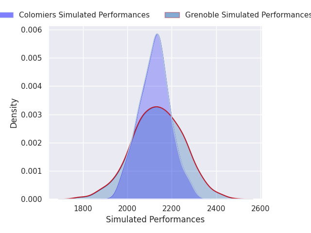

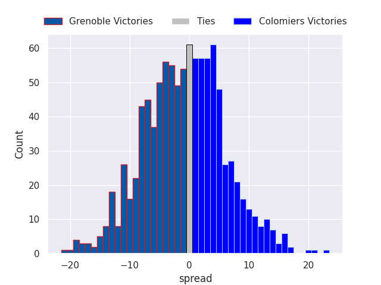

#### Valence Romans Drome Rugby V Beziers on 2026/10/09

Average Margin: Valence Romans Drome Rugby by 12.0

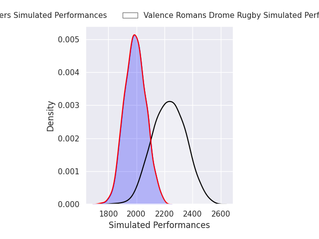
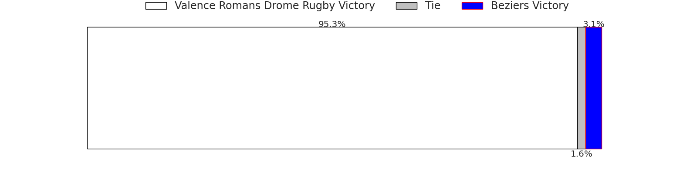
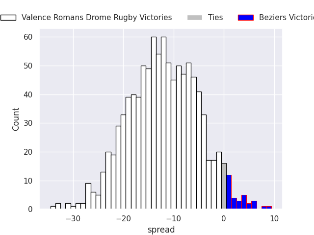

#### US Montauban V Brive on 2026/10/09

Average Margin: Brive by 6.6

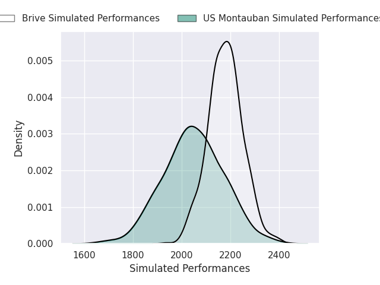
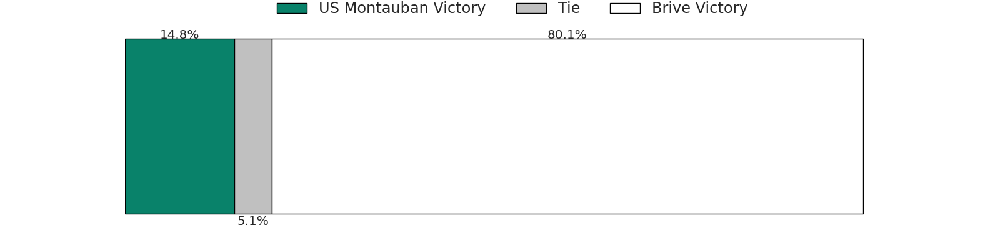
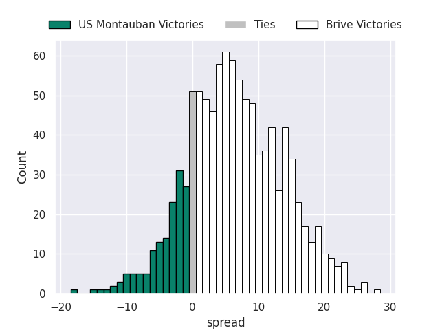

#### Narbonne V Oyonnax on 2026/10/09

Average Margin: Oyonnax by 2.1

#### Aurillac V Biarritz Olympique on 2026/10/09

Average Margin: Aurillac by 3.6

#### Agen V Dax on 2026/10/09

Average Margin: Agen by 4.9

#### Nice V USON Nevers on 2026/10/09

Average Margin: Nice by 9.1

#### Soyaux-Angouleme V Provence Rugby on 2026/10/09

Average Margin: Provence Rugby by 0.6

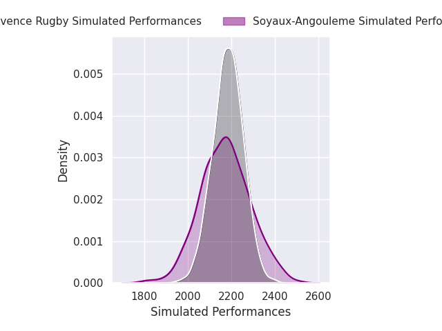

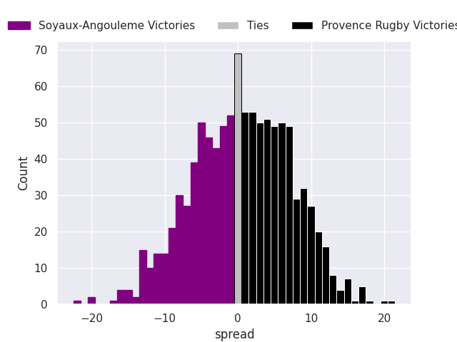

### Week 7
#### Brive V Grenoble on 2026/10/16

Average Margin: Brive by 14.0

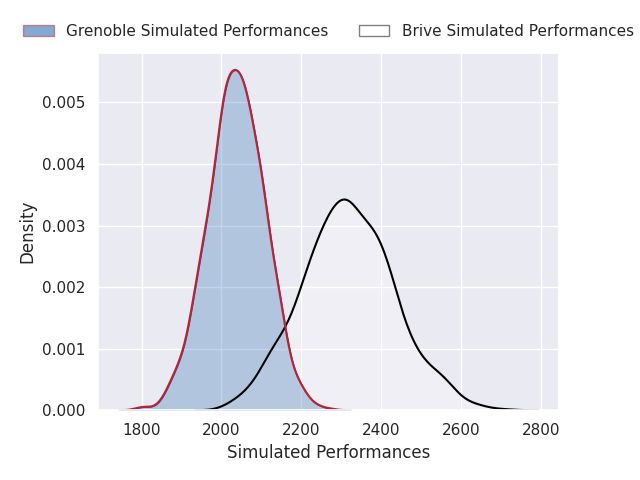
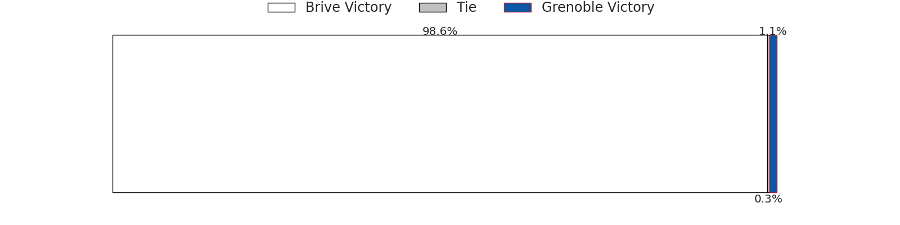
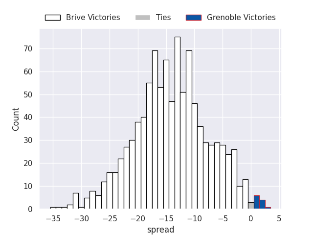

#### Oyonnax V Valence Romans Drome Rugby on 2026/10/16

Average Margin: Oyonnax by 12.9

#### Biarritz Olympique V Soyaux-Angouleme on 2026/10/16

Average Margin: Biarritz Olympique by 8.0

#### Nice V Provence Rugby on 2026/10/16

Average Margin: Provence Rugby by 1.6

#### Beziers V Aurillac on 2026/10/16

Average Margin: Beziers by 6.2

#### Colomiers V Narbonne on 2026/10/16

Average Margin: Colomiers by 10.2

#### USON Nevers V Agen on 2026/10/16

Average Margin: USON Nevers by 2.0

#### Dax V US Montauban on 2026/10/16

Average Margin: Dax by 14.0

### Week 8
#### Agen V Nice on 2026/10/23

Average Margin: Agen by 5.9

#### US Montauban V Oyonnax on 2026/10/23

Average Margin: Oyonnax by 8.6

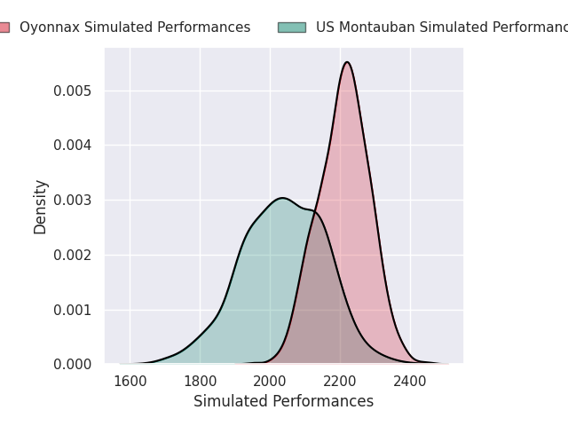
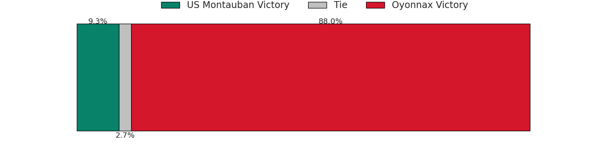
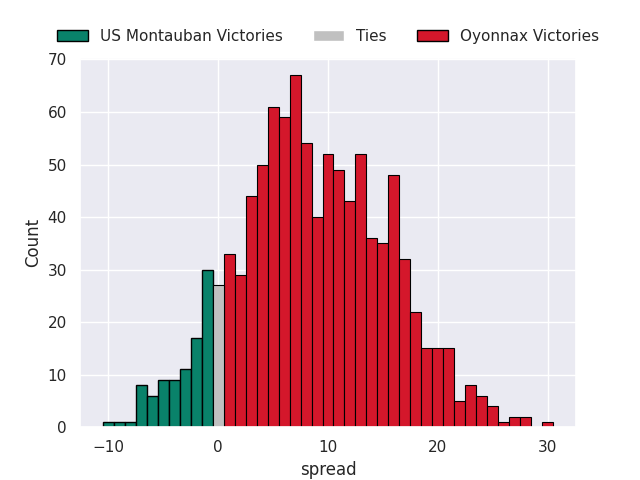

#### Narbonne V Brive on 2026/10/23

Average Margin: Brive by 0.9

#### Soyaux-Angouleme V Dax on 2026/10/23

Average Margin: Soyaux-Angouleme by 5.0

#### Provence Rugby V Beziers on 2026/10/23

Average Margin: Provence Rugby by 15.5

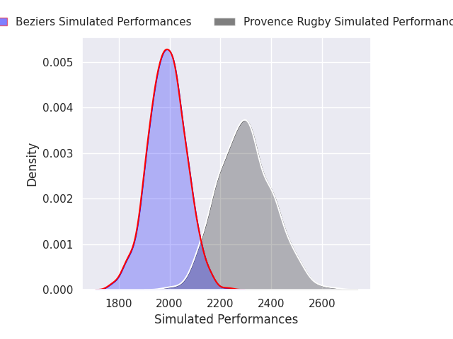
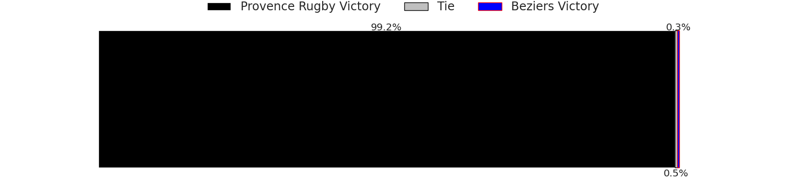
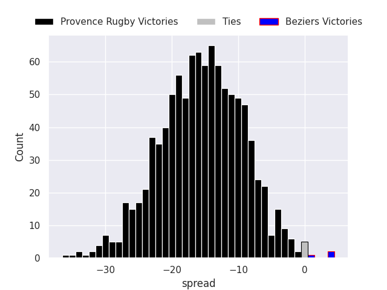

#### Aurillac V USON Nevers on 2026/10/23

Average Margin: Aurillac by 9.1

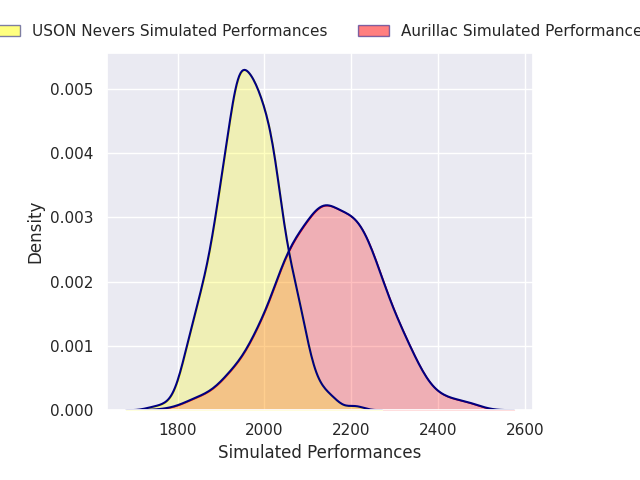
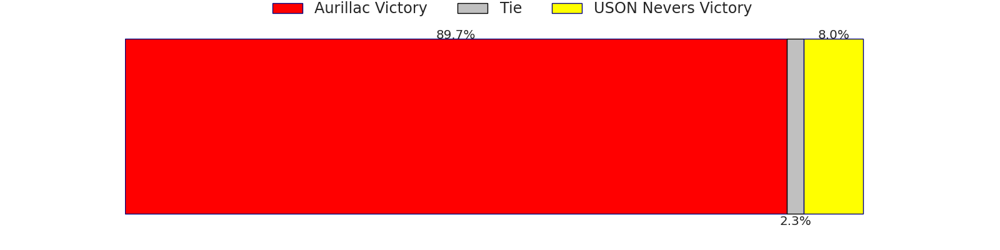
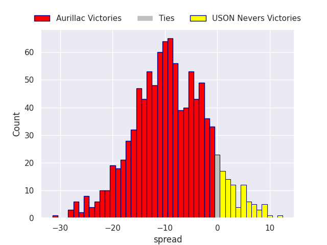

#### Grenoble V Biarritz Olympique on 2026/10/23

Average Margin: Grenoble by 3.6

#### Valence Romans Drome Rugby V Colomiers on 2026/10/23

Average Margin: Valence Romans Drome Rugby by 5.5

### Week 9
#### Oyonnax V Soyaux-Angouleme on 2026/10/30

Average Margin: Oyonnax by 16.4

#### Beziers V Grenoble on 2026/10/30

Average Margin: Beziers by 3.7

#### Colomiers V Agen on 2026/10/30

Average Margin: Colomiers by 9.9

#### US Montauban V Narbonne on 2026/10/30

Average Margin: Narbonne by 0.7

#### Nice V Aurillac on 2026/10/30

Average Margin: Nice by 7.6

#### USON Nevers V Brive on 2026/10/30

Average Margin: Brive by 3.9

#### Biarritz Olympique V Valence Romans Drome Rugby on 2026/10/30

Average Margin: Biarritz Olympique by 4.7

#### Dax V Provence Rugby on 2026/10/30

Average Margin: Dax by 0.8

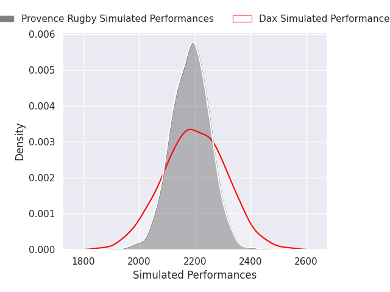

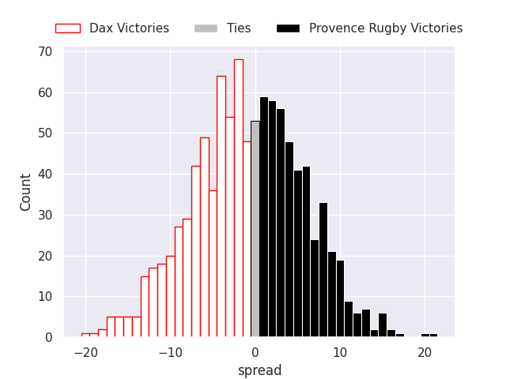

### Week 10
#### Aurillac V US Montauban on 2026/11/06

Average Margin: Aurillac by 11.2

#### Brive V Dax on 2026/11/06

Average Margin: Brive by 12.3

#### Colomiers V Beziers on 2026/11/06

Average Margin: Colomiers by 13.2

#### Provence Rugby V Oyonnax on 2026/11/06

Average Margin: Provence Rugby by 4.4

#### Agen V Biarritz Olympique on 2026/11/06

Average Margin: Agen by 5.3

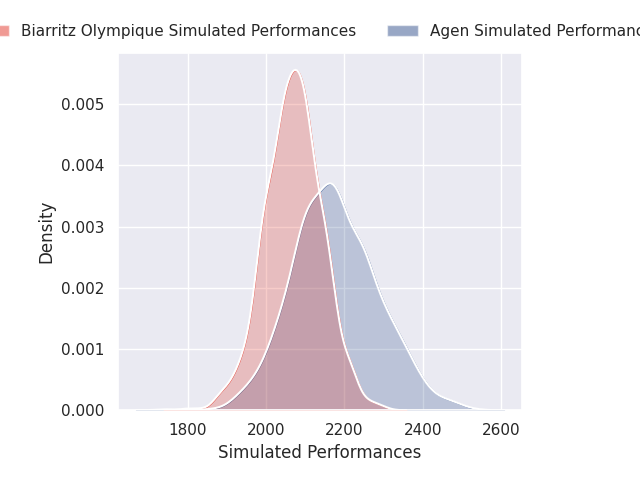
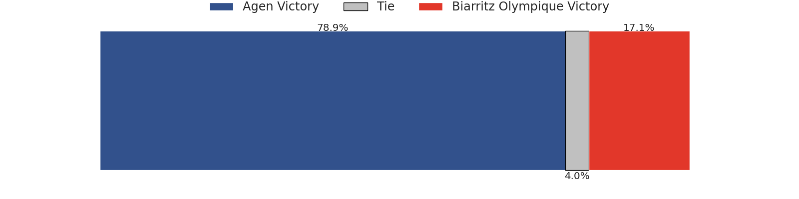
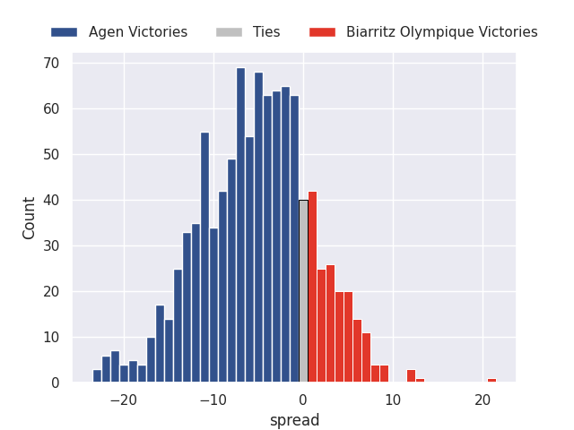

#### Valence Romans Drome Rugby V USON Nevers on 2026/11/06

Average Margin: Valence Romans Drome Rugby by 13.5

#### Narbonne V Nice on 2026/11/06

Average Margin: Narbonne by 5.2

#### Soyaux-Angouleme V Grenoble on 2026/11/06

Average Margin: Soyaux-Angouleme by 7.2

### Week 11
#### USON Nevers V Soyaux-Angouleme on 2026/11/20

Average Margin: USON Nevers by 3.0

#### Biarritz Olympique V Narbonne on 2026/11/20

Average Margin: Biarritz Olympique by 7.1

#### US Montauban V Agen on 2026/11/20

Average Margin: Agen by 0.0

#### Nice V Valence Romans Drome Rugby on 2026/11/20

Average Margin: Nice by 2.1

#### Grenoble V Provence Rugby on 2026/11/20

Average Margin: Provence Rugby by 1.7

#### Aurillac V Colomiers on 2026/11/20

Average Margin: Aurillac by 1.1

#### Oyonnax V Brive on 2026/11/20

Average Margin: Oyonnax by 9.4

#### Beziers V Dax on 2026/11/20

Average Margin: Beziers by 2.1

### Week 12
#### Valence Romans Drome Rugby V Aurillac on 2026/11/27

Average Margin: Valence Romans Drome Rugby by 12.2

#### Dax V Oyonnax on 2026/11/27

Average Margin: Oyonnax by 0.5

#### Brive V Biarritz Olympique on 2026/11/27

Average Margin: Brive by 12.3

#### Colomiers V USON Nevers on 2026/11/27

Average Margin: Colomiers by 14.4

#### Narbonne V Grenoble on 2026/11/27

Average Margin: Narbonne by 6.5

#### Provence Rugby V US Montauban on 2026/11/27

Average Margin: Provence Rugby by 18.7

#### Agen V Beziers on 2026/11/27

Average Margin: Agen by 9.6

#### Soyaux-Angouleme V Nice on 2026/11/27

Average Margin: Soyaux-Angouleme by 6.0

### Week 13
#### Aurillac V Soyaux-Angouleme on 2026/12/04

Average Margin: Aurillac by 5.0

#### Biarritz Olympique V Provence Rugby on 2026/12/04

Average Margin: Biarritz Olympique by 0.6

#### Oyonnax V Grenoble on 2026/12/04

Average Margin: Oyonnax by 16.0

#### Narbonne V Agen on 2026/12/04

Average Margin: Narbonne by 5.6

#### US Montauban V Valence Romans Drome Rugby on 2026/12/04

Average Margin: Valence Romans Drome Rugby by 2.9

#### USON Nevers V Dax on 2026/12/04

Average Margin: USON Nevers by 1.6

#### Nice V Colomiers on 2026/12/04

Average Margin: Nice by 1.2

#### Beziers V Brive on 2026/12/04

Average Margin: Brive by 2.9

### Week 14
#### Provence Rugby V Brive on 2026/12/11

Average Margin: Provence Rugby by 6.1

#### Agen V Aurillac on 2026/12/11

Average Margin: Agen by 9.3

#### Nice V Oyonnax on 2026/12/11

Average Margin: Oyonnax by 3.0

#### Dax V Biarritz Olympique on 2026/12/11

Average Margin: Dax by 6.5

#### Grenoble V USON Nevers on 2026/12/11

Average Margin: Grenoble by 8.7

#### Colomiers V US Montauban on 2026/12/11

Average Margin: Colomiers by 16.0

#### Valence Romans Drome Rugby V Narbonne on 2026/12/11

Average Margin: Valence Romans Drome Rugby by 8.6

#### Soyaux-Angouleme V Beziers on 2026/12/11

Average Margin: Soyaux-Angouleme by 8.6

### Week 15
#### US Montauban V Nice on 2026/12/18

Average Margin: Nice by 0.5

#### USON Nevers V Provence Rugby on 2026/12/18

Average Margin: Provence Rugby by 4.0

#### Oyonnax V Colomiers on 2026/12/18

Average Margin: Oyonnax by 12.3

#### Brive V Soyaux-Angouleme on 2026/12/18

Average Margin: Brive by 13.5

#### Dax V Grenoble on 2026/12/18

Average Margin: Dax by 8.1

#### Valence Romans Drome Rugby V Agen on 2026/12/18

Average Margin: Valence Romans Drome Rugby by 9.1

#### Beziers V Biarritz Olympique on 2026/12/18

Average Margin: Beziers by 2.2

#### Aurillac V Narbonne on 2026/12/18

Average Margin: Aurillac by 4.5

### Week 16
#### Agen V USON Nevers on 2027/01/08

Average Margin: Agen by 10.1

#### Grenoble V Beziers on 2027/01/08

Average Margin: Grenoble by 8.0

#### Nice V Dax on 2027/01/08

Average Margin: Nice by 4.3

#### Biarritz Olympique V Aurillac on 2027/01/08

Average Margin: Biarritz Olympique by 10.5

#### Provence Rugby V Valence Romans Drome Rugby on 2027/01/08

Average Margin: Provence Rugby by 9.9

#### Colomiers V Brive on 2027/01/08

Average Margin: Colomiers by 3.6

#### Narbonne V US Montauban on 2027/01/08

Average Margin: Narbonne by 11.8

#### Soyaux-Angouleme V Oyonnax on 2027/01/08

Average Margin: Oyonnax by 1.2

### Week 17
#### Valence Romans Drome Rugby V Grenoble on 2027/01/15

Average Margin: Valence Romans Drome Rugby by 9.7

#### USON Nevers V Nice on 2027/01/15

Average Margin: USON Nevers by 2.5

#### Oyonnax V Narbonne on 2027/01/15

Average Margin: Oyonnax by 15.3

#### Dax V Soyaux-Angouleme on 2027/01/15

Average Margin: Dax by 8.0

#### US Montauban V Biarritz Olympique on 2027/01/15

Average Margin: Biarritz Olympique by 1.2

#### Brive V Agen on 2027/01/15

Average Margin: Brive by 12.9

#### Beziers V Colomiers on 2027/01/15

Average Margin: Colomiers by 0.6

#### Aurillac V Provence Rugby on 2027/01/15

Average Margin: Provence Rugby by 2.0

### Week 18
#### Soyaux-Angouleme V Valence Romans Drome Rugby on 2027/01/22

Average Margin: Soyaux-Angouleme by 3.7

#### Colomiers V Aurillac on 2027/01/22

Average Margin: Colomiers by 12.9

#### Oyonnax V Beziers on 2027/01/22

Average Margin: Oyonnax by 18.3

#### Agen V US Montauban on 2027/01/22

Average Margin: Agen by 12.7

#### Narbonne V Dax on 2027/01/22

Average Margin: Narbonne by 4.4

#### Biarritz Olympique V USON Nevers on 2027/01/22

Average Margin: Biarritz Olympique by 11.1

#### Nice V Brive on 2027/01/22

Average Margin: Brive by 1.5

#### Provence Rugby V Grenoble on 2027/01/22

Average Margin: Provence Rugby by 12.8

### Week 19
#### USON Nevers V Colomiers on 2027/01/29

Average Margin: Colomiers by 0.9

#### Brive V Narbonne on 2027/01/29

Average Margin: Brive by 12.7

#### Beziers V Provence Rugby on 2027/01/29

Average Margin: Provence Rugby by 3.3

#### Grenoble V Nice on 2027/01/29

Average Margin: Grenoble by 5.0

#### Aurillac V Oyonnax on 2027/01/29

Average Margin: Oyonnax by 2.5

#### Valence Romans Drome Rugby V Biarritz Olympique on 2027/01/29

Average Margin: Valence Romans Drome Rugby by 7.9

#### Dax V Agen on 2027/01/29

Average Margin: Dax by 7.5

#### US Montauban V Soyaux-Angouleme on 2027/01/29

Average Margin: US Montauban by 0.4

### Week 20
#### Provence Rugby V Dax on 2027/02/12

Average Margin: Provence Rugby by 11.3

#### Oyonnax V US Montauban on 2027/02/12

Average Margin: Oyonnax by 21.0

#### Narbonne V Biarritz Olympique on 2027/02/12

Average Margin: Narbonne by 4.4

#### Aurillac V Beziers on 2027/02/12

Average Margin: Aurillac by 7.4

#### Nice V Agen on 2027/02/12

Average Margin: Nice by 4.6

#### Soyaux-Angouleme V USON Nevers on 2027/02/12

Average Margin: Soyaux-Angouleme by 9.7

#### Grenoble V Brive on 2027/02/12

Average Margin: Brive by 1.3

#### Colomiers V Valence Romans Drome Rugby on 2027/02/12

Average Margin: Colomiers by 7.3

### Week 21
#### Valence Romans Drome Rugby V Nice on 2027/02/19

Average Margin: Valence Romans Drome Rugby by 8.9

#### Dax V Colomiers on 2027/02/19

Average Margin: Dax by 4.2

#### Brive V Provence Rugby on 2027/02/19

Average Margin: Brive by 6.6

#### US Montauban V Aurillac on 2027/02/19

Average Margin: US Montauban by 2.7

#### Beziers V Soyaux-Angouleme on 2027/02/19

Average Margin: Beziers by 3.9

#### Biarritz Olympique V Oyonnax on 2027/02/19

Average Margin: Oyonnax by 0.1

#### Agen V Narbonne on 2027/02/19

Average Margin: Agen by 6.1

#### USON Nevers V Grenoble on 2027/02/19

Average Margin: USON Nevers by 3.7

### Week 22
#### Oyonnax V Dax on 2027/02/26

Average Margin: Oyonnax by 14.5

#### Nice V Biarritz Olympique on 2027/02/26

Average Margin: Nice by 4.2

#### Brive V Beziers on 2027/02/26

Average Margin: Brive by 15.9

#### Narbonne V Valence Romans Drome Rugby on 2027/02/26

Average Margin: Narbonne by 3.1

#### Provence Rugby V USON Nevers on 2027/02/26

Average Margin: Provence Rugby by 15.8

#### Aurillac V Agen on 2027/02/26

Average Margin: Aurillac by 4.8

#### Colomiers V Soyaux-Angouleme on 2027/02/26

Average Margin: Colomiers by 10.2

#### Grenoble V US Montauban on 2027/02/26

Average Margin: Grenoble by 11.1

### Week 23
#### US Montauban V Provence Rugby on 2027/03/05

Average Margin: Provence Rugby by 5.9

#### Beziers V Nice on 2027/03/05

Average Margin: Beziers by 3.1

#### Soyaux-Angouleme V Narbonne on 2027/03/05

Average Margin: Soyaux-Angouleme by 6.0

#### USON Nevers V Oyonnax on 2027/03/05

Average Margin: Oyonnax by 4.8

#### Dax V Aurillac on 2027/03/05

Average Margin: Dax by 10.2

#### Biarritz Olympique V Grenoble on 2027/03/05

Average Margin: Biarritz Olympique by 8.1

#### Agen V Colomiers on 2027/03/05

Average Margin: Agen by 2.7

#### Valence Romans Drome Rugby V Brive on 2027/03/05

Average Margin: Valence Romans Drome Rugby by 2.7

### Week 24
#### Aurillac V Valence Romans Drome Rugby on 2027/03/26

Average Margin: Aurillac by 2.2

#### Colomiers V Oyonnax on 2027/03/26

Average Margin: Colomiers by 2.4

#### Biarritz Olympique V Agen on 2027/03/26

Average Margin: Biarritz Olympique by 7.1

#### Provence Rugby V Soyaux-Angouleme on 2027/03/26

Average Margin: Provence Rugby by 12.7

#### Nice V US Montauban on 2027/03/26

Average Margin: Nice by 10.7

#### Brive V USON Nevers on 2027/03/26

Average Margin: Brive by 16.8

#### Dax V Beziers on 2027/03/26

Average Margin: Dax by 10.4

#### Grenoble V Narbonne on 2027/03/26

Average Margin: Grenoble by 4.7

### Week 25
#### Narbonne V Provence Rugby on 2027/04/02

Average Margin: Provence Rugby by 0.6

#### Beziers V US Montauban on 2027/04/02

Average Margin: Beziers by 9.0

#### Agen V Grenoble on 2027/04/02

Average Margin: Agen by 6.8

#### Soyaux-Angouleme V Brive on 2027/04/02

Average Margin: Soyaux-Angouleme by 0.2

#### Colomiers V Biarritz Olympique on 2027/04/02

Average Margin: Colomiers by 8.7

#### USON Nevers V Aurillac on 2027/04/02

Average Margin: USON Nevers by 5.6

#### Valence Romans Drome Rugby V Dax on 2027/04/02

Average Margin: Valence Romans Drome Rugby by 7.7

#### Oyonnax V Nice on 2027/04/02

Average Margin: Oyonnax by 15.3

### Week 26
#### Agen V Valence Romans Drome Rugby on 2027/04/09

Average Margin: Agen by 3.8

#### Nice V Soyaux-Angouleme on 2027/04/09

Average Margin: Nice by 5.2

#### Grenoble V Dax on 2027/04/09

Average Margin: Grenoble by 3.7

#### Provence Rugby V Colomiers on 2027/04/09

Average Margin: Provence Rugby by 9.0

#### Brive V Oyonnax on 2027/04/09

Average Margin: Brive by 5.5

#### Biarritz Olympique V Beziers on 2027/04/09

Average Margin: Biarritz Olympique by 10.0

#### Narbonne V Aurillac on 2027/04/09

Average Margin: Narbonne by 8.6

#### US Montauban V USON Nevers on 2027/04/09

Average Margin: US Montauban by 3.8

### Week 27
#### Valence Romans Drome Rugby V US Montauban on 2027/04/16

Average Margin: Valence Romans Drome Rugby by 14.7

#### Aurillac V Grenoble on 2027/04/16

Average Margin: Aurillac by 5.4

#### Oyonnax V Provence Rugby on 2027/04/16

Average Margin: Oyonnax by 9.5

#### Beziers V Agen on 2027/04/16

Average Margin: Beziers by 3.7

#### Colomiers V Nice on 2027/04/16

Average Margin: Colomiers by 9.2

#### Soyaux-Angouleme V Biarritz Olympique on 2027/04/16

Average Margin: Soyaux-Angouleme by 5.0

#### Dax V Brive on 2027/04/16

Average Margin: Dax by 1.6

#### USON Nevers V Narbonne on 2027/04/16

Average Margin: USON Nevers by 2.7

### Week 28
#### USON Nevers V Valence Romans Drome Rugby on 2027/04/23

Average Margin: USON Nevers by 0.5

#### Brive V Aurillac on 2027/04/23

Average Margin: Brive by 15.8

#### US Montauban V Colomiers on 2027/04/23

Average Margin: Colomiers by 3.3

#### Provence Rugby V Nice on 2027/04/23

Average Margin: Provence Rugby by 12.0

#### Grenoble V Oyonnax on 2027/04/23

Average Margin: Oyonnax by 2.5

#### Biarritz Olympique V Dax on 2027/04/23

Average Margin: Biarritz Olympique by 6.4

#### Narbonne V Beziers on 2027/04/23

Average Margin: Narbonne by 8.3

#### Agen V Soyaux-Angouleme on 2027/04/23

Average Margin: Agen by 6.8

### Week 29
#### Oyonnax V Agen on 2027/05/07

Average Margin: Oyonnax by 15.1

#### Beziers V Valence Romans Drome Rugby on 2027/05/07

Average Margin: Beziers by 1.1

#### Colomiers V Grenoble on 2027/05/07

Average Margin: Colomiers by 10.0

#### Nice V Narbonne on 2027/05/07

Average Margin: Nice by 4.8

#### Dax V USON Nevers on 2027/05/07

Average Margin: Dax by 11.3

#### Soyaux-Angouleme V Aurillac on 2027/05/07

Average Margin: Soyaux-Angouleme by 8.7

#### Provence Rugby V Biarritz Olympique on 2027/05/07

Average Margin: Provence Rugby by 11.0

#### Brive V US Montauban on 2027/05/07

Average Margin: Brive by 18.6

### Week 30
#### Grenoble V Soyaux-Angouleme on 2027/05/14

Average Margin: Grenoble by 4.9

#### Valence Romans Drome Rugby V Oyonnax on 2027/05/14

Average Margin: Valence Romans Drome Rugby by 1.6

#### Biarritz Olympique V Brive on 2027/05/14

Average Margin: Biarritz Olympique by 1.3

#### US Montauban V Dax on 2027/05/14

Average Margin: Dax by 1.1

#### Narbonne V Colomiers on 2027/05/14

Average Margin: Narbonne by 2.3

#### Agen V Provence Rugby on 2027/05/14

Average Margin: Provence Rugby by 0.1

#### Aurillac V Nice on 2027/05/14

Average Margin: Aurillac by 4.4

#### USON Nevers V Beziers on 2027/05/14

Average Margin: USON Nevers by 5.6

