## Team Rankings

## Standings
### Current Standings

| Club                       |   Played |   Wins |   Point Differential |   Losing Bonus Points |   Try Bonus Points |   Competition Points |
|:---------------------------|---------:|-------:|---------------------:|----------------------:|-------------------:|---------------------:|
| Provence Rugby             |       10 |      9 |                  124 |                     0 |                  4 |                   42 |
| Oyonnax                    |       10 |      8 |                  158 |                     1 |                  6 |                   39 |
| Brive                      |       11 |      7 |                   90 |                     0 |                  6 |                   34 |
| Grenoble                   |       10 |      7 |                   47 |                     3 |                  3 |                   34 |
| US Montauban               |       11 |      7 |                  -70 |                     0 |                  4 |                   32 |
| Soyaux-Angouleme           |       10 |      5 |                   79 |                     2 |                  5 |                   29 |
| Aurillac                   |       10 |      5 |                   54 |                     2 |                  5 |                   27 |
| Agen                       |       10 |      5 |                    4 |                     1 |                  5 |                   26 |
| Colomiers                  |       10 |      4 |                   60 |                     3 |                  5 |                   24 |
| Valence Romans Drome Rugby |       10 |      4 |                   37 |                     5 |                  3 |                   24 |
| Biarritz Olympique         |       10 |      5 |                  -23 |                     0 |                  2 |                   24 |
| Nice                       |       10 |      4 |                  -34 |                     2 |                  5 |                   23 |
| Dax                        |       10 |      4 |                  -80 |                     0 |                  5 |                   23 |
| Narbonne                   |       10 |      3 |                 -110 |                     3 |                  4 |                   19 |
| Beziers                    |       10 |      2 |                 -180 |                     2 |                  1 |                   11 |
| USON Nevers                |       10 |      0 |                 -156 |                     4 |                  1 |                    5 |

### Projected Remaining Table

| Club                       |   To Play |   Projected Wins |   Projected Differential |   Projected Losing Bonus Points | Projected Try Bonus Points   |   Projected Competition Points |
|:---------------------------|----------:|-----------------:|-------------------------:|--------------------------------:|:-----------------------------|-------------------------------:|
| Provence Rugby             |        21 |           15.757 |                  143.954 |                           3.208 |                              |                         67.618 |
| Oyonnax                    |        21 |           15.524 |                  158.636 |                           3.669 |                              |                         67.203 |
| Colomiers                  |        21 |           13.764 |                   89.691 |                           4.099 |                              |                         60.665 |
| Valence Romans Drome Rugby |        21 |           13.05  |                   69.404 |                           4.501 |                              |                         58.203 |
| Brive                      |        20 |           11.943 |                   73.525 |                           4.257 |                              |                         53.373 |
| Agen                       |        21 |           11.706 |                   40.069 |                           4.924 |                              |                         53.32  |
| Grenoble                   |        21 |           10.179 |                    5.617 |                           5.284 |                              |                         47.578 |
| Soyaux-Angouleme           |        21 |           10.067 |                    3.353 |                           5.363 |                              |                         47.197 |
| Nice                       |        21 |            9.5   |                  -20.561 |                           5.403 |                              |                         45.101 |
| Dax                        |        21 |            9.421 |                  -19.561 |                           5.516 |                              |                         44.866 |
| Aurillac                   |        21 |            9.198 |                  -24.804 |                           5.576 |                              |                         43.97  |
| Biarritz Olympique         |        21 |            8.32  |                  -41.49  |                           5.674 |                              |                         40.694 |
| Narbonne                   |        21 |            7.92  |                  -56.434 |                           5.676 |                              |                         39.032 |
| US Montauban               |        20 |            5.459 |                 -123.488 |                           4.858 |                              |                         28.028 |
| Beziers                    |        21 |            5.094 |                 -129.226 |                           5.924 |                              |                         27.772 |
| USON Nevers                |        21 |            4.018 |                 -168.685 |                           5.503 |                              |                         22.815 |

### Projected Total Table

| Club                       |   Played |   Wins |   Point Differential |   Losing Bonus Points |   Try Bonus Points |   Competition Points |
|:---------------------------|---------:|-------:|---------------------:|----------------------:|-------------------:|---------------------:|
| Provence Rugby             |       31 | 24.757 |              267.954 |                 3.208 |                  4 |              109.618 |
| Oyonnax                    |       31 | 23.524 |              316.636 |                 4.669 |                  6 |              106.203 |
| Brive                      |       31 | 18.943 |              163.525 |                 4.257 |                  6 |               87.373 |
| Colomiers                  |       31 | 17.764 |              149.691 |                 7.099 |                  5 |               84.665 |
| Valence Romans Drome Rugby |       31 | 17.05  |              106.404 |                 9.501 |                  3 |               82.203 |
| Grenoble                   |       31 | 17.179 |               52.617 |                 8.284 |                  3 |               81.578 |
| Agen                       |       31 | 16.706 |               44.069 |                 5.924 |                  5 |               79.32  |
| Soyaux-Angouleme           |       31 | 15.067 |               82.353 |                 7.363 |                  5 |               76.197 |
| Aurillac                   |       31 | 14.198 |               29.196 |                 7.576 |                  5 |               70.97  |
| Nice                       |       31 | 13.5   |              -54.561 |                 7.403 |                  5 |               68.101 |
| Dax                        |       31 | 13.421 |              -99.561 |                 5.516 |                  5 |               67.866 |
| Biarritz Olympique         |       31 | 13.32  |              -64.49  |                 5.674 |                  2 |               64.694 |
| US Montauban               |       31 | 12.459 |             -193.488 |                 4.858 |                  4 |               60.028 |
| Narbonne                   |       31 | 10.92  |             -166.434 |                 8.676 |                  4 |               58.032 |
| Beziers                    |       31 |  7.094 |             -309.226 |                 7.924 |                  1 |               38.772 |
| USON Nevers                |       31 |  4.018 |             -324.685 |                 9.503 |                  1 |               27.815 |

## Completed Match Review

| Model | Percent Correct Predictions | Spread Error |
| ------ | ------ | ------ |
| Club Level | 81.5% | 7.4 |
| Player Level: Lineup | nan% | nan |
| Player Level: Minutes | nan% | nan |

## Future Predictions
### Week 12
#### Soyaux-Angouleme V Provence Rugby on 2026/09/01

Average Margin: Provence Rugby by 1.3

#### Aurillac V Biarritz Olympique on 2026/09/01

Average Margin: Aurillac by 3.1

#### Agen V Dax on 2026/09/01

Average Margin: Agen by 5.2

#### Nice V USON Nevers on 2026/09/01

Average Margin: Nice by 10.5

#### Grenoble V Colomiers on 2026/09/01

Average Margin: Colomiers by 0.0

#### Valence Romans Drome Rugby V Beziers on 2026/09/01

Average Margin: Valence Romans Drome Rugby by 10.7

#### Narbonne V Oyonnax on 2026/09/01

Average Margin: Oyonnax by 1.2

### Week 13
#### Grenoble V Provence Rugby on 2026/11/19

Average Margin: Provence Rugby by 0.3

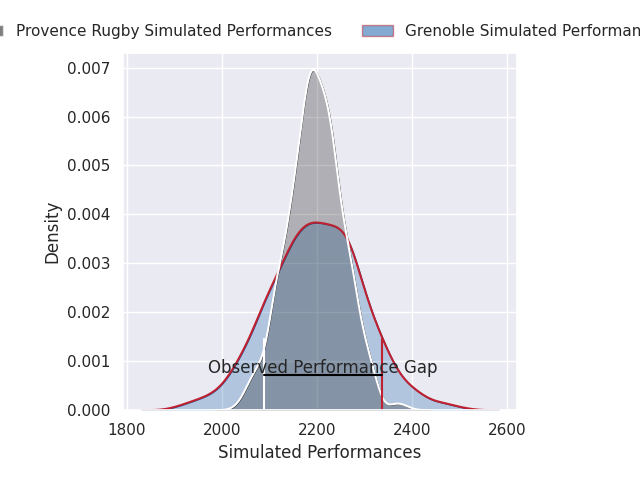

#### US Montauban V Agen on 2026/11/20

Average Margin: Agen by 0.2

#### Oyonnax V Brive on 2026/11/20

Average Margin: Oyonnax by 11.8

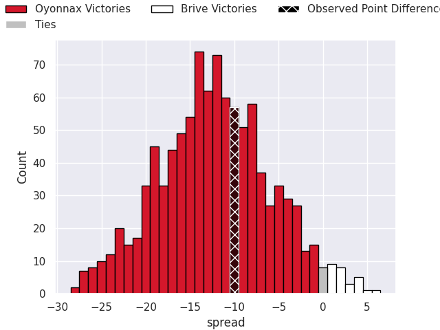

#### Biarritz Olympique V Narbonne on 2026/11/20

Average Margin: Biarritz Olympique by 6.5

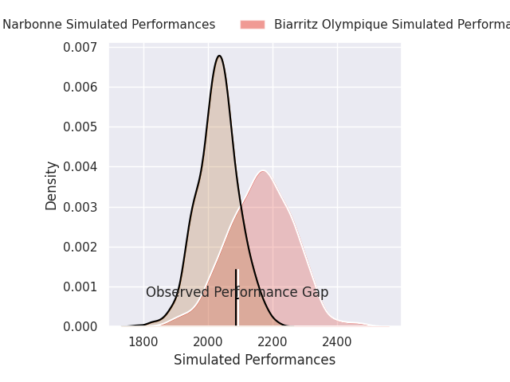

#### Aurillac V Colomiers on 2026/11/20

Average Margin: Aurillac by 2.0

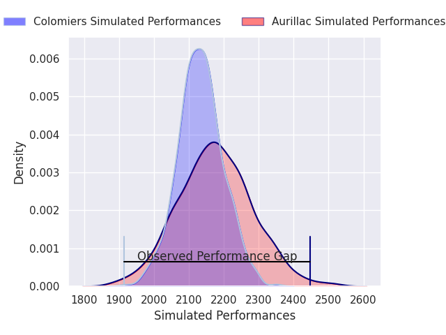
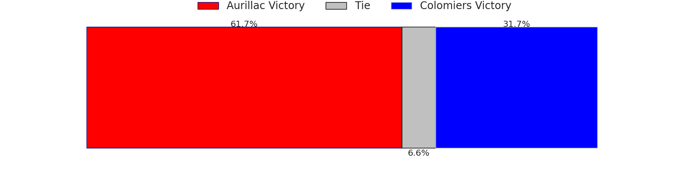

#### Beziers V Dax on 2026/11/20

Average Margin: Beziers by 1.8

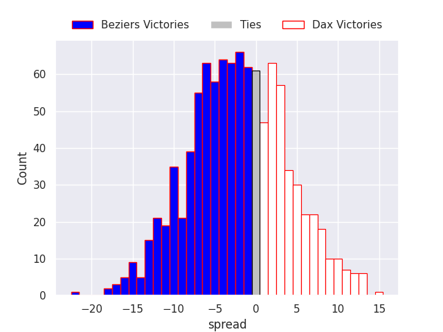

#### Nice V Valence Romans Drome Rugby on 2026/11/20

Average Margin: Nice by 1.7

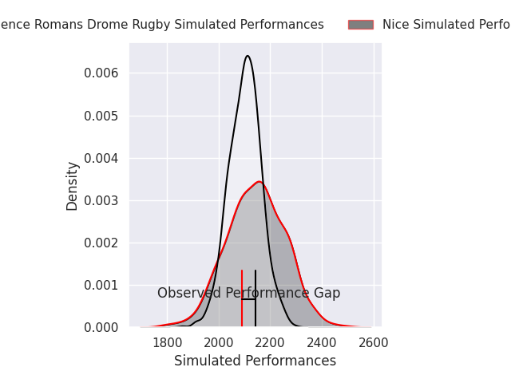

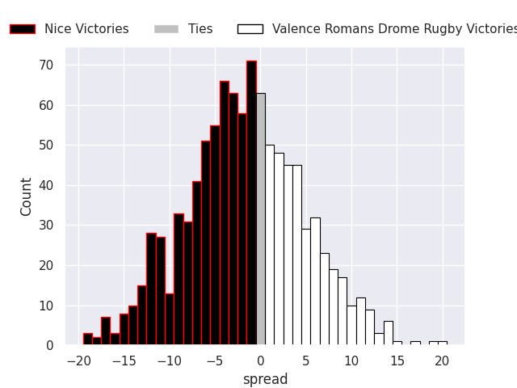

#### USON Nevers V Soyaux-Angouleme on 2026/11/20

Average Margin: Soyaux-Angouleme by 1.7

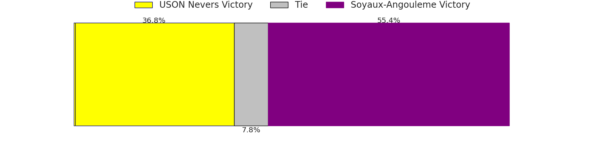

### Week 14
#### Provence Rugby V US Montauban on 2026/11/27

Average Margin: Provence Rugby by 18.0

#### Valence Romans Drome Rugby V Aurillac on 2026/11/27

Average Margin: Valence Romans Drome Rugby by 10.7

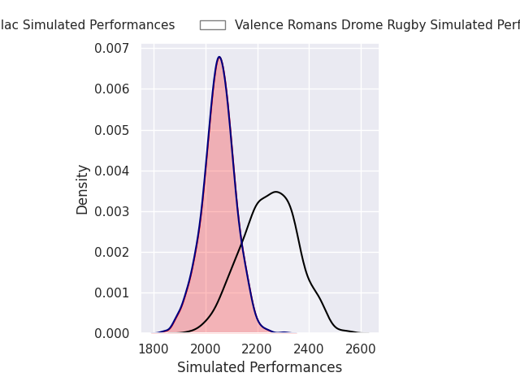

#### Dax V Oyonnax on 2026/11/27

Average Margin: Oyonnax by 1.9

#### Brive V Biarritz Olympique on 2026/11/27

Average Margin: Brive by 12.2

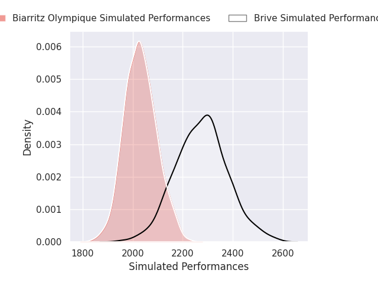
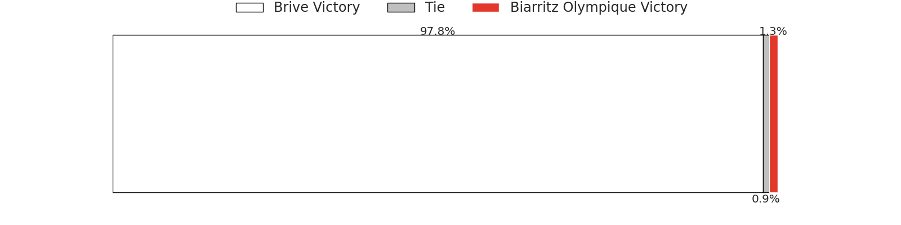
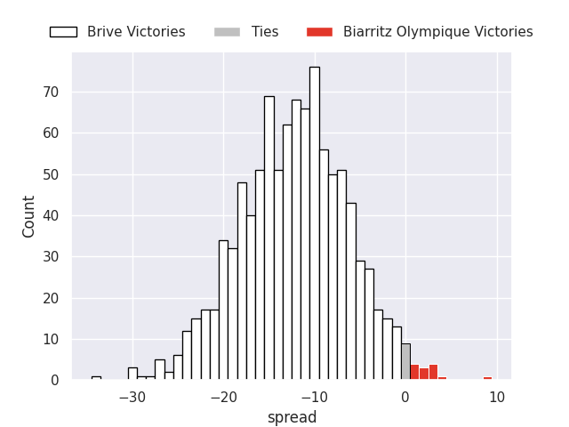

#### Colomiers V USON Nevers on 2026/11/27

Average Margin: Colomiers by 18.0

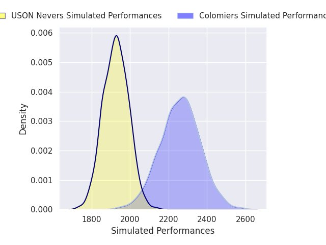

#### Narbonne V Grenoble on 2026/11/27

Average Margin: Narbonne by 2.6

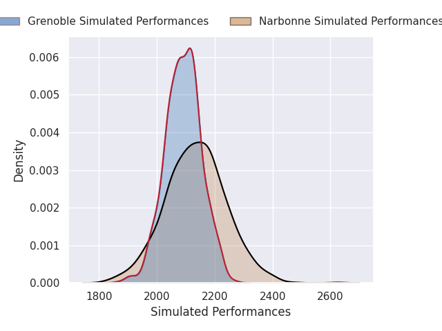

#### Agen V Beziers on 2026/11/27

Average Margin: Agen by 12.9

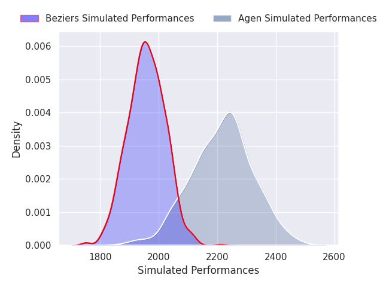

#### Soyaux-Angouleme V Nice on 2026/11/27

Average Margin: Soyaux-Angouleme by 7.0

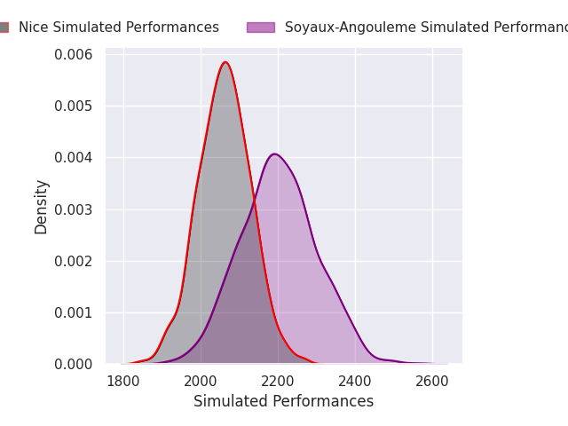

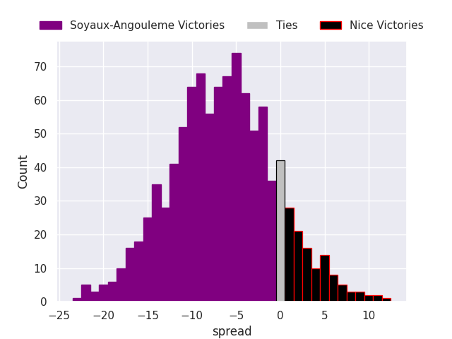

### Week 15
#### Narbonne V Agen on 2026/12/04

Average Margin: Narbonne by 2.1

#### USON Nevers V Dax on 2026/12/04

Average Margin: Dax by 0.6

#### Nice V Colomiers on 2026/12/04

Average Margin: Nice by 0.9

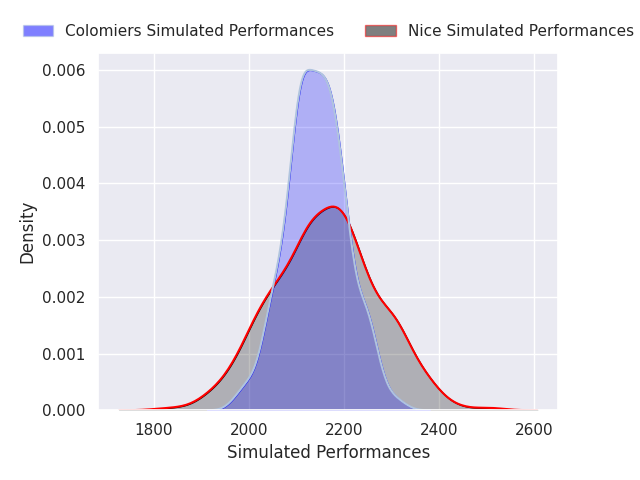

#### Biarritz Olympique V Provence Rugby on 2026/12/04

Average Margin: Provence Rugby by 2.2

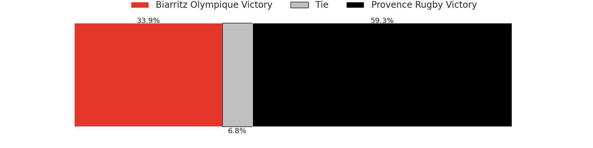

#### Oyonnax V Grenoble on 2026/12/04

Average Margin: Oyonnax by 14.2

#### US Montauban V Valence Romans Drome Rugby on 2026/12/04

Average Margin: Valence Romans Drome Rugby by 1.3

#### Beziers V Brive on 2026/12/04

Average Margin: Brive by 3.0

#### Aurillac V Soyaux-Angouleme on 2026/12/04

Average Margin: Aurillac by 5.8

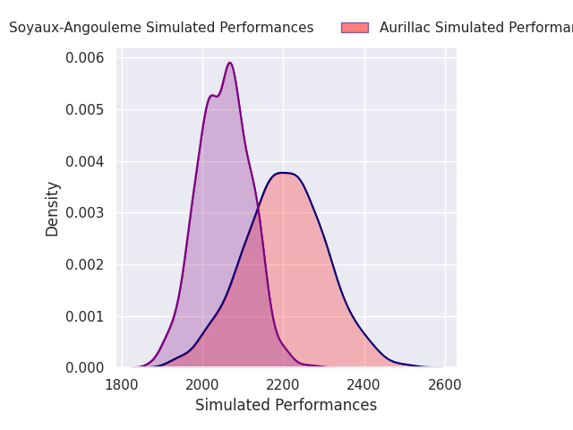
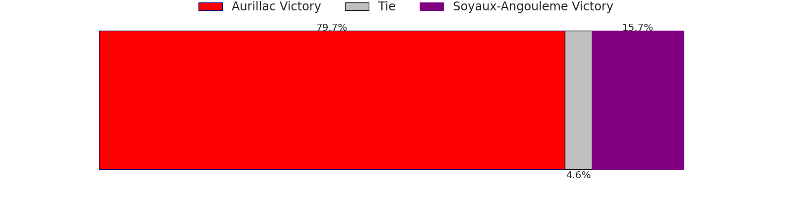

### Week 16
#### Provence Rugby V Brive on 2026/12/11

Average Margin: Provence Rugby by 9.0

#### Grenoble V USON Nevers on 2026/12/11

Average Margin: Grenoble by 14.4

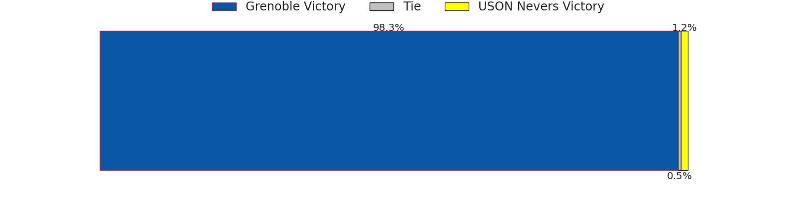

#### Nice V Oyonnax on 2026/12/11

Average Margin: Oyonnax by 2.7

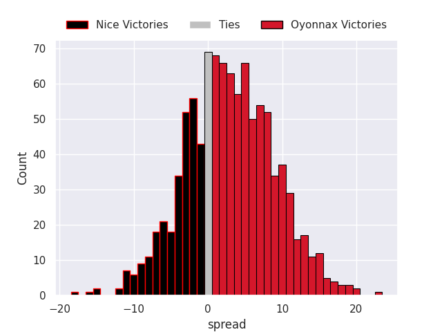

#### Valence Romans Drome Rugby V Narbonne on 2026/12/11

Average Margin: Valence Romans Drome Rugby by 10.8

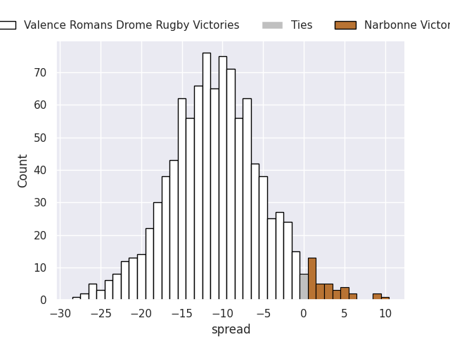

#### Soyaux-Angouleme V Beziers on 2026/12/11

Average Margin: Soyaux-Angouleme by 12.2

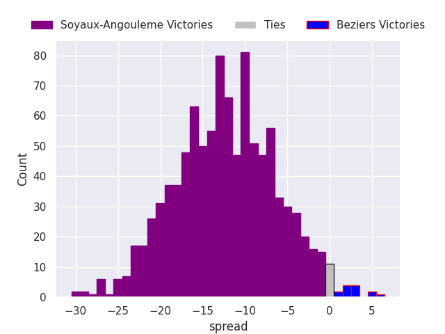

#### Dax V Biarritz Olympique on 2026/12/11

Average Margin: Dax by 7.0

#### Colomiers V US Montauban on 2026/12/11

Average Margin: Colomiers by 15.6

#### Agen V Aurillac on 2026/12/11

Average Margin: Agen by 9.1

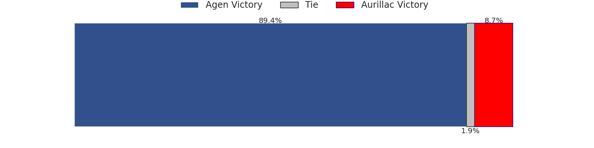

### Week 17
#### Beziers V Biarritz Olympique on 2026/12/18

Average Margin: Beziers by 2.6

#### Dax V Grenoble on 2026/12/18

Average Margin: Dax by 4.5

#### Brive V Soyaux-Angouleme on 2026/12/18

Average Margin: Brive by 10.7

#### USON Nevers V Provence Rugby on 2026/12/18

Average Margin: Provence Rugby by 8.3

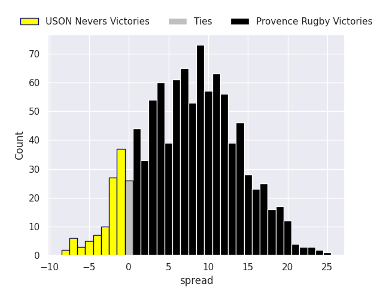

#### Valence Romans Drome Rugby V Agen on 2026/12/18

Average Margin: Valence Romans Drome Rugby by 7.6

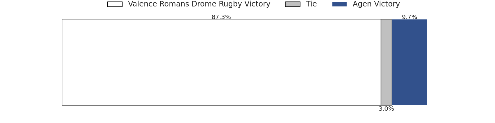
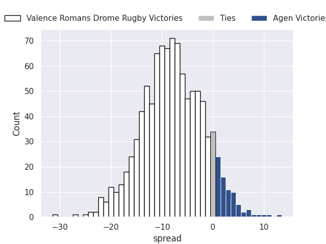

#### US Montauban V Nice on 2026/12/18

Average Margin: US Montauban by 0.9

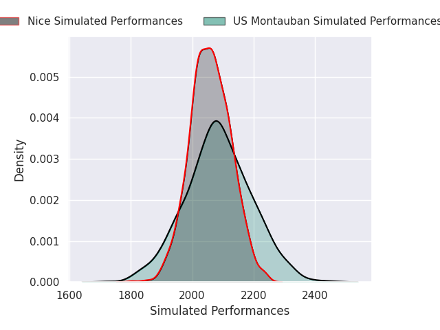

#### Aurillac V Narbonne on 2026/12/18

Average Margin: Aurillac by 8.1

#### Oyonnax V Colomiers on 2026/12/18

Average Margin: Oyonnax by 11.2

### Week 18
#### Agen V USON Nevers on 2027/01/08

Average Margin: Agen by 15.3

#### Colomiers V Brive on 2027/01/08

Average Margin: Colomiers by 6.7

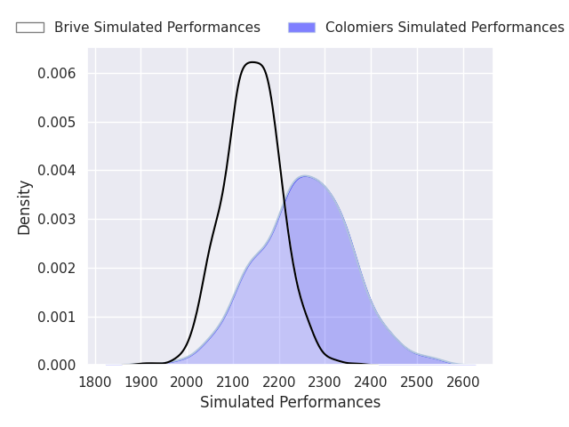

#### Nice V Dax on 2027/01/08

Average Margin: Nice by 5.9

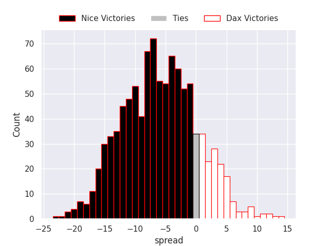

#### Soyaux-Angouleme V Oyonnax on 2027/01/08

Average Margin: Oyonnax by 0.5

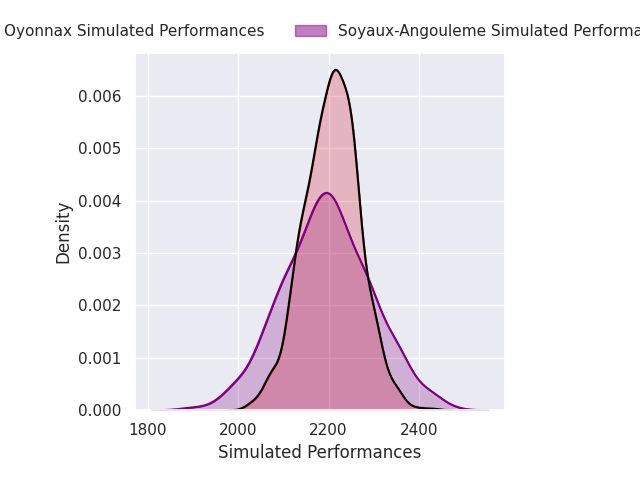

#### Grenoble V Beziers on 2027/01/08

Average Margin: Grenoble by 11.9

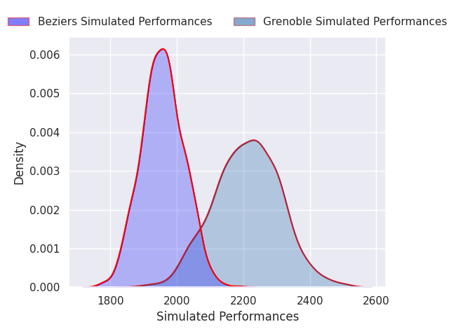

#### Provence Rugby V Valence Romans Drome Rugby on 2027/01/08

Average Margin: Provence Rugby by 10.4

#### Narbonne V US Montauban on 2027/01/08

Average Margin: Narbonne by 8.6

#### Biarritz Olympique V Aurillac on 2027/01/08

Average Margin: Biarritz Olympique by 6.2

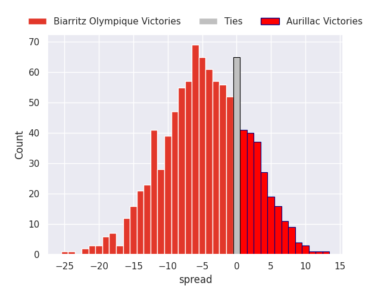

### Week 19
#### Dax V Soyaux-Angouleme on 2027/01/15

Average Margin: Dax by 5.2

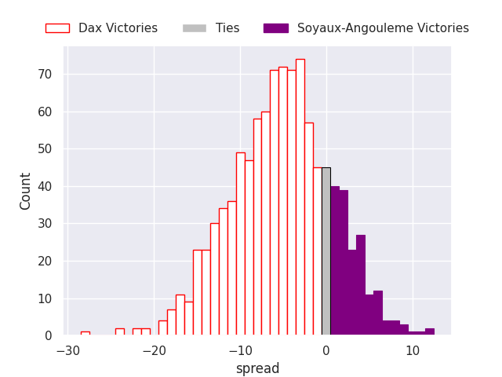

#### Brive V Agen on 2027/01/15

Average Margin: Brive by 9.6

#### USON Nevers V Nice on 2027/01/15

Average Margin: Nice by 1.1

#### Aurillac V Provence Rugby on 2027/01/15

Average Margin: Provence Rugby by 0.5

#### Valence Romans Drome Rugby V Grenoble on 2027/01/15

Average Margin: Valence Romans Drome Rugby by 7.7

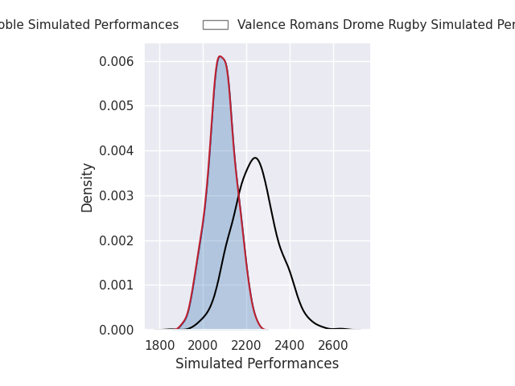

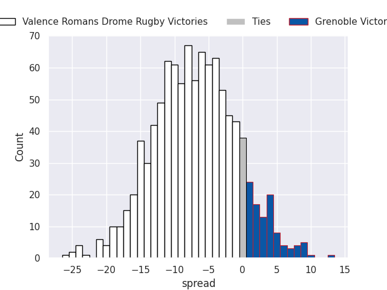

#### Beziers V Colomiers on 2027/01/15

Average Margin: Colomiers by 3.4

#### US Montauban V Biarritz Olympique on 2027/01/15

Average Margin: US Montauban by 2.8

#### Oyonnax V Narbonne on 2027/01/15

Average Margin: Oyonnax by 17.0

### Week 20
#### Agen V US Montauban on 2027/01/22

Average Margin: Agen by 12.5

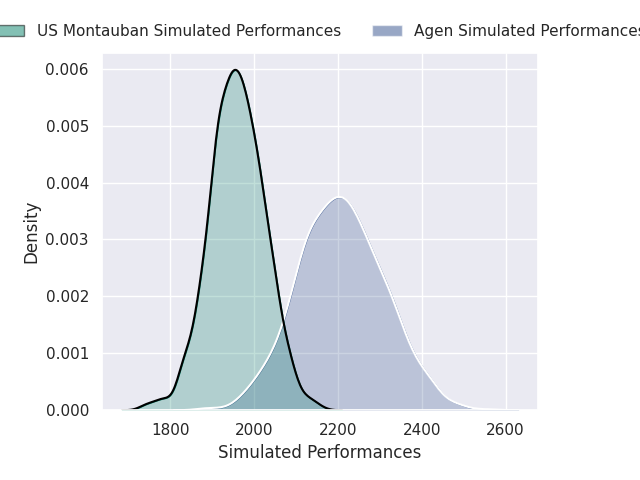

#### Nice V Brive on 2027/01/22

Average Margin: Nice by 1.0

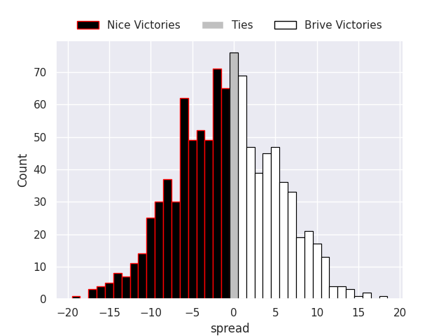

#### Provence Rugby V Grenoble on 2027/01/22

Average Margin: Provence Rugby by 11.7

#### Oyonnax V Beziers on 2027/01/22

Average Margin: Oyonnax by 20.5

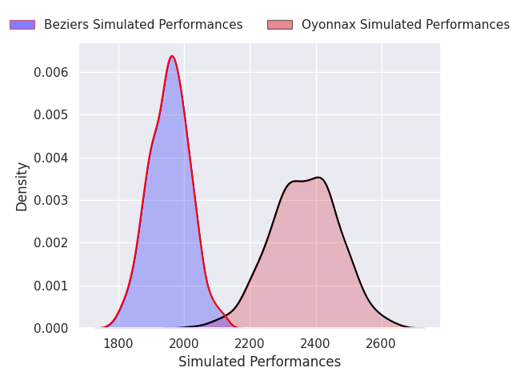

#### Soyaux-Angouleme V Valence Romans Drome Rugby on 2027/01/22

Average Margin: Soyaux-Angouleme by 4.5

#### Narbonne V Dax on 2027/01/22

Average Margin: Narbonne by 4.1

#### Biarritz Olympique V USON Nevers on 2027/01/22

Average Margin: Biarritz Olympique by 11.8

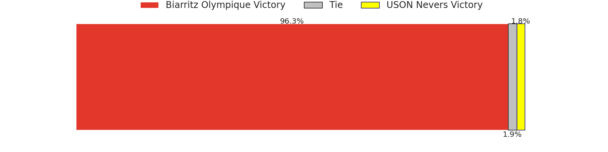

#### Colomiers V Aurillac on 2027/01/22

Average Margin: Colomiers by 12.0

### Week 21
#### Valence Romans Drome Rugby V Biarritz Olympique on 2027/01/29

Average Margin: Valence Romans Drome Rugby by 10.5

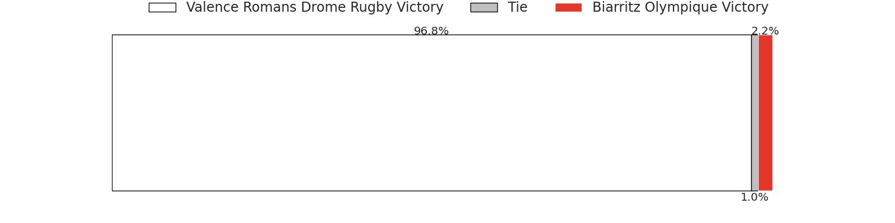

#### Brive V Narbonne on 2027/01/29

Average Margin: Brive by 12.1

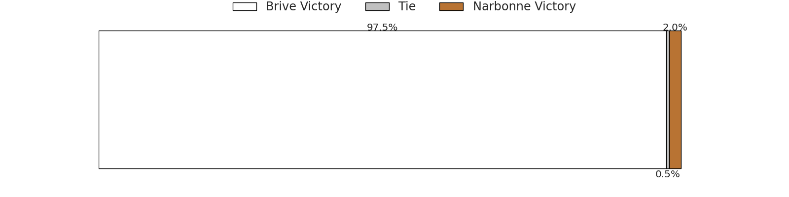

#### Grenoble V Nice on 2027/01/29

Average Margin: Grenoble by 6.6

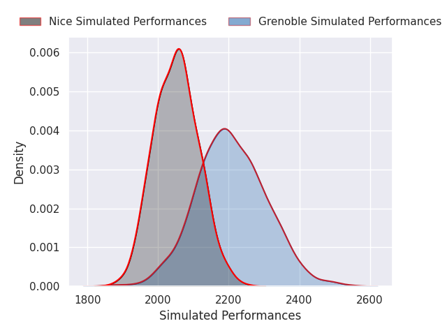

#### Dax V Agen on 2027/01/29

Average Margin: Dax by 4.0

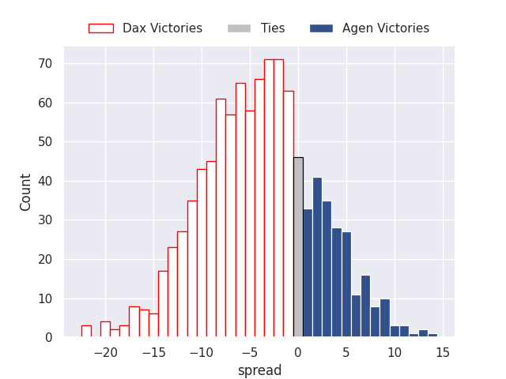

#### US Montauban V Soyaux-Angouleme on 2027/01/29

Average Margin: US Montauban by 0.7

#### Beziers V Provence Rugby on 2027/01/29

Average Margin: Provence Rugby by 5.8

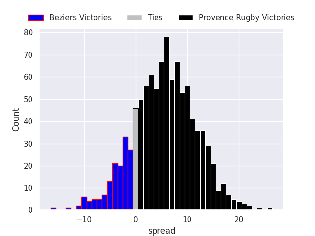

#### USON Nevers V Colomiers on 2027/01/29

Average Margin: Colomiers by 5.4

#### Aurillac V Oyonnax on 2027/01/29

Average Margin: Oyonnax by 1.1

### Week 22
#### Soyaux-Angouleme V USON Nevers on 2027/02/12

Average Margin: Soyaux-Angouleme by 14.4

#### Colomiers V Valence Romans Drome Rugby on 2027/02/12

Average Margin: Colomiers by 8.2

#### Provence Rugby V Dax on 2027/02/12

Average Margin: Provence Rugby by 13.9

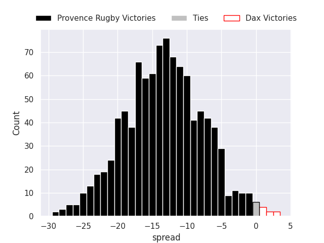

#### Aurillac V Beziers on 2027/02/12

Average Margin: Aurillac by 11.5

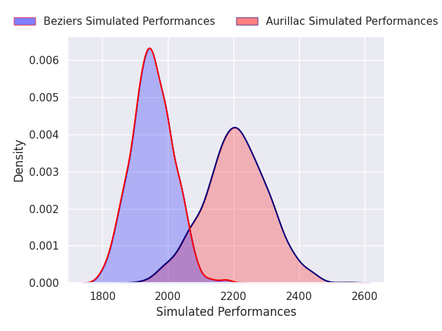

#### Oyonnax V US Montauban on 2027/02/12

Average Margin: Oyonnax by 20.5

#### Narbonne V Biarritz Olympique on 2027/02/12

Average Margin: Narbonne by 5.0

#### Nice V Agen on 2027/02/12

Average Margin: Nice by 3.3

#### Grenoble V Brive on 2027/02/12

Average Margin: Grenoble by 3.1

### Week 23
#### US Montauban V Aurillac on 2027/02/19

Average Margin: US Montauban by 2.8

#### USON Nevers V Grenoble on 2027/02/19

Average Margin: Grenoble by 2.3

#### Agen V Narbonne on 2027/02/19

Average Margin: Agen by 9.7

#### Dax V Colomiers on 2027/02/19

Average Margin: Dax by 1.5

#### Brive V Provence Rugby on 2027/02/19

Average Margin: Brive by 4.3

#### Biarritz Olympique V Oyonnax on 2027/02/19

Average Margin: Oyonnax by 2.7

#### Beziers V Soyaux-Angouleme on 2027/02/19

Average Margin: Beziers by 0.9

#### Valence Romans Drome Rugby V Nice on 2027/02/19

Average Margin: Valence Romans Drome Rugby by 9.1

### Week 24
#### Colomiers V Soyaux-Angouleme on 2027/02/26

Average Margin: Colomiers by 10.1

#### Brive V Beziers on 2027/02/26

Average Margin: Brive by 15.3

#### Oyonnax V Dax on 2027/02/26

Average Margin: Oyonnax by 15.7

#### Narbonne V Valence Romans Drome Rugby on 2027/02/26

Average Margin: Narbonne by 1.2

#### Nice V Biarritz Olympique on 2027/02/26

Average Margin: Nice by 6.3

#### Aurillac V Agen on 2027/02/26

Average Margin: Aurillac by 5.0

#### Grenoble V US Montauban on 2027/02/26

Average Margin: Grenoble by 11.6

#### Provence Rugby V USON Nevers on 2027/02/26

Average Margin: Provence Rugby by 20.0

### Week 25
#### Soyaux-Angouleme V Narbonne on 2027/03/05

Average Margin: Soyaux-Angouleme by 8.7

#### Beziers V Nice on 2027/03/05

Average Margin: Beziers by 1.1

#### Biarritz Olympique V Grenoble on 2027/03/05

Average Margin: Biarritz Olympique by 3.8

#### Agen V Colomiers on 2027/03/05

Average Margin: Agen by 3.5

#### US Montauban V Provence Rugby on 2027/03/05

Average Margin: Provence Rugby by 5.2

#### Dax V Aurillac on 2027/03/05

Average Margin: Dax by 7.0

#### Valence Romans Drome Rugby V Brive on 2027/03/05

Average Margin: Valence Romans Drome Rugby by 5.6

#### USON Nevers V Oyonnax on 2027/03/05

Average Margin: Oyonnax by 8.0

### Week 26
#### Nice V US Montauban on 2027/03/26

Average Margin: Nice by 9.7

#### Colomiers V Oyonnax on 2027/03/26

Average Margin: Colomiers by 3.1

#### Aurillac V Valence Romans Drome Rugby on 2027/03/26

Average Margin: Aurillac by 4.0

#### Grenoble V Narbonne on 2027/03/26

Average Margin: Grenoble by 8.7

#### Provence Rugby V Soyaux-Angouleme on 2027/03/26

Average Margin: Provence Rugby by 12.3

#### Brive V USON Nevers on 2027/03/26

Average Margin: Brive by 17.9

#### Dax V Beziers on 2027/03/26

Average Margin: Dax by 10.8

#### Biarritz Olympique V Agen on 2027/03/26

Average Margin: Biarritz Olympique by 3.3

### Week 27
#### Beziers V US Montauban on 2027/04/02

Average Margin: Beziers by 6.3

#### Oyonnax V Nice on 2027/04/02

Average Margin: Oyonnax by 15.0

#### Narbonne V Provence Rugby on 2027/04/02

Average Margin: Provence Rugby by 3.3

#### Agen V Grenoble on 2027/04/02

Average Margin: Agen by 6.8

#### Valence Romans Drome Rugby V Dax on 2027/04/02

Average Margin: Valence Romans Drome Rugby by 10.3

#### USON Nevers V Aurillac on 2027/04/02

Average Margin: USON Nevers by 0.5

#### Colomiers V Biarritz Olympique on 2027/04/02

Average Margin: Colomiers by 12.2

#### Soyaux-Angouleme V Brive on 2027/04/02

Average Margin: Soyaux-Angouleme by 3.2

### Week 28
#### Narbonne V Aurillac on 2027/04/09

Average Margin: Narbonne by 5.1

#### Provence Rugby V Colomiers on 2027/04/09

Average Margin: Provence Rugby by 8.7

#### US Montauban V USON Nevers on 2027/04/09

Average Margin: US Montauban by 8.6

#### Biarritz Olympique V Beziers on 2027/04/09

Average Margin: Biarritz Olympique by 9.6

#### Grenoble V Dax on 2027/04/09

Average Margin: Grenoble by 7.5

#### Brive V Oyonnax on 2027/04/09

Average Margin: Brive by 3.4

#### Agen V Valence Romans Drome Rugby on 2027/04/09

Average Margin: Agen by 4.9

#### Nice V Soyaux-Angouleme on 2027/04/09

Average Margin: Nice by 4.2

### Week 29
#### Aurillac V Grenoble on 2027/04/16

Average Margin: Aurillac by 5.1

#### Soyaux-Angouleme V Biarritz Olympique on 2027/04/16

Average Margin: Soyaux-Angouleme by 8.7

#### USON Nevers V Narbonne on 2027/04/16

Average Margin: USON Nevers by 0.8

#### Oyonnax V Provence Rugby on 2027/04/16

Average Margin: Oyonnax by 8.4

#### Valence Romans Drome Rugby V US Montauban on 2027/04/16

Average Margin: Valence Romans Drome Rugby by 13.8

#### Dax V Brive on 2027/04/16

Average Margin: Dax by 1.6

#### Beziers V Agen on 2027/04/16

Average Margin: Agen by 0.4

#### Colomiers V Nice on 2027/04/16

Average Margin: Colomiers by 10.4

### Week 30
#### Grenoble V Oyonnax on 2027/04/23

Average Margin: Oyonnax by 0.7

#### US Montauban V Colomiers on 2027/04/23

Average Margin: Colomiers by 2.8

#### Biarritz Olympique V Dax on 2027/04/23

Average Margin: Biarritz Olympique by 5.7

#### USON Nevers V Valence Romans Drome Rugby on 2027/04/23

Average Margin: Valence Romans Drome Rugby by 3.2

#### Agen V Soyaux-Angouleme on 2027/04/23

Average Margin: Agen by 7.6

#### Brive V Aurillac on 2027/04/23

Average Margin: Brive by 12.3

#### Provence Rugby V Nice on 2027/04/23

Average Margin: Provence Rugby by 12.9

#### Narbonne V Beziers on 2027/04/23

Average Margin: Narbonne by 8.7

### Week 31
#### Nice V Narbonne on 2027/05/07

Average Margin: Nice by 6.6

#### Beziers V Valence Romans Drome Rugby on 2027/05/07

Average Margin: Valence Romans Drome Rugby by 1.2

#### Dax V USON Nevers on 2027/05/07

Average Margin: Dax by 12.6

#### Colomiers V Grenoble on 2027/05/07

Average Margin: Colomiers by 9.3

#### Provence Rugby V Biarritz Olympique on 2027/05/07

Average Margin: Provence Rugby by 13.9

#### Oyonnax V Agen on 2027/05/07

Average Margin: Oyonnax by 14.0

#### Soyaux-Angouleme V Aurillac on 2027/05/07

Average Margin: Soyaux-Angouleme by 8.4

#### Brive V US Montauban on 2027/05/07

Average Margin: Brive by 15.4

### Week 32
#### USON Nevers V Beziers on 2027/05/14

Average Margin: USON Nevers by 4.1

#### Grenoble V Soyaux-Angouleme on 2027/05/14

Average Margin: Grenoble by 6.1

#### Biarritz Olympique V Brive on 2027/05/14

Average Margin: Biarritz Olympique by 0.7

#### US Montauban V Dax on 2027/05/14

Average Margin: US Montauban by 2.3

#### Aurillac V Nice on 2027/05/14

Average Margin: Aurillac by 6.3

#### Narbonne V Colomiers on 2027/05/14

Average Margin: Colomiers by 0.4

#### Valence Romans Drome Rugby V Oyonnax on 2027/05/14

Average Margin: Valence Romans Drome Rugby by 1.8

#### Agen V Provence Rugby on 2027/05/14

Average Margin: Agen by 1.0

