## Team Rankings

## Standings
### Current Standings

| Club                       |   Played |   Wins |   Point Differential |   Losing Bonus Points |   Try Bonus Points |   Competition Points |
|:---------------------------|---------:|-------:|---------------------:|----------------------:|-------------------:|---------------------:|
| Oyonnax                    |        9 |      8 |                  167 |                     1 |                  6 |                   39 |
| Provence Rugby             |        9 |      8 |                  115 |                     0 |                  3 |                   37 |
| Grenoble                   |        9 |      7 |                   53 |                     2 |                  3 |                   33 |
| US Montauban               |       10 |      7 |                  -18 |                     0 |                  4 |                   32 |
| Brive                      |       10 |      6 |                   47 |                     0 |                  5 |                   29 |
| Soyaux-Angouleme           |        9 |      4 |                   73 |                     2 |                  5 |                   25 |
| Biarritz Olympique         |        9 |      5 |                   12 |                     0 |                  2 |                   24 |
| Aurillac                   |        9 |      4 |                    2 |                     2 |                  4 |                   22 |
| Dax                        |        9 |      4 |                  -37 |                     0 |                  4 |                   22 |
| Agen                       |        9 |      4 |                  -31 |                     1 |                  4 |                   21 |
| Colomiers                  |        9 |      3 |                   26 |                     3 |                  4 |                   19 |
| Valence Romans Drome Rugby |        9 |      3 |                    3 |                     5 |                  2 |                   19 |
| Nice                       |        9 |      3 |                  -37 |                     2 |                  5 |                   19 |
| Narbonne                   |        9 |      3 |                 -107 |                     2 |                  4 |                   18 |
| Beziers                    |        9 |      2 |                 -146 |                     2 |                  1 |                   11 |
| USON Nevers                |        9 |      0 |                 -122 |                     4 |                  1 |                    5 |

### Projected Remaining Table

| Club                       |   To Play |   Projected Wins |   Projected Differential |   Projected Losing Bonus Points | Projected Try Bonus Points   |   Projected Competition Points |
|:---------------------------|----------:|-----------------:|-------------------------:|--------------------------------:|:-----------------------------|-------------------------------:|
| Provence Rugby             |        22 |           16.324 |                  142.9   |                           3.471 |                              |                         70.235 |
| Oyonnax                    |        22 |           15.791 |                  158.271 |                           3.995 |                              |                         68.653 |
| Colomiers                  |        22 |           14.226 |                   92.756 |                           4.373 |                              |                         62.769 |
| Valence Romans Drome Rugby |        22 |           13.66  |                   76.599 |                           4.653 |                              |                         60.871 |
| Brive                      |        21 |           12.367 |                   70.145 |                           4.525 |                              |                         55.375 |
| Agen                       |        22 |           12.085 |                   35.31  |                           5.171 |                              |                         55.143 |
| Soyaux-Angouleme           |        22 |           11.009 |                   14.39  |                           5.534 |                              |                         51.268 |
| Grenoble                   |        22 |           10.43  |                   -0.204 |                           5.597 |                              |                         48.957 |
| Aurillac                   |        22 |            9.776 |                  -24.11  |                           5.51  |                              |                         46.334 |
| Dax                        |        22 |            9.638 |                  -25.48  |                           5.687 |                              |                         45.875 |
| Nice                       |        22 |            9.392 |                  -33.293 |                           5.826 |                              |                         45.212 |
| Narbonne                   |        22 |            8.982 |                  -44.194 |                           5.915 |                              |                         43.593 |
| Biarritz Olympique         |        22 |            8.957 |                  -36.899 |                           5.86  |                              |                         43.436 |
| US Montauban               |        21 |            6.116 |                 -115.962 |                           5.149 |                              |                         31.007 |
| Beziers                    |        22 |            5.542 |                 -133.684 |                           6.015 |                              |                         29.711 |
| USON Nevers                |        22 |            4.354 |                 -176.545 |                           5.395 |                              |                         24.237 |

### Projected Total Table

| Club                       |   Played |   Wins |   Point Differential |   Losing Bonus Points |   Try Bonus Points |   Competition Points |
|:---------------------------|---------:|-------:|---------------------:|----------------------:|-------------------:|---------------------:|
| Oyonnax                    |       31 | 23.791 |              325.271 |                 4.995 |                  6 |              107.653 |
| Provence Rugby             |       31 | 24.324 |              257.9   |                 3.471 |                  3 |              107.235 |
| Brive                      |       31 | 18.367 |              117.145 |                 4.525 |                  5 |               84.375 |
| Grenoble                   |       31 | 17.43  |               52.796 |                 7.597 |                  3 |               81.957 |
| Colomiers                  |       31 | 17.226 |              118.756 |                 7.373 |                  4 |               81.769 |
| Valence Romans Drome Rugby |       31 | 16.66  |               79.599 |                 9.653 |                  2 |               79.871 |
| Soyaux-Angouleme           |       31 | 15.009 |               87.39  |                 7.534 |                  5 |               76.268 |
| Agen                       |       31 | 16.085 |                4.31  |                 6.171 |                  4 |               76.143 |
| Aurillac                   |       31 | 13.776 |              -22.11  |                 7.51  |                  4 |               68.334 |
| Dax                        |       31 | 13.638 |              -62.48  |                 5.687 |                  4 |               67.875 |
| Biarritz Olympique         |       31 | 13.957 |              -24.899 |                 5.86  |                  2 |               67.436 |
| Nice                       |       31 | 12.392 |              -70.293 |                 7.826 |                  5 |               64.212 |
| US Montauban               |       31 | 13.116 |             -133.962 |                 5.149 |                  4 |               63.007 |
| Narbonne                   |       31 | 11.982 |             -151.194 |                 7.915 |                  4 |               61.593 |
| Beziers                    |       31 |  7.542 |             -279.684 |                 8.015 |                  1 |               40.711 |
| USON Nevers                |       31 |  4.354 |             -298.545 |                 9.395 |                  1 |               29.237 |

## Completed Match Review

| Model | Percent Correct Predictions | Spread Error |
| ------ | ------ | ------ |
| Club Level | 78.2% | 7.2 |
| Player Level: Lineup | nan% | nan |
| Player Level: Minutes | nan% | nan |

## Future Predictions
### Week 11
#### Agen V Dax on 2026/09/01

Average Margin: Agen by 5.8

#### Grenoble V Colomiers on 2026/09/01

Average Margin: Grenoble by 0.3

#### Soyaux-Angouleme V Provence Rugby on 2026/09/01

Average Margin: Provence Rugby by 1.1

#### Aurillac V Biarritz Olympique on 2026/09/01

Average Margin: Aurillac by 2.8

#### Nice V USON Nevers on 2026/09/01

Average Margin: Nice by 11.1

#### Valence Romans Drome Rugby V Beziers on 2026/09/01

Average Margin: Valence Romans Drome Rugby by 10.4

#### Narbonne V Oyonnax on 2026/09/01

Average Margin: Oyonnax by 1.1

### Week 12
#### Agen V Biarritz Olympique on 2026/11/05

Average Margin: Agen by 8.2

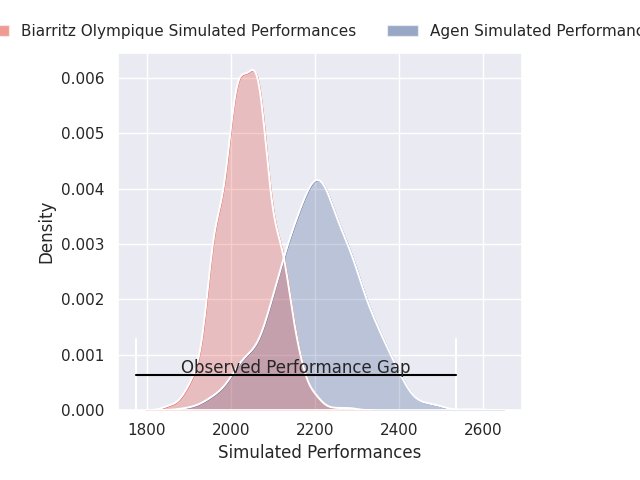
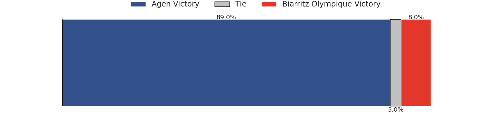
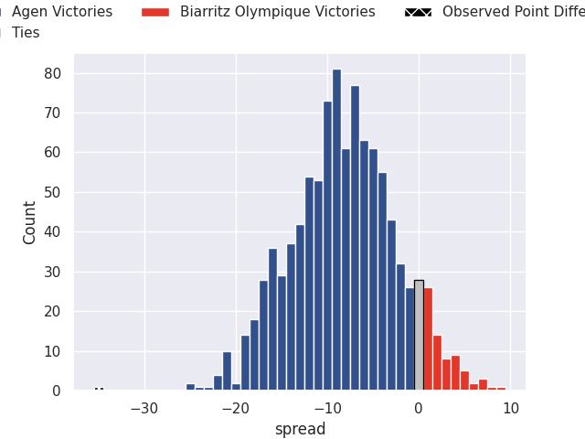

#### Colomiers V Beziers on 2026/11/06

Average Margin: Colomiers by 14.7

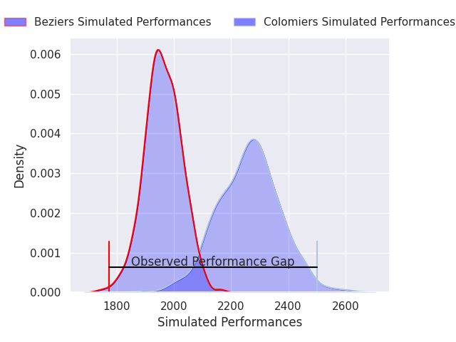
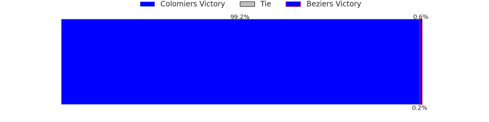
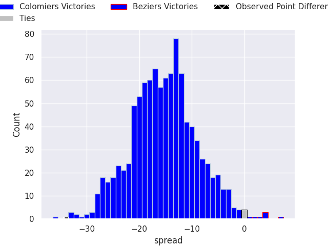

#### Narbonne V Nice on 2026/11/06

Average Margin: Narbonne by 4.4

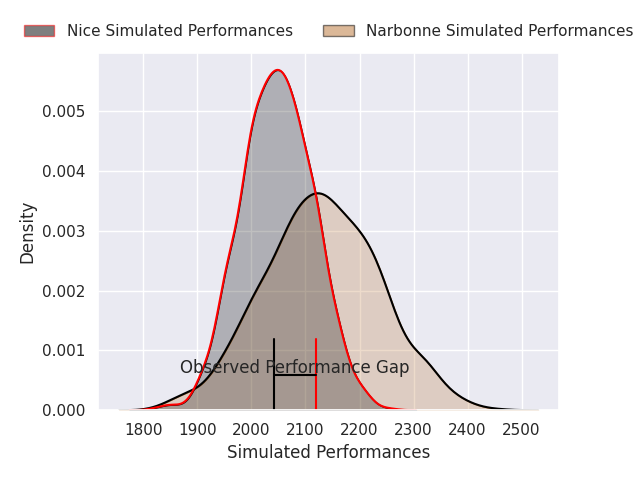
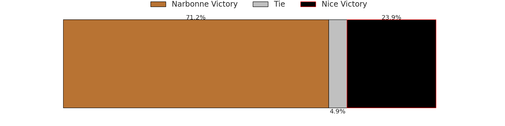
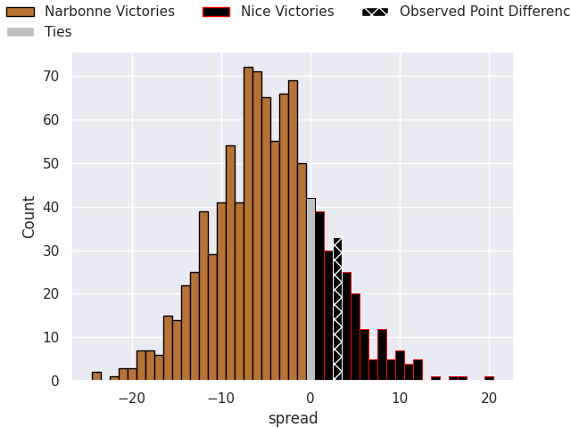

#### Aurillac V US Montauban on 2026/11/06

Average Margin: Aurillac by 10.0

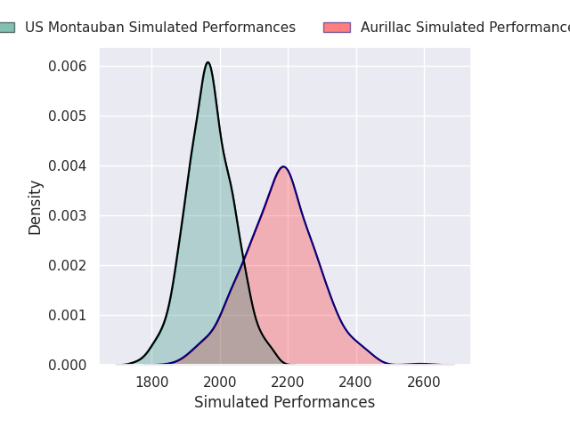
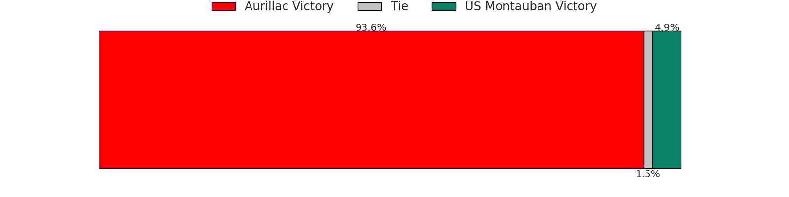
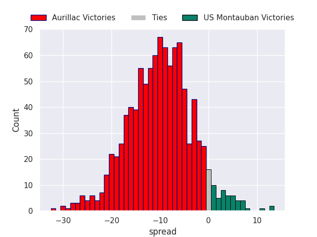

#### Brive V Dax on 2026/11/06

Average Margin: Brive by 10.8

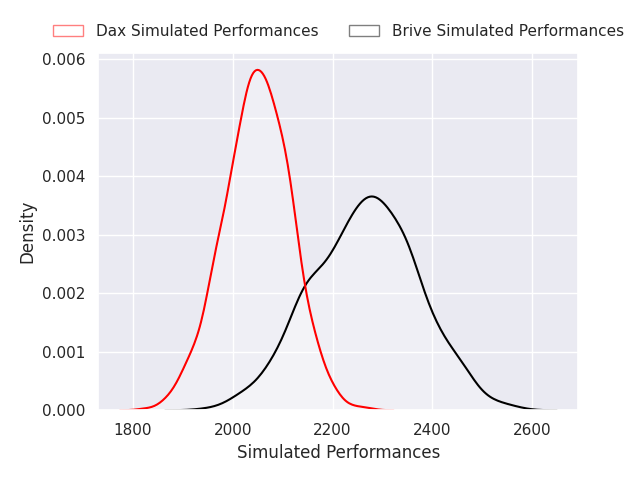
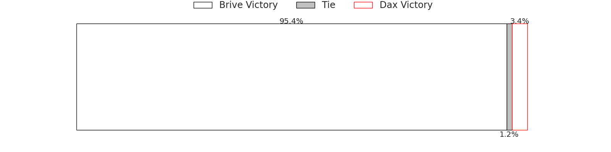
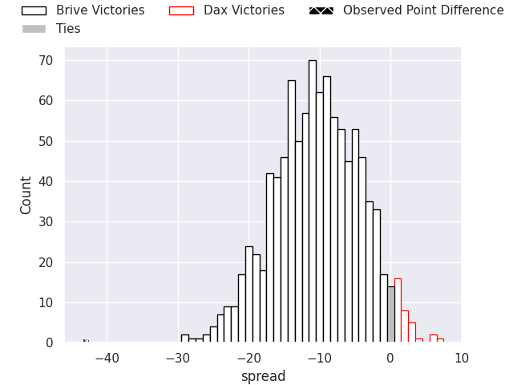

#### Soyaux-Angouleme V Grenoble on 2026/11/06

Average Margin: Soyaux-Angouleme by 5.9

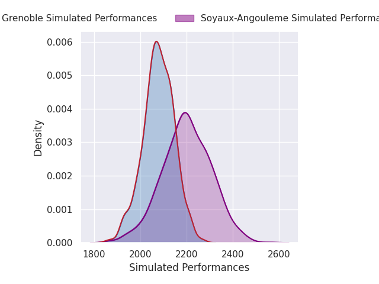
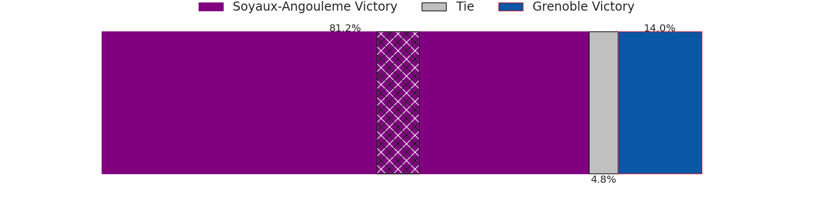
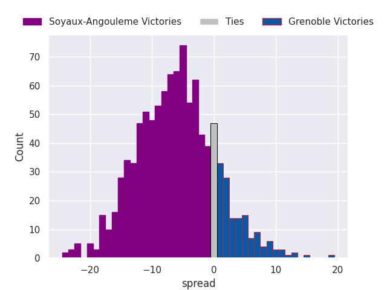

#### Provence Rugby V Oyonnax on 2026/11/06

Average Margin: Provence Rugby by 5.1

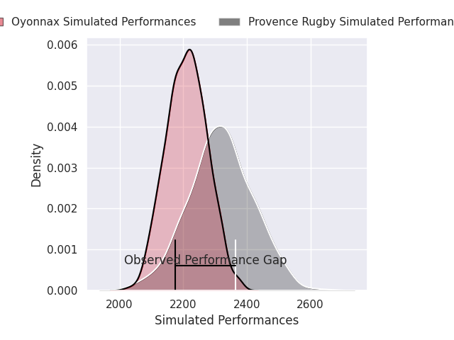
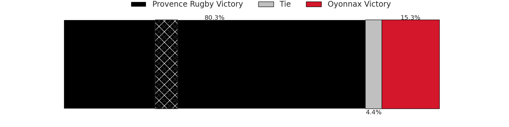
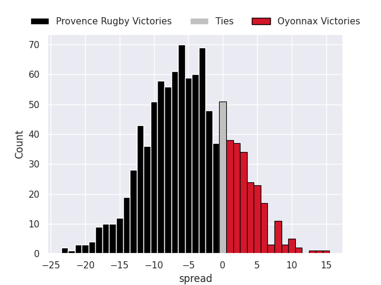

#### Valence Romans Drome Rugby V USON Nevers on 2026/11/06

Average Margin: Valence Romans Drome Rugby by 16.1

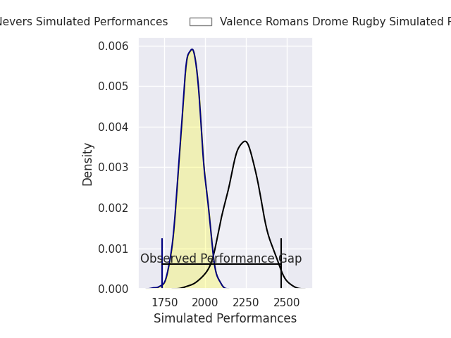
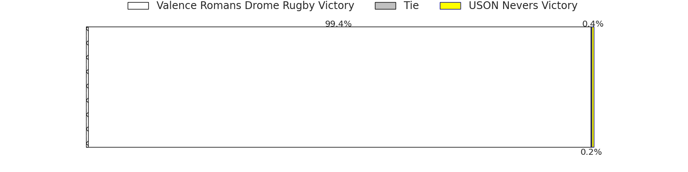
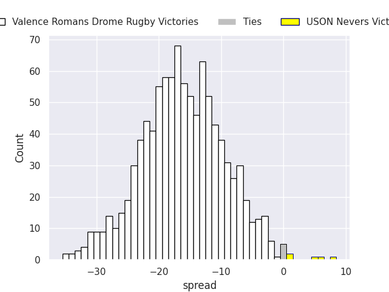

### Week 13
#### Grenoble V Provence Rugby on 2026/11/19

Average Margin: Provence Rugby by 0.4

#### US Montauban V Agen on 2026/11/20

Average Margin: US Montauban by 0.7

#### Aurillac V Colomiers on 2026/11/20

Average Margin: Aurillac by 1.9

#### Nice V Valence Romans Drome Rugby on 2026/11/20

Average Margin: Nice by 2.1

#### Biarritz Olympique V Narbonne on 2026/11/20

Average Margin: Biarritz Olympique by 6.7

#### USON Nevers V Soyaux-Angouleme on 2026/11/20

Average Margin: Soyaux-Angouleme by 1.6

#### Oyonnax V Brive on 2026/11/20

Average Margin: Oyonnax by 12.5

#### Beziers V Dax on 2026/11/20

Average Margin: Beziers by 2.2

### Week 14
#### Soyaux-Angouleme V Nice on 2026/11/27

Average Margin: Soyaux-Angouleme by 7.5

#### Narbonne V Grenoble on 2026/11/27

Average Margin: Narbonne by 2.9

#### Agen V Beziers on 2026/11/27

Average Margin: Agen by 11.6

#### Brive V Biarritz Olympique on 2026/11/27

Average Margin: Brive by 11.1

#### Valence Romans Drome Rugby V Aurillac on 2026/11/27

Average Margin: Valence Romans Drome Rugby by 10.5

#### Dax V Oyonnax on 2026/11/27

Average Margin: Oyonnax by 1.8

#### Colomiers V USON Nevers on 2026/11/27

Average Margin: Colomiers by 17.5

#### Provence Rugby V US Montauban on 2026/11/27

Average Margin: Provence Rugby by 17.0

### Week 15
#### Biarritz Olympique V Provence Rugby on 2026/12/04

Average Margin: Provence Rugby by 1.5

#### Narbonne V Agen on 2026/12/04

Average Margin: Narbonne by 3.0

#### US Montauban V Valence Romans Drome Rugby on 2026/12/04

Average Margin: Valence Romans Drome Rugby by 0.0

#### Beziers V Brive on 2026/12/04

Average Margin: Brive by 1.8

#### Aurillac V Soyaux-Angouleme on 2026/12/04

Average Margin: Aurillac by 5.5

#### USON Nevers V Dax on 2026/12/04

Average Margin: Dax by 0.5

#### Oyonnax V Grenoble on 2026/12/04

Average Margin: Oyonnax by 14.4

#### Nice V Colomiers on 2026/12/04

Average Margin: Nice by 0.7

### Week 16
#### Provence Rugby V Brive on 2026/12/11

Average Margin: Provence Rugby by 9.3

#### Agen V Aurillac on 2026/12/11

Average Margin: Agen by 9.2

#### Dax V Biarritz Olympique on 2026/12/11

Average Margin: Dax by 7.0

#### Nice V Oyonnax on 2026/12/11

Average Margin: Oyonnax by 3.2

#### Colomiers V US Montauban on 2026/12/11

Average Margin: Colomiers by 14.5

#### Soyaux-Angouleme V Beziers on 2026/12/11

Average Margin: Soyaux-Angouleme by 11.8

#### Valence Romans Drome Rugby V Narbonne on 2026/12/11

Average Margin: Valence Romans Drome Rugby by 10.2

#### Grenoble V USON Nevers on 2026/12/11

Average Margin: Grenoble by 14.0

### Week 17
#### US Montauban V Nice on 2026/12/18

Average Margin: US Montauban by 2.4

#### Oyonnax V Colomiers on 2026/12/18

Average Margin: Oyonnax by 12.0

#### Beziers V Biarritz Olympique on 2026/12/18

Average Margin: Beziers by 2.5

#### Dax V Grenoble on 2026/12/18

Average Margin: Dax by 4.5

#### Aurillac V Narbonne on 2026/12/18

Average Margin: Aurillac by 7.4

#### USON Nevers V Provence Rugby on 2026/12/18

Average Margin: Provence Rugby by 7.5

#### Brive V Soyaux-Angouleme on 2026/12/18

Average Margin: Brive by 9.1

#### Valence Romans Drome Rugby V Agen on 2026/12/18

Average Margin: Valence Romans Drome Rugby by 7.9

### Week 18
#### Soyaux-Angouleme V Oyonnax on 2027/01/08

Average Margin: Oyonnax by 0.4

#### Agen V USON Nevers on 2027/01/08

Average Margin: Agen by 14.1

#### Grenoble V Beziers on 2027/01/08

Average Margin: Grenoble by 11.6

#### Narbonne V US Montauban on 2027/01/08

Average Margin: Narbonne by 8.4

#### Provence Rugby V Valence Romans Drome Rugby on 2027/01/08

Average Margin: Provence Rugby by 10.4

#### Biarritz Olympique V Aurillac on 2027/01/08

Average Margin: Biarritz Olympique by 7.3

#### Colomiers V Brive on 2027/01/08

Average Margin: Colomiers by 6.7

#### Nice V Dax on 2027/01/08

Average Margin: Nice by 4.9

### Week 19
#### US Montauban V Biarritz Olympique on 2027/01/15

Average Margin: US Montauban by 2.6

#### Oyonnax V Narbonne on 2027/01/15

Average Margin: Oyonnax by 17.2

#### Dax V Soyaux-Angouleme on 2027/01/15

Average Margin: Dax by 5.6

#### USON Nevers V Nice on 2027/01/15

Average Margin: Nice by 0.1

#### Brive V Agen on 2027/01/15

Average Margin: Brive by 9.2

#### Valence Romans Drome Rugby V Grenoble on 2027/01/15

Average Margin: Valence Romans Drome Rugby by 7.4

#### Beziers V Colomiers on 2027/01/15

Average Margin: Colomiers by 2.3

#### Aurillac V Provence Rugby on 2027/01/15

Average Margin: Provence Rugby by 1.0

### Week 20
#### Biarritz Olympique V USON Nevers on 2027/01/22

Average Margin: Biarritz Olympique by 12.6

#### Colomiers V Aurillac on 2027/01/22

Average Margin: Colomiers by 12.2

#### Provence Rugby V Grenoble on 2027/01/22

Average Margin: Provence Rugby by 11.6

#### Soyaux-Angouleme V Valence Romans Drome Rugby on 2027/01/22

Average Margin: Soyaux-Angouleme by 5.3

#### Nice V Brive on 2027/01/22

Average Margin: Nice by 1.2

#### Narbonne V Dax on 2027/01/22

Average Margin: Narbonne by 4.7

#### Agen V US Montauban on 2027/01/22

Average Margin: Agen by 11.2

#### Oyonnax V Beziers on 2027/01/22

Average Margin: Oyonnax by 19.9

### Week 21
#### Aurillac V Oyonnax on 2027/01/29

Average Margin: Oyonnax by 1.9

#### Valence Romans Drome Rugby V Biarritz Olympique on 2027/01/29

Average Margin: Valence Romans Drome Rugby by 9.3

#### Dax V Agen on 2027/01/29

Average Margin: Dax by 4.9

#### US Montauban V Soyaux-Angouleme on 2027/01/29

Average Margin: US Montauban by 1.4

#### Beziers V Provence Rugby on 2027/01/29

Average Margin: Provence Rugby by 5.3

#### Grenoble V Nice on 2027/01/29

Average Margin: Grenoble by 7.3

#### Brive V Narbonne on 2027/01/29

Average Margin: Brive by 11.5

#### USON Nevers V Colomiers on 2027/01/29

Average Margin: Colomiers by 4.1

### Week 22
#### Provence Rugby V Dax on 2027/02/12

Average Margin: Provence Rugby by 13.1

#### Aurillac V Beziers on 2027/02/12

Average Margin: Aurillac by 10.4

#### Nice V Agen on 2027/02/12

Average Margin: Nice by 4.0

#### Soyaux-Angouleme V USON Nevers on 2027/02/12

Average Margin: Soyaux-Angouleme by 14.1

#### Grenoble V Brive on 2027/02/12

Average Margin: Grenoble by 3.5

#### Colomiers V Valence Romans Drome Rugby on 2027/02/12

Average Margin: Colomiers by 8.0

#### Narbonne V Biarritz Olympique on 2027/02/12

Average Margin: Narbonne by 4.9

#### Oyonnax V US Montauban on 2027/02/12

Average Margin: Oyonnax by 19.6

### Week 23
#### Beziers V Soyaux-Angouleme on 2027/02/19

Average Margin: Beziers by 1.0

#### Dax V Colomiers on 2027/02/19

Average Margin: Dax by 2.6

#### USON Nevers V Grenoble on 2027/02/19

Average Margin: Grenoble by 1.8

#### Agen V Narbonne on 2027/02/19

Average Margin: Agen by 8.5

#### US Montauban V Aurillac on 2027/02/19

Average Margin: US Montauban by 3.9

#### Brive V Provence Rugby on 2027/02/19

Average Margin: Brive by 3.6

#### Valence Romans Drome Rugby V Nice on 2027/02/19

Average Margin: Valence Romans Drome Rugby by 8.9

#### Biarritz Olympique V Oyonnax on 2027/02/19

Average Margin: Oyonnax by 1.9

### Week 24
#### Narbonne V Valence Romans Drome Rugby on 2027/02/26

Average Margin: Narbonne by 1.8

#### Grenoble V US Montauban on 2027/02/26

Average Margin: Grenoble by 11.0

#### Brive V Beziers on 2027/02/26

Average Margin: Brive by 14.9

#### Provence Rugby V USON Nevers on 2027/02/26

Average Margin: Provence Rugby by 19.1

#### Oyonnax V Dax on 2027/02/26

Average Margin: Oyonnax by 16.1

#### Nice V Biarritz Olympique on 2027/02/26

Average Margin: Nice by 5.1

#### Aurillac V Agen on 2027/02/26

Average Margin: Aurillac by 5.1

#### Colomiers V Soyaux-Angouleme on 2027/02/26

Average Margin: Colomiers by 9.2

### Week 25
#### Dax V Aurillac on 2027/03/05

Average Margin: Dax by 7.8

#### Beziers V Nice on 2027/03/05

Average Margin: Beziers by 2.1

#### USON Nevers V Oyonnax on 2027/03/05

Average Margin: Oyonnax by 7.8

#### US Montauban V Provence Rugby on 2027/03/05

Average Margin: Provence Rugby by 4.4

#### Biarritz Olympique V Grenoble on 2027/03/05

Average Margin: Biarritz Olympique by 4.1

#### Agen V Colomiers on 2027/03/05

Average Margin: Agen by 3.7

#### Soyaux-Angouleme V Narbonne on 2027/03/05

Average Margin: Soyaux-Angouleme by 8.5

#### Valence Romans Drome Rugby V Brive on 2027/03/05

Average Margin: Valence Romans Drome Rugby by 5.4

### Week 26
#### Brive V USON Nevers on 2027/03/26

Average Margin: Brive by 17.0

#### Grenoble V Narbonne on 2027/03/26

Average Margin: Grenoble by 8.3

#### Colomiers V Oyonnax on 2027/03/26

Average Margin: Colomiers by 2.4

#### Biarritz Olympique V Agen on 2027/03/26

Average Margin: Biarritz Olympique by 4.3

#### Dax V Beziers on 2027/03/26

Average Margin: Dax by 10.3

#### Aurillac V Valence Romans Drome Rugby on 2027/03/26

Average Margin: Aurillac by 3.6

#### Nice V US Montauban on 2027/03/26

Average Margin: Nice by 8.8

#### Provence Rugby V Soyaux-Angouleme on 2027/03/26

Average Margin: Provence Rugby by 11.5

### Week 27
#### Valence Romans Drome Rugby V Dax on 2027/04/02

Average Margin: Valence Romans Drome Rugby by 9.4

#### Agen V Grenoble on 2027/04/02

Average Margin: Agen by 6.1

#### Oyonnax V Nice on 2027/04/02

Average Margin: Oyonnax by 15.8

#### USON Nevers V Aurillac on 2027/04/02

Average Margin: USON Nevers by 1.4

#### Colomiers V Biarritz Olympique on 2027/04/02

Average Margin: Colomiers by 10.9

#### Soyaux-Angouleme V Brive on 2027/04/02

Average Margin: Soyaux-Angouleme by 3.9

#### Beziers V US Montauban on 2027/04/02

Average Margin: Beziers by 5.7

#### Narbonne V Provence Rugby on 2027/04/02

Average Margin: Provence Rugby by 2.5

### Week 28
#### Narbonne V Aurillac on 2027/04/09

Average Margin: Narbonne by 5.7

#### Agen V Valence Romans Drome Rugby on 2027/04/09

Average Margin: Agen by 4.7

#### US Montauban V USON Nevers on 2027/04/09

Average Margin: US Montauban by 9.0

#### Biarritz Olympique V Beziers on 2027/04/09

Average Margin: Biarritz Olympique by 9.8

#### Nice V Soyaux-Angouleme on 2027/04/09

Average Margin: Nice by 4.0

#### Provence Rugby V Colomiers on 2027/04/09

Average Margin: Provence Rugby by 9.1

#### Brive V Oyonnax on 2027/04/09

Average Margin: Brive by 2.5

#### Grenoble V Dax on 2027/04/09

Average Margin: Grenoble by 7.1

### Week 29
#### Soyaux-Angouleme V Biarritz Olympique on 2027/04/16

Average Margin: Soyaux-Angouleme by 8.3

#### Beziers V Agen on 2027/04/16

Average Margin: Beziers by 0.9

#### Aurillac V Grenoble on 2027/04/16

Average Margin: Aurillac by 4.8

#### Colomiers V Nice on 2027/04/16

Average Margin: Colomiers by 10.7

#### Valence Romans Drome Rugby V US Montauban on 2027/04/16

Average Margin: Valence Romans Drome Rugby by 12.7

#### USON Nevers V Narbonne on 2027/04/16

Average Margin: USON Nevers by 0.9

#### Oyonnax V Provence Rugby on 2027/04/16

Average Margin: Oyonnax by 8.9

#### Dax V Brive on 2027/04/16

Average Margin: Dax by 2.8

### Week 30
#### USON Nevers V Valence Romans Drome Rugby on 2027/04/23

Average Margin: Valence Romans Drome Rugby by 2.5

#### Brive V Aurillac on 2027/04/23

Average Margin: Brive by 12.0

#### Grenoble V Oyonnax on 2027/04/23

Average Margin: Oyonnax by 0.5

#### US Montauban V Colomiers on 2027/04/23

Average Margin: Colomiers by 1.4

#### Biarritz Olympique V Dax on 2027/04/23

Average Margin: Biarritz Olympique by 5.5

#### Provence Rugby V Nice on 2027/04/23

Average Margin: Provence Rugby by 13.0

#### Agen V Soyaux-Angouleme on 2027/04/23

Average Margin: Agen by 6.4

#### Narbonne V Beziers on 2027/04/23

Average Margin: Narbonne by 8.5

### Week 31
#### Provence Rugby V Biarritz Olympique on 2027/05/07

Average Margin: Provence Rugby by 13.1

#### Beziers V Valence Romans Drome Rugby on 2027/05/07

Average Margin: Valence Romans Drome Rugby by 0.6

#### Brive V US Montauban on 2027/05/07

Average Margin: Brive by 13.9

#### Dax V USON Nevers on 2027/05/07

Average Margin: Dax by 12.6

#### Nice V Narbonne on 2027/05/07

Average Margin: Nice by 5.8

#### Colomiers V Grenoble on 2027/05/07

Average Margin: Colomiers by 8.7

#### Oyonnax V Agen on 2027/05/07

Average Margin: Oyonnax by 14.6

#### Soyaux-Angouleme V Aurillac on 2027/05/07

Average Margin: Soyaux-Angouleme by 8.9

### Week 32
#### Biarritz Olympique V Brive on 2027/05/14

Average Margin: Biarritz Olympique by 1.9

#### Agen V Provence Rugby on 2027/05/14

Average Margin: Agen by 0.6

#### Valence Romans Drome Rugby V Oyonnax on 2027/05/14

Average Margin: Valence Romans Drome Rugby by 1.3

#### US Montauban V Dax on 2027/05/14

Average Margin: US Montauban by 2.7

#### Aurillac V Nice on 2027/05/14

Average Margin: Aurillac by 6.2

#### Grenoble V Soyaux-Angouleme on 2027/05/14

Average Margin: Grenoble by 6.2

#### USON Nevers V Beziers on 2027/05/14

Average Margin: USON Nevers by 4.2

#### Narbonne V Colomiers on 2027/05/14

Average Margin: Narbonne by 0.2

