## Team Rankings

## Standings
### Current Standings

| Club                       |   Played |   Wins |   Point Differential |   Losing Bonus Points |   Try Bonus Points |   Competition Points |
|:---------------------------|---------:|-------:|---------------------:|----------------------:|-------------------:|---------------------:|
| Provence Rugby             |       11 |      9 |                  113 |                     0 |                  4 |                   42 |
| Oyonnax                    |       10 |      8 |                  158 |                     1 |                  6 |                   39 |
| Grenoble                   |       11 |      8 |                   58 |                     3 |                  4 |                   39 |
| Brive                      |       11 |      7 |                   90 |                     0 |                  6 |                   34 |
| US Montauban               |       11 |      7 |                  -70 |                     0 |                  4 |                   32 |
| Soyaux-Angouleme           |       10 |      5 |                   79 |                     2 |                  5 |                   29 |
| Aurillac                   |       10 |      5 |                   54 |                     2 |                  5 |                   27 |
| Agen                       |       10 |      5 |                    4 |                     1 |                  5 |                   26 |
| Colomiers                  |       10 |      4 |                   60 |                     3 |                  5 |                   24 |
| Valence Romans Drome Rugby |       10 |      4 |                   37 |                     5 |                  3 |                   24 |
| Biarritz Olympique         |       10 |      5 |                  -23 |                     0 |                  2 |                   24 |
| Nice                       |       10 |      4 |                  -34 |                     2 |                  5 |                   23 |
| Dax                        |       10 |      4 |                  -80 |                     0 |                  5 |                   23 |
| Narbonne                   |       10 |      3 |                 -110 |                     3 |                  4 |                   19 |
| Beziers                    |       10 |      2 |                 -180 |                     2 |                  1 |                   11 |
| USON Nevers                |       10 |      0 |                 -156 |                     4 |                  1 |                    5 |

### Projected Remaining Table

| Club                       |   To Play |   Projected Wins |   Projected Differential |   Projected Losing Bonus Points | Projected Try Bonus Points   |   Projected Competition Points |
|:---------------------------|----------:|-----------------:|-------------------------:|--------------------------------:|:-----------------------------|-------------------------------:|
| Oyonnax                    |        21 |           15.407 |                  156.617 |                           3.714 |                              |                         66.762 |
| Provence Rugby             |        20 |           15.011 |                  134.268 |                           3.036 |                              |                         64.298 |
| Colomiers                  |        21 |           13.623 |                   88.039 |                           4.204 |                              |                         60.3   |
| Valence Romans Drome Rugby |        21 |           12.93  |                   66.038 |                           4.619 |                              |                         57.861 |
| Agen                       |        21 |           11.765 |                   41.141 |                           4.882 |                              |                         53.584 |
| Brive                      |        20 |           11.885 |                   72.49  |                           4.353 |                              |                         53.235 |
| Soyaux-Angouleme           |        21 |           10.107 |                    5.686 |                           5.358 |                              |                         47.408 |
| Grenoble                   |        20 |           10.213 |                   19.315 |                           4.763 |                              |                         47.099 |
| Nice                       |        21 |            9.548 |                  -19.991 |                           5.32  |                              |                         45.132 |
| Aurillac                   |        21 |            9.259 |                  -21.917 |                           5.531 |                              |                         44.353 |
| Dax                        |        21 |            9.202 |                  -23.492 |                           5.621 |                              |                         44.151 |
| Biarritz Olympique         |        21 |            8.488 |                  -38.4   |                           5.66  |                              |                         41.33  |
| Narbonne                   |        21 |            7.88  |                  -57.782 |                           5.828 |                              |                         38.978 |
| US Montauban               |        20 |            5.479 |                 -123.841 |                           4.828 |                              |                         28.084 |
| Beziers                    |        21 |            5.051 |                 -128.348 |                           6.032 |                              |                         27.764 |
| USON Nevers                |        21 |            4.036 |                 -169.823 |                           5.432 |                              |                         22.842 |

### Projected Total Table

| Club                       |   Played |   Wins |   Point Differential |   Losing Bonus Points |   Try Bonus Points |   Competition Points |
|:---------------------------|---------:|-------:|---------------------:|----------------------:|-------------------:|---------------------:|
| Provence Rugby             |       31 | 24.011 |              247.268 |                 3.036 |                  4 |              106.298 |
| Oyonnax                    |       31 | 23.407 |              314.617 |                 4.714 |                  6 |              105.762 |
| Brive                      |       31 | 18.885 |              162.49  |                 4.353 |                  6 |               87.235 |
| Grenoble                   |       31 | 18.213 |               77.315 |                 7.763 |                  4 |               86.099 |
| Colomiers                  |       31 | 17.623 |              148.039 |                 7.204 |                  5 |               84.3   |
| Valence Romans Drome Rugby |       31 | 16.93  |              103.038 |                 9.619 |                  3 |               81.861 |
| Agen                       |       31 | 16.765 |               45.141 |                 5.882 |                  5 |               79.584 |
| Soyaux-Angouleme           |       31 | 15.107 |               84.686 |                 7.358 |                  5 |               76.408 |
| Aurillac                   |       31 | 14.259 |               32.083 |                 7.531 |                  5 |               71.353 |
| Nice                       |       31 | 13.548 |              -53.991 |                 7.32  |                  5 |               68.132 |
| Dax                        |       31 | 13.202 |             -103.492 |                 5.621 |                  5 |               67.151 |
| Biarritz Olympique         |       31 | 13.488 |              -61.4   |                 5.66  |                  2 |               65.33  |
| US Montauban               |       31 | 12.479 |             -193.841 |                 4.828 |                  4 |               60.084 |
| Narbonne                   |       31 | 10.88  |             -167.782 |                 8.828 |                  4 |               57.978 |
| Beziers                    |       31 |  7.051 |             -308.348 |                 8.032 |                  1 |               38.764 |
| USON Nevers                |       31 |  4.036 |             -325.823 |                 9.432 |                  1 |               27.842 |

## Completed Match Review

| Model | Percent Correct Predictions | Spread Error |
| ------ | ------ | ------ |
| Club Level | 77.0% | 7.5 |
| Player Level: Lineup | nan% | nan |
| Player Level: Minutes | nan% | nan |

## Future Predictions
### Week 12
#### Narbonne V Oyonnax on 2026/09/01

Average Margin: Oyonnax by 0.8

#### Nice V USON Nevers on 2026/09/01

Average Margin: Nice by 11.4

#### Soyaux-Angouleme V Provence Rugby on 2026/09/01

Average Margin: Provence Rugby by 1.1

#### Valence Romans Drome Rugby V Beziers on 2026/09/01

Average Margin: Valence Romans Drome Rugby by 10.4

#### Grenoble V Colomiers on 2026/09/01

Average Margin: Colomiers by 0.2

#### Agen V Dax on 2026/09/01

Average Margin: Agen by 5.7

#### Aurillac V Biarritz Olympique on 2026/09/01

Average Margin: Aurillac by 3.2

### Week 13
#### Biarritz Olympique V Narbonne on 2026/11/20

Average Margin: Biarritz Olympique by 6.7

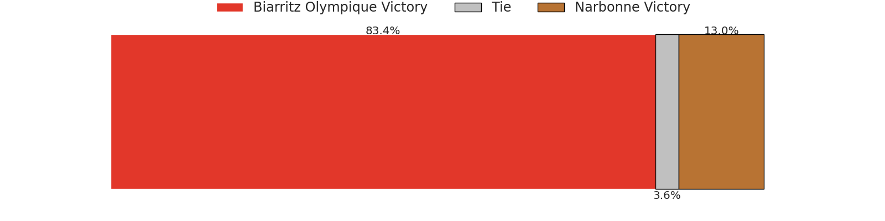
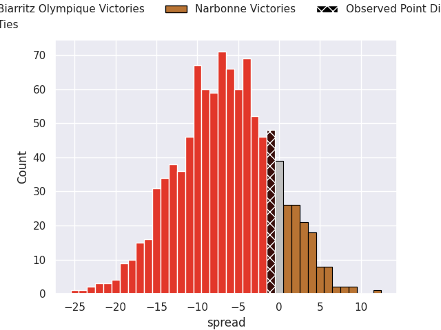

#### Nice V Valence Romans Drome Rugby on 2026/11/20

Average Margin: Nice by 2.3

#### Oyonnax V Brive on 2026/11/20

Average Margin: Oyonnax by 11.6

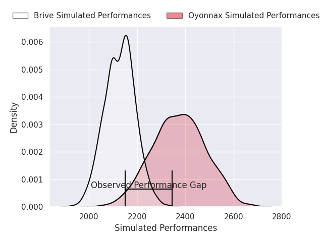
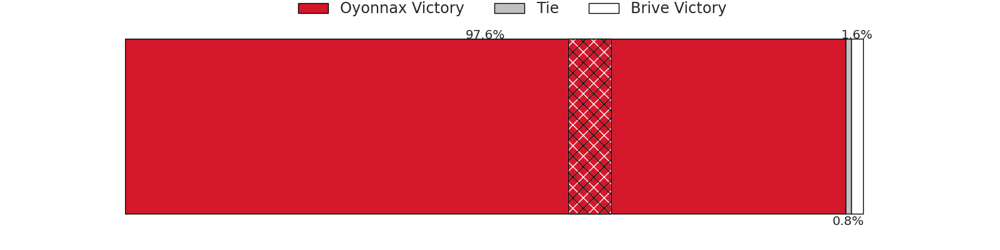

#### US Montauban V Agen on 2026/11/20

Average Margin: Agen by 0.3

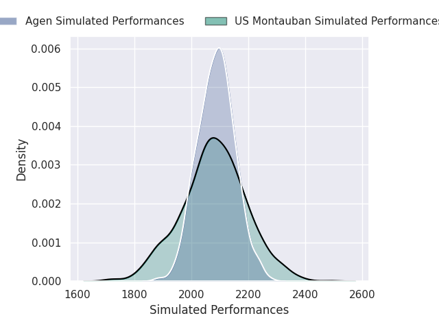

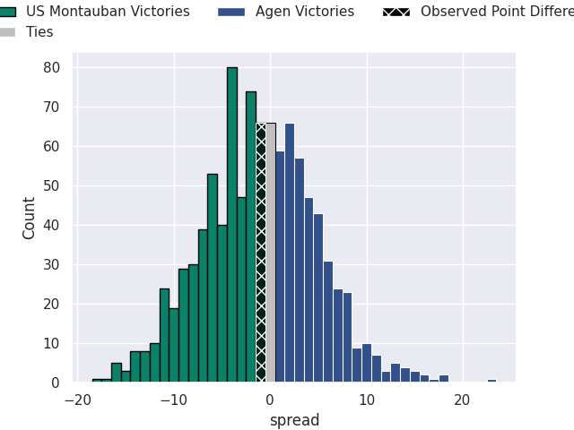

#### Aurillac V Colomiers on 2026/11/20

Average Margin: Aurillac by 2.3

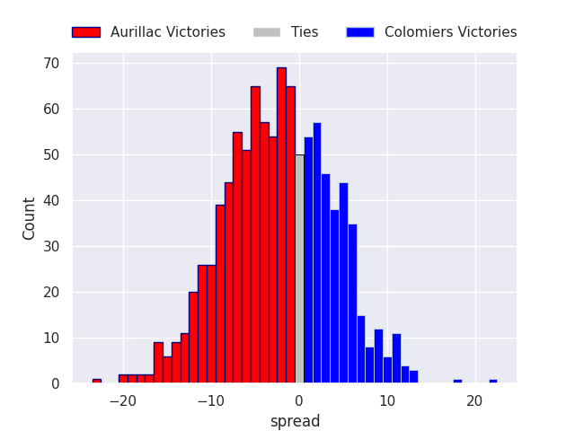

#### Beziers V Dax on 2026/11/20

Average Margin: Beziers by 1.7

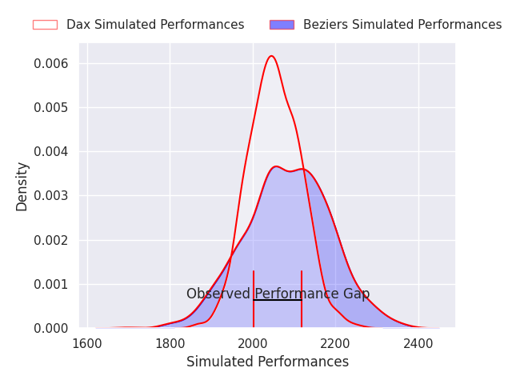

#### USON Nevers V Soyaux-Angouleme on 2026/11/20

Average Margin: Soyaux-Angouleme by 1.6

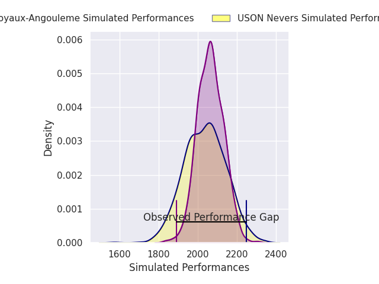

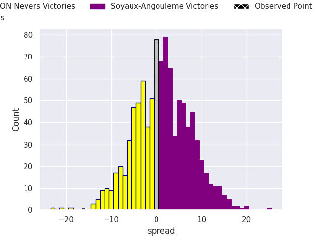

### Week 14
#### Brive V Biarritz Olympique on 2026/11/26

Average Margin: Brive by 12.2

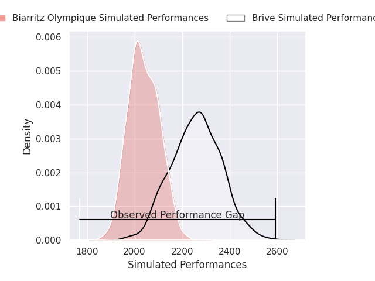
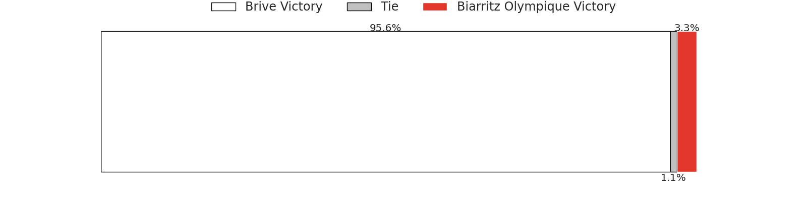

#### Valence Romans Drome Rugby V Aurillac on 2026/11/27

Average Margin: Valence Romans Drome Rugby by 10.3

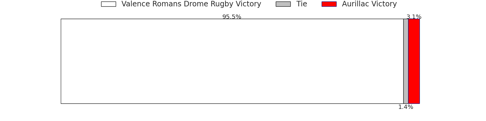
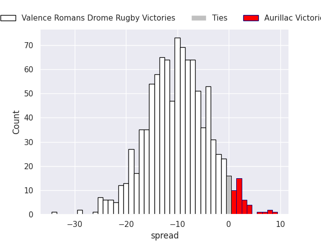

#### Soyaux-Angouleme V Nice on 2026/11/27

Average Margin: Soyaux-Angouleme by 7.5

#### Provence Rugby V US Montauban on 2026/11/27

Average Margin: Provence Rugby by 17.8

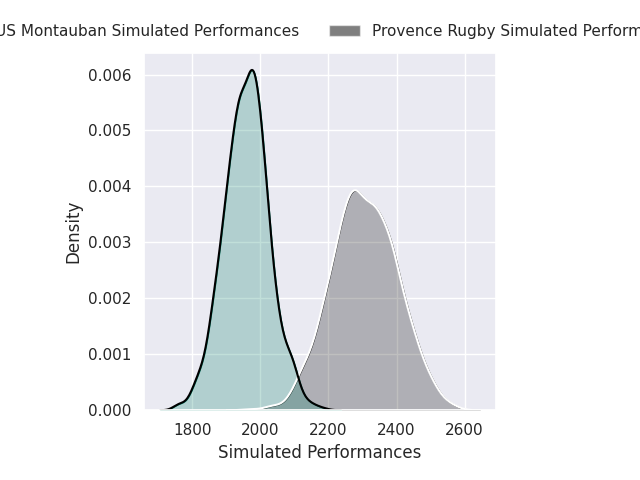

#### Colomiers V USON Nevers on 2026/11/27

Average Margin: Colomiers by 18.2

#### Agen V Beziers on 2026/11/27

Average Margin: Agen by 13.2

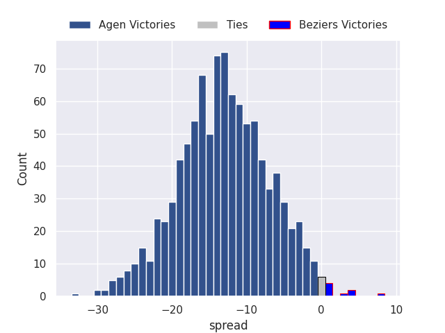

#### Narbonne V Grenoble on 2026/11/27

Average Margin: Narbonne by 1.6

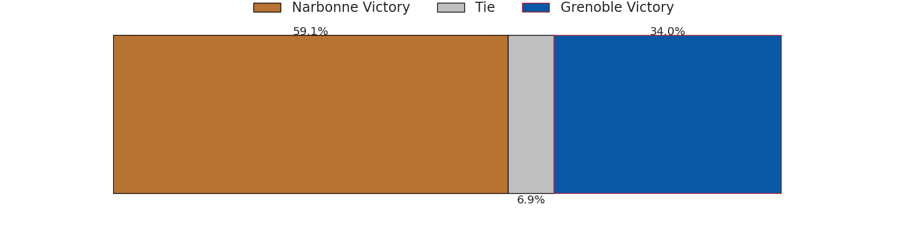

#### Dax V Oyonnax on 2026/11/27

Average Margin: Oyonnax by 2.3

### Week 15
#### Beziers V Brive on 2026/12/04

Average Margin: Brive by 3.0

#### Aurillac V Soyaux-Angouleme on 2026/12/04

Average Margin: Aurillac by 6.0

#### Nice V Colomiers on 2026/12/04

Average Margin: Nice by 0.8

#### USON Nevers V Dax on 2026/12/04

Average Margin: Dax by 0.3

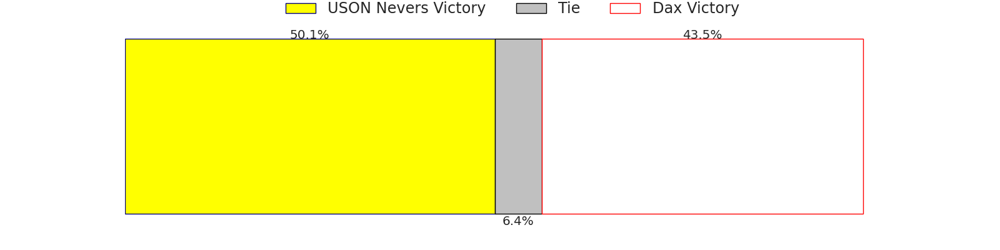
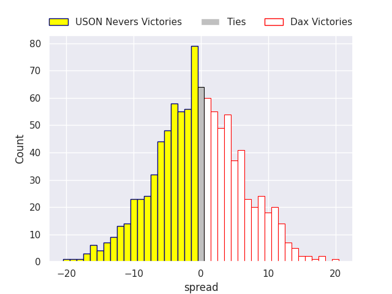

#### Biarritz Olympique V Provence Rugby on 2026/12/04

Average Margin: Provence Rugby by 1.8

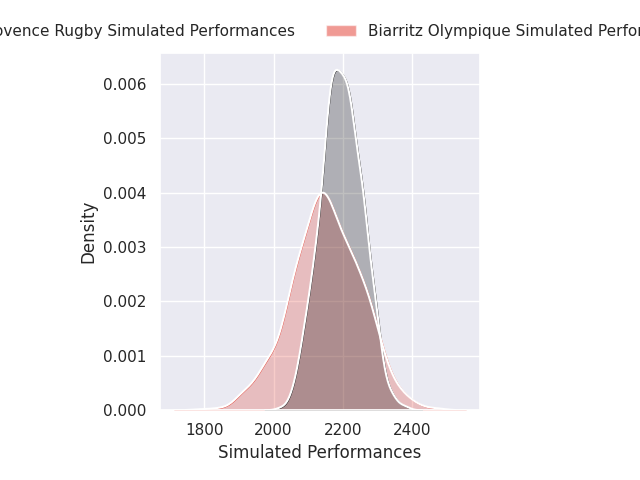

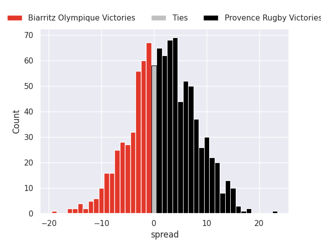

#### US Montauban V Valence Romans Drome Rugby on 2026/12/04

Average Margin: Valence Romans Drome Rugby by 1.5

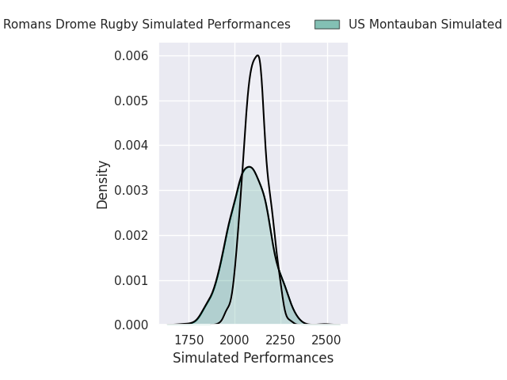

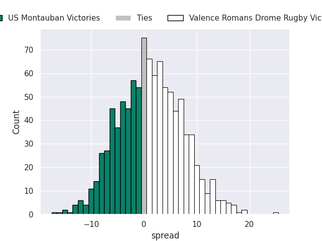

#### Narbonne V Agen on 2026/12/04

Average Margin: Narbonne by 2.0

#### Oyonnax V Grenoble on 2026/12/04

Average Margin: Oyonnax by 13.6

### Week 16
#### Provence Rugby V Brive on 2026/12/11

Average Margin: Provence Rugby by 8.8

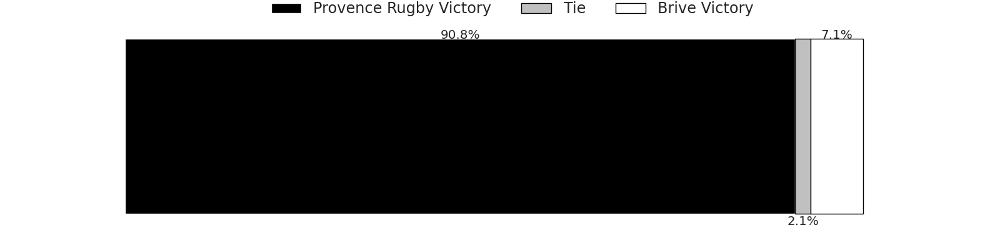

#### Nice V Oyonnax on 2026/12/11

Average Margin: Oyonnax by 2.2

#### Valence Romans Drome Rugby V Narbonne on 2026/12/11

Average Margin: Valence Romans Drome Rugby by 10.8

#### Grenoble V USON Nevers on 2026/12/11

Average Margin: Grenoble by 15.2

#### Colomiers V US Montauban on 2026/12/11

Average Margin: Colomiers by 15.2

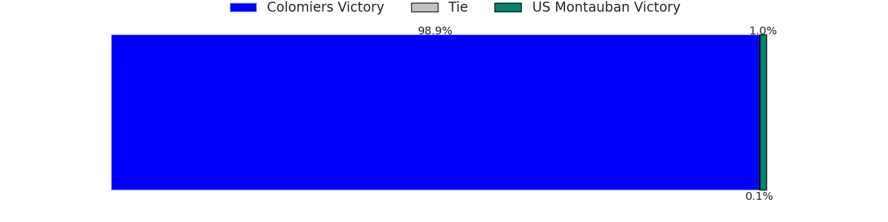

#### Dax V Biarritz Olympique on 2026/12/11

Average Margin: Dax by 6.5

#### Soyaux-Angouleme V Beziers on 2026/12/11

Average Margin: Soyaux-Angouleme by 12.4

#### Agen V Aurillac on 2026/12/11

Average Margin: Agen by 9.4

### Week 17
#### US Montauban V Nice on 2026/12/18

Average Margin: US Montauban by 1.4

#### Oyonnax V Colomiers on 2026/12/18

Average Margin: Oyonnax by 11.3

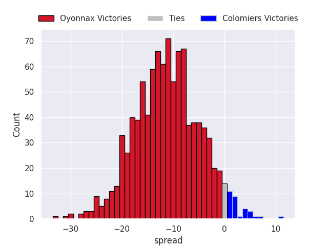

#### Beziers V Biarritz Olympique on 2026/12/18

Average Margin: Beziers by 2.5

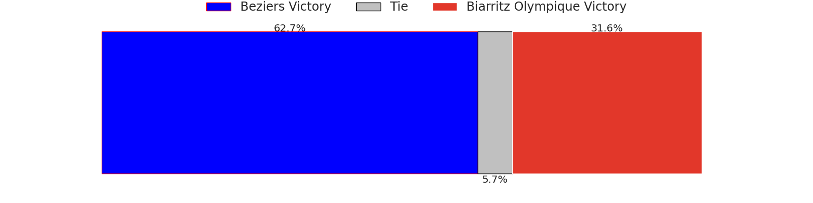

#### Aurillac V Narbonne on 2026/12/18

Average Margin: Aurillac by 8.1

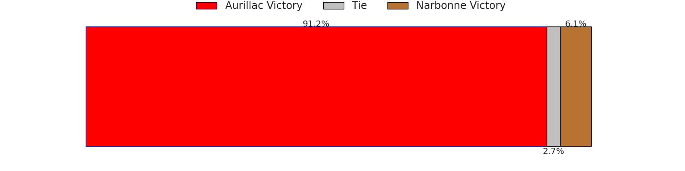
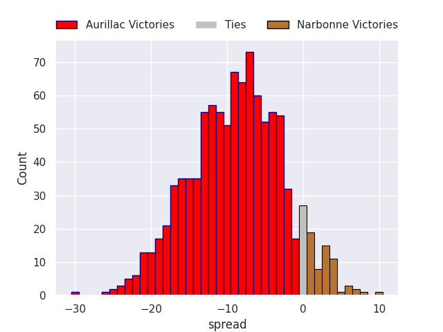

#### Dax V Grenoble on 2026/12/18

Average Margin: Dax by 3.5

#### Brive V Soyaux-Angouleme on 2026/12/18

Average Margin: Brive by 10.2

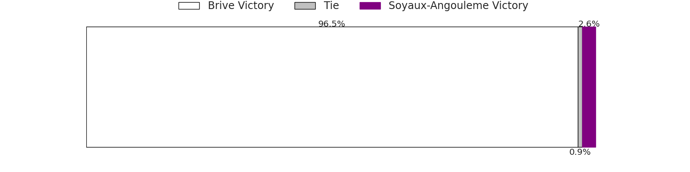

#### USON Nevers V Provence Rugby on 2026/12/18

Average Margin: Provence Rugby by 7.8

#### Valence Romans Drome Rugby V Agen on 2026/12/18

Average Margin: Valence Romans Drome Rugby by 7.6

### Week 18
#### Soyaux-Angouleme V Oyonnax on 2027/01/08

Average Margin: Oyonnax by 0.3

#### Narbonne V US Montauban on 2027/01/08

Average Margin: Narbonne by 8.7

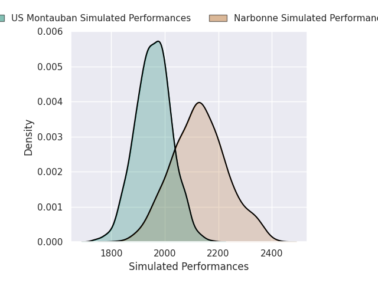

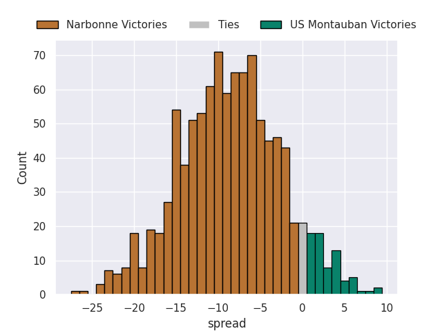

#### Colomiers V Brive on 2027/01/08

Average Margin: Colomiers by 6.8

#### Agen V USON Nevers on 2027/01/08

Average Margin: Agen by 15.2

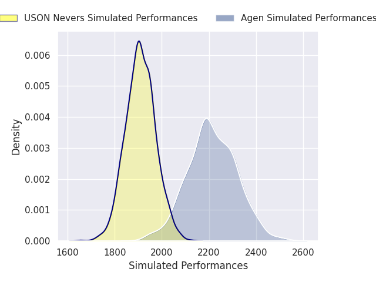

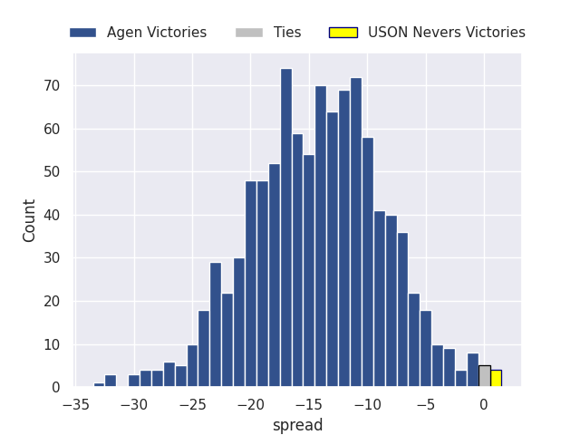

#### Grenoble V Beziers on 2027/01/08

Average Margin: Grenoble by 12.7

#### Biarritz Olympique V Aurillac on 2027/01/08

Average Margin: Biarritz Olympique by 6.1

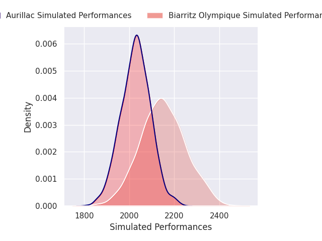

#### Nice V Dax on 2027/01/08

Average Margin: Nice by 6.0

#### Provence Rugby V Valence Romans Drome Rugby on 2027/01/08

Average Margin: Provence Rugby by 9.8

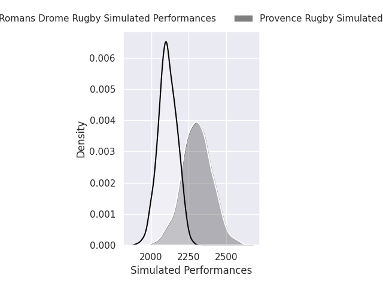
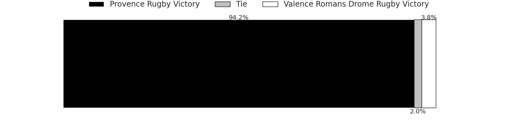

### Week 19
#### Aurillac V Provence Rugby on 2027/01/15

Average Margin: Provence Rugby by 0.0

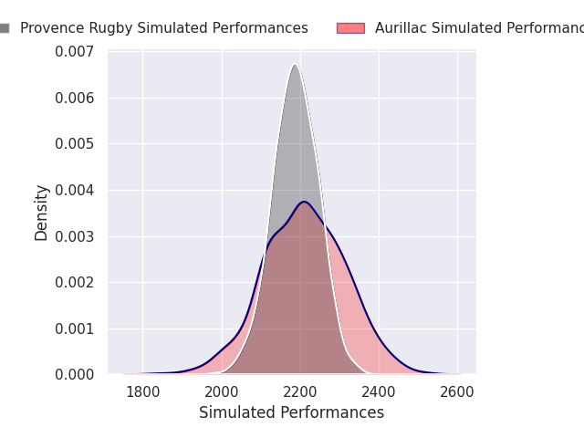

#### Dax V Soyaux-Angouleme on 2027/01/15

Average Margin: Dax by 4.9

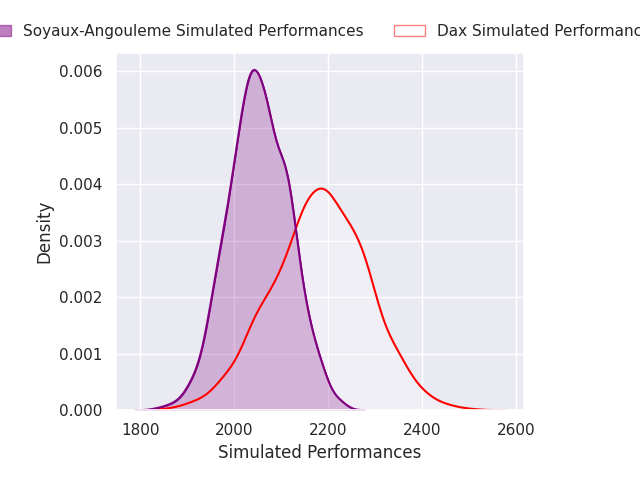

#### Beziers V Colomiers on 2027/01/15

Average Margin: Colomiers by 3.0

#### US Montauban V Biarritz Olympique on 2027/01/15

Average Margin: US Montauban by 2.4

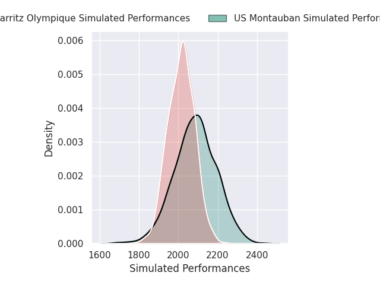
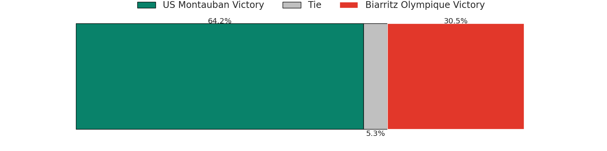

#### USON Nevers V Nice on 2027/01/15

Average Margin: Nice by 1.0

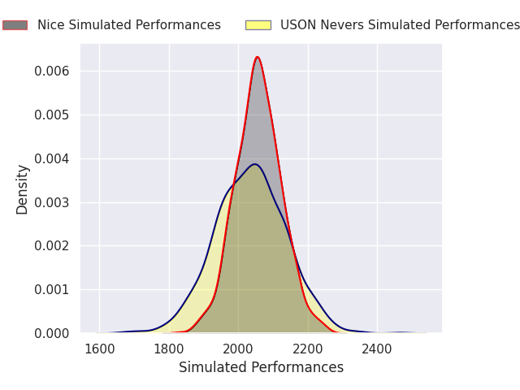

#### Valence Romans Drome Rugby V Grenoble on 2027/01/15

Average Margin: Valence Romans Drome Rugby by 7.0

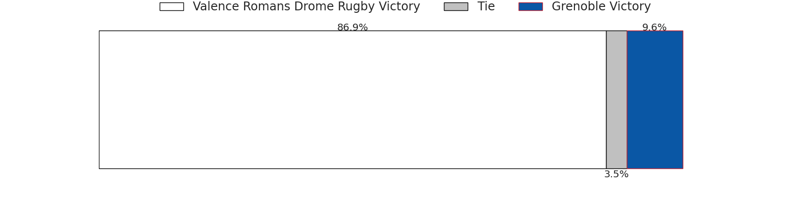

#### Brive V Agen on 2027/01/15

Average Margin: Brive by 9.0

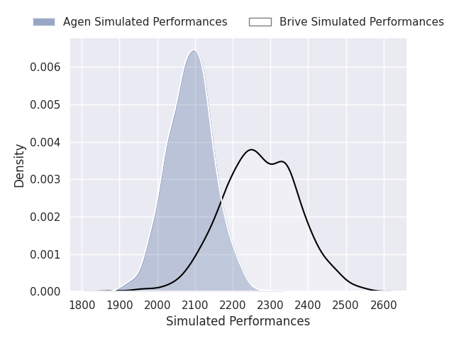

#### Oyonnax V Narbonne on 2027/01/15

Average Margin: Oyonnax by 17.2

### Week 20
#### Oyonnax V Beziers on 2027/01/22

Average Margin: Oyonnax by 19.9

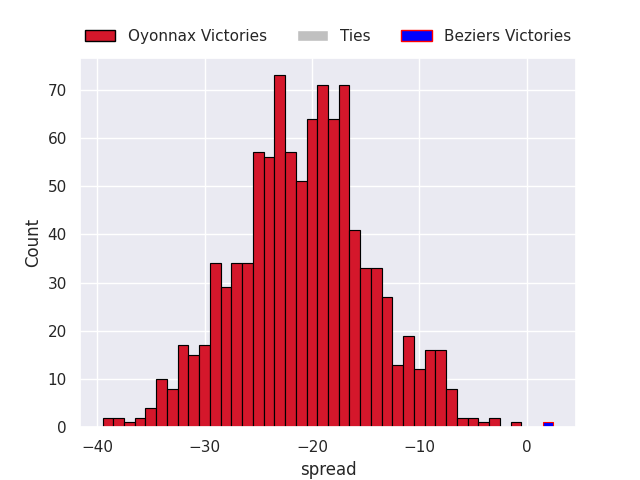

#### Provence Rugby V Grenoble on 2027/01/22

Average Margin: Provence Rugby by 10.7

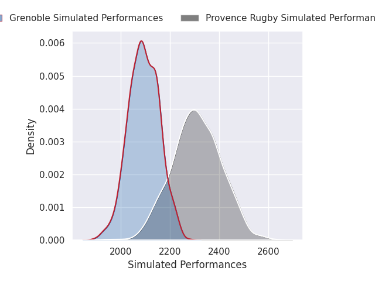

#### Narbonne V Dax on 2027/01/22

Average Margin: Narbonne by 4.4

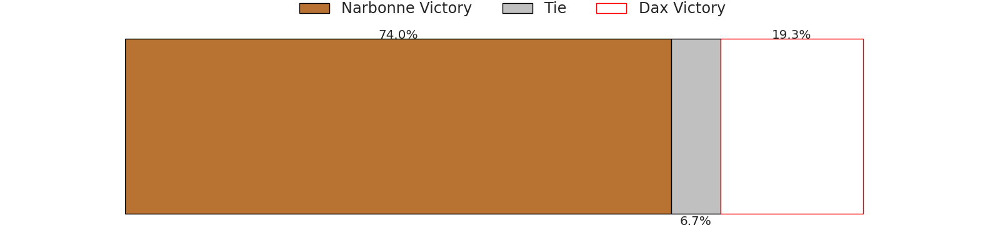
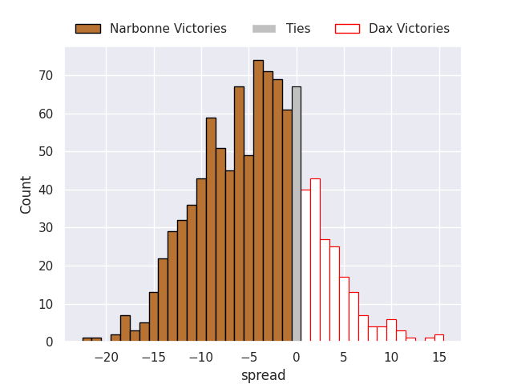

#### Agen V US Montauban on 2027/01/22

Average Margin: Agen by 13.0

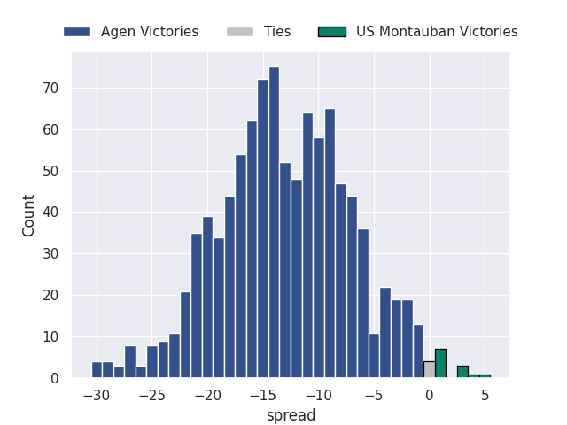

#### Nice V Brive on 2027/01/22

Average Margin: Nice by 0.9

#### Colomiers V Aurillac on 2027/01/22

Average Margin: Colomiers by 11.8

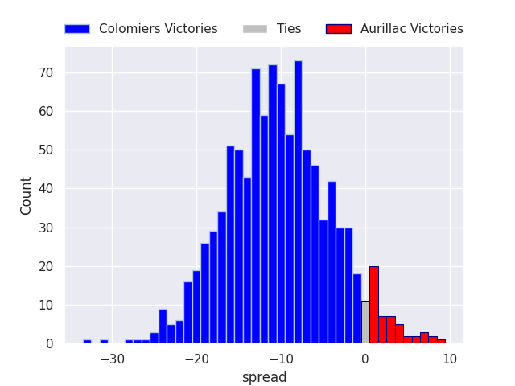

#### Biarritz Olympique V USON Nevers on 2027/01/22

Average Margin: Biarritz Olympique by 12.1

#### Soyaux-Angouleme V Valence Romans Drome Rugby on 2027/01/22

Average Margin: Soyaux-Angouleme by 4.7

### Week 21
#### USON Nevers V Colomiers on 2027/01/29

Average Margin: Colomiers by 5.3

#### Aurillac V Oyonnax on 2027/01/29

Average Margin: Oyonnax by 1.0

#### US Montauban V Soyaux-Angouleme on 2027/01/29

Average Margin: US Montauban by 0.5

#### Valence Romans Drome Rugby V Biarritz Olympique on 2027/01/29

Average Margin: Valence Romans Drome Rugby by 10.7

#### Grenoble V Nice on 2027/01/29

Average Margin: Grenoble by 7.1

#### Brive V Narbonne on 2027/01/29

Average Margin: Brive by 12.4

#### Dax V Agen on 2027/01/29

Average Margin: Dax by 3.7

#### Beziers V Provence Rugby on 2027/01/29

Average Margin: Provence Rugby by 5.2

### Week 22
#### Provence Rugby V Dax on 2027/02/12

Average Margin: Provence Rugby by 13.3

#### Aurillac V Beziers on 2027/02/12

Average Margin: Aurillac by 11.3

#### Oyonnax V US Montauban on 2027/02/12

Average Margin: Oyonnax by 20.1

#### Colomiers V Valence Romans Drome Rugby on 2027/02/12

Average Margin: Colomiers by 8.2

#### Grenoble V Brive on 2027/02/12

Average Margin: Grenoble by 3.4

#### Soyaux-Angouleme V USON Nevers on 2027/02/12

Average Margin: Soyaux-Angouleme by 14.7

#### Nice V Agen on 2027/02/12

Average Margin: Nice by 3.4

#### Narbonne V Biarritz Olympique on 2027/02/12

Average Margin: Narbonne by 5.0

### Week 23
#### Beziers V Soyaux-Angouleme on 2027/02/19

Average Margin: Beziers by 0.5

#### Agen V Narbonne on 2027/02/19

Average Margin: Agen by 8.9

#### Brive V Provence Rugby on 2027/02/19

Average Margin: Brive by 4.4

#### USON Nevers V Grenoble on 2027/02/19

Average Margin: Grenoble by 2.7

#### US Montauban V Aurillac on 2027/02/19

Average Margin: US Montauban by 2.3

#### Biarritz Olympique V Oyonnax on 2027/02/19

Average Margin: Oyonnax by 2.4

#### Dax V Colomiers on 2027/02/19

Average Margin: Dax by 1.7

#### Valence Romans Drome Rugby V Nice on 2027/02/19

Average Margin: Valence Romans Drome Rugby by 8.9

### Week 24
#### Brive V Beziers on 2027/02/26

Average Margin: Brive by 15.6

#### Aurillac V Agen on 2027/02/26

Average Margin: Aurillac by 5.1

#### Provence Rugby V USON Nevers on 2027/02/26

Average Margin: Provence Rugby by 19.6

#### Grenoble V US Montauban on 2027/02/26

Average Margin: Grenoble by 12.8

#### Narbonne V Valence Romans Drome Rugby on 2027/02/26

Average Margin: Narbonne by 1.3

#### Colomiers V Soyaux-Angouleme on 2027/02/26

Average Margin: Colomiers by 10.1

#### Oyonnax V Dax on 2027/02/26

Average Margin: Oyonnax by 16.2

#### Nice V Biarritz Olympique on 2027/02/26

Average Margin: Nice by 6.0

### Week 25
#### USON Nevers V Oyonnax on 2027/03/05

Average Margin: Oyonnax by 8.1

#### Dax V Aurillac on 2027/03/05

Average Margin: Dax by 6.6

#### Beziers V Nice on 2027/03/05

Average Margin: Beziers by 1.2

#### Biarritz Olympique V Grenoble on 2027/03/05

Average Margin: Biarritz Olympique by 3.5

#### Agen V Colomiers on 2027/03/05

Average Margin: Agen by 3.4

#### US Montauban V Provence Rugby on 2027/03/05

Average Margin: Provence Rugby by 5.0

#### Valence Romans Drome Rugby V Brive on 2027/03/05

Average Margin: Valence Romans Drome Rugby by 5.1

#### Soyaux-Angouleme V Narbonne on 2027/03/05

Average Margin: Soyaux-Angouleme by 8.8

### Week 26
#### Provence Rugby V Soyaux-Angouleme on 2027/03/26

Average Margin: Provence Rugby by 11.9

#### Colomiers V Oyonnax on 2027/03/26

Average Margin: Colomiers by 2.9

#### Dax V Beziers on 2027/03/26

Average Margin: Dax by 10.0

#### Grenoble V Narbonne on 2027/03/26

Average Margin: Grenoble by 9.1

#### Nice V US Montauban on 2027/03/26

Average Margin: Nice by 9.7

#### Aurillac V Valence Romans Drome Rugby on 2027/03/26

Average Margin: Aurillac by 4.0

#### Biarritz Olympique V Agen on 2027/03/26

Average Margin: Biarritz Olympique by 3.5

#### Brive V USON Nevers on 2027/03/26

Average Margin: Brive by 18.0

### Week 27
#### Narbonne V Provence Rugby on 2027/04/02

Average Margin: Provence Rugby by 2.5

#### Agen V Grenoble on 2027/04/02

Average Margin: Agen by 6.1

#### Valence Romans Drome Rugby V Dax on 2027/04/02

Average Margin: Valence Romans Drome Rugby by 9.5

#### Beziers V US Montauban on 2027/04/02

Average Margin: Beziers by 5.9

#### Soyaux-Angouleme V Brive on 2027/04/02

Average Margin: Soyaux-Angouleme by 3.3

#### Oyonnax V Nice on 2027/04/02

Average Margin: Oyonnax by 15.3

#### USON Nevers V Aurillac on 2027/04/02

Average Margin: USON Nevers by 0.7

#### Colomiers V Biarritz Olympique on 2027/04/02

Average Margin: Colomiers by 12.0

### Week 28
#### Biarritz Olympique V Beziers on 2027/04/09

Average Margin: Biarritz Olympique by 9.7

#### Brive V Oyonnax on 2027/04/09

Average Margin: Brive by 3.5

#### Narbonne V Aurillac on 2027/04/09

Average Margin: Narbonne by 4.9

#### Grenoble V Dax on 2027/04/09

Average Margin: Grenoble by 8.3

#### Agen V Valence Romans Drome Rugby on 2027/04/09

Average Margin: Agen by 5.0

#### Provence Rugby V Colomiers on 2027/04/09

Average Margin: Provence Rugby by 8.0

#### US Montauban V USON Nevers on 2027/04/09

Average Margin: US Montauban by 8.5

#### Nice V Soyaux-Angouleme on 2027/04/09

Average Margin: Nice by 4.3

### Week 29
#### USON Nevers V Narbonne on 2027/04/16

Average Margin: USON Nevers by 1.3

#### Aurillac V Grenoble on 2027/04/16

Average Margin: Aurillac by 4.6

#### Beziers V Agen on 2027/04/16

Average Margin: Agen by 0.2

#### Valence Romans Drome Rugby V US Montauban on 2027/04/16

Average Margin: Valence Romans Drome Rugby by 13.6

#### Soyaux-Angouleme V Biarritz Olympique on 2027/04/16

Average Margin: Soyaux-Angouleme by 8.5

#### Oyonnax V Provence Rugby on 2027/04/16

Average Margin: Oyonnax by 8.9

#### Dax V Brive on 2027/04/16

Average Margin: Dax by 1.5

#### Colomiers V Nice on 2027/04/16

Average Margin: Colomiers by 10.4

### Week 30
#### Grenoble V Oyonnax on 2027/04/23

Average Margin: Grenoble by 0.5

#### Biarritz Olympique V Dax on 2027/04/23

Average Margin: Biarritz Olympique by 5.5

#### Narbonne V Beziers on 2027/04/23

Average Margin: Narbonne by 8.2

#### Agen V Soyaux-Angouleme on 2027/04/23

Average Margin: Agen by 7.4

#### USON Nevers V Valence Romans Drome Rugby on 2027/04/23

Average Margin: Valence Romans Drome Rugby by 3.5

#### US Montauban V Colomiers on 2027/04/23

Average Margin: Colomiers by 2.3

#### Brive V Aurillac on 2027/04/23

Average Margin: Brive by 11.6

#### Provence Rugby V Nice on 2027/04/23

Average Margin: Provence Rugby by 12.2

### Week 31
#### Beziers V Valence Romans Drome Rugby on 2027/05/07

Average Margin: Valence Romans Drome Rugby by 1.1

#### Oyonnax V Agen on 2027/05/07

Average Margin: Oyonnax by 13.7

#### Dax V USON Nevers on 2027/05/07

Average Margin: Dax by 12.7

#### Colomiers V Grenoble on 2027/05/07

Average Margin: Colomiers by 8.9

#### Provence Rugby V Biarritz Olympique on 2027/05/07

Average Margin: Provence Rugby by 13.6

#### Brive V US Montauban on 2027/05/07

Average Margin: Brive by 15.3

#### Soyaux-Angouleme V Aurillac on 2027/05/07

Average Margin: Soyaux-Angouleme by 8.6

#### Nice V Narbonne on 2027/05/07

Average Margin: Nice by 6.8

### Week 32
#### Grenoble V Soyaux-Angouleme on 2027/05/14

Average Margin: Grenoble by 7.1

#### Aurillac V Nice on 2027/05/14

Average Margin: Aurillac by 6.6

#### Valence Romans Drome Rugby V Oyonnax on 2027/05/14

Average Margin: Valence Romans Drome Rugby by 1.4

#### Agen V Provence Rugby on 2027/05/14

Average Margin: Agen by 1.6

#### USON Nevers V Beziers on 2027/05/14

Average Margin: USON Nevers by 4.1

#### Biarritz Olympique V Brive on 2027/05/14

Average Margin: Biarritz Olympique by 1.3

#### US Montauban V Dax on 2027/05/14

Average Margin: US Montauban by 2.2

#### Narbonne V Colomiers on 2027/05/14

Average Margin: Colomiers by 0.4

