## Team Rankings

## Standings
### Current Standings

| Club                |   Played |   Wins |   Point Differential |   Losing Bonus Points |   Try Bonus Points |   Competition Points |
|:--------------------|---------:|-------:|---------------------:|----------------------:|-------------------:|---------------------:|
| Ealing Trailfinders |        9 |      8 |                  191 |                     1 |                  6 |                   39 |
| Coventry            |        9 |      7 |                  131 |                     2 |                  6 |                   36 |
| Worcester Warriors  |        9 |      7 |                  177 |                     0 |                  6 |                   34 |
| Bedford             |        9 |      6 |                   72 |                     1 |                  6 |                   31 |
| Cornish Pirates     |        9 |      6 |                   55 |                     0 |                  5 |                   29 |
| Chinnor             |        9 |      6 |                   11 |                     0 |                  5 |                   29 |
| Rotherham Titans    |        9 |      6 |                  -32 |                     1 |                  4 |                   29 |
| Doncaster           |        9 |      4 |                    1 |                     2 |                  7 |                   25 |
| Ampthill            |        9 |      4 |                 -115 |                     0 |                  3 |                   19 |
| Richmond            |        9 |      3 |                  -75 |                     1 |                  4 |                   17 |
| Hartpury College    |        9 |      3 |                 -106 |                     1 |                  2 |                   15 |
| Nottingham          |        9 |      1 |                  -92 |                     5 |                  4 |                   13 |
| Caldy               |        9 |      1 |                 -120 |                     4 |                  5 |                   13 |
| Blackheath          |        9 |      1 |                  -98 |                     3 |                  3 |                   10 |

### Projected Remaining Table

| Club                |   To Play |   Projected Wins |   Projected Differential |   Projected Losing Bonus Points | Projected Try Bonus Points   |   Projected Competition Points |
|:--------------------|----------:|-----------------:|-------------------------:|--------------------------------:|:-----------------------------|-------------------------------:|
| Ealing Trailfinders |         6 |            5.028 |                   66.369 |                           0.596 |                              |                         21.002 |
| Doncaster           |         6 |            4.806 |                   52.823 |                           0.674 |                              |                         20.22  |
| Coventry            |         6 |            4.688 |                   47.18  |                           0.796 |                              |                         19.892 |
| Bedford             |         6 |            3.769 |                   33.594 |                           0.94  |                              |                         16.31  |
| Cornish Pirates     |         6 |            3.548 |                   19.017 |                           1.203 |                              |                         15.799 |
| Worcester Warriors  |         6 |            3.29  |                   10.713 |                           1.295 |                              |                         14.901 |
| Chinnor             |         6 |            3.167 |                    6.359 |                           1.218 |                              |                         14.344 |
| Ampthill            |         6 |            2.794 |                    2.63  |                           1.389 |                              |                         12.941 |
| Hartpury College    |         6 |            2.511 |                   -7.962 |                           1.278 |                              |                         11.71  |
| Nottingham          |         6 |            1.992 |                  -31.64  |                           1.337 |                              |                          9.701 |
| Rotherham Titans    |         6 |            1.668 |                  -35.832 |                           1.446 |                              |                          8.524 |
| Blackheath          |         6 |            1.445 |                  -52.143 |                           1.06  |                              |                          7.11  |
| Richmond            |         6 |            1.419 |                  -45.93  |                           0.998 |                              |                          6.884 |
| Caldy               |         6 |            0.657 |                  -65.178 |                           1.369 |                              |                          4.261 |

### Projected Total Table

| Club                |   Played |   Wins |   Point Differential |   Losing Bonus Points |   Try Bonus Points |   Competition Points |
|:--------------------|---------:|-------:|---------------------:|----------------------:|-------------------:|---------------------:|
| Ealing Trailfinders |       15 | 13.028 |              257.369 |                 1.596 |                  6 |               60.002 |
| Coventry            |       15 | 11.688 |              178.18  |                 2.796 |                  6 |               55.892 |
| Worcester Warriors  |       15 | 10.29  |              187.713 |                 1.295 |                  6 |               48.901 |
| Bedford             |       15 |  9.769 |              105.594 |                 1.94  |                  6 |               47.31  |
| Doncaster           |       15 |  8.806 |               53.823 |                 2.674 |                  7 |               45.22  |
| Cornish Pirates     |       15 |  9.548 |               74.017 |                 1.203 |                  5 |               44.799 |
| Chinnor             |       15 |  9.167 |               17.359 |                 1.218 |                  5 |               43.344 |
| Rotherham Titans    |       15 |  7.668 |              -67.832 |                 2.446 |                  4 |               37.524 |
| Ampthill            |       15 |  6.794 |             -112.37  |                 1.389 |                  3 |               31.941 |
| Hartpury College    |       15 |  5.511 |             -113.962 |                 2.278 |                  2 |               26.71  |
| Richmond            |       15 |  4.419 |             -120.93  |                 1.998 |                  4 |               23.884 |
| Nottingham          |       15 |  2.992 |             -123.64  |                 6.337 |                  4 |               22.701 |
| Caldy               |       15 |  1.657 |             -185.178 |                 5.369 |                  5 |               17.261 |
| Blackheath          |       15 |  2.445 |             -150.143 |                 4.06  |                  3 |               17.11  |

## Completed Match Review

| Model | Percent Correct Predictions | Spread Error |
| ------ | ------ | ------ |
| Club Level | 72.4% | 13.3 |
| Player Level: Lineup | nan% | nan |
| Player Level: Minutes | nan% | nan |

## Future Predictions
### Week 10
#### Nottingham V Caldy on 2026/12/04

Average Margin: Nottingham by 8.1

#### Cornish Pirates V Hartpury College on 2026/12/05

Average Margin: Cornish Pirates by 9.0

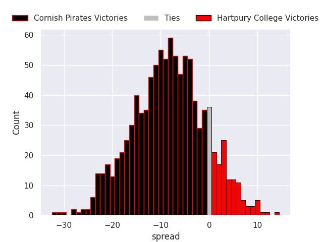

#### Bedford V Coventry on 2026/12/05

Average Margin: Bedford by 2.8

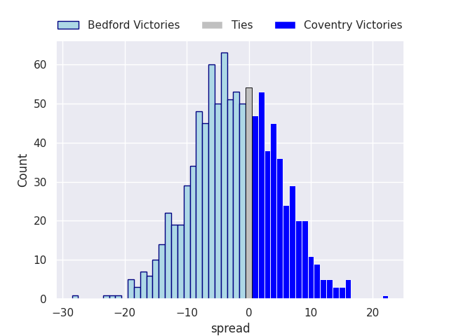

#### Worcester Warriors V Ealing Trailfinders on 2026/12/05

Average Margin: Ealing Trailfinders by 1.3

#### Richmond V Blackheath on 2026/12/05

Average Margin: Richmond by 9.1

#### Rotherham Titans V Doncaster on 2026/12/05

Average Margin: Doncaster by 2.1

#### Chinnor V Ampthill on 2026/12/06

Average Margin: Chinnor by 8.9

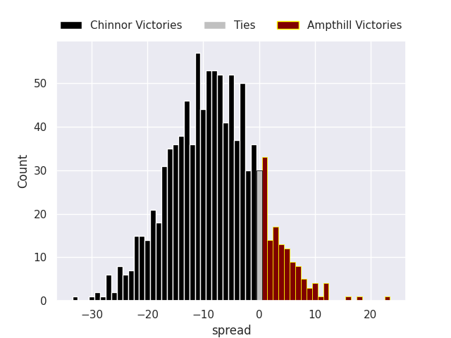

### Week 11
#### Doncaster V Richmond on 2026/12/12

Average Margin: Doncaster by 14.9

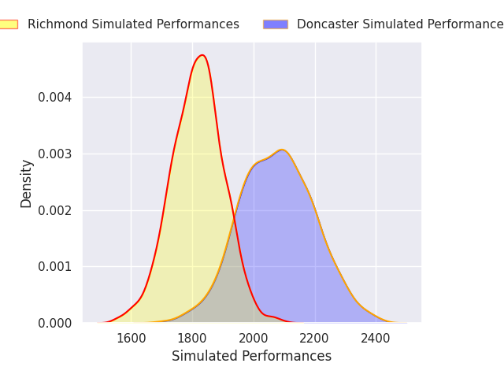

#### Ealing Trailfinders V Bedford on 2026/12/12

Average Margin: Ealing Trailfinders by 10.0

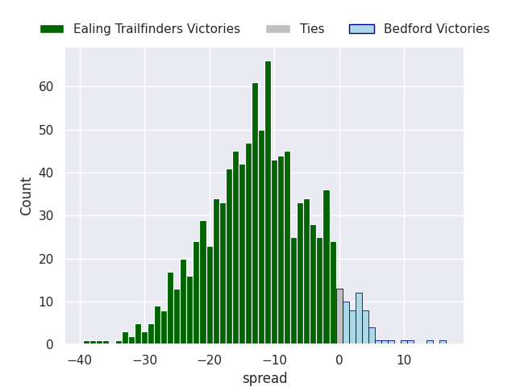

#### Caldy V Worcester Warriors on 2026/12/12

Average Margin: Worcester Warriors by 12.8

#### Blackheath V Cornish Pirates on 2026/12/12

Average Margin: Cornish Pirates by 11.2

#### Ampthill V Rotherham Titans on 2026/12/12

Average Margin: Ampthill by 3.8

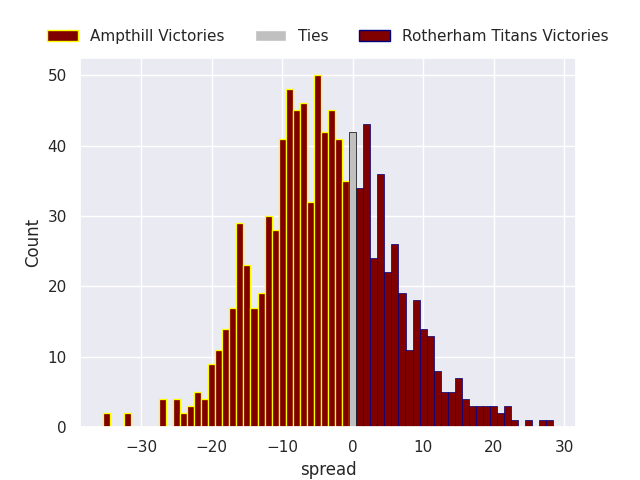

#### Hartpury College V Nottingham on 2026/12/12

Average Margin: Hartpury College by 6.1

#### Coventry V Chinnor on 2026/12/13

Average Margin: Coventry by 11.7

### Week 12
#### Hartpury College V Blackheath on 2026/12/18

Average Margin: Hartpury College by 15.0

#### Nottingham V Doncaster on 2026/12/18

Average Margin: Doncaster by 3.0

#### Cornish Pirates V Ampthill on 2026/12/18

Average Margin: Cornish Pirates by 9.0

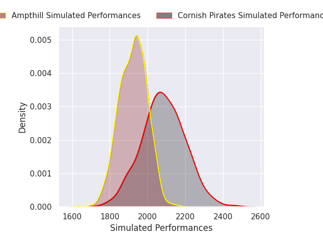

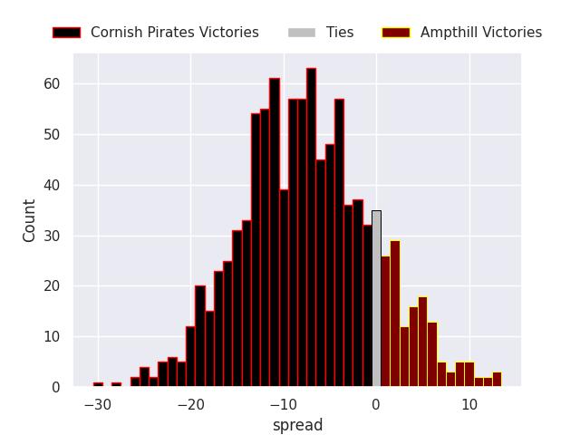

#### Chinnor V Worcester Warriors on 2026/12/19

Average Margin: Worcester Warriors by 0.1

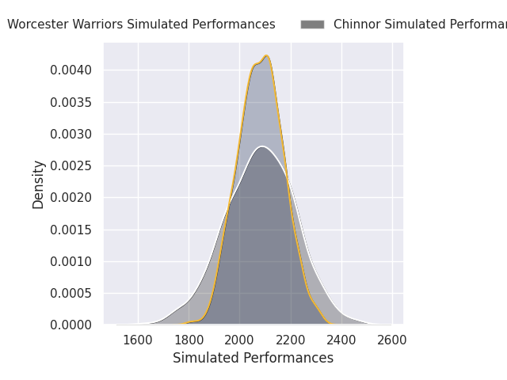

#### Rotherham Titans V Ealing Trailfinders on 2026/12/19

Average Margin: Ealing Trailfinders by 12.1

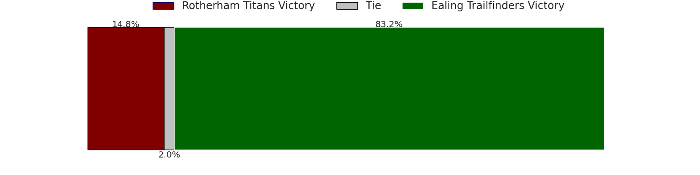

#### Richmond V Coventry on 2026/12/19

Average Margin: Coventry by 11.4

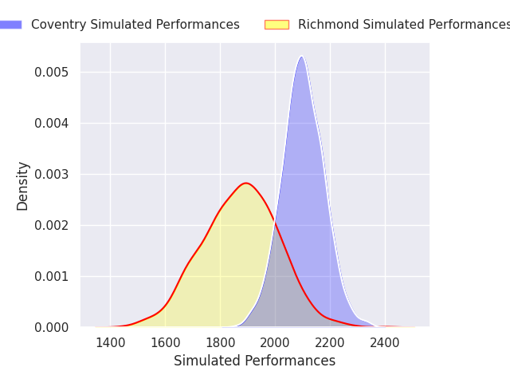

#### Bedford V Caldy on 2026/12/20

Average Margin: Bedford by 18.3

### Week 13
#### Worcester Warriors V Cornish Pirates on 2026/12/26

Average Margin: Worcester Warriors by 9.4

#### Coventry V Hartpury College on 2026/12/26

Average Margin: Coventry by 15.4

#### Richmond V Bedford on 2026/12/26

Average Margin: Bedford by 10.7

#### Ampthill V Blackheath on 2026/12/26

Average Margin: Ampthill by 13.4

#### Doncaster V Caldy on 2026/12/26

Average Margin: Doncaster by 15.3

#### Chinnor V Rotherham Titans on 2026/12/27

Average Margin: Chinnor by 8.7

#### Ealing Trailfinders V Nottingham on 2026/12/27

Average Margin: Ealing Trailfinders by 20.9

### Week 14
#### Nottingham V Ealing Trailfinders on 2027/01/01

Average Margin: Ealing Trailfinders by 11.9

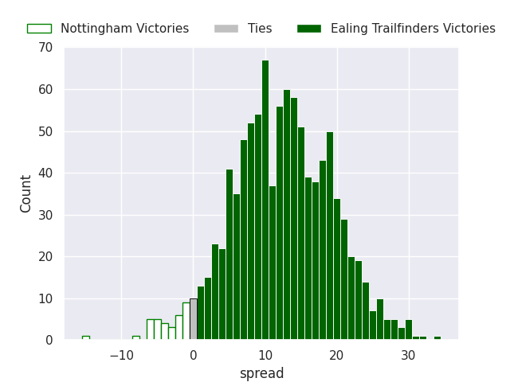

#### Bedford V Richmond on 2027/01/01

Average Margin: Bedford by 17.9

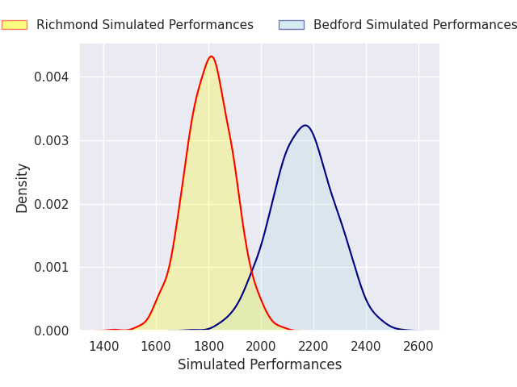

#### Blackheath V Ampthill on 2027/01/01

Average Margin: Ampthill by 3.6

#### Cornish Pirates V Worcester Warriors on 2027/01/02

Average Margin: Worcester Warriors by 0.0

#### Rotherham Titans V Chinnor on 2027/01/02

Average Margin: Chinnor by 0.2

#### Hartpury College V Coventry on 2027/01/02

Average Margin: Coventry by 5.4

#### Caldy V Doncaster on 2027/01/02

Average Margin: Doncaster by 8.5

### Week 15
#### Blackheath V Richmond on 2027/01/22

Average Margin: Blackheath by 0.2

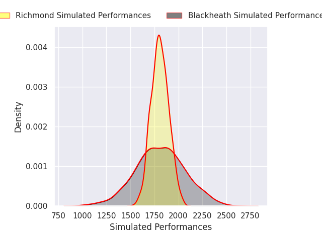

#### Ealing Trailfinders V Worcester Warriors on 2027/01/23

Average Margin: Ealing Trailfinders by 10.2

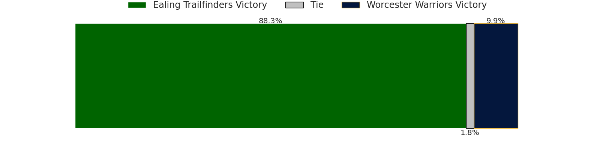

#### Caldy V Nottingham on 2027/01/23

Average Margin: Nottingham by 2.1

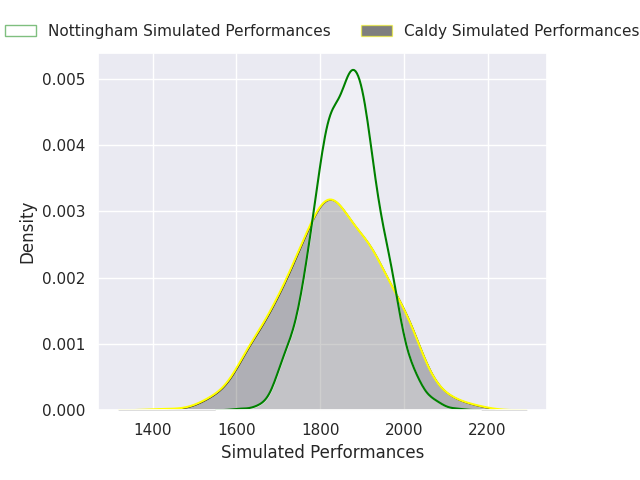

#### Doncaster V Rotherham Titans on 2027/01/23

Average Margin: Doncaster by 8.9

#### Hartpury College V Cornish Pirates on 2027/01/23

Average Margin: Hartpury College by 0.8

#### Ampthill V Chinnor on 2027/01/23

Average Margin: Chinnor by 0.3

#### Coventry V Bedford on 2027/01/23

Average Margin: Coventry by 6.1

