## Team Rankings

## Standings
### Current Standings

| Club                |   Played |   Wins |   Point Differential |   Losing Bonus Points |   Try Bonus Points |   Competition Points |
|:--------------------|---------:|-------:|---------------------:|----------------------:|-------------------:|---------------------:|
| Ealing Trailfinders |        8 |      7 |                  185 |                     1 |                  5 |                   34 |
| Worcester Warriors  |        8 |      7 |                  192 |                     0 |                  5 |                   33 |
| Coventry            |        8 |      6 |                  116 |                     2 |                  5 |                   31 |
| Chinnor             |        8 |      6 |                   35 |                     0 |                  5 |                   29 |
| Bedford             |        8 |      5 |                   44 |                     1 |                  6 |                   27 |
| Rotherham Titans    |        8 |      5 |                  -52 |                     1 |                  4 |                   25 |
| Cornish Pirates     |        8 |      5 |                   50 |                     0 |                  4 |                   24 |
| Doncaster           |        8 |      3 |                  -23 |                     2 |                  6 |                   20 |
| Ampthill            |        8 |      4 |                  -87 |                     0 |                  3 |                   19 |
| Richmond            |        8 |      3 |                  -48 |                     1 |                  4 |                   17 |
| Nottingham          |        8 |      1 |                  -87 |                     4 |                  3 |                   11 |
| Caldy               |        8 |      1 |                 -114 |                     3 |                  4 |                   11 |
| Hartpury College    |        8 |      2 |                 -133 |                     1 |                  2 |                   11 |
| Blackheath          |        8 |      1 |                  -78 |                     3 |                  3 |                   10 |

### Projected Remaining Table

| Club                |   To Play |   Projected Wins |   Projected Differential |   Projected Losing Bonus Points | Projected Try Bonus Points   |   Projected Competition Points |
|:--------------------|----------:|-----------------:|-------------------------:|--------------------------------:|:-----------------------------|-------------------------------:|
| Ealing Trailfinders |         6 |            5.29  |                   83.76  |                           0.406 |                              |                         21.736 |
| Doncaster           |         6 |            4.748 |                   48.782 |                           0.772 |                              |                         20.158 |
| Coventry            |         6 |            4.526 |                   40.325 |                           0.913 |                              |                         19.391 |
| Bedford             |         6 |            4.2   |                   36.671 |                           0.813 |                              |                         17.879 |
| Worcester Warriors  |         6 |            3.623 |                   22.01  |                           1.305 |                              |                         16.267 |
| Cornish Pirates     |         6 |            3.322 |                    9.08  |                           1.233 |                              |                         14.927 |
| Chinnor             |         6 |            3.165 |                   13.313 |                           1.342 |                              |                         14.424 |
| Ampthill            |         6 |            2.658 |                   -0.45  |                           1.374 |                              |                         12.418 |
| Hartpury College    |         6 |            2.688 |                   -5.883 |                           1.246 |                              |                         12.332 |
| Blackheath          |         6 |            2.188 |                  -21.426 |                           1.21  |                              |                         10.318 |
| Nottingham          |         6 |            1.908 |                  -33.428 |                           1.408 |                              |                          9.402 |
| Rotherham Titans    |         6 |            1.312 |                  -56.797 |                           1.133 |                              |                          6.615 |
| Richmond            |         6 |            0.963 |                  -51.938 |                           1.381 |                              |                          5.491 |
| Caldy               |         6 |            0.259 |                  -84.019 |                           1.009 |                              |                          2.187 |

### Projected Total Table

| Club                |   Played |   Wins |   Point Differential |   Losing Bonus Points |   Try Bonus Points |   Competition Points |
|:--------------------|---------:|-------:|---------------------:|----------------------:|-------------------:|---------------------:|
| Ealing Trailfinders |       14 | 12.29  |              268.76  |                 1.406 |                  5 |               55.736 |
| Coventry            |       14 | 10.526 |              156.325 |                 2.913 |                  5 |               50.391 |
| Worcester Warriors  |       14 | 10.623 |              214.01  |                 1.305 |                  5 |               49.267 |
| Bedford             |       14 |  9.2   |               80.671 |                 1.813 |                  6 |               44.879 |
| Chinnor             |       14 |  9.165 |               48.313 |                 1.342 |                  5 |               43.424 |
| Doncaster           |       14 |  7.748 |               25.782 |                 2.772 |                  6 |               40.158 |
| Cornish Pirates     |       14 |  8.322 |               59.08  |                 1.233 |                  4 |               38.927 |
| Rotherham Titans    |       14 |  6.312 |             -108.797 |                 2.133 |                  4 |               31.615 |
| Ampthill            |       14 |  6.658 |              -87.45  |                 1.374 |                  3 |               31.418 |
| Hartpury College    |       14 |  4.688 |             -138.883 |                 2.246 |                  2 |               23.332 |
| Richmond            |       14 |  3.963 |              -99.938 |                 2.381 |                  4 |               22.491 |
| Nottingham          |       14 |  2.908 |             -120.428 |                 5.408 |                  3 |               20.402 |
| Blackheath          |       14 |  3.188 |              -99.426 |                 4.21  |                  3 |               20.318 |
| Caldy               |       14 |  1.259 |             -198.019 |                 4.009 |                  4 |               13.187 |

## Completed Match Review

| Model | Percent Correct Predictions | Spread Error |
| ------ | ------ | ------ |
| Club Level | 72.4% | 12.1 |
| Player Level: Lineup | nan% | nan |
| Player Level: Minutes | nan% | nan |

## Future Predictions
### Week 9
#### Caldy V Ealing Trailfinders on 2026/11/21

Average Margin: Ealing Trailfinders by 19.8

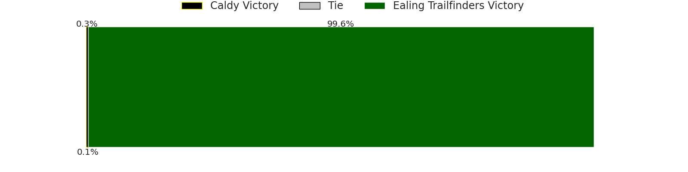

#### Blackheath V Rotherham Titans on 2026/11/21

Average Margin: Blackheath by 5.2

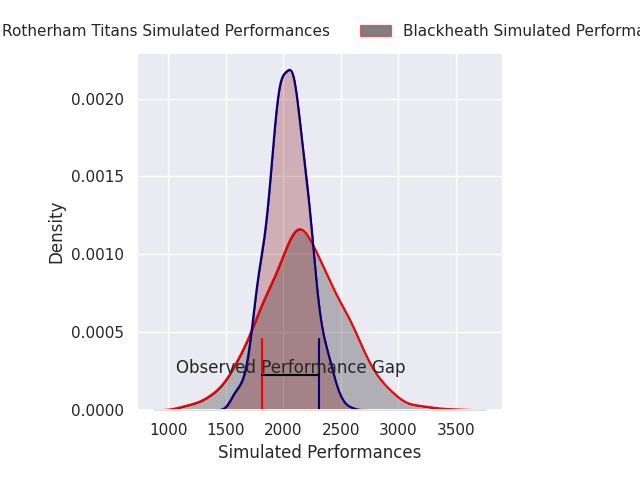

#### Doncaster V Chinnor on 2026/11/21

Average Margin: Doncaster by 4.1

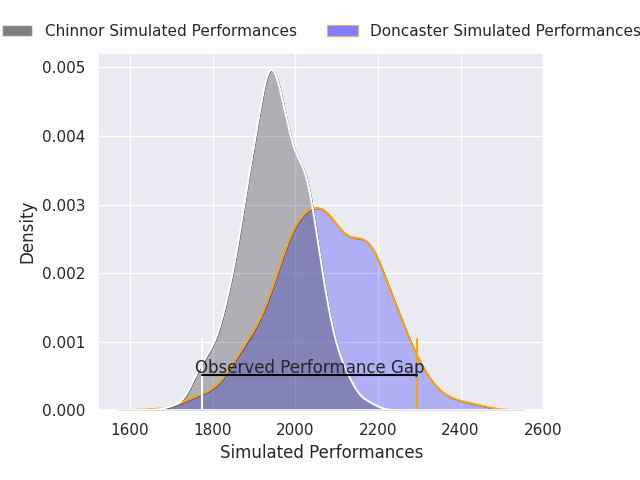

#### Coventry V Worcester Warriors on 2026/11/21

Average Margin: Coventry by 4.3

#### Ampthill V Bedford on 2026/11/21

Average Margin: Bedford by 3.8

#### Hartpury College RFC V Richmond on 2026/11/21

Average Margin: Hartpury College by 8.7

#### Nottingham V Cornish Pirates on 2026/11/22

Average Margin: Cornish Pirates by 0.9

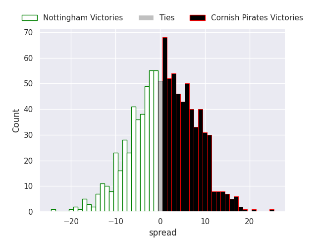

### Week 10
#### Nottingham V Caldy on 2026/12/04

Average Margin: Nottingham by 9.1

#### Cornish Pirates V Hartpury College on 2026/12/05

Average Margin: Cornish Pirates by 8.7

#### Bedford V Coventry on 2026/12/05

Average Margin: Bedford by 2.7

#### Rotherham Titans V Doncaster on 2026/12/05

Average Margin: Doncaster by 6.5

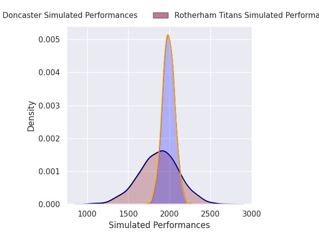

#### Worcester Warriors V Ealing Trailfinders on 2026/12/05

Average Margin: Ealing Trailfinders by 0.5

#### Richmond V Blackheath on 2026/12/05

Average Margin: Richmond by 4.1

#### Chinnor V Ampthill on 2026/12/06

Average Margin: Chinnor by 8.4

### Week 11
#### Blackheath V Cornish Pirates on 2026/12/12

Average Margin: Cornish Pirates by 4.3

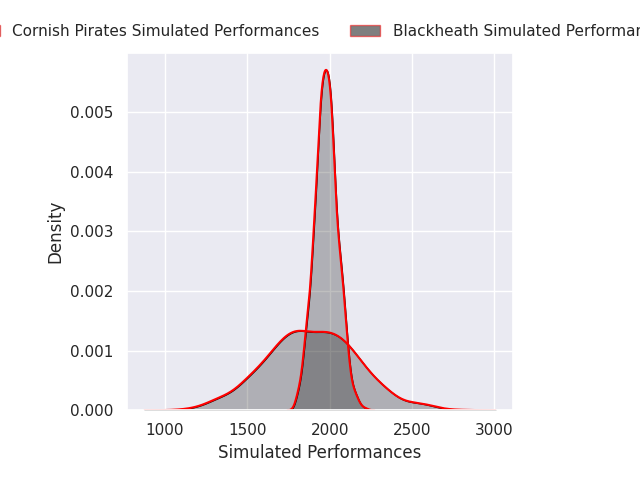

#### Ealing Trailfinders V Bedford on 2026/12/12

Average Margin: Ealing Trailfinders by 12.2

#### Caldy V Worcester Warriors on 2026/12/12

Average Margin: Worcester Warriors by 14.1

#### Hartpury College V Nottingham on 2026/12/12

Average Margin: Hartpury College by 5.2

#### Ampthill V Rotherham Titans on 2026/12/12

Average Margin: Ampthill by 9.5

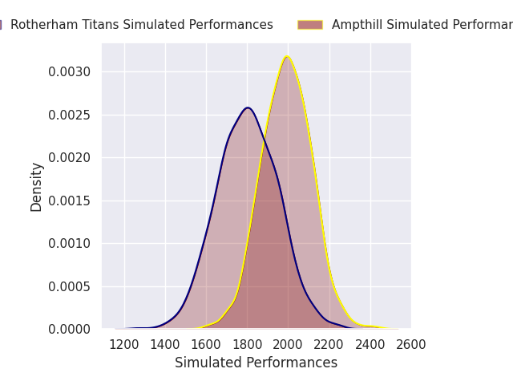

#### Doncaster V Richmond on 2026/12/12

Average Margin: Doncaster by 13.0

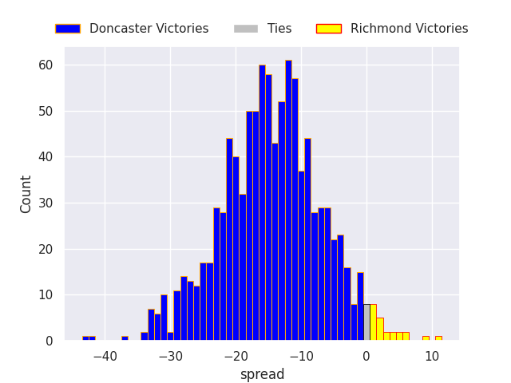

#### Coventry V Chinnor on 2026/12/13

Average Margin: Coventry by 9.4

### Week 12
#### Cornish Pirates V Ampthill on 2026/12/18

Average Margin: Cornish Pirates by 7.4

#### Nottingham V Doncaster on 2026/12/18

Average Margin: Doncaster by 2.0

#### Hartpury College V Blackheath on 2026/12/18

Average Margin: Hartpury College by 8.5

#### Richmond V Coventry on 2026/12/19

Average Margin: Coventry by 9.7

#### Rotherham Titans V Ealing Trailfinders on 2026/12/19

Average Margin: Ealing Trailfinders by 16.9

#### Chinnor V Worcester Warriors on 2026/12/19

Average Margin: Worcester Warriors by 0.4

#### Bedford V Caldy on 2026/12/20

Average Margin: Bedford by 17.8

### Week 13
#### Worcester Warriors V Cornish Pirates on 2026/12/26

Average Margin: Worcester Warriors by 10.9

#### Ampthill V Blackheath on 2026/12/26

Average Margin: Ampthill by 9.3

#### Doncaster V Caldy on 2026/12/26

Average Margin: Doncaster by 15.0

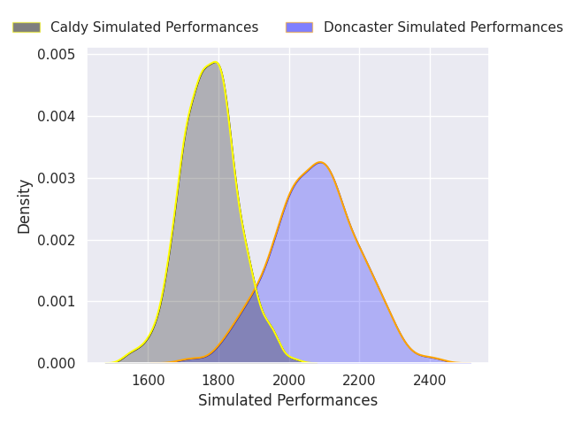

#### Coventry V Hartpury College on 2026/12/26

Average Margin: Coventry by 14.8

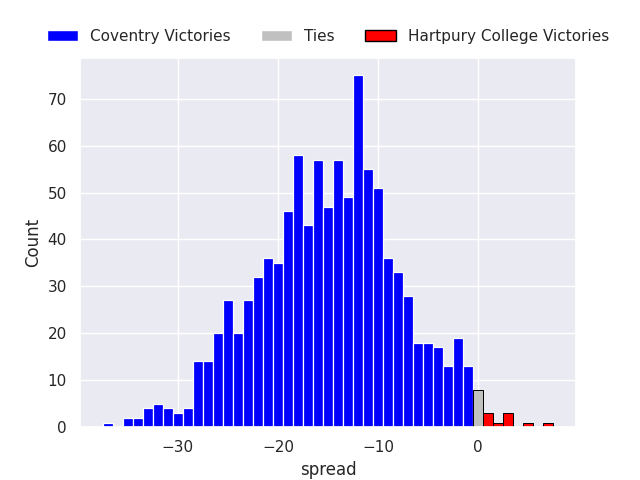

#### Richmond V Bedford on 2026/12/26

Average Margin: Bedford by 9.2

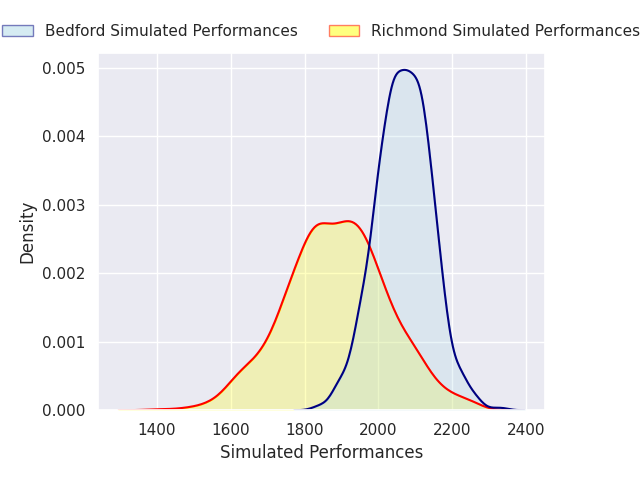

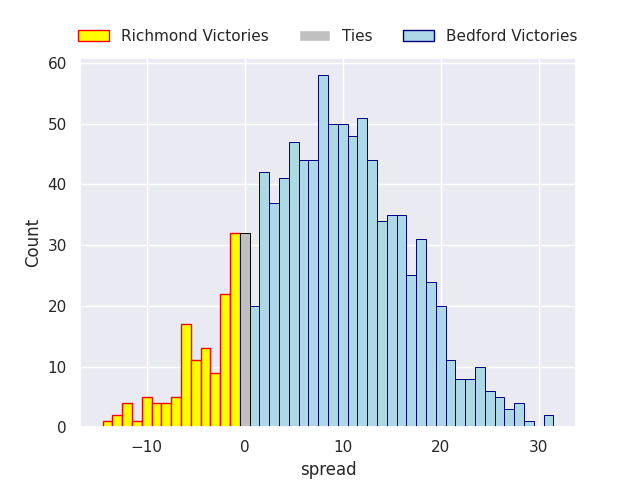

#### Chinnor V Rotherham Titans on 2026/12/27

Average Margin: Chinnor by 14.6

#### Ealing Trailfinders V Nottingham on 2026/12/27

Average Margin: Ealing Trailfinders by 22.0

### Week 14
#### Nottingham V Ealing Trailfinders on 2027/01/01

Average Margin: Ealing Trailfinders by 12.4

#### Bedford V Richmond on 2027/01/01

Average Margin: Bedford by 15.5

#### Blackheath V Ampthill on 2027/01/01

Average Margin: Ampthill by 0.3

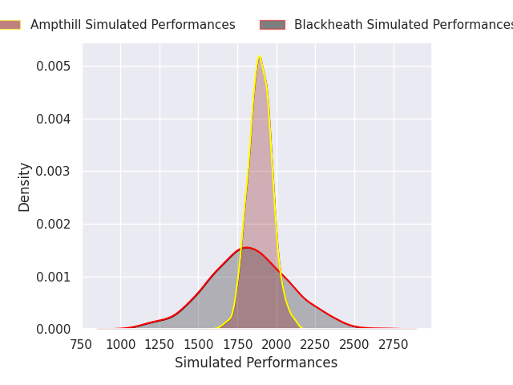

#### Caldy V Doncaster on 2027/01/02

Average Margin: Doncaster by 8.3

#### Cornish Pirates V Worcester Warriors on 2027/01/02

Average Margin: Worcester Warriors by 1.3

#### Rotherham Titans V Chinnor on 2027/01/02

Average Margin: Chinnor by 4.2

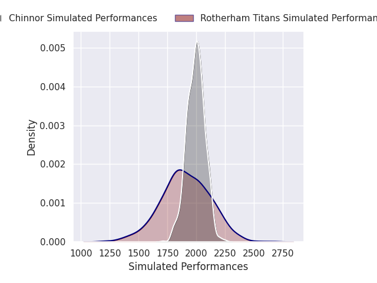

#### Hartpury College V Coventry on 2027/01/02

Average Margin: Coventry by 4.7

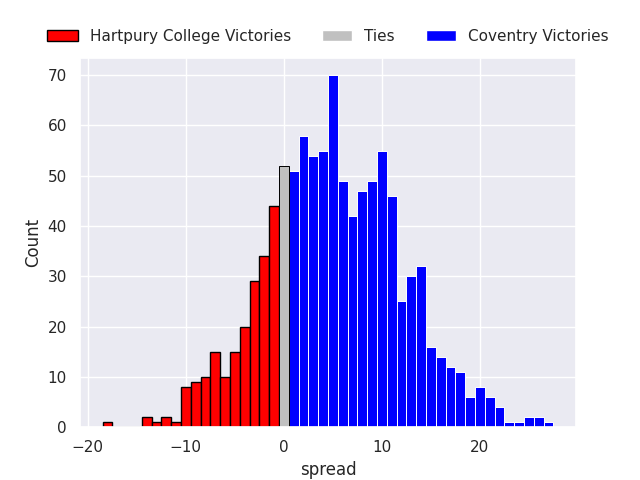

