## Team Rankings

## Standings
### Current Standings

| Club                |   Played |   Wins |   Point Differential |   Losing Bonus Points | Try Bonus Points   |   Competition Points |
|:--------------------|---------:|-------:|---------------------:|----------------------:|:-------------------|---------------------:|
| Worcester Warriors  |        2 |      2 |                  101 |                     0 |                    |                    8 |
| Ealing Trailfinders |        2 |      2 |                   34 |                     0 |                    |                    8 |
| Ampthill            |        2 |      2 |                    7 |                     0 |                    |                    8 |
| Coventry            |        2 |      1 |                   30 |                     1 |                    |                    5 |
| Caldy               |        2 |      1 |                    2 |                     1 |                    |                    5 |
| Nottingham          |        2 |      1 |                    2 |                     1 |                    |                    5 |
| Chinnor             |        2 |      1 |                    2 |                     0 |                    |                    4 |
| Cornish Pirates     |        2 |      1 |                   -7 |                     0 |                    |                    4 |
| Doncaster           |        2 |      1 |                  -12 |                     0 |                    |                    4 |
| Hartpury College    |        2 |      1 |                  -12 |                     0 |                    |                    4 |
| Rotherham Titans    |        2 |      1 |                  -63 |                     0 |                    |                    4 |
| Blackheath          |        2 |      0 |                  -11 |                     2 |                    |                    2 |
| Richmond            |        2 |      0 |                  -19 |                     1 |                    |                    1 |
| Bedford             |        2 |      0 |                  -54 |                     0 |                    |                    0 |

### Projected Remaining Table

| Club                |   To Play |   Projected Wins |   Projected Differential |   Projected Losing Bonus Points | Projected Try Bonus Points   |   Projected Competition Points |
|:--------------------|----------:|-----------------:|-------------------------:|--------------------------------:|:-----------------------------|-------------------------------:|
| Worcester Warriors  |         1 |            0.913 |                   12.329 |                           0.061 |                              |                          3.735 |
| Ealing Trailfinders |         1 |            0.824 |                    7.879 |                           0.119 |                              |                          3.461 |
| Chinnor             |         1 |            0.749 |                    6.255 |                           0.179 |                              |                          3.233 |
| Hartpury College    |         1 |            0.714 |                    4.667 |                           0.186 |                              |                          3.124 |
| Doncaster           |         1 |            0.678 |                   12.127 |                           0.096 |                              |                          2.842 |
| Coventry            |         1 |            0.488 |                    0.283 |                           0.304 |                              |                          2.348 |
| Nottingham          |         1 |            0.466 |                   -0.283 |                           0.298 |                              |                          2.254 |
| Bedford             |         1 |            0.503 |                    0.045 |                           0.137 |                              |                          2.179 |
| Rotherham Titans    |         1 |            0.482 |                   -0.045 |                           0.149 |                              |                          2.107 |
| Ampthill            |         1 |            0.245 |                   -4.667 |                           0.377 |                              |                          1.439 |
| Blackheath          |         1 |            0.305 |                  -12.127 |                           0.099 |                              |                          1.353 |
| Caldy               |         1 |            0.222 |                   -6.255 |                           0.302 |                              |                          1.248 |
| Cornish Pirates     |         1 |            0.153 |                   -7.879 |                           0.288 |                              |                          0.946 |
| Richmond            |         1 |            0.076 |                  -12.329 |                           0.203 |                              |                          0.529 |

### Projected Total Table

| Club                |   Played |   Wins |   Point Differential |   Losing Bonus Points | Try Bonus Points   |   Competition Points |
|:--------------------|---------:|-------:|---------------------:|----------------------:|:-------------------|---------------------:|
| Worcester Warriors  |        3 |  2.913 |              113.329 |                 0.061 |                    |               11.735 |
| Ealing Trailfinders |        3 |  2.824 |               41.879 |                 0.119 |                    |               11.461 |
| Ampthill            |        3 |  2.245 |                2.333 |                 0.377 |                    |                9.439 |
| Coventry            |        3 |  1.488 |               30.283 |                 1.304 |                    |                7.348 |
| Nottingham          |        3 |  1.466 |                1.717 |                 1.298 |                    |                7.254 |
| Chinnor             |        3 |  1.749 |                8.255 |                 0.179 |                    |                7.233 |
| Hartpury College    |        3 |  1.714 |               -7.333 |                 0.186 |                    |                7.124 |
| Doncaster           |        3 |  1.678 |                0.127 |                 0.096 |                    |                6.842 |
| Caldy               |        3 |  1.222 |               -4.255 |                 1.302 |                    |                6.248 |
| Rotherham Titans    |        3 |  1.482 |              -63.045 |                 0.149 |                    |                6.107 |
| Cornish Pirates     |        3 |  1.153 |              -14.879 |                 0.288 |                    |                4.946 |
| Blackheath          |        3 |  0.305 |              -23.127 |                 2.099 |                    |                3.353 |
| Bedford             |        3 |  0.503 |              -53.955 |                 0.137 |                    |                2.179 |
| Richmond            |        3 |  0.076 |              -31.329 |                 1.203 |                    |                1.529 |

## Completed Match Review

| Model | Percent Correct Predictions | Spread Error |
| ------ | ------ | ------ |
| Club Level | 76.2% | 14.5 |
| Player Level: Lineup | nan% | nan |
| Player Level: Minutes | nan% | nan |

## Future Predictions
### Week 3
#### Hartpury College RFC V Ampthill on 2026/10/02

Average Margin: Hartpury College by 4.7

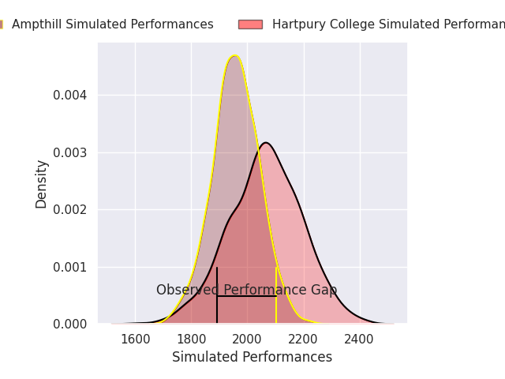

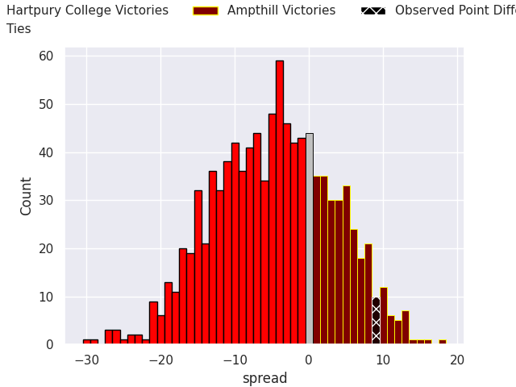

#### Nottingham V Coventry on 2026/10/02

Average Margin: Coventry by 0.3

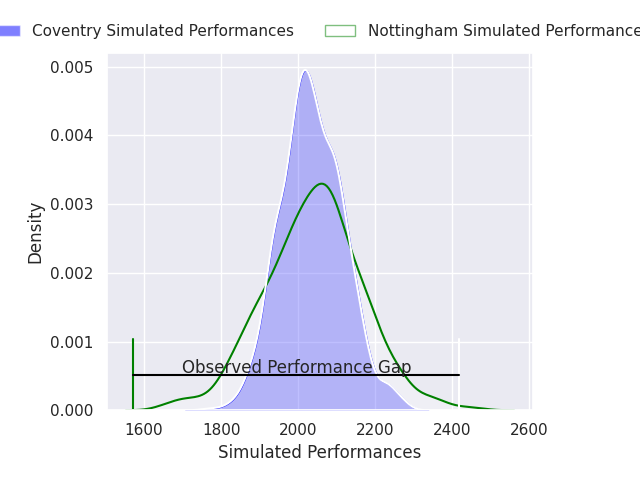

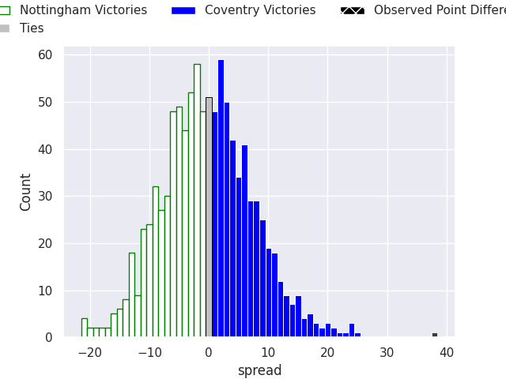

#### Caldy V Chinnor on 2026/10/03

Average Margin: Chinnor by 6.3

#### Rotherham Titans V Bedford on 2026/10/03

Average Margin: Bedford by 0.0

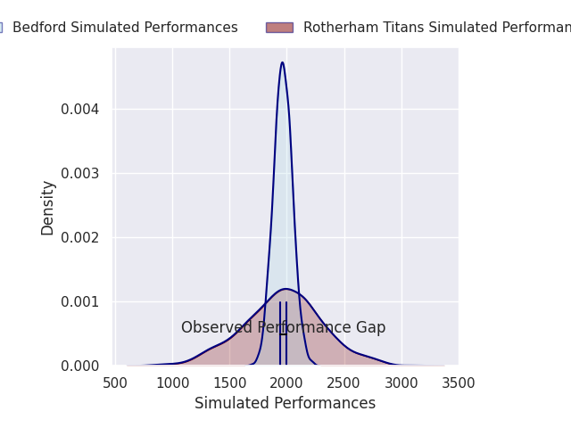

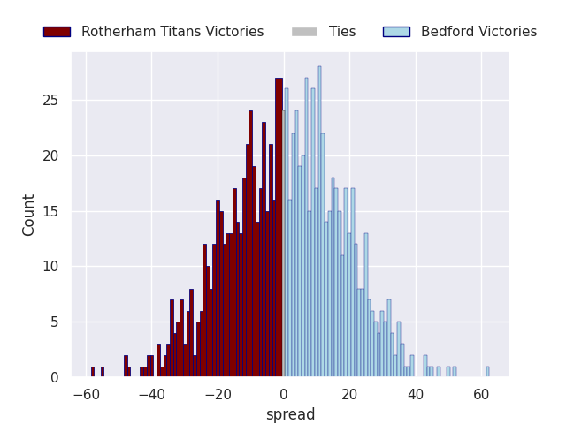

#### Richmond V Worcester Warriors on 2026/10/03

Average Margin: Worcester Warriors by 12.3

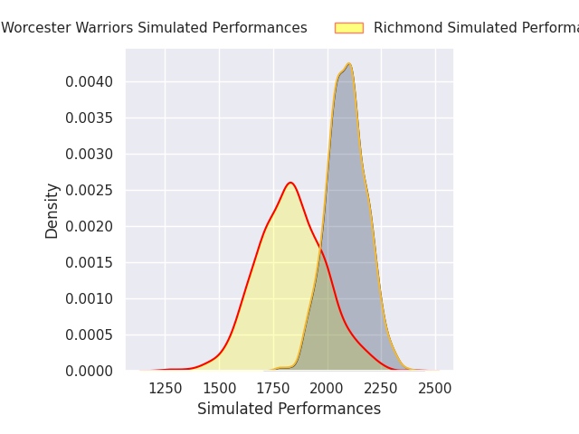
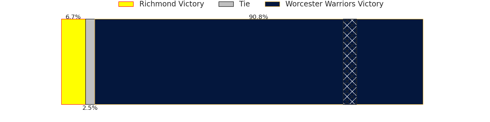
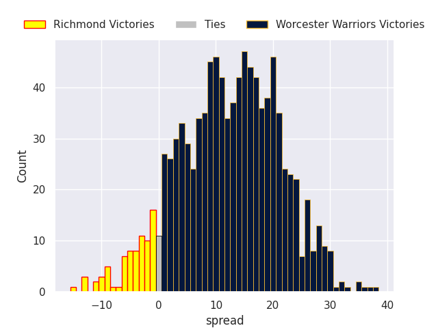

#### Cornish Pirates V Ealing Trailfinders on 2026/10/03

Average Margin: Ealing Trailfinders by 7.9

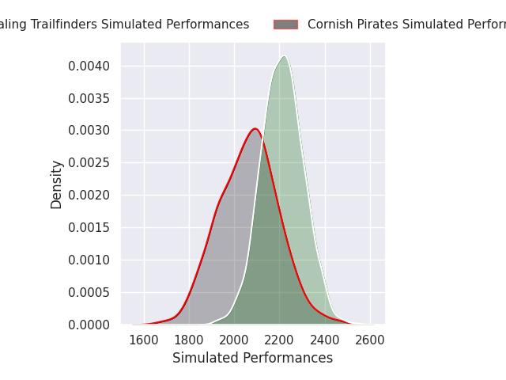
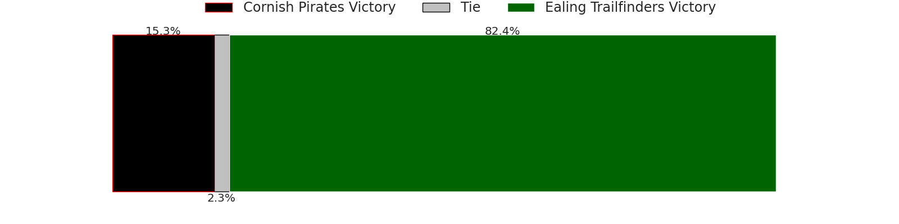
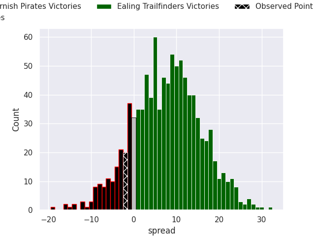

#### Blackheath V Doncaster on 2026/10/04

Average Margin: Doncaster by 12.1

