## Team Rankings

## Standings
### Current Standings

| Club                |   Played |   Wins |   Point Differential |   Losing Bonus Points |   Try Bonus Points |   Competition Points |
|:--------------------|---------:|-------:|---------------------:|----------------------:|-------------------:|---------------------:|
| Worcester Warriors  |        3 |      3 |                  120 |                     0 |                  2 |                   14 |
| Ampthill            |        3 |      3 |                   16 |                     0 |                  2 |                   14 |
| Coventry            |        3 |      2 |                   68 |                     1 |                  2 |                   11 |
| Ealing Trailfinders |        3 |      2 |                   32 |                     1 |                  2 |                   11 |
| Chinnor             |        3 |      2 |                    5 |                     0 |                  2 |                   10 |
| Cornish Pirates     |        3 |      2 |                   -5 |                     0 |                  2 |                   10 |
| Rotherham Titans    |        3 |      2 |                  -61 |                     0 |                  1 |                    9 |
| Caldy               |        3 |      1 |                   -1 |                     2 |                  2 |                    8 |
| Blackheath          |        3 |      1 |                   -4 |                     2 |                  1 |                    7 |
| Doncaster           |        3 |      1 |                  -19 |                     1 |                  2 |                    7 |
| Nottingham          |        3 |      1 |                  -36 |                     1 |                  2 |                    7 |
| Hartpury College    |        3 |      1 |                  -21 |                     0 |                  1 |                    5 |
| Bedford             |        3 |      0 |                  -56 |                     1 |                  2 |                    3 |
| Richmond            |        3 |      0 |                  -38 |                     1 |                  1 |                    2 |

### Projected Remaining Table

| Club                |   To Play |   Projected Wins |   Projected Differential |   Projected Losing Bonus Points | Projected Try Bonus Points   |   Projected Competition Points |
|:--------------------|----------:|-----------------:|-------------------------:|--------------------------------:|:-----------------------------|-------------------------------:|
| Ealing Trailfinders |         7 |            5.759 |                   77.3   |                           0.672 |                              |                         23.982 |
| Cornish Pirates     |         7 |            4.844 |                   40.326 |                           1.153 |                              |                         20.953 |
| Worcester Warriors  |         7 |            4.653 |                   38.289 |                           1.283 |                              |                         20.335 |
| Coventry            |         7 |            4.555 |                   31.377 |                           1.204 |                              |                         19.828 |
| Chinnor             |         7 |            3.922 |                   20.906 |                           1.553 |                              |                         17.813 |
| Bedford             |         7 |            3.295 |                   -4.196 |                           1.929 |                              |                         15.727 |
| Nottingham          |         7 |            3.385 |                   -2.479 |                           1.523 |                              |                         15.559 |
| Rotherham Titans    |         7 |            3.342 |                   -5.179 |                           1.129 |                              |                         14.841 |
| Ampthill            |         7 |            2.775 |                  -16.133 |                           1.78  |                              |                         13.426 |
| Hartpury College    |         7 |            2.747 |                  -17.471 |                           1.598 |                              |                         13.022 |
| Blackheath          |         7 |            2.908 |                  -18.621 |                           1.09  |                              |                         13.008 |
| Doncaster           |         7 |            2.552 |                  -22.647 |                           1.929 |                              |                         12.653 |
| Richmond            |         7 |            1.536 |                  -59.132 |                           1.438 |                              |                          7.956 |
| Caldy               |         7 |            1.2   |                  -62.34  |                           1.621 |                              |                          6.799 |

### Projected Total Table

| Club                |   Played |   Wins |   Point Differential |   Losing Bonus Points |   Try Bonus Points |   Competition Points |
|:--------------------|---------:|-------:|---------------------:|----------------------:|-------------------:|---------------------:|
| Ealing Trailfinders |       10 |  7.759 |              109.3   |                 1.672 |                  2 |               34.982 |
| Worcester Warriors  |       10 |  7.653 |              158.289 |                 1.283 |                  2 |               34.335 |
| Cornish Pirates     |       10 |  6.844 |               35.326 |                 1.153 |                  2 |               30.953 |
| Coventry            |       10 |  6.555 |               99.377 |                 2.204 |                  2 |               30.828 |
| Chinnor             |       10 |  5.922 |               25.906 |                 1.553 |                  2 |               27.813 |
| Ampthill            |       10 |  5.775 |               -0.133 |                 1.78  |                  2 |               27.426 |
| Rotherham Titans    |       10 |  5.342 |              -66.179 |                 1.129 |                  1 |               23.841 |
| Nottingham          |       10 |  4.385 |              -38.479 |                 2.523 |                  2 |               22.559 |
| Blackheath          |       10 |  3.908 |              -22.621 |                 3.09  |                  1 |               20.008 |
| Doncaster           |       10 |  3.552 |              -41.647 |                 2.929 |                  2 |               19.653 |
| Bedford             |       10 |  3.295 |              -60.196 |                 2.929 |                  2 |               18.727 |
| Hartpury College    |       10 |  3.747 |              -38.471 |                 1.598 |                  1 |               18.022 |
| Caldy               |       10 |  2.2   |              -63.34  |                 3.621 |                  2 |               14.799 |
| Richmond            |       10 |  1.536 |              -97.132 |                 2.438 |                  1 |                9.956 |

## Completed Match Review

| Model | Percent Correct Predictions | Spread Error |
| ------ | ------ | ------ |
| Club Level | 64.3% | 11.3 |
| Player Level: Lineup | nan% | nan |
| Player Level: Minutes | nan% | nan |

## Future Predictions
### Week 4
#### Rotherham Titans V Caldy on 2026/10/09

Average Margin: Rotherham Titans by 8.9

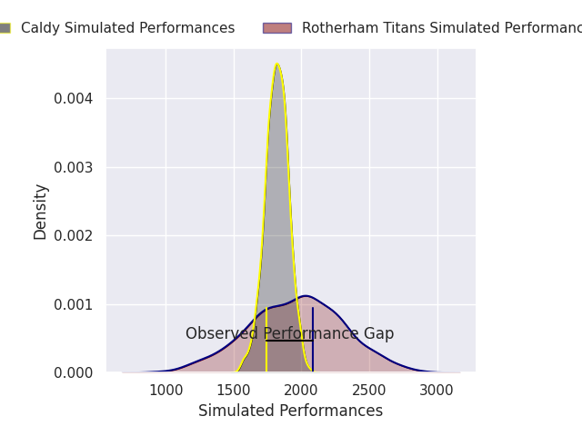

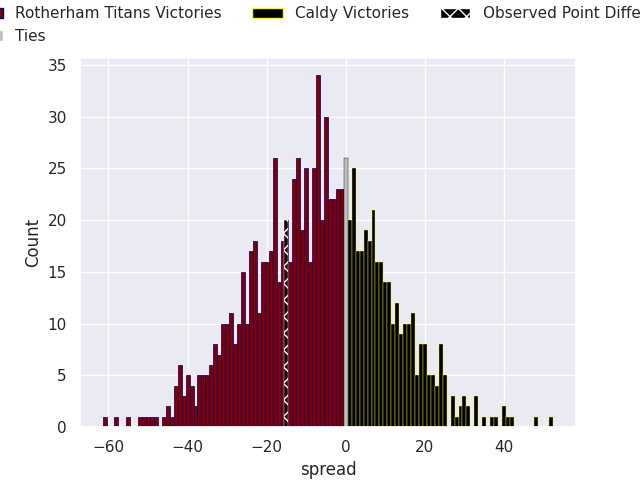

#### Coventry V Blackheath on 2026/10/09

Average Margin: Coventry by 14.2

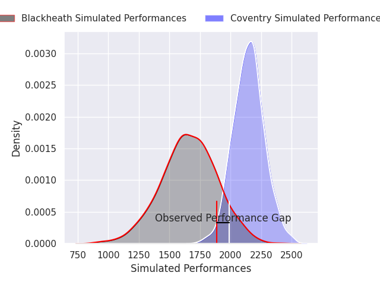

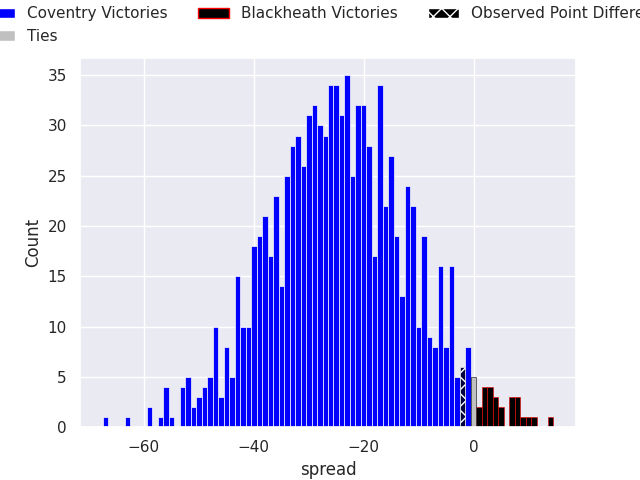

#### Bedford V Cornish Pirates on 2026/10/10

Average Margin: Bedford by 2.3

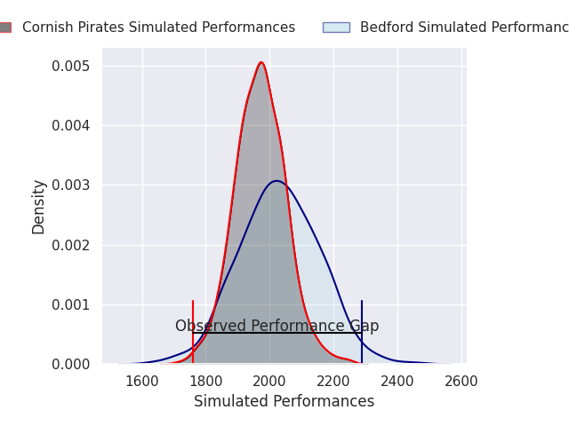

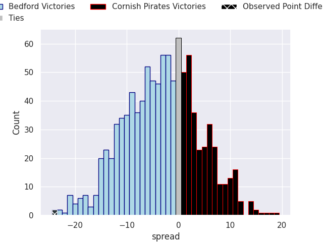

#### Ampthill V Doncaster on 2026/10/10

Average Margin: Ampthill by 4.4

#### Chinnor V Richmond on 2026/10/10

Average Margin: Chinnor by 15.9

#### Worcester Warriors V Nottingham on 2026/10/10

Average Margin: Worcester Warriors by 13.6

#### Ealing Trailfinders V Hartpury College RFC on 2026/10/11

Average Margin: Ealing Trailfinders by 17.9

### Week 5
#### Nottingham V Bedford on 2026/10/16

Average Margin: Nottingham by 1.4

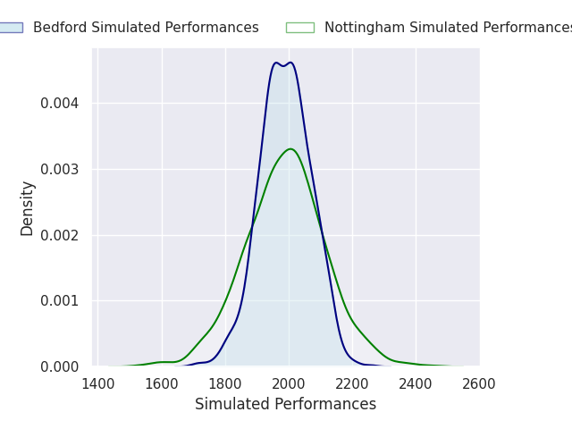

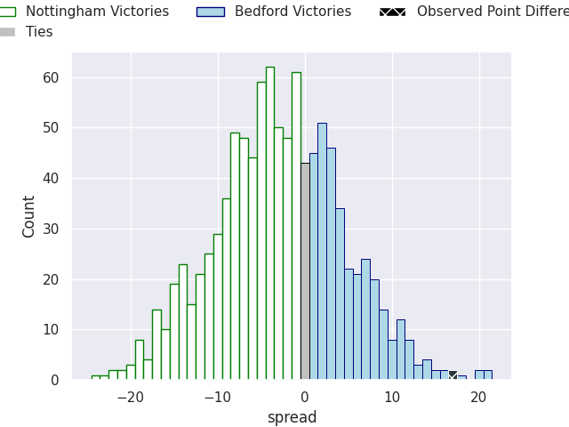

#### Caldy V Ampthill on 2026/10/17

Average Margin: Ampthill by 5.6

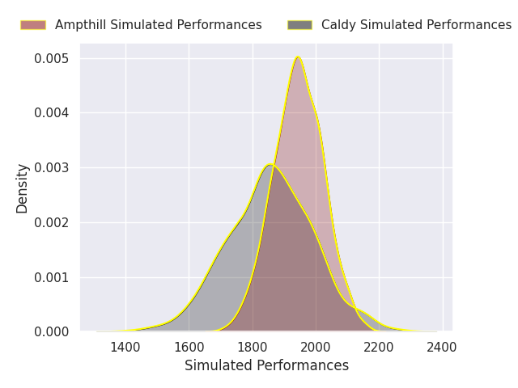

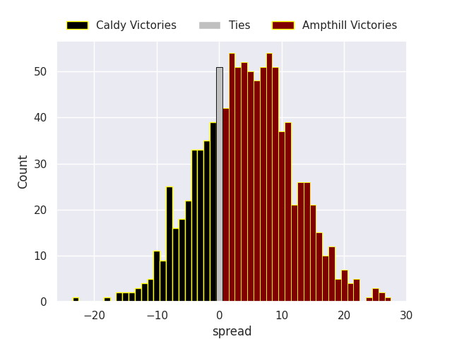

#### Hartpury College V Worcester Warriors on 2026/10/17

Average Margin: Worcester Warriors by 3.3

#### Cornish Pirates V Chinnor on 2026/10/17

Average Margin: Cornish Pirates by 5.4

#### Doncaster V Coventry on 2026/10/17

Average Margin: Coventry by 0.8

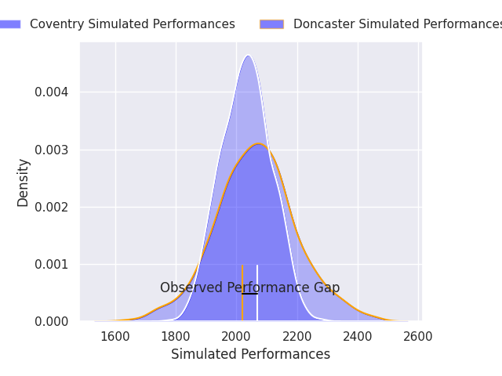

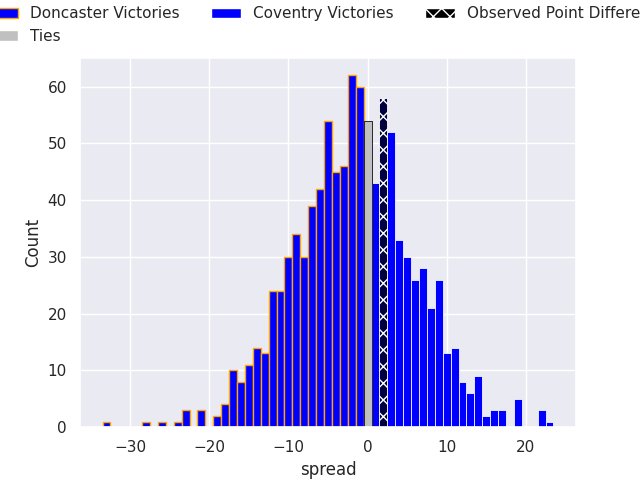

#### Blackheath V Ealing Trailfinders on 2026/10/17

Average Margin: Ealing Trailfinders by 9.0

#### Richmond V Rotherham Titans on 2026/10/18

Average Margin: Rotherham Titans by 3.7

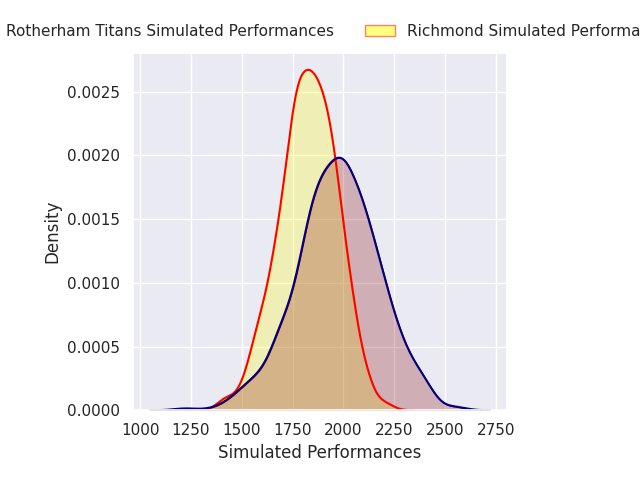

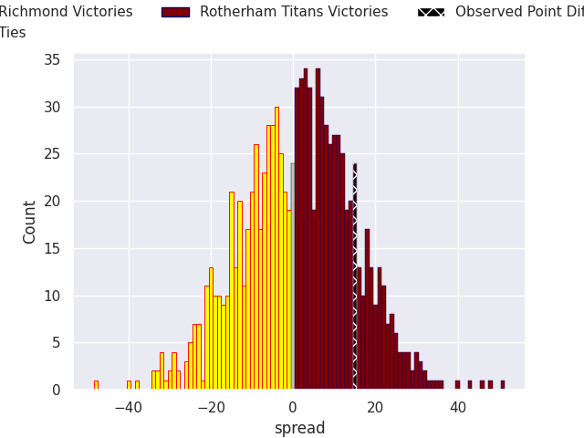

### Week 6
#### Worcester Warriors V Blackheath on 2026/10/30

Average Margin: Worcester Warriors by 14.3

#### Chinnor V Nottingham on 2026/10/30

Average Margin: Chinnor by 8.4

#### Richmond V Caldy on 2026/10/31

Average Margin: Richmond by 0.1

#### Bedford V Hartpury College on 2026/10/31

Average Margin: Bedford by 4.9

#### Coventry V Ampthill on 2026/10/31

Average Margin: Coventry by 10.2

#### Ealing Trailfinders V Doncaster on 2026/10/31

Average Margin: Ealing Trailfinders by 16.4

#### Rotherham Titans V Cornish Pirates on 2026/11/01

Average Margin: Cornish Pirates by 1.3

### Week 7
#### Nottingham V Rotherham Titans on 2026/11/06

Average Margin: Nottingham by 5.5

#### Blackheath V Bedford on 2026/11/07

Average Margin: Blackheath by 6.6

#### Caldy V Coventry on 2026/11/07

Average Margin: Coventry by 10.4

#### Doncaster V Worcester Warriors on 2026/11/07

Average Margin: Worcester Warriors by 2.5

#### Cornish Pirates V Richmond on 2026/11/07

Average Margin: Cornish Pirates by 16.3

#### Ampthill V Ealing Trailfinders on 2026/11/07

Average Margin: Ealing Trailfinders by 6.7

#### Hartpury College V Chinnor on 2026/11/08

Average Margin: Hartpury College by 2.7

### Week 8
#### Bedford V Doncaster on 2026/11/13

Average Margin: Bedford by 3.0

#### Rotherham Titans V Hartpury College on 2026/11/14

Average Margin: Rotherham Titans by 0.5

#### Cornish Pirates V Caldy on 2026/11/14

Average Margin: Cornish Pirates by 12.8

#### Richmond V Nottingham on 2026/11/14

Average Margin: Nottingham by 3.9

#### Chinnor V Blackheath on 2026/11/14

Average Margin: Chinnor by 4.6

#### Worcester Warriors V Ampthill on 2026/11/15

Average Margin: Worcester Warriors by 9.4

#### Ealing Trailfinders V Coventry on 2026/11/15

Average Margin: Ealing Trailfinders by 10.9

### Week 9
#### Caldy V Ealing Trailfinders on 2026/11/21

Average Margin: Ealing Trailfinders by 16.2

#### Ampthill V Bedford on 2026/11/21

Average Margin: Ampthill by 4.4

#### Doncaster V Chinnor on 2026/11/21

Average Margin: Doncaster by 4.1

#### Hartpury College V Richmond on 2026/11/21

Average Margin: Hartpury College by 13.6

#### Coventry V Worcester Warriors on 2026/11/21

Average Margin: Coventry by 4.7

#### Blackheath V Rotherham Titans on 2026/11/21

Average Margin: Blackheath by 11.2

#### Nottingham V Cornish Pirates on 2026/11/22

Average Margin: Nottingham by 0.5

### Week 10
#### Nottingham V Caldy on 2026/12/04

Average Margin: Nottingham by 8.3

#### Worcester Warriors V Ealing Trailfinders on 2026/12/05

Average Margin: Ealing Trailfinders by 0.2

#### Cornish Pirates V Hartpury College on 2026/12/05

Average Margin: Cornish Pirates by 7.2

#### Richmond V Blackheath on 2026/12/05

Average Margin: Blackheath by 5.8

#### Rotherham Titans V Doncaster on 2026/12/05

Average Margin: Doncaster by 0.2

#### Bedford V Coventry on 2026/12/05

Average Margin: Coventry by 2.0

#### Chinnor V Ampthill on 2026/12/06

Average Margin: Chinnor by 4.2

