## Team Rankings

## Standings
### Current Standings

| Club                |   Played |   Wins |   Point Differential |   Losing Bonus Points |   Try Bonus Points |   Competition Points |
|:--------------------|---------:|-------:|---------------------:|----------------------:|-------------------:|---------------------:|
| Ealing Trailfinders |        8 |      7 |                  185 |                     1 |                  5 |                   34 |
| Worcester Warriors  |        8 |      7 |                  192 |                     0 |                  5 |                   33 |
| Coventry            |        8 |      6 |                  116 |                     2 |                  5 |                   31 |
| Chinnor             |        8 |      6 |                   35 |                     0 |                  5 |                   29 |
| Bedford             |        8 |      5 |                   44 |                     1 |                  6 |                   27 |
| Rotherham Titans    |        8 |      5 |                  -52 |                     1 |                  4 |                   25 |
| Cornish Pirates     |        8 |      5 |                   50 |                     0 |                  4 |                   24 |
| Doncaster           |        8 |      3 |                  -23 |                     2 |                  6 |                   20 |
| Ampthill            |        8 |      4 |                  -87 |                     0 |                  3 |                   19 |
| Richmond            |        8 |      3 |                  -48 |                     1 |                  4 |                   17 |
| Nottingham          |        8 |      1 |                  -87 |                     4 |                  3 |                   11 |
| Caldy               |        8 |      1 |                 -114 |                     3 |                  4 |                   11 |
| Hartpury College    |        8 |      2 |                 -133 |                     1 |                  2 |                   11 |
| Blackheath          |        8 |      1 |                  -78 |                     3 |                  3 |                   10 |

### Projected Remaining Table

| Club                |   To Play |   Projected Wins |   Projected Differential |   Projected Losing Bonus Points | Projected Try Bonus Points   |   Projected Competition Points |
|:--------------------|----------:|-----------------:|-------------------------:|--------------------------------:|:-----------------------------|-------------------------------:|
| Ealing Trailfinders |         6 |            5.305 |                   85.282 |                           0.426 |                              |                         21.8   |
| Doncaster           |         6 |            4.685 |                   47.336 |                           0.846 |                              |                         19.914 |
| Coventry            |         6 |            4.559 |                   41.121 |                           0.884 |                              |                         19.514 |
| Bedford             |         6 |            4.114 |                   34.122 |                           0.8   |                              |                         17.588 |
| Worcester Warriors  |         6 |            3.614 |                   20.993 |                           1.273 |                              |                         16.143 |
| Cornish Pirates     |         6 |            3.357 |                    9.693 |                           1.245 |                              |                         15.061 |
| Chinnor             |         6 |            3.198 |                   13.714 |                           1.289 |                              |                         14.497 |
| Hartpury College    |         6 |            2.662 |                   -6.204 |                           1.288 |                              |                         12.258 |
| Ampthill            |         6 |            2.6   |                   -1.196 |                           1.436 |                              |                         12.224 |
| Blackheath          |         6 |            2.256 |                  -19.368 |                           1.25  |                              |                         10.568 |
| Nottingham          |         6 |            1.941 |                  -33.556 |                           1.382 |                              |                          9.52  |
| Rotherham Titans    |         6 |            1.298 |                  -57.693 |                           1.165 |                              |                          6.597 |
| Richmond            |         6 |            1.054 |                  -50.209 |                           1.375 |                              |                          5.861 |
| Caldy               |         6 |            0.245 |                  -84.035 |                           1.016 |                              |                          2.13  |

### Projected Total Table

| Club                |   Played |   Wins |   Point Differential |   Losing Bonus Points |   Try Bonus Points |   Competition Points |
|:--------------------|---------:|-------:|---------------------:|----------------------:|-------------------:|---------------------:|
| Ealing Trailfinders |       14 | 12.305 |              270.282 |                 1.426 |                  5 |               55.8   |
| Coventry            |       14 | 10.559 |              157.121 |                 2.884 |                  5 |               50.514 |
| Worcester Warriors  |       14 | 10.614 |              212.993 |                 1.273 |                  5 |               49.143 |
| Bedford             |       14 |  9.114 |               78.122 |                 1.8   |                  6 |               44.588 |
| Chinnor             |       14 |  9.198 |               48.714 |                 1.289 |                  5 |               43.497 |
| Doncaster           |       14 |  7.685 |               24.336 |                 2.846 |                  6 |               39.914 |
| Cornish Pirates     |       14 |  8.357 |               59.693 |                 1.245 |                  4 |               39.061 |
| Rotherham Titans    |       14 |  6.298 |             -109.693 |                 2.165 |                  4 |               31.597 |
| Ampthill            |       14 |  6.6   |              -88.196 |                 1.436 |                  3 |               31.224 |
| Hartpury College    |       14 |  4.662 |             -139.204 |                 2.288 |                  2 |               23.258 |
| Richmond            |       14 |  4.054 |              -98.209 |                 2.375 |                  4 |               22.861 |
| Blackheath          |       14 |  3.256 |              -97.368 |                 4.25  |                  3 |               20.568 |
| Nottingham          |       14 |  2.941 |             -120.556 |                 5.382 |                  3 |               20.52  |
| Caldy               |       14 |  1.245 |             -198.035 |                 4.016 |                  4 |               13.13  |

## Completed Match Review

| Model | Percent Correct Predictions | Spread Error |
| ------ | ------ | ------ |
| Club Level | 75.5% | 11.3 |
| Player Level: Lineup | nan% | nan |
| Player Level: Minutes | nan% | nan |

## Future Predictions
### Week 9
#### Caldy V Ealing Trailfinders on 2026/11/21

Average Margin: Ealing Trailfinders by 19.8

#### Blackheath V Rotherham Titans on 2026/11/21

Average Margin: Blackheath by 5.7

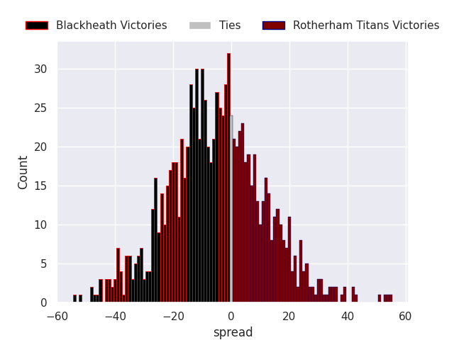

#### Doncaster V Chinnor on 2026/11/21

Average Margin: Doncaster by 3.9

#### Ampthill V Bedford on 2026/11/21

Average Margin: Bedford by 3.6

#### Coventry V Worcester Warriors on 2026/11/21

Average Margin: Coventry by 4.9

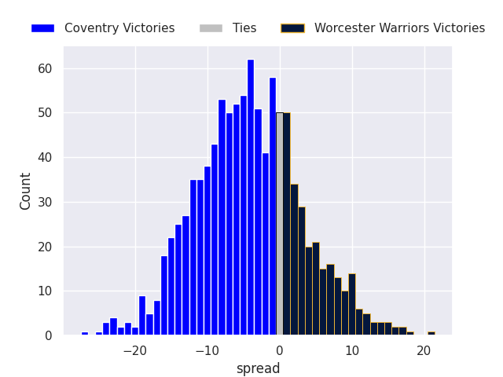

#### Hartpury College RFC V Richmond on 2026/11/21

Average Margin: Hartpury College by 8.2

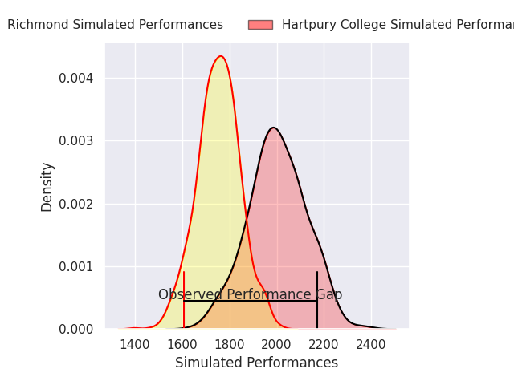

#### Nottingham V Cornish Pirates on 2026/11/22

Average Margin: Cornish Pirates by 1.6

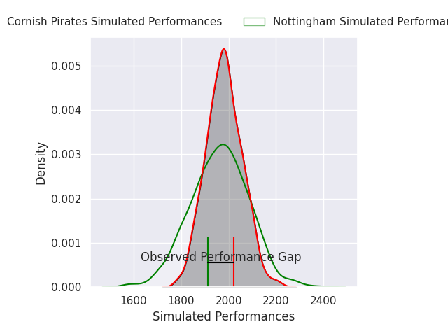

### Week 10
#### Nottingham V Caldy on 2026/12/04

Average Margin: Nottingham by 9.2

#### Rotherham Titans V Doncaster on 2026/12/05

Average Margin: Doncaster by 5.5

#### Bedford V Coventry on 2026/12/05

Average Margin: Bedford by 2.2

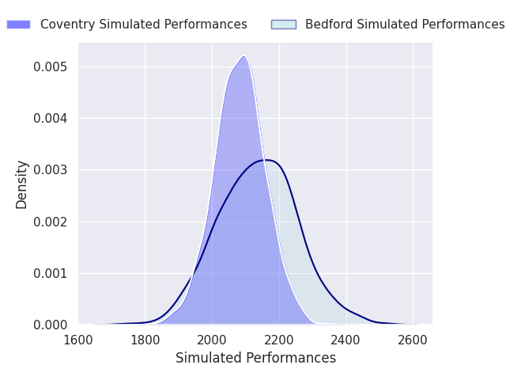

#### Worcester Warriors V Ealing Trailfinders on 2026/12/05

Average Margin: Ealing Trailfinders by 1.1

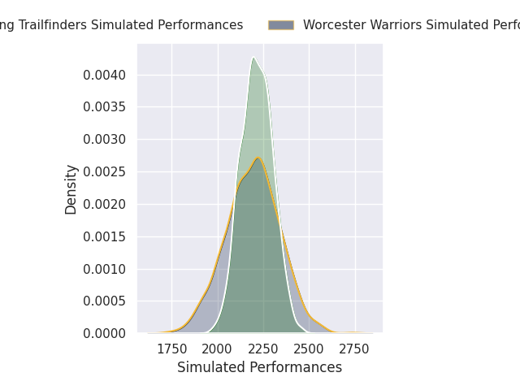

#### Richmond V Blackheath on 2026/12/05

Average Margin: Richmond by 3.9

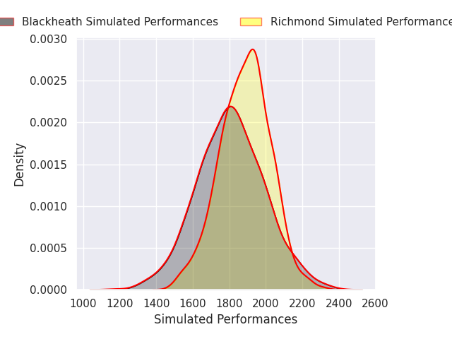

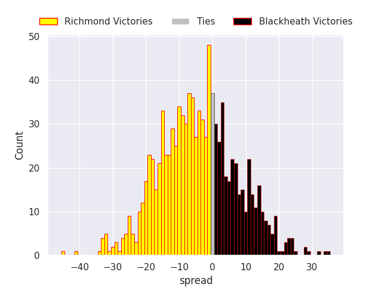

#### Cornish Pirates V Hartpury College on 2026/12/05

Average Margin: Cornish Pirates by 9.2

#### Chinnor V Ampthill on 2026/12/06

Average Margin: Chinnor by 8.7

### Week 11
#### Blackheath V Cornish Pirates on 2026/12/12

Average Margin: Cornish Pirates by 3.5

#### Ealing Trailfinders V Bedford on 2026/12/12

Average Margin: Ealing Trailfinders by 12.8

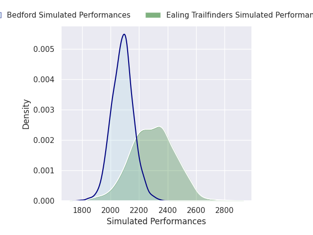

#### Caldy V Worcester Warriors on 2026/12/12

Average Margin: Worcester Warriors by 14.2

#### Doncaster V Richmond on 2026/12/12

Average Margin: Doncaster by 12.9

#### Ampthill V Rotherham Titans on 2026/12/12

Average Margin: Ampthill by 10.1

#### Hartpury College V Nottingham on 2026/12/12

Average Margin: Hartpury College by 5.3

#### Coventry V Chinnor on 2026/12/13

Average Margin: Coventry by 9.8

### Week 12
#### Cornish Pirates V Ampthill on 2026/12/18

Average Margin: Cornish Pirates by 8.0

#### Hartpury College V Blackheath on 2026/12/18

Average Margin: Hartpury College by 8.7

#### Nottingham V Doncaster on 2026/12/18

Average Margin: Doncaster by 1.6

#### Rotherham Titans V Ealing Trailfinders on 2026/12/19

Average Margin: Ealing Trailfinders by 17.4

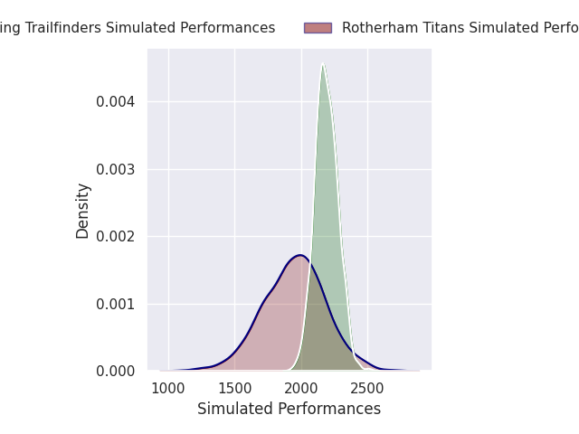

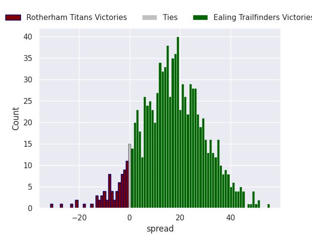

#### Richmond V Coventry on 2026/12/19

Average Margin: Coventry by 9.3

#### Chinnor V Worcester Warriors on 2026/12/19

Average Margin: Worcester Warriors by 0.3

#### Bedford V Caldy on 2026/12/20

Average Margin: Bedford by 17.5

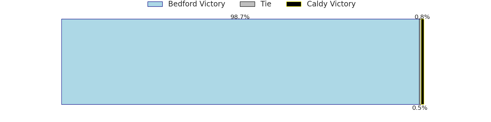
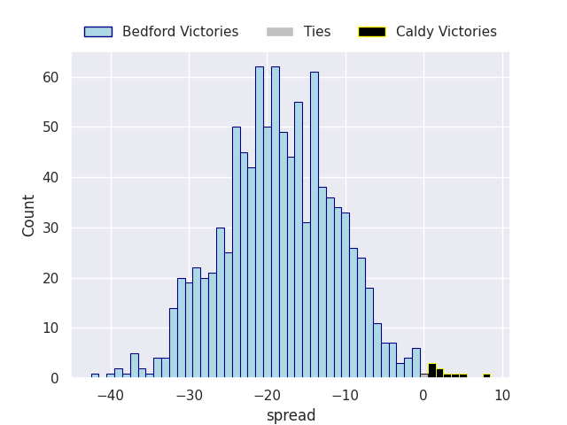

### Week 13
#### Ampthill V Blackheath on 2026/12/26

Average Margin: Ampthill by 8.6

#### Richmond V Bedford on 2026/12/26

Average Margin: Bedford by 8.5

#### Doncaster V Caldy on 2026/12/26

Average Margin: Doncaster by 15.2

#### Coventry V Hartpury College on 2026/12/26

Average Margin: Coventry by 14.5

#### Worcester Warriors V Cornish Pirates on 2026/12/26

Average Margin: Worcester Warriors by 11.0

#### Chinnor V Rotherham Titans on 2026/12/27

Average Margin: Chinnor by 14.7

#### Ealing Trailfinders V Nottingham on 2026/12/27

Average Margin: Ealing Trailfinders by 22.2

### Week 14
#### Bedford V Richmond on 2027/01/01

Average Margin: Bedford by 15.1

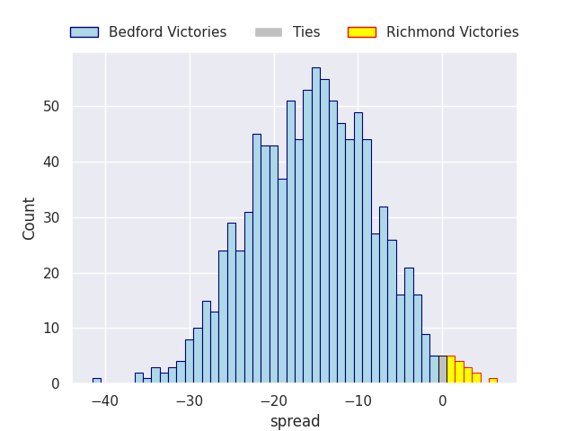

#### Nottingham V Ealing Trailfinders on 2027/01/01

Average Margin: Ealing Trailfinders by 12.1

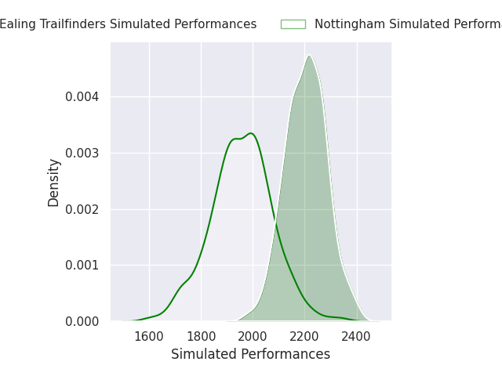
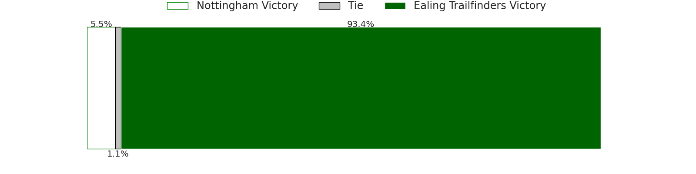

#### Blackheath V Ampthill on 2027/01/01

Average Margin: Ampthill by 0.4

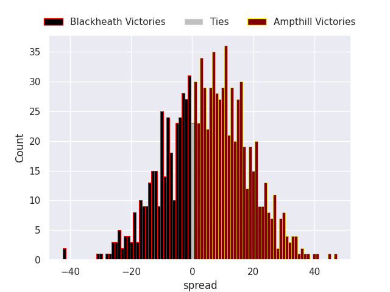

#### Cornish Pirates V Worcester Warriors on 2027/01/02

Average Margin: Worcester Warriors by 1.5

#### Hartpury College V Coventry on 2027/01/02

Average Margin: Coventry by 4.8

#### Caldy V Doncaster on 2027/01/02

Average Margin: Doncaster by 8.2

#### Rotherham Titans V Chinnor on 2027/01/02

Average Margin: Chinnor by 4.3

