## Team Rankings

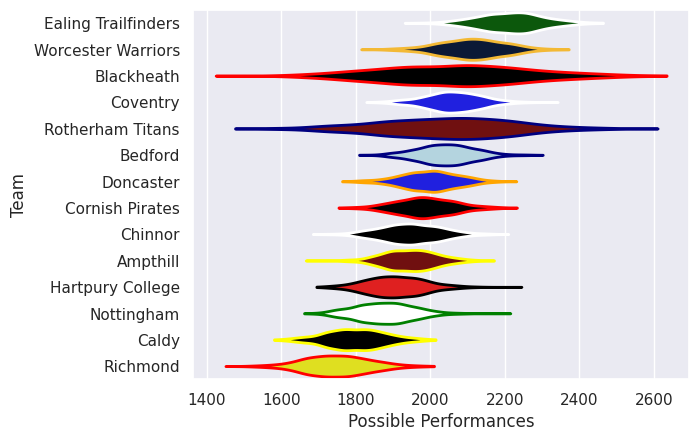
## Standings
### Current Standings

| Club                |   Played |   Wins |   Point Differential |   Losing Bonus Points |   Try Bonus Points |   Competition Points |
|:--------------------|---------:|-------:|---------------------:|----------------------:|-------------------:|---------------------:|
| Ealing Trailfinders |        9 |      8 |                  191 |                     1 |                  6 |                   39 |
| Coventry            |        9 |      7 |                  131 |                     2 |                  6 |                   36 |
| Worcester Warriors  |        9 |      7 |                  177 |                     0 |                  6 |                   34 |
| Bedford             |        9 |      6 |                   72 |                     1 |                  6 |                   31 |
| Cornish Pirates     |        9 |      6 |                   55 |                     0 |                  5 |                   29 |
| Chinnor             |        9 |      6 |                   11 |                     0 |                  5 |                   29 |
| Rotherham Titans    |        9 |      6 |                  -32 |                     1 |                  4 |                   29 |
| Doncaster           |        9 |      4 |                    1 |                     2 |                  7 |                   25 |
| Ampthill            |        9 |      4 |                 -115 |                     0 |                  3 |                   19 |
| Richmond            |        9 |      3 |                  -75 |                     1 |                  4 |                   17 |
| Hartpury College    |        9 |      3 |                 -106 |                     1 |                  2 |                   15 |
| Nottingham          |        9 |      1 |                  -92 |                     5 |                  4 |                   13 |
| Caldy               |        9 |      1 |                 -120 |                     4 |                  5 |                   13 |
| Blackheath          |        9 |      1 |                  -98 |                     3 |                  3 |                   10 |

### Projected Remaining Table

| Club                |   To Play |   Projected Wins |   Projected Differential |   Projected Losing Bonus Points | Projected Try Bonus Points   |   Projected Competition Points |
|:--------------------|----------:|-----------------:|-------------------------:|--------------------------------:|:-----------------------------|-------------------------------:|
| Ealing Trailfinders |         6 |            5.091 |                   68.398 |                           0.553 |                              |                         21.183 |
| Doncaster           |         6 |            4.759 |                   51.367 |                           0.705 |                              |                         20.079 |
| Coventry            |         6 |            4.662 |                   45.786 |                           0.844 |                              |                         19.798 |
| Bedford             |         6 |            3.746 |                   32.147 |                           0.98  |                              |                         16.23  |
| Cornish Pirates     |         6 |            3.48  |                   17.611 |                           1.263 |                              |                         15.601 |
| Worcester Warriors  |         6 |            3.306 |                   10.687 |                           1.309 |                              |                         14.945 |
| Chinnor             |         6 |            3.181 |                    7.499 |                           1.287 |                              |                         14.399 |
| Ampthill            |         6 |            2.85  |                    4.462 |                           1.396 |                              |                         13.17  |
| Hartpury College    |         6 |            2.567 |                   -6.243 |                           1.314 |                              |                         11.936 |
| Nottingham          |         6 |            1.944 |                  -32.944 |                           1.358 |                              |                          9.506 |
| Rotherham Titans    |         6 |            1.634 |                  -37.828 |                           1.412 |                              |                          8.29  |
| Blackheath          |         6 |            1.467 |                  -51.605 |                           1.08  |                              |                          7.218 |
| Richmond            |         6 |            1.443 |                  -45.604 |                           1.007 |                              |                          7.003 |
| Caldy               |         6 |            0.725 |                  -63.733 |                           1.357 |                              |                          4.507 |

### Projected Total Table

| Club                |   Played |   Wins |   Point Differential |   Losing Bonus Points |   Try Bonus Points |   Competition Points |
|:--------------------|---------:|-------:|---------------------:|----------------------:|-------------------:|---------------------:|
| Ealing Trailfinders |       15 | 13.091 |              259.398 |                 1.553 |                  6 |               60.183 |
| Coventry            |       15 | 11.662 |              176.786 |                 2.844 |                  6 |               55.798 |
| Worcester Warriors  |       15 | 10.306 |              187.687 |                 1.309 |                  6 |               48.945 |
| Bedford             |       15 |  9.746 |              104.147 |                 1.98  |                  6 |               47.23  |
| Doncaster           |       15 |  8.759 |               52.367 |                 2.705 |                  7 |               45.079 |
| Cornish Pirates     |       15 |  9.48  |               72.611 |                 1.263 |                  5 |               44.601 |
| Chinnor             |       15 |  9.181 |               18.499 |                 1.287 |                  5 |               43.399 |
| Rotherham Titans    |       15 |  7.634 |              -69.828 |                 2.412 |                  4 |               37.29  |
| Ampthill            |       15 |  6.85  |             -110.538 |                 1.396 |                  3 |               32.17  |
| Hartpury College    |       15 |  5.567 |             -112.243 |                 2.314 |                  2 |               26.936 |
| Richmond            |       15 |  4.443 |             -120.604 |                 2.007 |                  4 |               24.003 |
| Nottingham          |       15 |  2.944 |             -124.944 |                 6.358 |                  4 |               22.506 |
| Caldy               |       15 |  1.725 |             -183.733 |                 5.357 |                  5 |               17.507 |
| Blackheath          |       15 |  2.467 |             -149.605 |                 4.08  |                  3 |               17.218 |

## Completed Match Review

| Model | Percent Correct Predictions | Spread Error |
| ------ | ------ | ------ |
| Club Level | 70.5% | 12.2 |
| Player Level: Lineup | nan% | nan |
| Player Level: Minutes | nan% | nan |

## Future Predictions
### Week 10
#### Nottingham V Caldy on 2026/12/04

Average Margin: Nottingham by 7.9

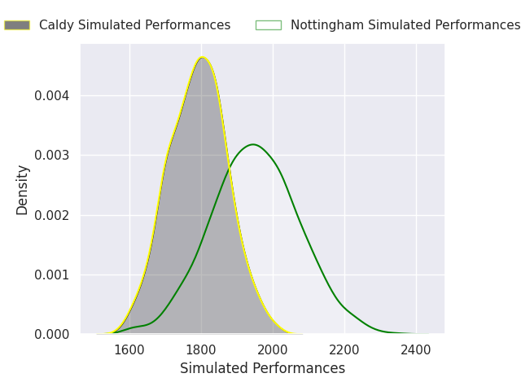

#### Richmond V Blackheath on 2026/12/05

Average Margin: Richmond by 8.5

#### Worcester Warriors V Ealing Trailfinders on 2026/12/05

Average Margin: Ealing Trailfinders by 1.2

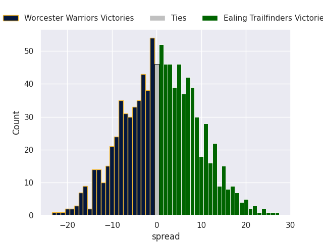

#### Bedford V Coventry on 2026/12/05

Average Margin: Bedford by 2.6

#### Rotherham Titans V Doncaster on 2026/12/05

Average Margin: Doncaster by 2.2

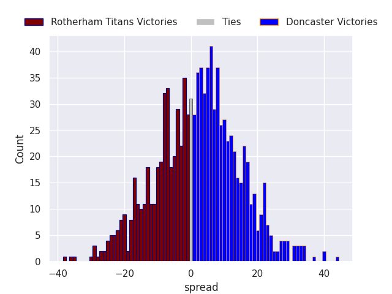

#### Cornish Pirates V Hartpury College on 2026/12/05

Average Margin: Cornish Pirates by 8.3

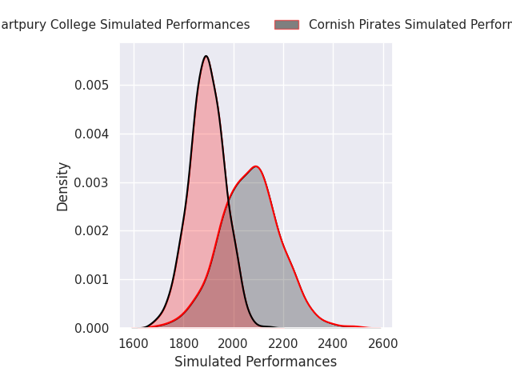

#### Chinnor V Ampthill on 2026/12/06

Average Margin: Chinnor by 8.2

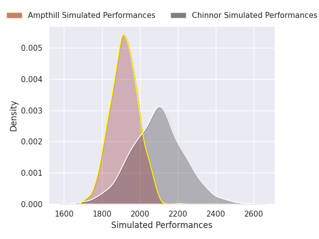

### Week 11
#### Ampthill V Rotherham Titans on 2026/12/12

Average Margin: Ampthill by 4.0

#### Blackheath V Cornish Pirates on 2026/12/12

Average Margin: Cornish Pirates by 10.9

#### Ealing Trailfinders V Bedford on 2026/12/12

Average Margin: Ealing Trailfinders by 10.7

#### Caldy V Worcester Warriors on 2026/12/12

Average Margin: Worcester Warriors by 12.7

#### Hartpury College V Nottingham on 2026/12/12

Average Margin: Hartpury College by 6.4

#### Doncaster V Richmond on 2026/12/12

Average Margin: Doncaster by 14.4

#### Coventry V Chinnor on 2026/12/13

Average Margin: Coventry by 11.2

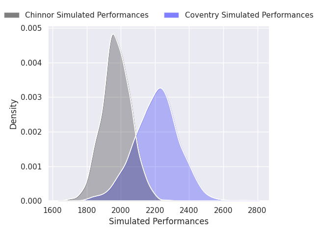

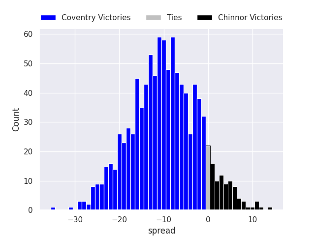

### Week 12
#### Cornish Pirates V Ampthill on 2026/12/18

Average Margin: Cornish Pirates by 8.6

#### Hartpury College V Blackheath on 2026/12/18

Average Margin: Hartpury College by 15.1

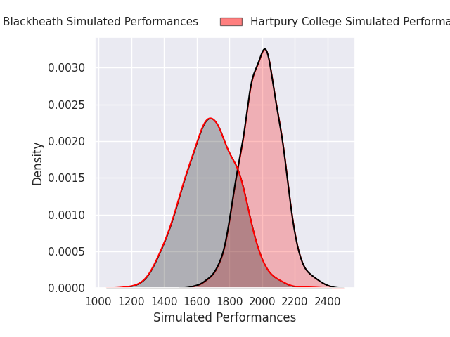
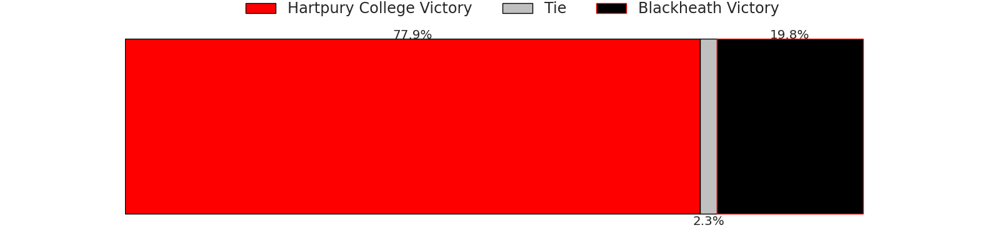
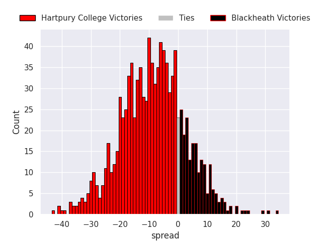

#### Nottingham V Doncaster on 2026/12/18

Average Margin: Doncaster by 2.7

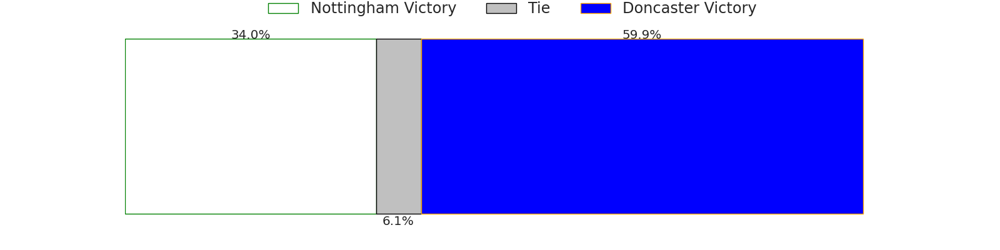

#### Chinnor V Worcester Warriors on 2026/12/19

Average Margin: Worcester Warriors by 0.1

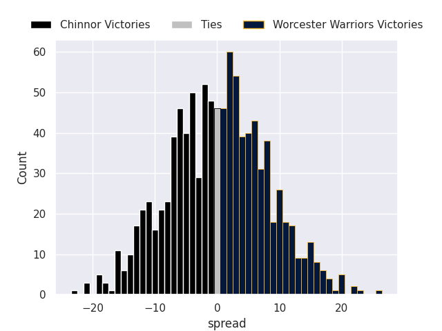

#### Richmond V Coventry on 2026/12/19

Average Margin: Coventry by 11.3

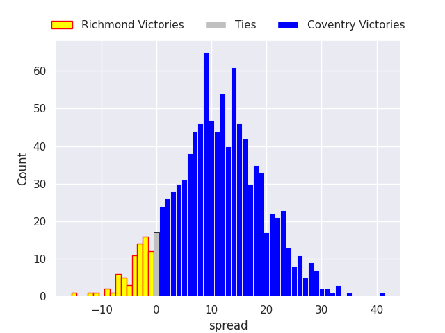

#### Rotherham Titans V Ealing Trailfinders on 2026/12/19

Average Margin: Ealing Trailfinders by 12.8

#### Bedford V Caldy on 2026/12/20

Average Margin: Bedford by 18.2

### Week 13
#### Ampthill V Blackheath on 2026/12/26

Average Margin: Ampthill by 13.4

#### Worcester Warriors V Cornish Pirates on 2026/12/26

Average Margin: Worcester Warriors by 9.6

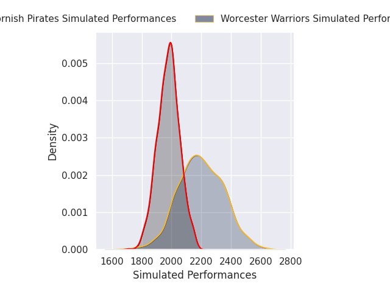

#### Coventry V Hartpury College on 2026/12/26

Average Margin: Coventry by 15.1

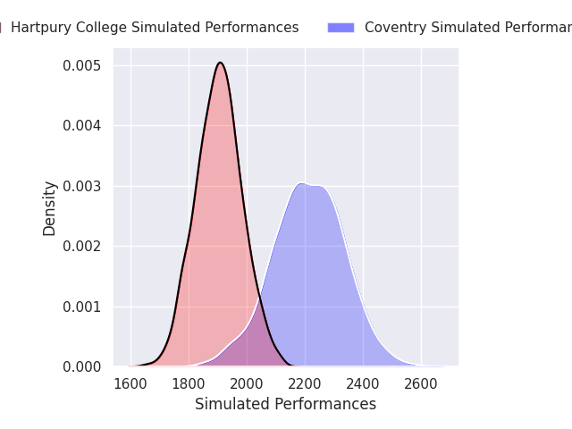

#### Doncaster V Caldy on 2026/12/26

Average Margin: Doncaster by 15.3

#### Richmond V Bedford on 2026/12/26

Average Margin: Bedford by 10.5

#### Chinnor V Rotherham Titans on 2026/12/27

Average Margin: Chinnor by 10.0

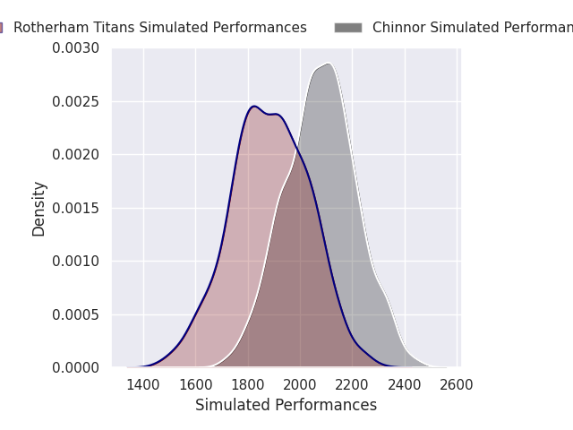

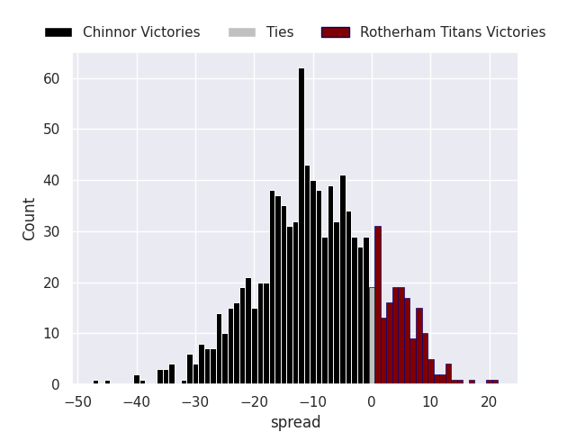

#### Ealing Trailfinders V Nottingham on 2026/12/27

Average Margin: Ealing Trailfinders by 21.4

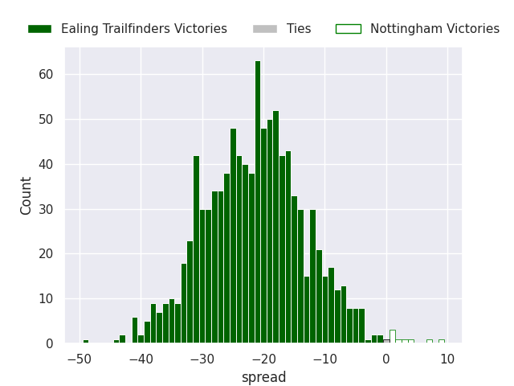

### Week 14
#### Blackheath V Ampthill on 2027/01/01

Average Margin: Ampthill by 4.2

#### Bedford V Richmond on 2027/01/01

Average Margin: Bedford by 17.4

#### Nottingham V Ealing Trailfinders on 2027/01/01

Average Margin: Ealing Trailfinders by 11.8

#### Cornish Pirates V Worcester Warriors on 2027/01/02

Average Margin: Worcester Warriors by 0.0

#### Rotherham Titans V Chinnor on 2027/01/02

Average Margin: Chinnor by 0.3

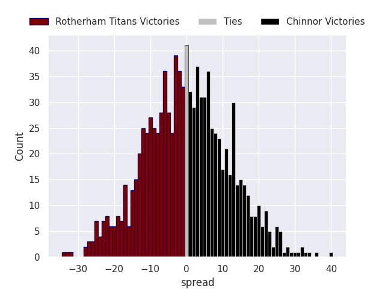

#### Hartpury College V Coventry on 2027/01/02

Average Margin: Coventry by 4.9

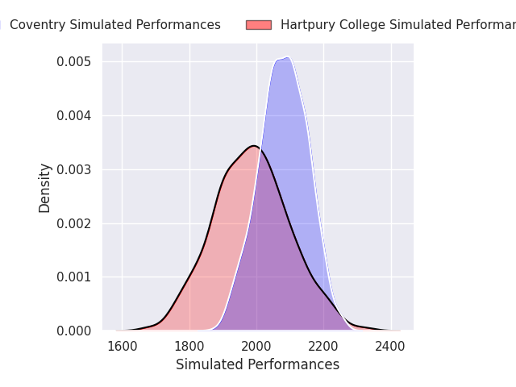

#### Caldy V Doncaster on 2027/01/02

Average Margin: Doncaster by 8.2

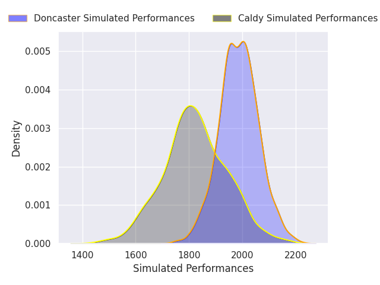

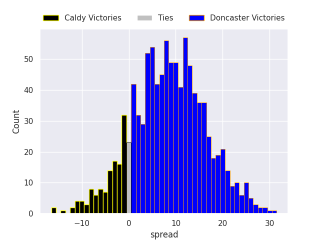

### Week 15
#### Blackheath V Richmond on 2027/01/22

Average Margin: Blackheath by 0.5

#### Ealing Trailfinders V Worcester Warriors on 2027/01/23

Average Margin: Ealing Trailfinders by 10.6

#### Doncaster V Rotherham Titans on 2027/01/23

Average Margin: Doncaster by 8.5

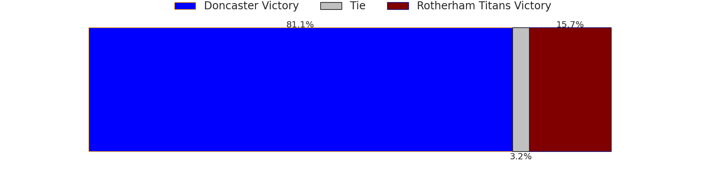

#### Ampthill V Chinnor on 2027/01/23

Average Margin: Chinnor by 0.3

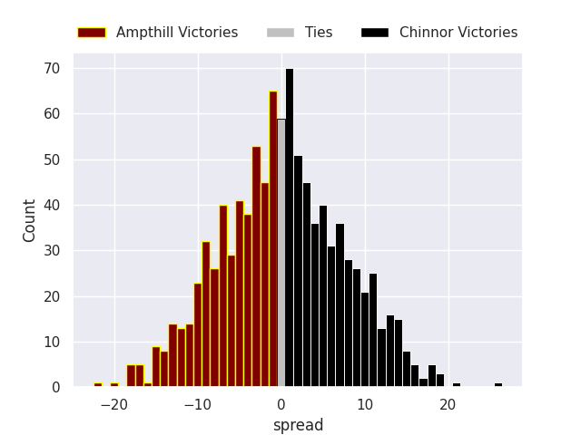

#### Coventry V Bedford on 2027/01/23

Average Margin: Coventry by 5.9

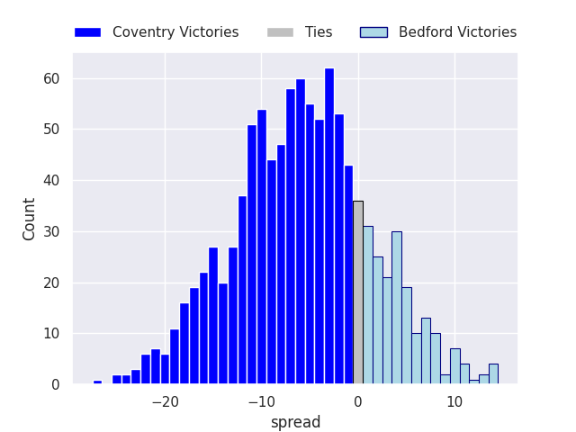

#### Caldy V Nottingham on 2027/01/23

Average Margin: Nottingham by 1.4

#### Hartpury College V Cornish Pirates on 2027/01/23

Average Margin: Hartpury College by 0.5

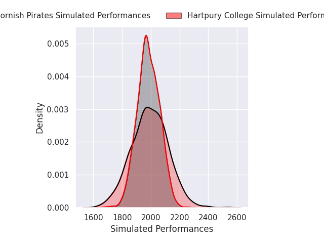

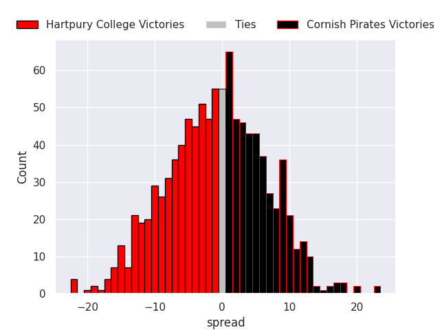

