## Team Rankings

## Standings
### Current Standings

| Club                |   Played |   Wins |   Point Differential |   Losing Bonus Points |   Try Bonus Points |   Competition Points |
|:--------------------|---------:|-------:|---------------------:|----------------------:|-------------------:|---------------------:|
| Ealing Trailfinders |        8 |      7 |                  185 |                     1 |                  5 |                   34 |
| Worcester Warriors  |        8 |      7 |                  192 |                     0 |                  5 |                   33 |
| Coventry            |        8 |      6 |                  116 |                     2 |                  5 |                   31 |
| Chinnor             |        8 |      6 |                   35 |                     0 |                  5 |                   29 |
| Bedford             |        8 |      5 |                   44 |                     1 |                  6 |                   27 |
| Rotherham Titans    |        8 |      5 |                  -52 |                     1 |                  4 |                   25 |
| Cornish Pirates     |        8 |      5 |                   50 |                     0 |                  4 |                   24 |
| Doncaster           |        8 |      3 |                  -23 |                     2 |                  6 |                   20 |
| Ampthill            |        8 |      4 |                  -87 |                     0 |                  3 |                   19 |
| Richmond            |        8 |      3 |                  -48 |                     1 |                  4 |                   17 |
| Nottingham          |        8 |      1 |                  -87 |                     4 |                  3 |                   11 |
| Caldy               |        8 |      1 |                 -114 |                     3 |                  4 |                   11 |
| Hartpury College    |        8 |      2 |                 -133 |                     1 |                  2 |                   11 |
| Blackheath          |        8 |      1 |                  -78 |                     3 |                  3 |                   10 |

### Projected Remaining Table

| Club                |   To Play |   Projected Wins |   Projected Differential |   Projected Losing Bonus Points | Projected Try Bonus Points   |   Projected Competition Points |
|:--------------------|----------:|-----------------:|-------------------------:|--------------------------------:|:-----------------------------|-------------------------------:|
| Ealing Trailfinders |         6 |            5.336 |                   84.568 |                           0.384 |                              |                         21.894 |
| Doncaster           |         6 |            4.765 |                   48.244 |                           0.742 |                              |                         20.182 |
| Coventry            |         6 |            4.6   |                   42.253 |                           0.862 |                              |                         19.7   |
| Bedford             |         6 |            4.126 |                   36.056 |                           0.835 |                              |                         17.631 |
| Worcester Warriors  |         6 |            3.552 |                   21.131 |                           1.34  |                              |                         16.014 |
| Cornish Pirates     |         6 |            3.345 |                    9.757 |                           1.237 |                              |                         14.997 |
| Chinnor             |         6 |            3.2   |                   13.871 |                           1.29  |                              |                         14.462 |
| Ampthill            |         6 |            2.663 |                    0.054 |                           1.451 |                              |                         12.457 |
| Hartpury College    |         6 |            2.684 |                   -7.131 |                           1.174 |                              |                         12.282 |
| Blackheath          |         6 |            2.187 |                  -21.405 |                           1.255 |                              |                         10.319 |
| Nottingham          |         6 |            1.879 |                  -33.807 |                           1.439 |                              |                          9.337 |
| Rotherham Titans    |         6 |            1.255 |                  -58.048 |                           1.142 |                              |                          6.458 |
| Richmond            |         6 |            1.003 |                  -51.263 |                           1.376 |                              |                          5.676 |
| Caldy               |         6 |            0.242 |                  -84.28  |                           1.013 |                              |                          2.131 |

### Projected Total Table

| Club                |   Played |   Wins |   Point Differential |   Losing Bonus Points |   Try Bonus Points |   Competition Points |
|:--------------------|---------:|-------:|---------------------:|----------------------:|-------------------:|---------------------:|
| Ealing Trailfinders |       14 | 12.336 |              269.568 |                 1.384 |                  5 |               55.894 |
| Coventry            |       14 | 10.6   |              158.253 |                 2.862 |                  5 |               50.7   |
| Worcester Warriors  |       14 | 10.552 |              213.131 |                 1.34  |                  5 |               49.014 |
| Bedford             |       14 |  9.126 |               80.056 |                 1.835 |                  6 |               44.631 |
| Chinnor             |       14 |  9.2   |               48.871 |                 1.29  |                  5 |               43.462 |
| Doncaster           |       14 |  7.765 |               25.244 |                 2.742 |                  6 |               40.182 |
| Cornish Pirates     |       14 |  8.345 |               59.757 |                 1.237 |                  4 |               38.997 |
| Rotherham Titans    |       14 |  6.255 |             -110.048 |                 2.142 |                  4 |               31.458 |
| Ampthill            |       14 |  6.663 |              -86.946 |                 1.451 |                  3 |               31.457 |
| Hartpury College    |       14 |  4.684 |             -140.131 |                 2.174 |                  2 |               23.282 |
| Richmond            |       14 |  4.003 |              -99.263 |                 2.376 |                  4 |               22.676 |
| Nottingham          |       14 |  2.879 |             -120.807 |                 5.439 |                  3 |               20.337 |
| Blackheath          |       14 |  3.187 |              -99.405 |                 4.255 |                  3 |               20.319 |
| Caldy               |       14 |  1.242 |             -198.28  |                 4.013 |                  4 |               13.131 |

## Completed Match Review

| Model | Percent Correct Predictions | Spread Error |
| ------ | ------ | ------ |
| Club Level | 74.5% | 12.1 |
| Player Level: Lineup | nan% | nan |
| Player Level: Minutes | nan% | nan |

## Future Predictions
### Week 9
#### Caldy V Ealing Trailfinders on 2026/11/21

Average Margin: Ealing Trailfinders by 19.6

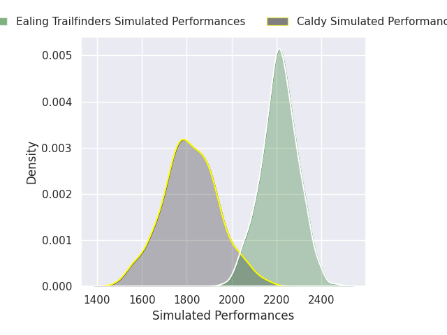

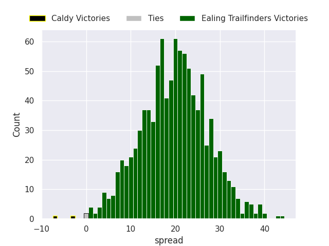

#### Blackheath V Rotherham Titans on 2026/11/21

Average Margin: Blackheath by 5.2

#### Hartpury College RFC V Richmond on 2026/11/21

Average Margin: Hartpury College by 8.3

#### Doncaster V Chinnor on 2026/11/21

Average Margin: Doncaster by 4.2

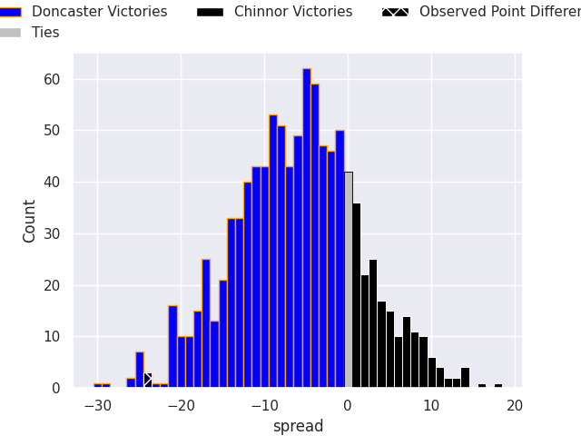

#### Ampthill V Bedford on 2026/11/21

Average Margin: Bedford by 3.6

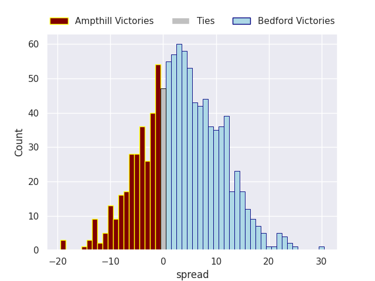

#### Coventry V Worcester Warriors on 2026/11/21

Average Margin: Coventry by 5.0

#### Nottingham V Cornish Pirates on 2026/11/22

Average Margin: Cornish Pirates by 0.9

### Week 10
#### Nottingham V Caldy on 2026/12/04

Average Margin: Nottingham by 8.9

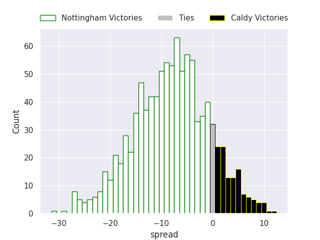

#### Rotherham Titans V Doncaster on 2026/12/05

Average Margin: Doncaster by 5.9

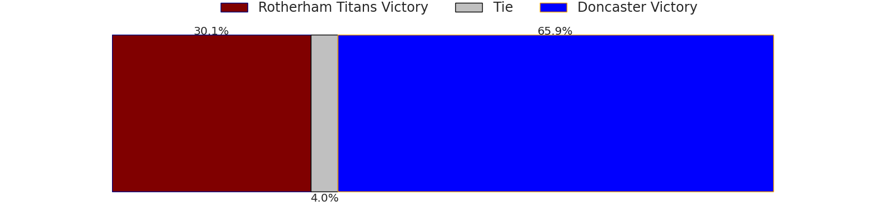

#### Bedford V Coventry on 2026/12/05

Average Margin: Bedford by 2.2

#### Cornish Pirates V Hartpury College on 2026/12/05

Average Margin: Cornish Pirates by 9.2

#### Worcester Warriors V Ealing Trailfinders on 2026/12/05

Average Margin: Ealing Trailfinders by 1.1

#### Richmond V Blackheath on 2026/12/05

Average Margin: Richmond by 3.9

#### Chinnor V Ampthill on 2026/12/06

Average Margin: Chinnor by 8.7

### Week 11
#### Caldy V Worcester Warriors on 2026/12/12

Average Margin: Worcester Warriors by 14.7

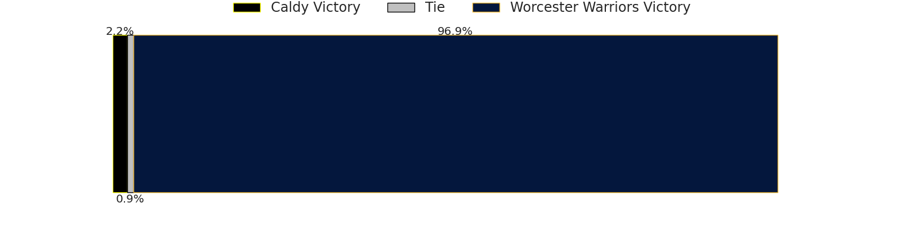
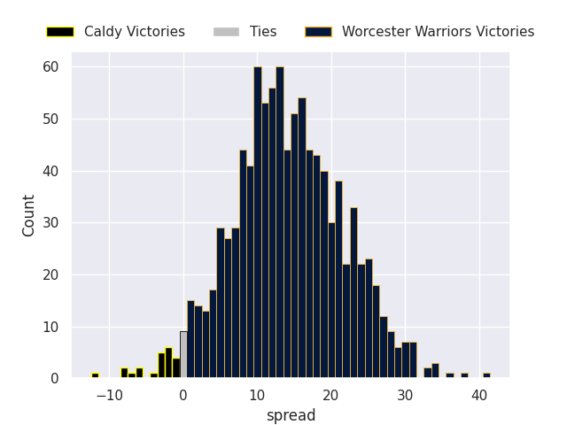

#### Doncaster V Richmond on 2026/12/12

Average Margin: Doncaster by 13.0

#### Blackheath V Cornish Pirates on 2026/12/12

Average Margin: Cornish Pirates by 4.7

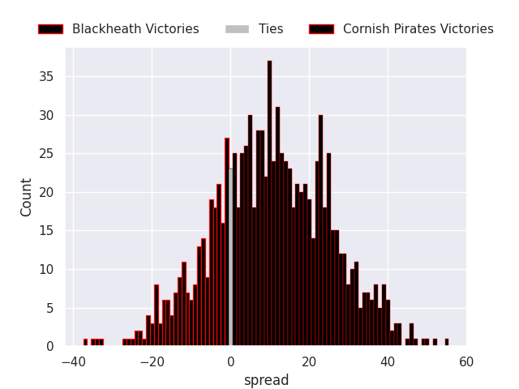

#### Ealing Trailfinders V Bedford on 2026/12/12

Average Margin: Ealing Trailfinders by 12.3

#### Hartpury College V Nottingham on 2026/12/12

Average Margin: Hartpury College by 5.2

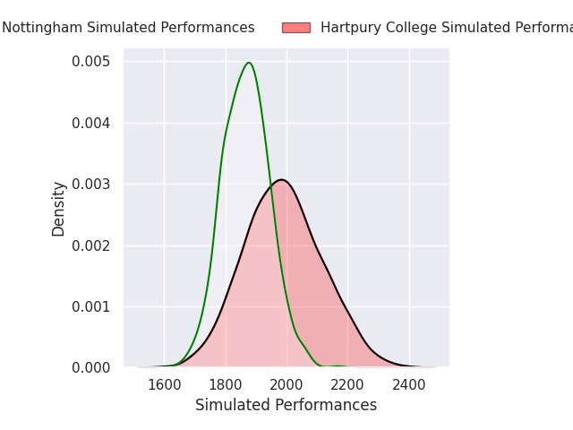

#### Ampthill V Rotherham Titans on 2026/12/12

Average Margin: Ampthill by 10.1

#### Coventry V Chinnor on 2026/12/13

Average Margin: Coventry by 10.2

### Week 12
#### Cornish Pirates V Ampthill on 2026/12/18

Average Margin: Cornish Pirates by 7.3

#### Nottingham V Doncaster on 2026/12/18

Average Margin: Doncaster by 2.1

#### Hartpury College V Blackheath on 2026/12/18

Average Margin: Hartpury College by 8.6

#### Richmond V Coventry on 2026/12/19

Average Margin: Coventry by 9.2

#### Chinnor V Worcester Warriors on 2026/12/19

Average Margin: Worcester Warriors by 0.2

#### Rotherham Titans V Ealing Trailfinders on 2026/12/19

Average Margin: Ealing Trailfinders by 17.0

#### Bedford V Caldy on 2026/12/20

Average Margin: Bedford by 18.0

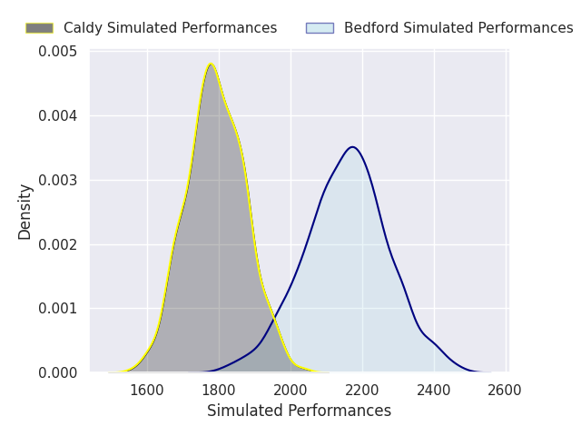

### Week 13
#### Coventry V Hartpury College on 2026/12/26

Average Margin: Coventry by 14.9

#### Doncaster V Caldy on 2026/12/26

Average Margin: Doncaster by 14.8

#### Ampthill V Blackheath on 2026/12/26

Average Margin: Ampthill by 9.1

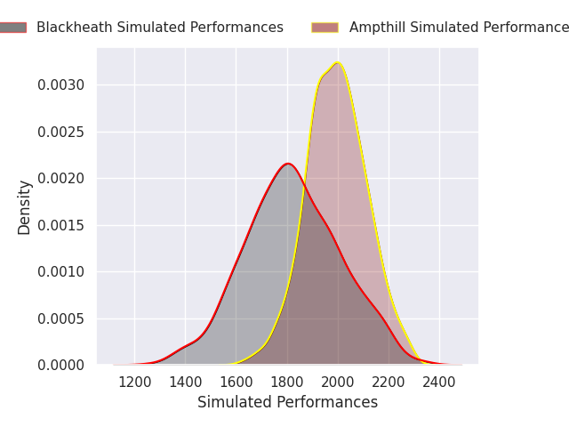

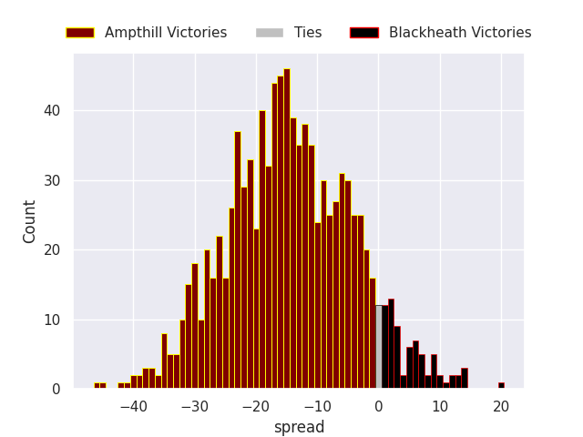

#### Worcester Warriors V Cornish Pirates on 2026/12/26

Average Margin: Worcester Warriors by 10.8

#### Richmond V Bedford on 2026/12/26

Average Margin: Bedford by 9.0

#### Chinnor V Rotherham Titans on 2026/12/27

Average Margin: Chinnor by 14.8

#### Ealing Trailfinders V Nottingham on 2026/12/27

Average Margin: Ealing Trailfinders by 22.1

### Week 14
#### Nottingham V Ealing Trailfinders on 2027/01/01

Average Margin: Ealing Trailfinders by 12.4

#### Blackheath V Ampthill on 2027/01/01

Average Margin: Ampthill by 0.4

#### Bedford V Richmond on 2027/01/01

Average Margin: Bedford by 15.6

#### Rotherham Titans V Chinnor on 2027/01/02

Average Margin: Chinnor by 5.0

#### Caldy V Doncaster on 2027/01/02

Average Margin: Doncaster by 8.3

#### Cornish Pirates V Worcester Warriors on 2027/01/02

Average Margin: Worcester Warriors by 1.6

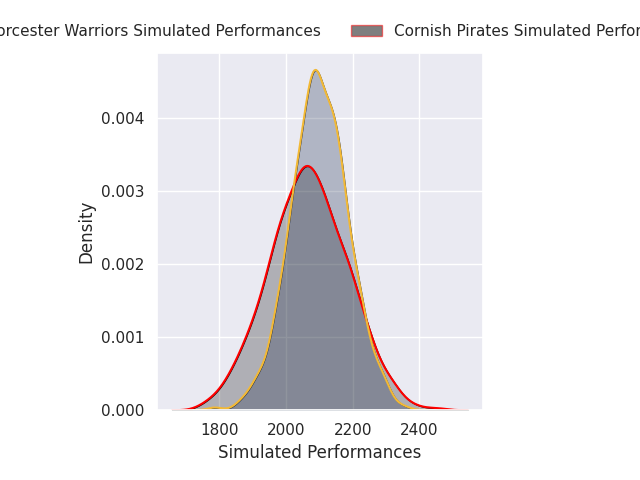

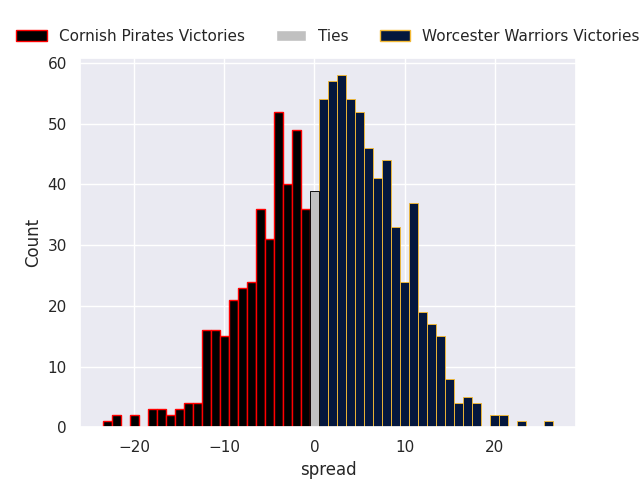

#### Hartpury College V Coventry on 2027/01/02

Average Margin: Coventry by 5.2

