## Team Rankings

## Standings
### Current Standings

| Club                |   Played |   Wins |   Point Differential |   Losing Bonus Points |   Try Bonus Points |   Competition Points |
|:--------------------|---------:|-------:|---------------------:|----------------------:|-------------------:|---------------------:|
| Ealing Trailfinders |        9 |      8 |                  191 |                     1 |                  6 |                   39 |
| Coventry            |        9 |      7 |                  131 |                     2 |                  6 |                   36 |
| Worcester Warriors  |        9 |      7 |                  177 |                     0 |                  6 |                   34 |
| Bedford             |        9 |      6 |                   72 |                     1 |                  6 |                   31 |
| Cornish Pirates     |        9 |      6 |                   55 |                     0 |                  5 |                   29 |
| Chinnor             |        9 |      6 |                   11 |                     0 |                  5 |                   29 |
| Rotherham Titans    |        9 |      6 |                  -32 |                     1 |                  4 |                   29 |
| Doncaster           |        9 |      4 |                    1 |                     2 |                  7 |                   25 |
| Ampthill            |        9 |      4 |                 -115 |                     0 |                  3 |                   19 |
| Richmond            |        9 |      3 |                  -75 |                     1 |                  4 |                   17 |
| Hartpury College    |        9 |      3 |                 -106 |                     1 |                  2 |                   15 |
| Nottingham          |        9 |      1 |                  -92 |                     5 |                  4 |                   13 |
| Caldy               |        9 |      1 |                 -120 |                     4 |                  5 |                   13 |
| Blackheath          |        9 |      1 |                  -98 |                     3 |                  3 |                   10 |

### Projected Remaining Table

| Club                |   To Play |   Projected Wins |   Projected Differential |   Projected Losing Bonus Points | Projected Try Bonus Points   |   Projected Competition Points |
|:--------------------|----------:|-----------------:|-------------------------:|--------------------------------:|:-----------------------------|-------------------------------:|
| Ealing Trailfinders |         6 |            5.065 |                   67.113 |                           0.574 |                              |                         21.068 |
| Doncaster           |         6 |            4.813 |                   52.686 |                           0.711 |                              |                         20.277 |
| Coventry            |         6 |            4.663 |                   46.211 |                           0.845 |                              |                         19.813 |
| Bedford             |         6 |            3.747 |                   31.973 |                           0.989 |                              |                         16.223 |
| Cornish Pirates     |         6 |            3.502 |                   17.728 |                           1.223 |                              |                         15.705 |
| Worcester Warriors  |         6 |            3.309 |                   11.483 |                           1.317 |                              |                         14.985 |
| Chinnor             |         6 |            3.116 |                    6.028 |                           1.318 |                              |                         14.186 |
| Ampthill            |         6 |            2.908 |                    6.592 |                           1.312 |                              |                         13.334 |
| Hartpury College    |         6 |            2.582 |                   -6.342 |                           1.308 |                              |                         12.006 |
| Nottingham          |         6 |            1.953 |                  -33.438 |                           1.345 |                              |                          9.531 |
| Rotherham Titans    |         6 |            1.697 |                  -37.006 |                           1.421 |                              |                          8.551 |
| Richmond            |         6 |            1.436 |                  -45.145 |                           1.033 |                              |                          6.977 |
| Blackheath          |         6 |            1.395 |                  -53.915 |                           1.099 |                              |                          6.923 |
| Caldy               |         6 |            0.657 |                  -63.968 |                           1.449 |                              |                          4.365 |

### Projected Total Table

| Club                |   Played |   Wins |   Point Differential |   Losing Bonus Points |   Try Bonus Points |   Competition Points |
|:--------------------|---------:|-------:|---------------------:|----------------------:|-------------------:|---------------------:|
| Ealing Trailfinders |       15 | 13.065 |              258.113 |                 1.574 |                  6 |               60.068 |
| Coventry            |       15 | 11.663 |              177.211 |                 2.845 |                  6 |               55.813 |
| Worcester Warriors  |       15 | 10.309 |              188.483 |                 1.317 |                  6 |               48.985 |
| Bedford             |       15 |  9.747 |              103.973 |                 1.989 |                  6 |               47.223 |
| Doncaster           |       15 |  8.813 |               53.686 |                 2.711 |                  7 |               45.277 |
| Cornish Pirates     |       15 |  9.502 |               72.728 |                 1.223 |                  5 |               44.705 |
| Chinnor             |       15 |  9.116 |               17.028 |                 1.318 |                  5 |               43.186 |
| Rotherham Titans    |       15 |  7.697 |              -69.006 |                 2.421 |                  4 |               37.551 |
| Ampthill            |       15 |  6.908 |             -108.408 |                 1.312 |                  3 |               32.334 |
| Hartpury College    |       15 |  5.582 |             -112.342 |                 2.308 |                  2 |               27.006 |
| Richmond            |       15 |  4.436 |             -120.145 |                 2.033 |                  4 |               23.977 |
| Nottingham          |       15 |  2.953 |             -125.438 |                 6.345 |                  4 |               22.531 |
| Caldy               |       15 |  1.657 |             -183.968 |                 5.449 |                  5 |               17.365 |
| Blackheath          |       15 |  2.395 |             -151.915 |                 4.099 |                  3 |               16.923 |

## Completed Match Review

| Model | Percent Correct Predictions | Spread Error |
| ------ | ------ | ------ |
| Club Level | 77.1% | 12.2 |
| Player Level: Lineup | nan% | nan |
| Player Level: Minutes | nan% | nan |

## Future Predictions
### Week 10
#### Nottingham V Caldy on 2026/12/04

Average Margin: Nottingham by 7.9

#### Cornish Pirates V Hartpury College on 2026/12/05

Average Margin: Cornish Pirates by 8.6

#### Richmond V Blackheath on 2026/12/05

Average Margin: Richmond by 8.8

#### Worcester Warriors V Ealing Trailfinders on 2026/12/05

Average Margin: Ealing Trailfinders by 0.9

#### Bedford V Coventry on 2026/12/05

Average Margin: Bedford by 2.5

#### Rotherham Titans V Doncaster on 2026/12/05

Average Margin: Doncaster by 2.2

#### Chinnor V Ampthill on 2026/12/06

Average Margin: Chinnor by 8.4

### Week 11
#### Caldy V Worcester Warriors on 2026/12/12

Average Margin: Worcester Warriors by 12.5

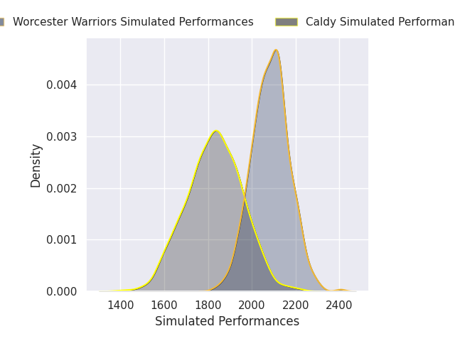

#### Ealing Trailfinders V Bedford on 2026/12/12

Average Margin: Ealing Trailfinders by 10.5

#### Ampthill V Rotherham Titans on 2026/12/12

Average Margin: Ampthill by 4.6

#### Hartpury College V Nottingham on 2026/12/12

Average Margin: Hartpury College by 6.4

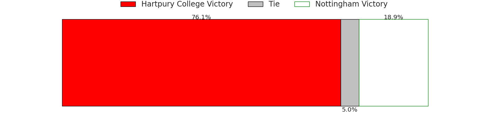
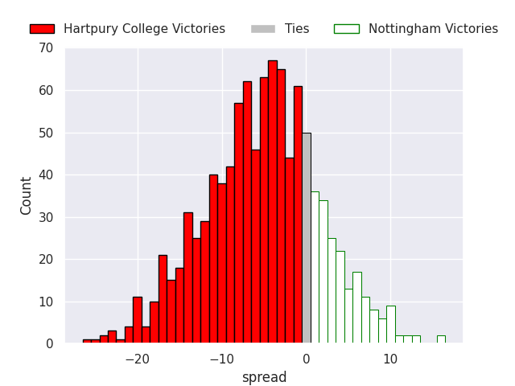

#### Blackheath V Cornish Pirates on 2026/12/12

Average Margin: Cornish Pirates by 10.5

#### Doncaster V Richmond on 2026/12/12

Average Margin: Doncaster by 14.6

#### Coventry V Chinnor on 2026/12/13

Average Margin: Coventry by 11.3

### Week 12
#### Hartpury College V Blackheath on 2026/12/18

Average Margin: Hartpury College by 15.4

#### Cornish Pirates V Ampthill on 2026/12/18

Average Margin: Cornish Pirates by 8.9

#### Nottingham V Doncaster on 2026/12/18

Average Margin: Doncaster by 3.2

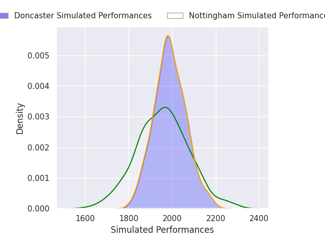

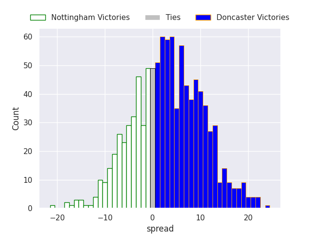

#### Richmond V Coventry on 2026/12/19

Average Margin: Coventry by 11.4

#### Rotherham Titans V Ealing Trailfinders on 2026/12/19

Average Margin: Ealing Trailfinders by 12.0

#### Chinnor V Worcester Warriors on 2026/12/19

Average Margin: Worcester Warriors by 0.4

#### Bedford V Caldy on 2026/12/20

Average Margin: Bedford by 18.3

### Week 13
#### Ampthill V Blackheath on 2026/12/26

Average Margin: Ampthill by 14.5

#### Coventry V Hartpury College on 2026/12/26

Average Margin: Coventry by 15.2

#### Richmond V Bedford on 2026/12/26

Average Margin: Bedford by 10.8

#### Worcester Warriors V Cornish Pirates on 2026/12/26

Average Margin: Worcester Warriors by 9.5

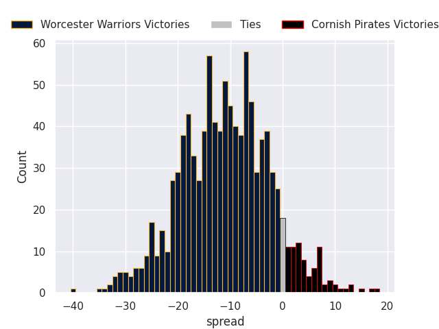

#### Doncaster V Caldy on 2026/12/26

Average Margin: Doncaster by 15.2

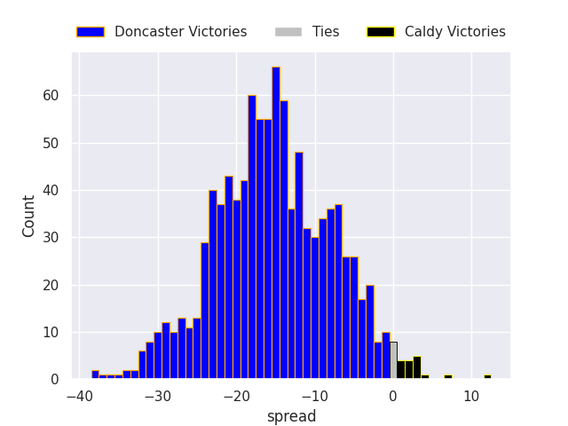

#### Ealing Trailfinders V Nottingham on 2026/12/27

Average Margin: Ealing Trailfinders by 21.6

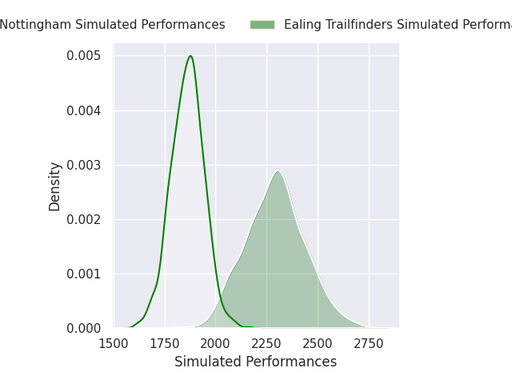

#### Chinnor V Rotherham Titans on 2026/12/27

Average Margin: Chinnor by 9.6

### Week 14
#### Nottingham V Ealing Trailfinders on 2027/01/01

Average Margin: Ealing Trailfinders by 11.8

#### Blackheath V Ampthill on 2027/01/01

Average Margin: Ampthill by 4.9

#### Bedford V Richmond on 2027/01/01

Average Margin: Bedford by 17.0

#### Caldy V Doncaster on 2027/01/02

Average Margin: Doncaster by 8.4

#### Cornish Pirates V Worcester Warriors on 2027/01/02

Average Margin: Worcester Warriors by 0.3

#### Hartpury College V Coventry on 2027/01/02

Average Margin: Coventry by 4.7

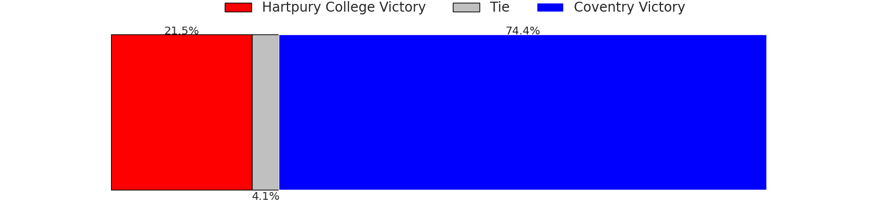

#### Rotherham Titans V Chinnor on 2027/01/02

Average Margin: Rotherham Titans by 0.5

### Week 15
#### Blackheath V Richmond on 2027/01/22

Average Margin: Blackheath by 0.2

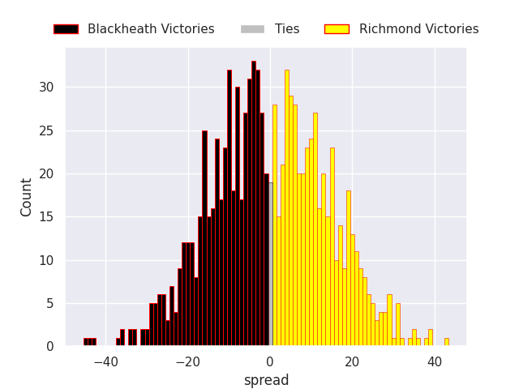

#### Hartpury College V Cornish Pirates on 2027/01/23

Average Margin: Hartpury College by 0.5

#### Ealing Trailfinders V Worcester Warriors on 2027/01/23

Average Margin: Ealing Trailfinders by 10.3

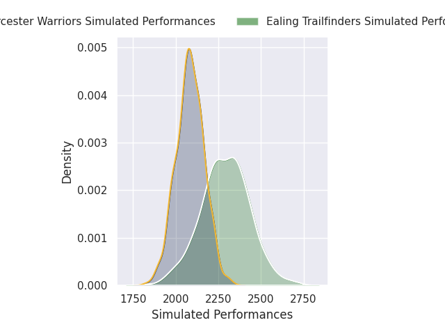

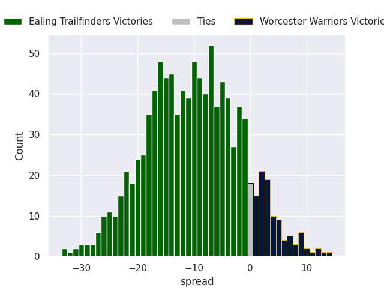

#### Ampthill V Chinnor on 2027/01/23

Average Margin: Chinnor by 0.2

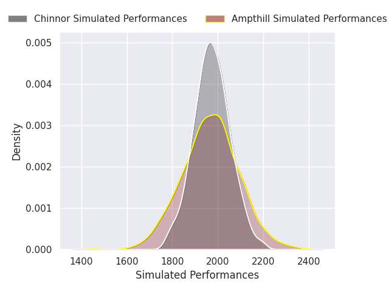

#### Coventry V Bedford on 2027/01/23

Average Margin: Coventry by 6.1

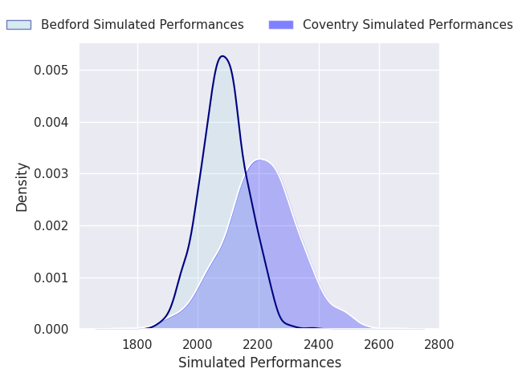

#### Caldy V Nottingham on 2027/01/23

Average Margin: Nottingham by 1.6

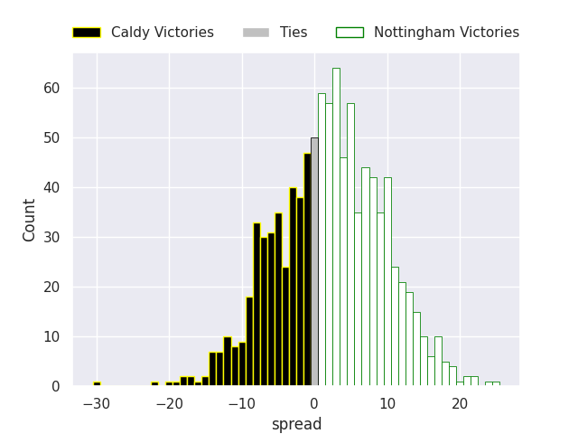

#### Doncaster V Rotherham Titans on 2027/01/23

Average Margin: Doncaster by 9.0

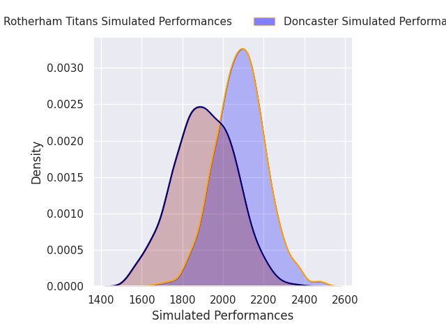

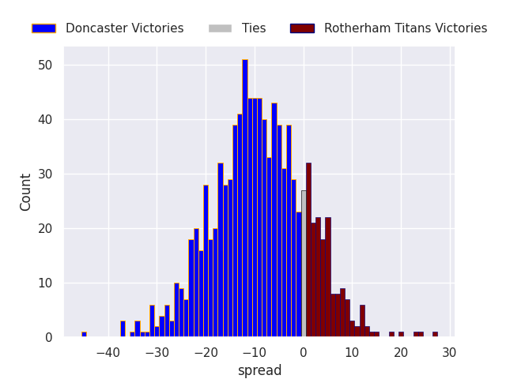

