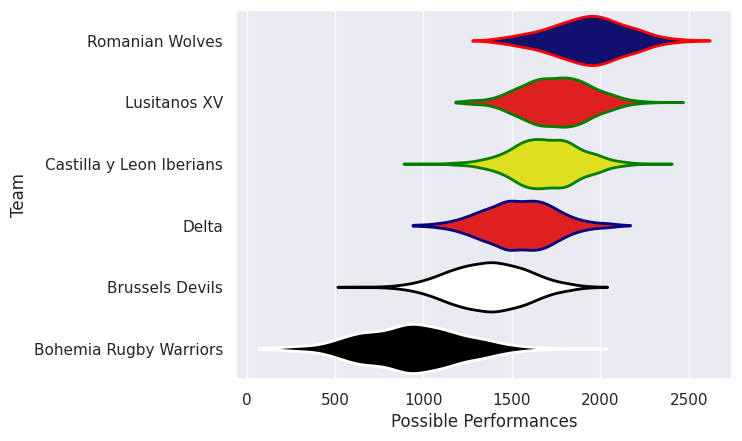
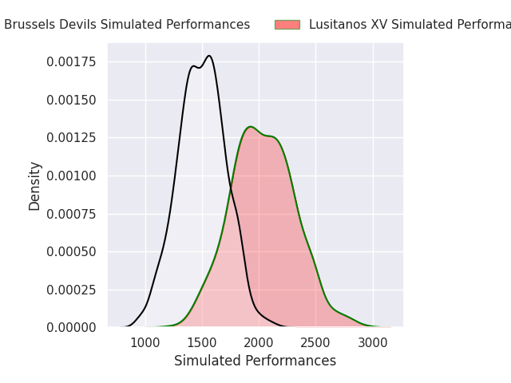
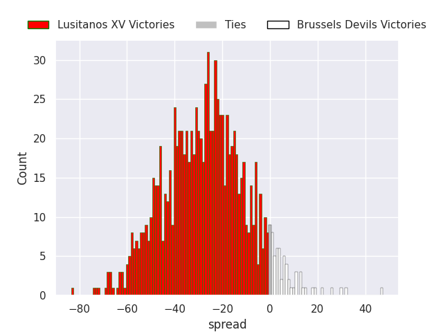
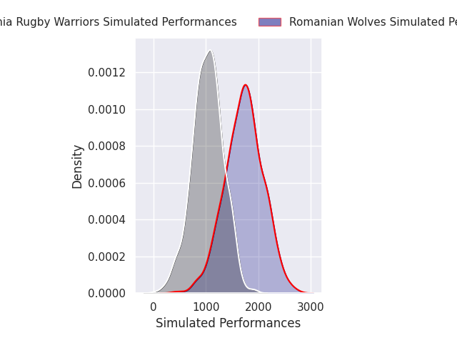
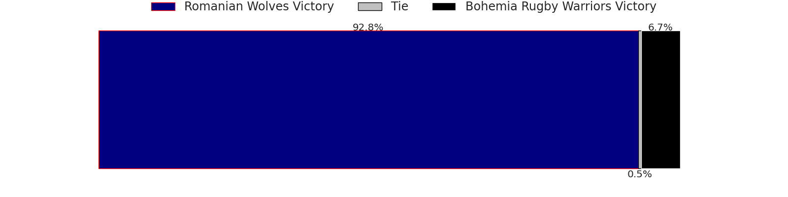
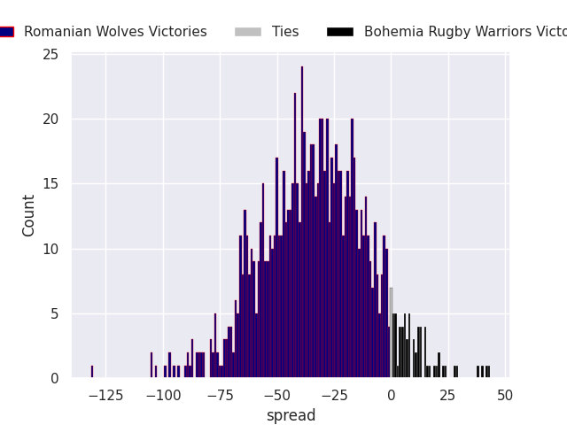
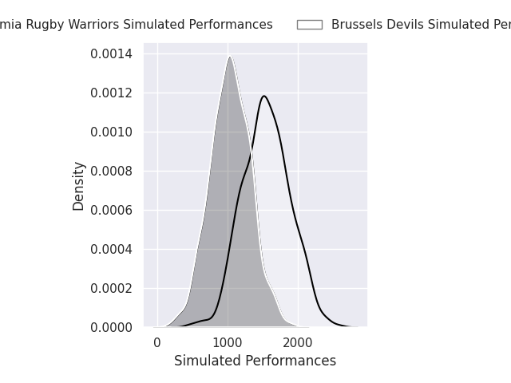
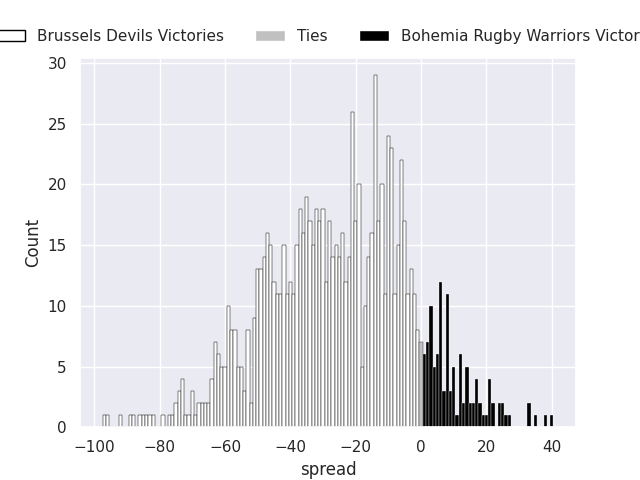
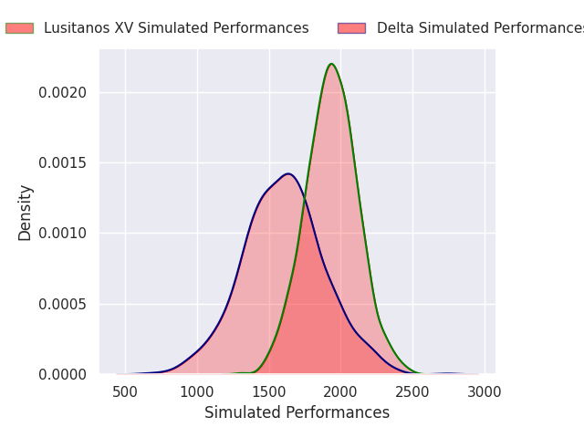
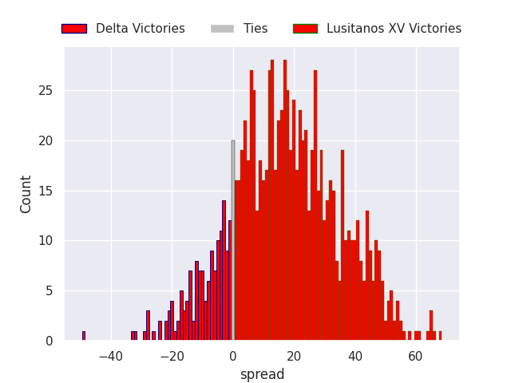

## Team Rankings

## Standings
### Current Standings

| Club                     |   Played |   Wins |   Point Differential |   Losing Bonus Points |   Try Bonus Points |   Competition Points |
|:-------------------------|---------:|-------:|---------------------:|----------------------:|-------------------:|---------------------:|
| Delta                    |        5 |      3 |                   10 |                     1 |                    |                   13 |
| Lusitanos XV             |        4 |      3 |                  158 |                     0 |                    |                   12 |
| Romanian Wolves          |        3 |      2 |                  -59 |                     0 |                  1 |                    9 |
| Castilla y Leon Iberians |        2 |      2 |                   30 |                     0 |                    |                    8 |
| Brussels Devils          |        4 |      0 |                  -62 |                     3 |                  1 |                    4 |
| Bohemia Rugby Warriors   |        2 |      0 |                  -77 |                     0 |                    |                    0 |

### Projected Remaining Table

| Club                   |   To Play |   Projected Wins |   Projected Differential |   Projected Losing Bonus Points | Projected Try Bonus Points   |   Projected Competition Points |
|:-----------------------|----------:|-----------------:|-------------------------:|--------------------------------:|:-----------------------------|-------------------------------:|
| Lusitanos XV           |         2 |            1.784 |                   45.636 |                           0.099 |                              |                          7.279 |
| Brussels Devils        |         2 |            0.927 |                   -2.366 |                           0.109 |                              |                          3.841 |
| Romanian Wolves        |         1 |            0.931 |                   33.478 |                           0.028 |                              |                          3.762 |
| Bohemia Rugby Warriors |         2 |            0.174 |                  -59.532 |                           0.142 |                              |                          0.868 |
| Delta                  |         1 |            0.147 |                  -17.216 |                           0.143 |                              |                          0.771 |

### Projected Total Table

| Club                     |   Played |   Wins |   Point Differential |   Losing Bonus Points |   Try Bonus Points |   Competition Points |
|:-------------------------|---------:|-------:|---------------------:|----------------------:|-------------------:|---------------------:|
| Lusitanos XV             |        6 |  4.784 |              203.636 |                 0.099 |                    |               19.279 |
| Delta                    |        6 |  3.147 |               -7.216 |                 1.143 |                    |               13.771 |
| Romanian Wolves          |        4 |  2.931 |              -25.522 |                 0.028 |                  1 |               12.762 |
| Castilla y Leon Iberians |        2 |  2     |               30     |                 0     |                    |                8     |
| Brussels Devils          |        6 |  0.927 |              -64.366 |                 3.109 |                  1 |                7.841 |
| Bohemia Rugby Warriors   |        4 |  0.174 |             -136.532 |                 0.142 |                    |                0.868 |

## Completed Match Review

| Model | Percent Correct Predictions | Spread Error |
| ------ | ------ | ------ |
| Club Level | 78.6% | 22.2 |
| Player Level: Lineup | nan% | nan |
| Player Level: Minutes | nan% | nan |

## Future Predictions
### Week 6
#### Lusitanos XV V Brussels Devils on 2026/12/05

Average Margin: Lusitanos XV by 28.4

#### Romanian Wolves V Bohemia Rugby Warriors on 2026/12/05

Average Margin: Romanian Wolves by 33.5

### Week 7
#### Brussels Devils V Bohemia Rugby Warriors on 2026/12/12

Average Margin: Brussels Devils by 26.1

#### Delta V Lusitanos XV on 2026/12/13

Average Margin: Lusitanos XV by 17.2

