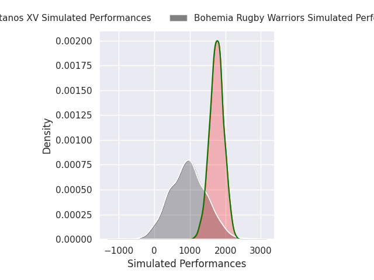
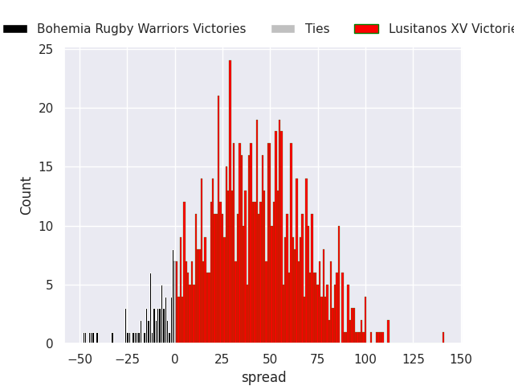
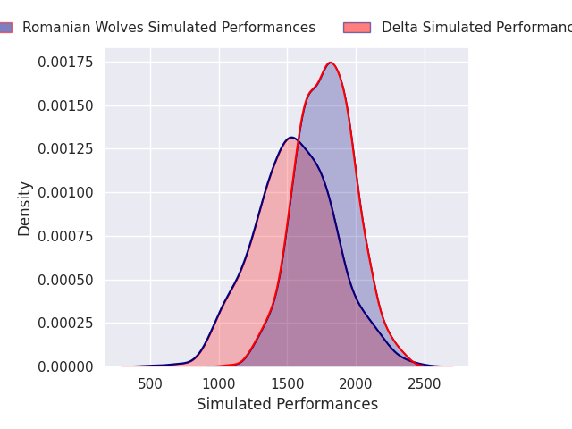
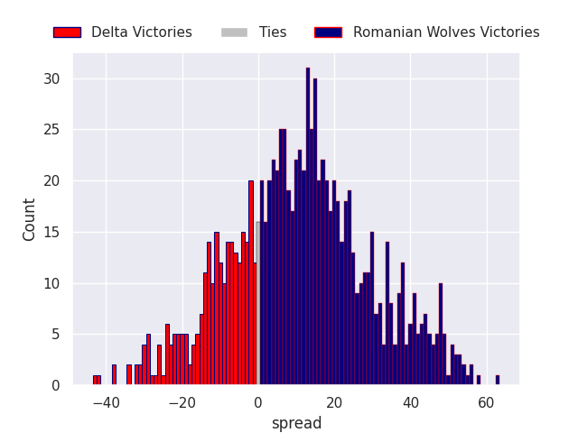
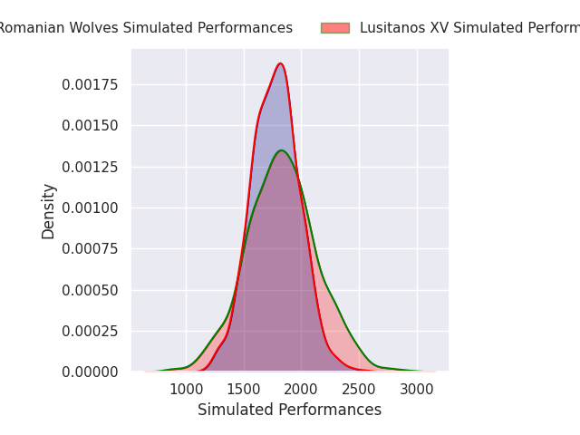
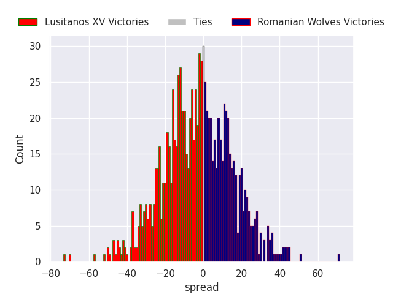
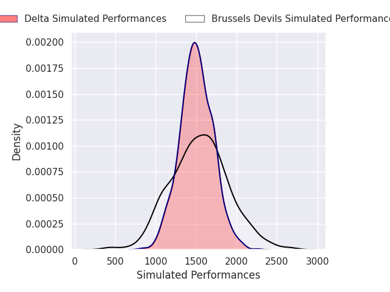
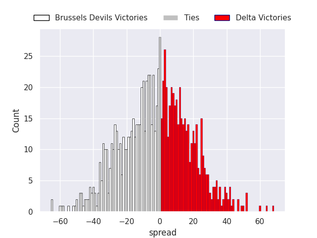

## Team Rankings

## Standings
### Current Standings

| Club                     |   Played |   Wins |   Point Differential |   Losing Bonus Points |   Try Bonus Points |   Competition Points |
|:-------------------------|---------:|-------:|---------------------:|----------------------:|-------------------:|---------------------:|
| Delta                    |        3 |      2 |                   15 |                     1 |                    |                    9 |
| Castilla y Leon Iberians |        2 |      2 |                   30 |                     0 |                    |                    8 |
| Romanian Wolves          |        1 |      1 |                    4 |                     0 |                  1 |                    5 |
| Lusitanos XV             |        2 |      1 |                   24 |                     0 |                    |                    4 |
| Brussels Devils          |        3 |      0 |                  -58 |                     2 |                  1 |                    3 |
| Bohemia Rugby Warriors   |        1 |      0 |                  -15 |                     0 |                    |                    0 |

### Projected Remaining Table

| Club                   |   To Play |   Projected Wins |   Projected Differential |   Projected Losing Bonus Points | Projected Try Bonus Points   |   Projected Competition Points |
|:-----------------------|----------:|-----------------:|-------------------------:|--------------------------------:|:-----------------------------|-------------------------------:|
| Lusitanos XV           |         4 |            2.945 |                   67.464 |                           0.365 |                              |                         12.285 |
| Romanian Wolves        |         3 |            2.069 |                   46.846 |                           0.286 |                              |                          8.664 |
| Brussels Devils        |         3 |            1.486 |                    5.25  |                           0.326 |                              |                          6.368 |
| Delta                  |         3 |            1.039 |                  -21.251 |                           0.432 |                              |                          4.714 |
| Bohemia Rugby Warriors |         3 |            0.335 |                  -98.309 |                           0.194 |                              |                          1.572 |

### Projected Total Table

| Club                     |   Played |   Wins |   Point Differential |   Losing Bonus Points |   Try Bonus Points |   Competition Points |
|:-------------------------|---------:|-------:|---------------------:|----------------------:|-------------------:|---------------------:|
| Lusitanos XV             |        6 |  3.945 |               91.464 |                 0.365 |                    |               16.285 |
| Delta                    |        6 |  3.039 |               -6.251 |                 1.432 |                    |               13.714 |
| Romanian Wolves          |        4 |  3.069 |               50.846 |                 0.286 |                  1 |               13.664 |
| Brussels Devils          |        6 |  1.486 |              -52.75  |                 2.326 |                  1 |                9.368 |
| Castilla y Leon Iberians |        2 |  2     |               30     |                 0     |                    |                8     |
| Bohemia Rugby Warriors   |        4 |  0.335 |             -113.309 |                 0.194 |                    |                1.572 |

## Completed Match Review

| Model | Percent Correct Predictions | Spread Error |
| ------ | ------ | ------ |
| Club Level | 92.9% | 20.4 |
| Player Level: Lineup | nan% | nan |
| Player Level: Minutes | nan% | nan |

## Future Predictions
### Week 4
#### Bohemia Rugby Warriors V Lusitanos XV on 2026/10/17

Average Margin: Lusitanos XV by 39.9

#### Delta V Romanian Wolves on 2026/10/17

Average Margin: Romanian Wolves by 11.2

### Week 5
#### Lusitanos XV V Romanian Wolves on 2026/10/24

Average Margin: Lusitanos XV by 2.8

#### Brussels Devils V Delta on 2026/10/24

Average Margin: Brussels Devils by 2.0

### Week 6
#### Romanian Wolves V Bohemia Rugby Warriors on 2026/12/05

Average Margin: Romanian Wolves by 38.5

#### Lusitanos XV V Brussels Devils on 2026/12/05

Average Margin: Lusitanos XV by 16.7

### Week 7
#### Brussels Devils V Bohemia Rugby Warriors on 2026/12/12

Average Margin: Brussels Devils by 19.9

#### Delta V Lusitanos XV on 2026/12/13

Average Margin: Lusitanos XV by 8.0

