## Team Rankings

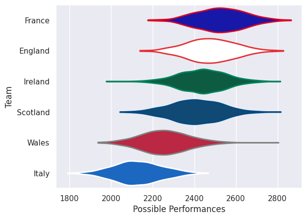
## Standings
### Projected Remaining Table

| Club     |   To Play |   Projected Wins |   Projected Differential |   Projected Losing Bonus Points | Projected Try Bonus Points   |   Projected Competition Points |
|:---------|----------:|-----------------:|-------------------------:|--------------------------------:|:-----------------------------|-------------------------------:|
| England  |         5 |            3.52  |                   42.907 |                           0.745 |                              |                         15.075 |
| France   |         5 |            3.461 |                   37.959 |                           0.703 |                              |                         14.785 |
| Ireland  |         5 |            3.222 |                   23.336 |                           0.902 |                              |                         14.094 |
| Scotland |         5 |            2.206 |                   -6.401 |                           0.861 |                              |                          9.911 |
| Wales    |         5 |            1.707 |                  -24.183 |                           1.09  |                              |                          8.23  |
| Italy    |         5 |            0.517 |                  -73.618 |                           0.815 |                              |                          3.021 |

### Projected Total Table

| Club     |   Played |   Wins |   Point Differential |   Losing Bonus Points | Try Bonus Points   |   Competition Points |
|:---------|---------:|-------:|---------------------:|----------------------:|:-------------------|---------------------:|
| England  |        5 |  3.52  |               42.907 |                 0.745 |                    |               15.075 |
| France   |        5 |  3.461 |               37.959 |                 0.703 |                    |               14.785 |
| Ireland  |        5 |  3.222 |               23.336 |                 0.902 |                    |               14.094 |
| Scotland |        5 |  2.206 |               -6.401 |                 0.861 |                    |                9.911 |
| Wales    |        5 |  1.707 |              -24.183 |                 1.09  |                    |                8.23  |
| Italy    |        5 |  0.517 |              -73.618 |                 0.815 |                    |                3.021 |

## Future Predictions
### Week 1
#### Scotland V Italy on 2027/02/06

Average Margin: Scotland by 16.0

#### France V Wales on 2027/02/06

Average Margin: France by 15.5

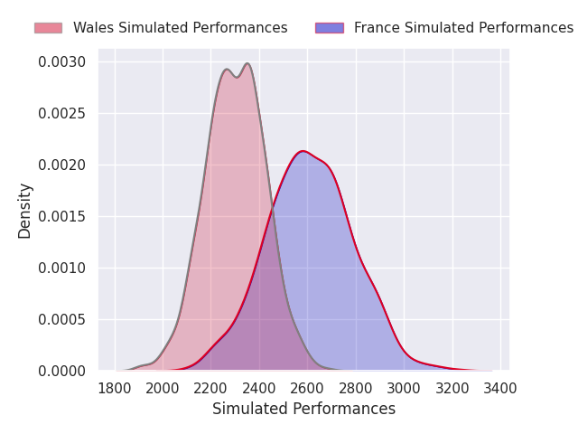

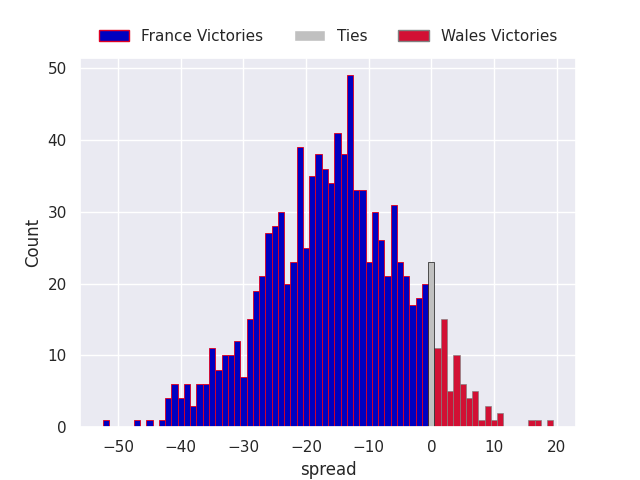

### Week 2
#### Italy V Ireland on 2027/02/13

Average Margin: Ireland by 14.0

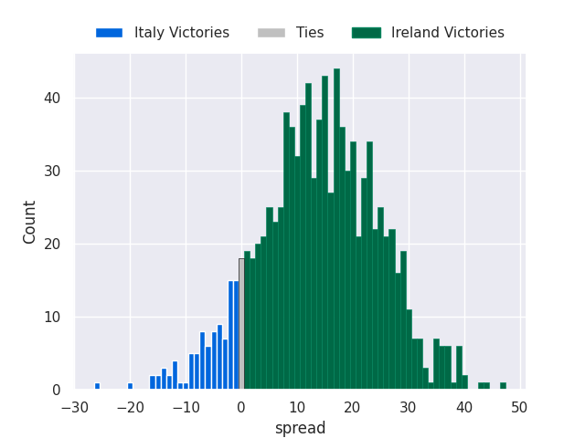

#### Scotland V Wales on 2027/02/13

Average Margin: Scotland by 5.4

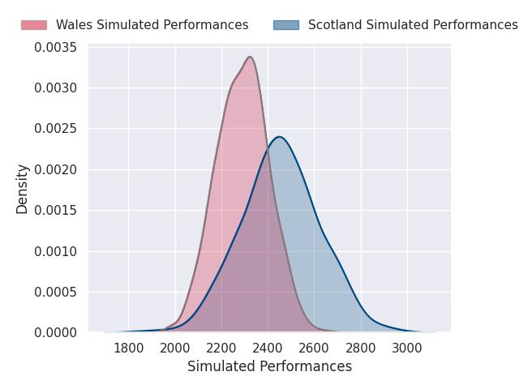

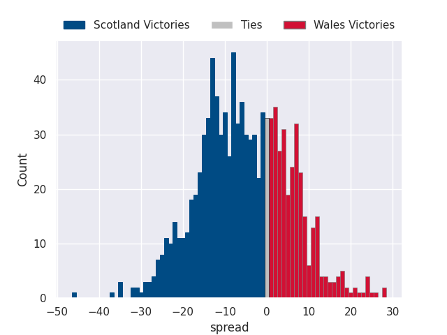

#### England V France on 2027/02/14

Average Margin: England by 3.8

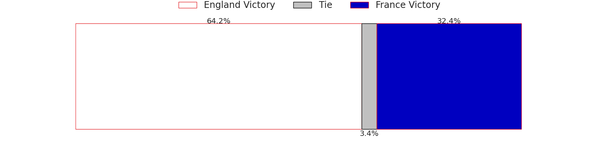

### Week 3
#### England V Italy on 2027/02/20

Average Margin: England by 24.4

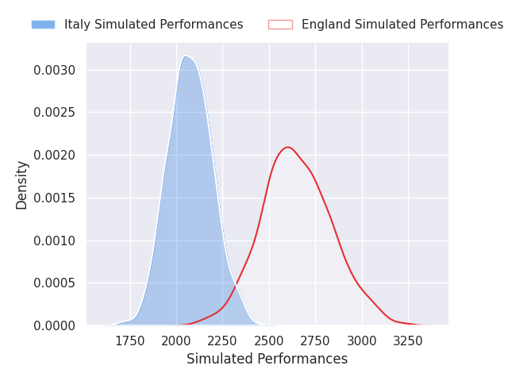

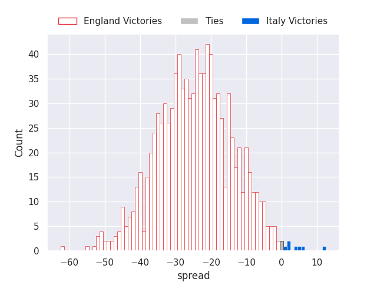

#### Wales V Ireland on 2027/02/20

Average Margin: Ireland by 3.4

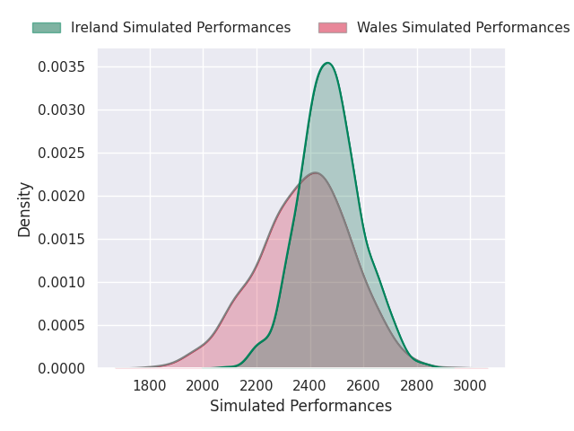

#### France V Scotland on 2027/02/21

Average Margin: France by 13.7

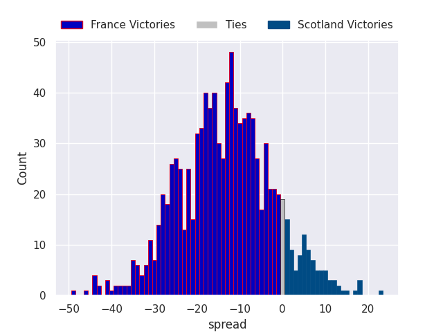

### Week 4
#### Italy V France on 2027/03/06

Average Margin: France by 14.5

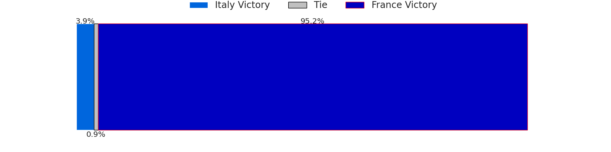
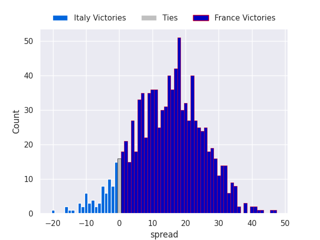

#### Wales V England on 2027/03/06

Average Margin: England by 4.6

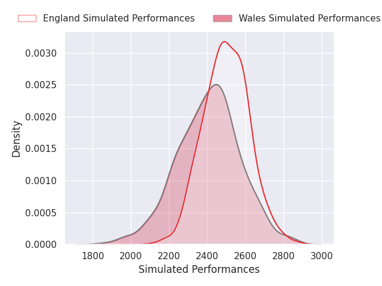

### Week 5
#### Ireland V France on 2027/03/13

Average Margin: Ireland by 1.8

#### Italy V Wales on 2027/03/13

Average Margin: Wales by 4.7

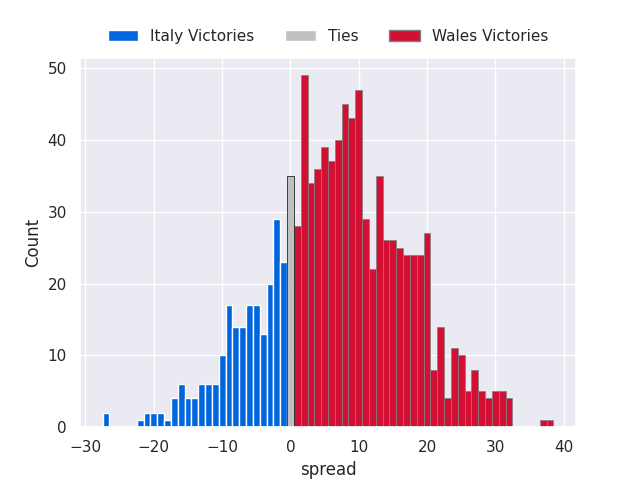

#### England V Scotland on 2027/03/13

Average Margin: England by 12.8

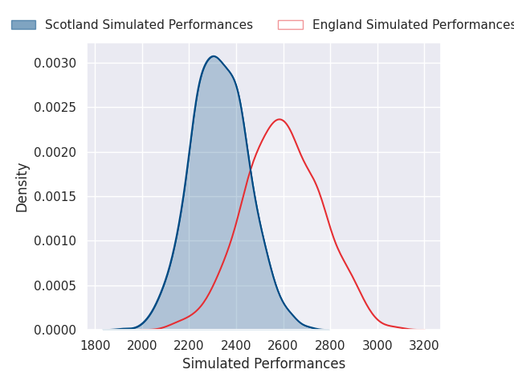

