## Team Rankings

## Standings
### Projected Remaining Table

| Club     |   To Play |   Projected Wins |   Projected Differential |   Projected Losing Bonus Points | Projected Try Bonus Points   |   Projected Competition Points |
|:---------|----------:|-----------------:|-------------------------:|--------------------------------:|:-----------------------------|-------------------------------:|
| England  |         5 |            3.854 |                   57.293 |                           0.614 |                              |                         16.252 |
| France   |         5 |            3.46  |                   39.837 |                           0.682 |                              |                         14.72  |
| Ireland  |         5 |            3.124 |                   22.469 |                           0.955 |                              |                         13.759 |
| Scotland |         5 |            2.3   |                   -3.295 |                           0.777 |                              |                         10.187 |
| Wales    |         5 |            1.557 |                  -28.523 |                           1.077 |                              |                          7.539 |
| Italy    |         5 |            0.379 |                  -87.781 |                           0.617 |                              |                          2.265 |

### Projected Total Table

| Club     |   Played |   Wins |   Point Differential |   Losing Bonus Points | Try Bonus Points   |   Competition Points |
|:---------|---------:|-------:|---------------------:|----------------------:|:-------------------|---------------------:|
| England  |        5 |  3.854 |               57.293 |                 0.614 |                    |               16.252 |
| France   |        5 |  3.46  |               39.837 |                 0.682 |                    |               14.72  |
| Ireland  |        5 |  3.124 |               22.469 |                 0.955 |                    |               13.759 |
| Scotland |        5 |  2.3   |               -3.295 |                 0.777 |                    |               10.187 |
| Wales    |        5 |  1.557 |              -28.523 |                 1.077 |                    |                7.539 |
| Italy    |        5 |  0.379 |              -87.781 |                 0.617 |                    |                2.265 |

## Future Predictions
### Week 1
#### Scotland V Italy on 2027/02/06

Average Margin: Scotland by 18.6

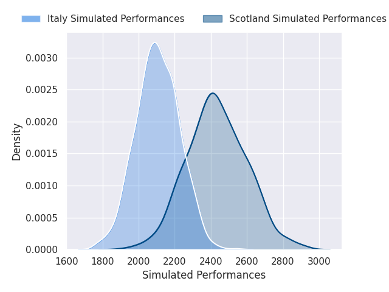

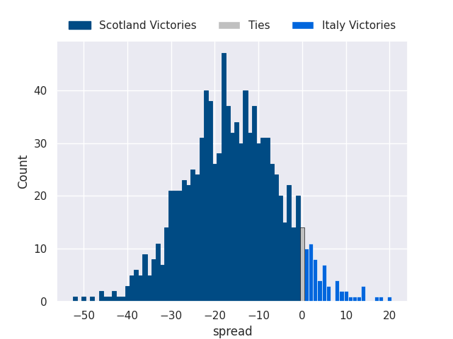

#### France V Wales on 2027/02/06

Average Margin: France by 16.3

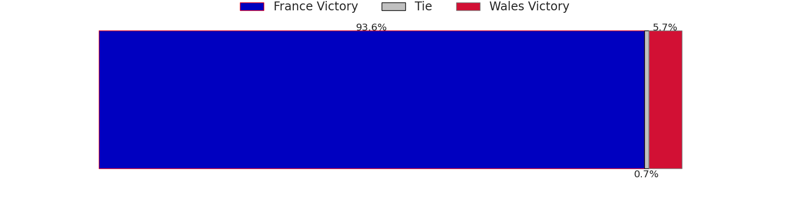

### Week 2
#### Scotland V Wales on 2027/02/13

Average Margin: Scotland by 7.1

#### Italy V Ireland on 2027/02/13

Average Margin: Ireland by 15.7

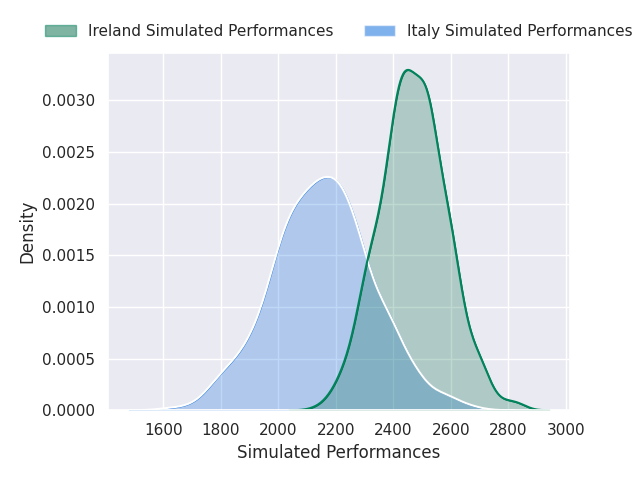

#### England V France on 2027/02/14

Average Margin: England by 6.0

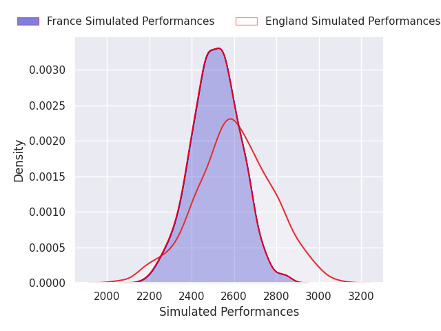

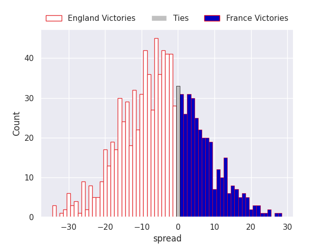

### Week 3
#### England V Italy on 2027/02/20

Average Margin: England by 28.8

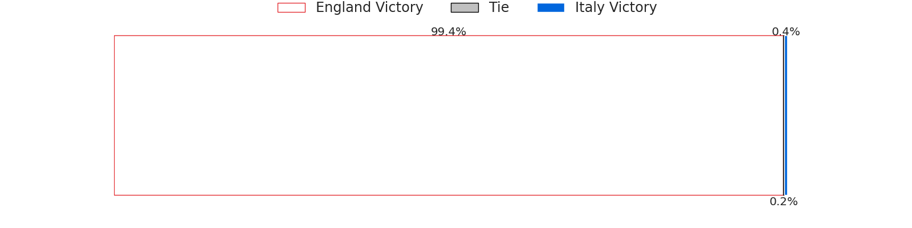

#### Wales V Ireland on 2027/02/20

Average Margin: Ireland by 4.2

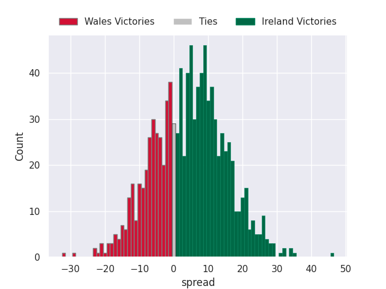

#### France V Scotland on 2027/02/21

Average Margin: France by 13.4

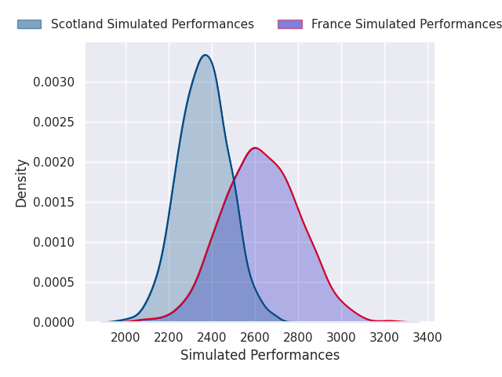
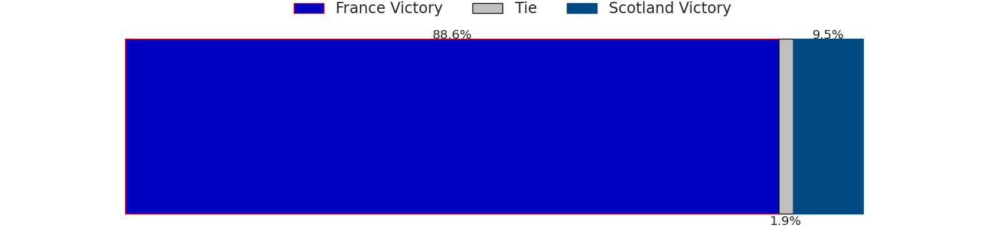

### Week 4
#### Scotland V Ireland on 2027/03/05

Average Margin: Ireland by 1.0

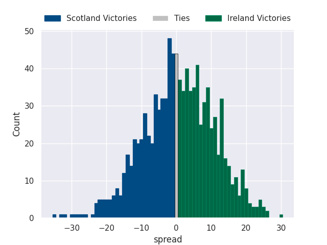

#### Wales V England on 2027/03/06

Average Margin: England by 8.1

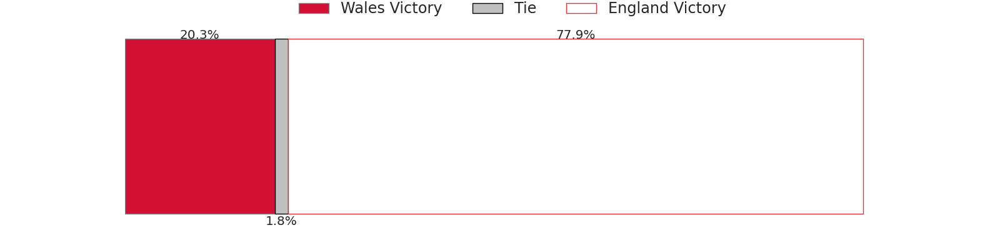
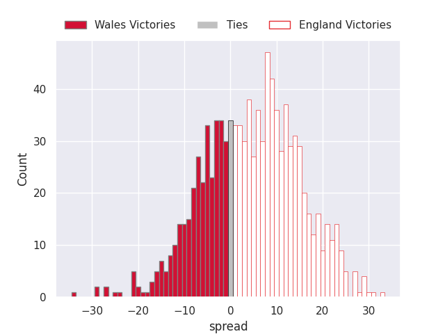

#### Italy V France on 2027/03/06

Average Margin: France by 17.5

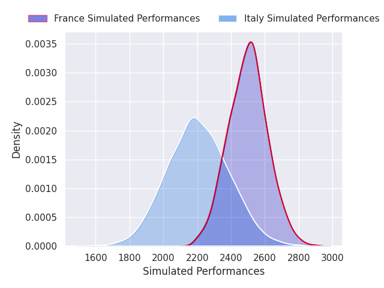

### Week 5
#### Ireland V France on 2027/03/13

Average Margin: Ireland by 1.3

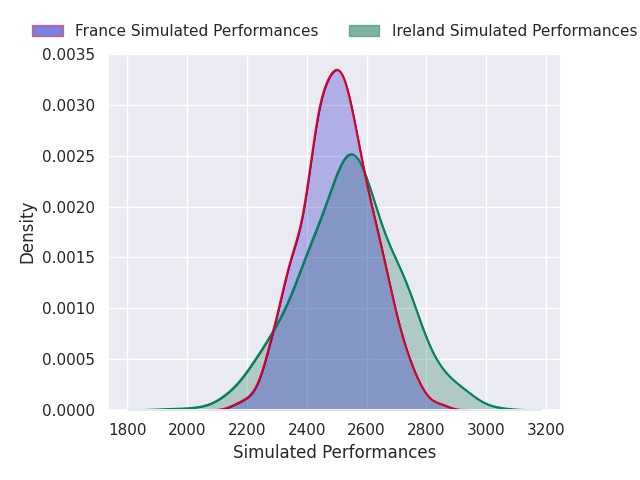

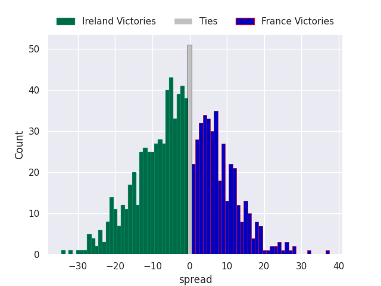

#### Italy V Wales on 2027/03/13

Average Margin: Wales by 7.3

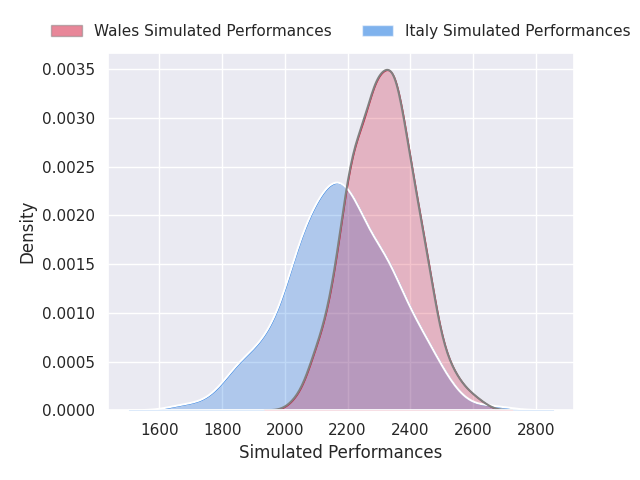

#### England V Scotland on 2027/03/13

Average Margin: England by 14.7

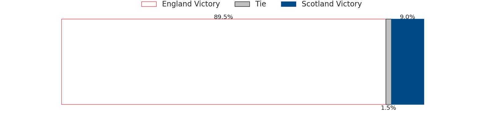
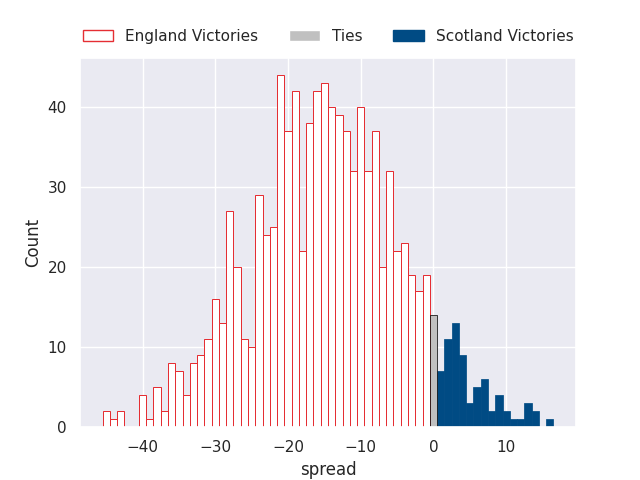

