## Team Rankings

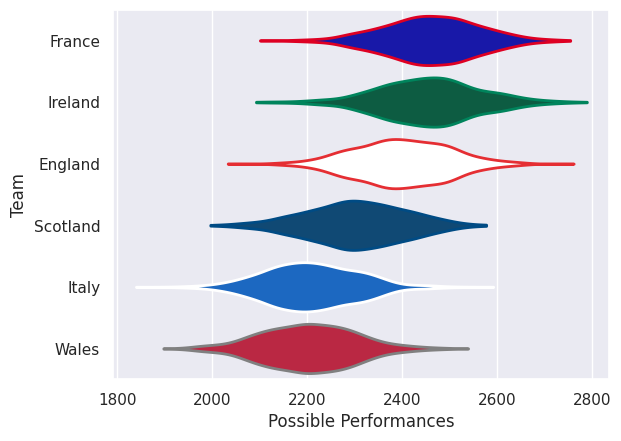
## Standings
### Projected Remaining Table

| Club     |   To Play |   Projected Wins |   Projected Differential |   Projected Losing Bonus Points | Projected Try Bonus Points   |   Projected Competition Points |
|:---------|----------:|-----------------:|-------------------------:|--------------------------------:|:-----------------------------|-------------------------------:|
| France   |         5 |            3.457 |                   36.321 |                           0.786 |                              |                         14.896 |
| England  |         5 |            3.376 |                   32.13  |                           0.836 |                              |                         14.642 |
| Ireland  |         5 |            3.001 |                   16.209 |                           1.028 |                              |                         13.386 |
| Scotland |         5 |            2.725 |                   12.17  |                           0.848 |                              |                         11.972 |
| Wales    |         5 |            1.25  |                  -37.728 |                           1.139 |                              |                          6.379 |
| Italy    |         5 |            0.788 |                  -59.102 |                           0.868 |                              |                          4.23  |

### Projected Total Table

| Club     |   Played |   Wins |   Point Differential |   Losing Bonus Points | Try Bonus Points   |   Competition Points |
|:---------|---------:|-------:|---------------------:|----------------------:|:-------------------|---------------------:|
| France   |        5 |  3.457 |               36.321 |                 0.786 |                    |               14.896 |
| England  |        5 |  3.376 |               32.13  |                 0.836 |                    |               14.642 |
| Ireland  |        5 |  3.001 |               16.209 |                 1.028 |                    |               13.386 |
| Scotland |        5 |  2.725 |               12.17  |                 0.848 |                    |               11.972 |
| Wales    |        5 |  1.25  |              -37.728 |                 1.139 |                    |                6.379 |
| Italy    |        5 |  0.788 |              -59.102 |                 0.868 |                    |                4.23  |

## Future Predictions
### Week 1
#### Scotland V Italy on 2027/02/06

Average Margin: Scotland by 16.6

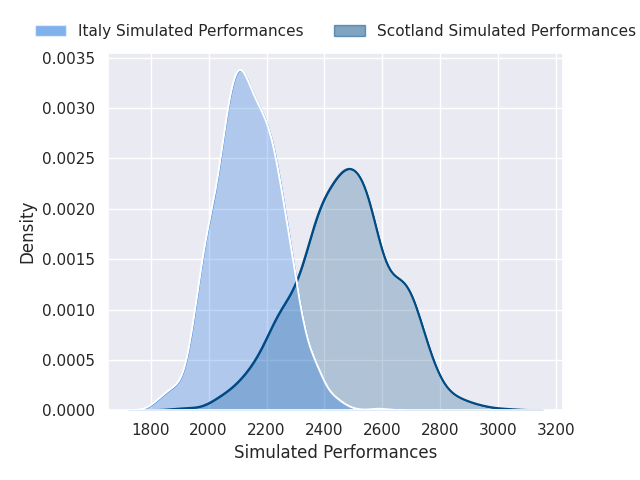

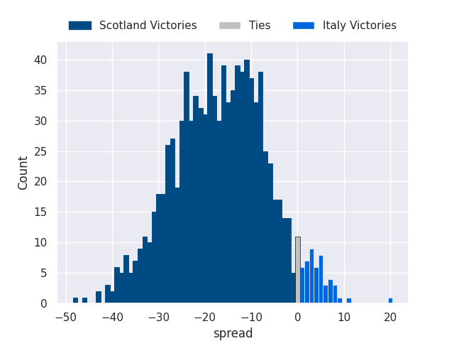

#### France V Wales on 2027/02/06

Average Margin: France by 17.3

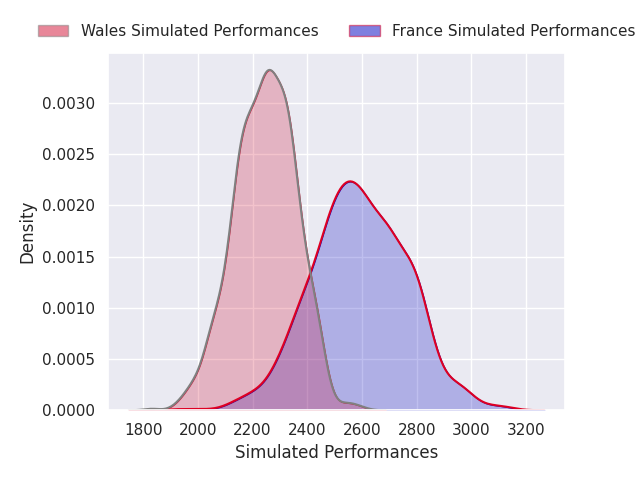
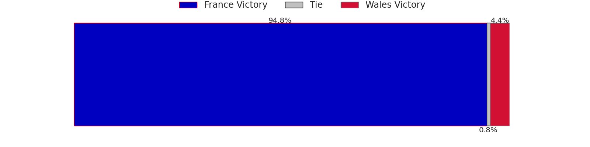
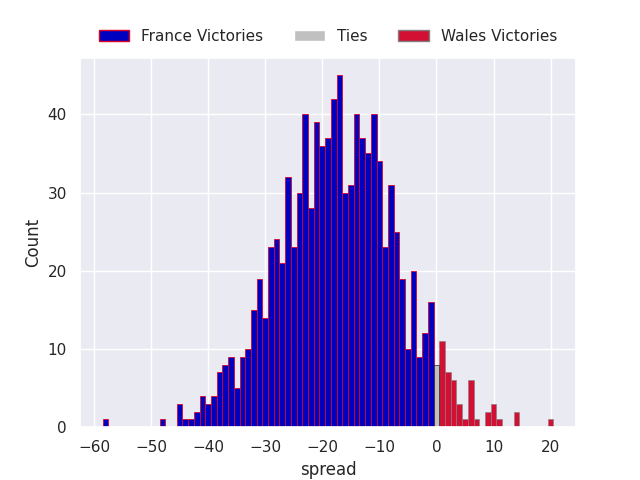

### Week 2
#### Italy V Ireland on 2027/02/13

Average Margin: Ireland by 10.0

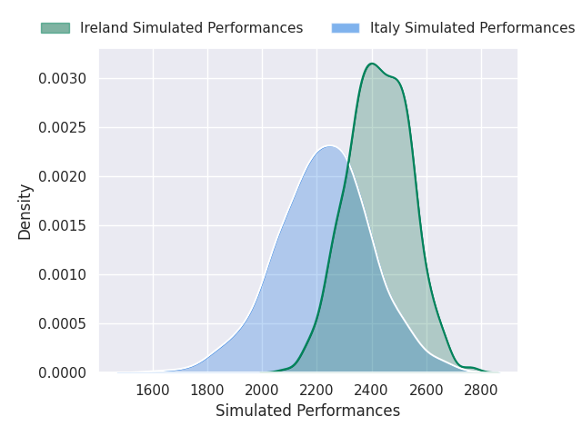
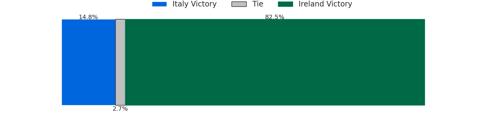
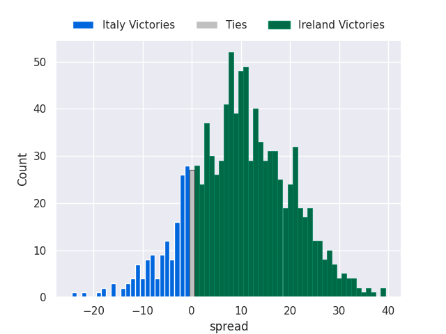

#### Scotland V Wales on 2027/02/13

Average Margin: Scotland by 11.7

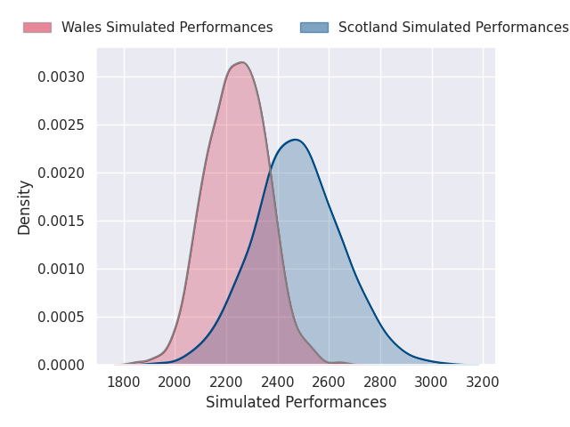
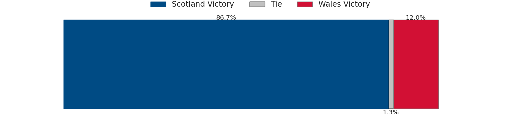
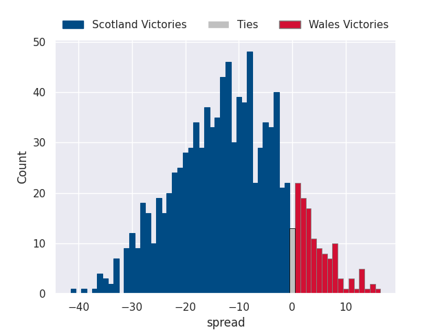

#### England V France on 2027/02/14

Average Margin: England by 2.1

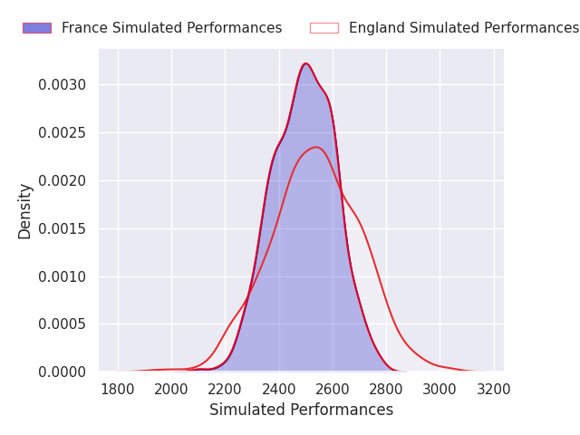

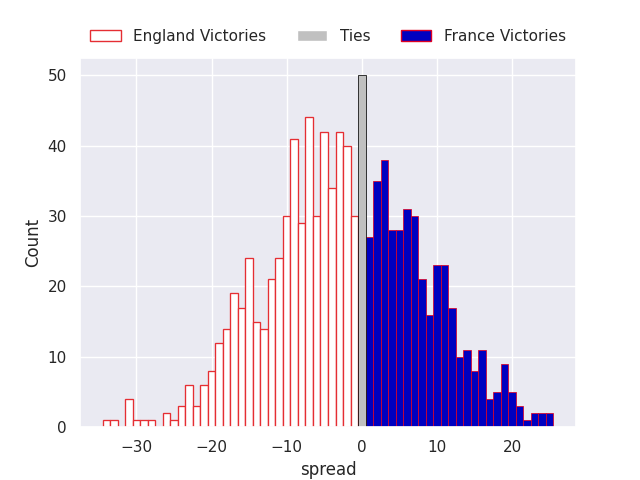

### Week 3
#### England V Italy on 2027/02/20

Average Margin: England by 19.4

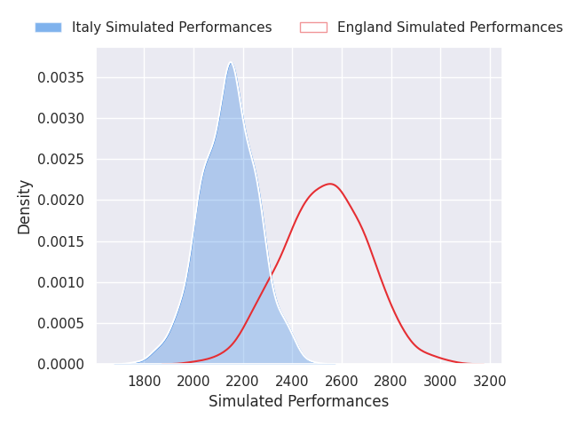
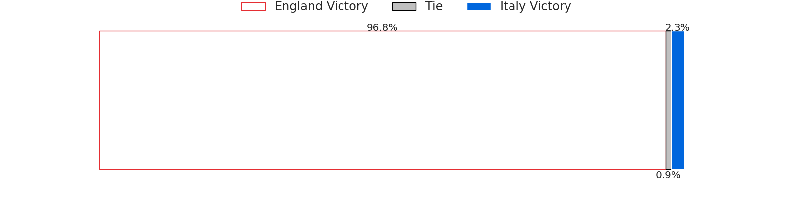
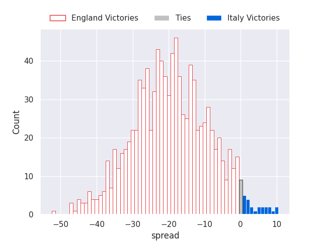

#### Wales V Ireland on 2027/02/20

Average Margin: Ireland by 4.9

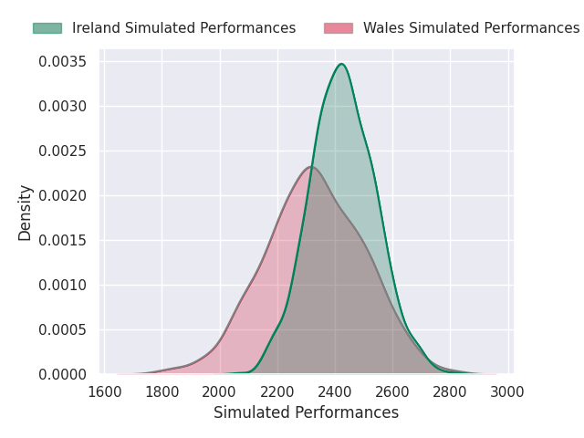

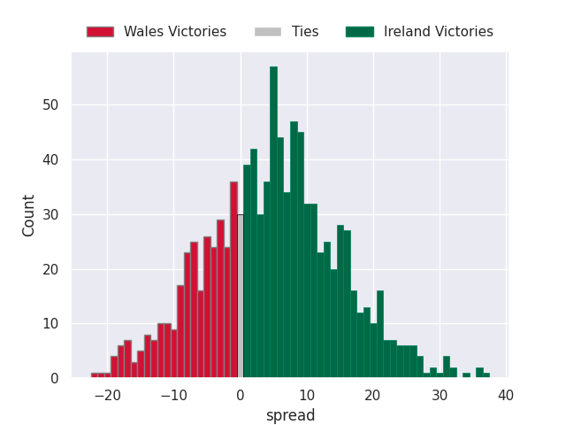

#### France V Scotland on 2027/02/21

Average Margin: France by 10.3

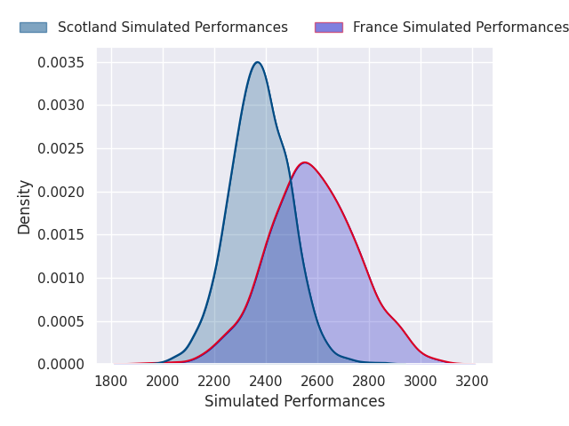
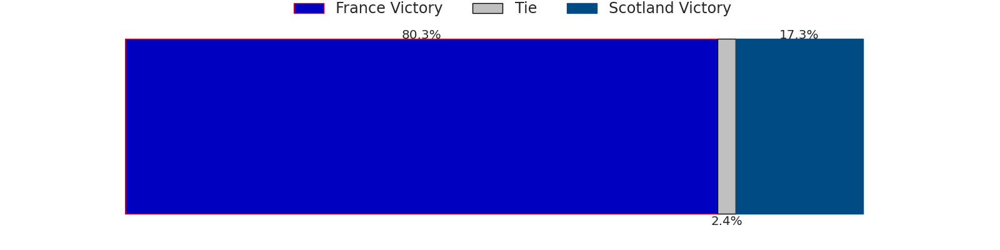
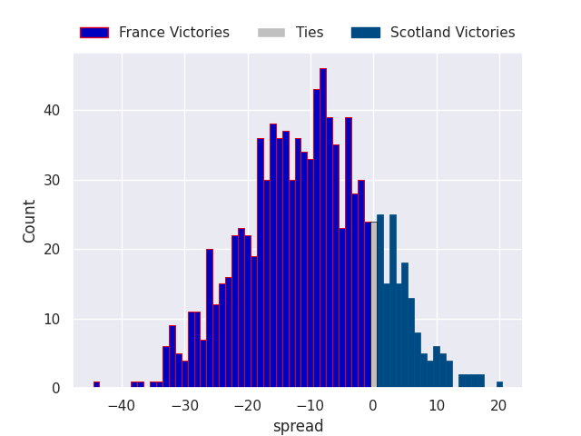

### Week 4
#### Wales V England on 2027/03/06

Average Margin: England by 5.3

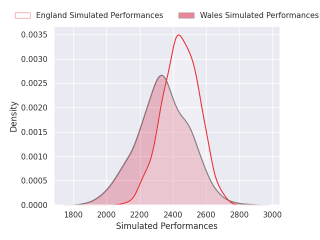
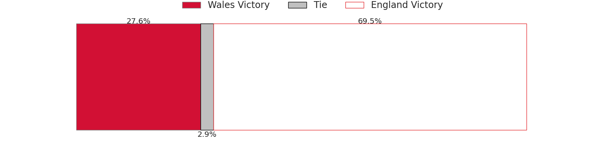
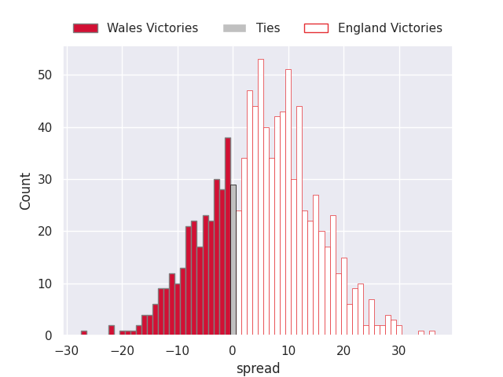

#### Italy V France on 2027/03/06

Average Margin: France by 11.7

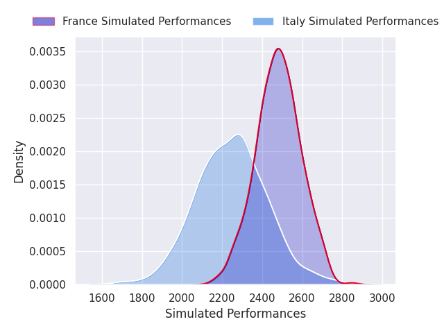
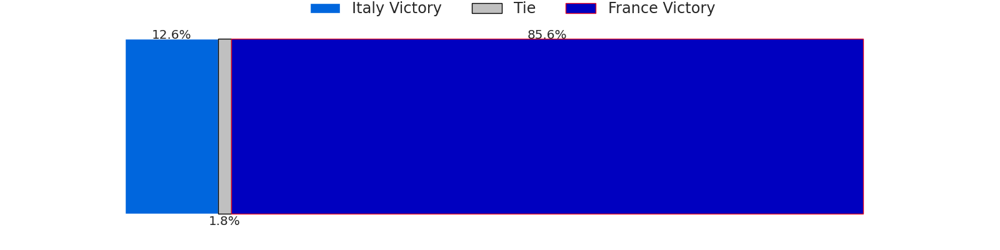
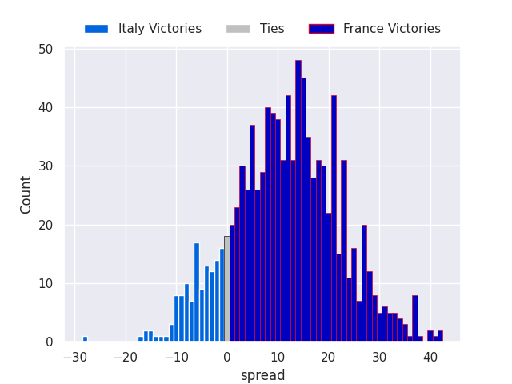

### Week 5
#### Ireland V France on 2027/03/13

Average Margin: Ireland by 0.8

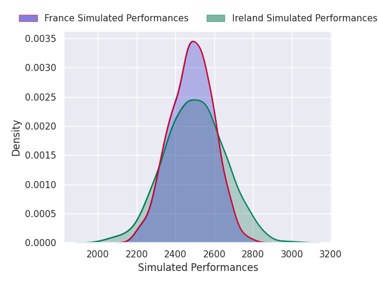

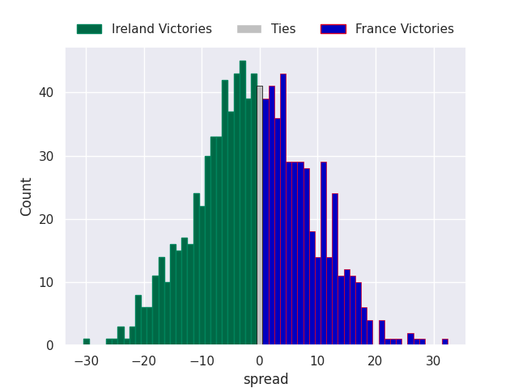

#### Italy V Wales on 2027/03/13

Average Margin: Wales by 1.5

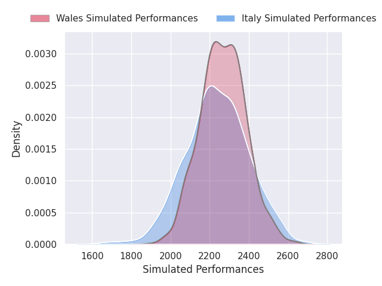

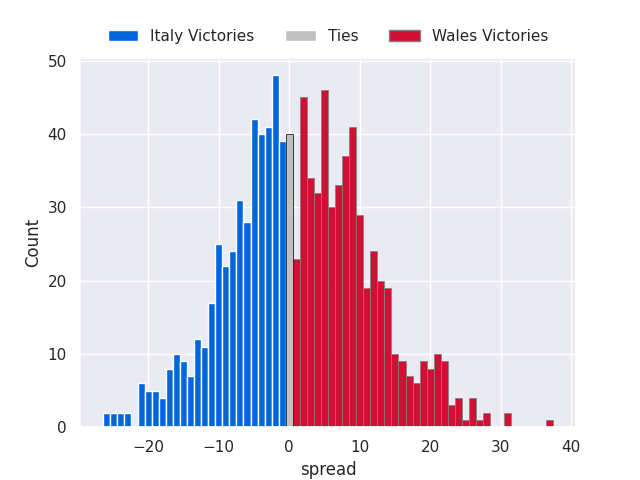

#### England V Scotland on 2027/03/13

Average Margin: England by 8.0

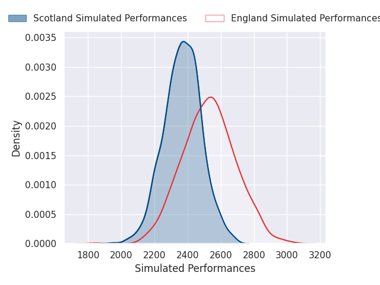
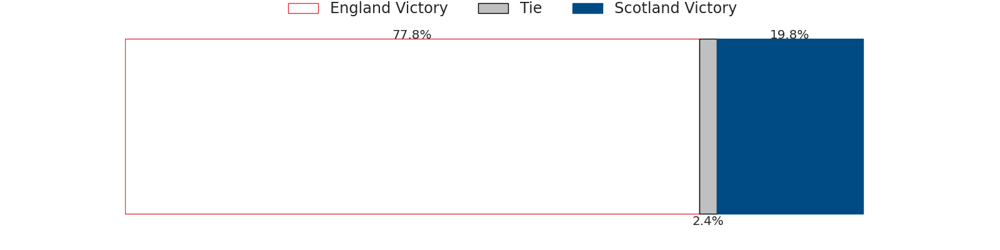
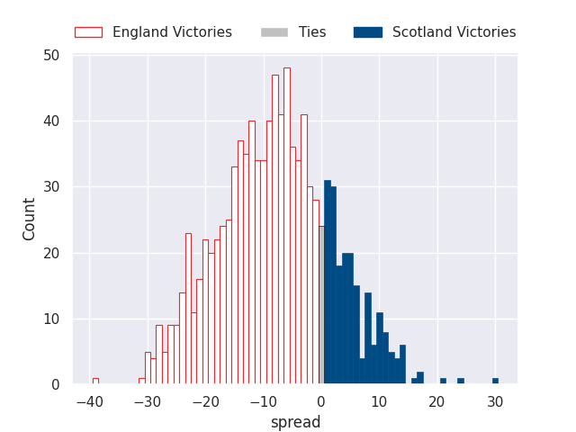

