## Team Rankings

## Standings
### Projected Remaining Table

| Club     |   To Play |   Projected Wins |   Projected Differential |   Projected Losing Bonus Points | Projected Try Bonus Points   |   Projected Competition Points |
|:---------|----------:|-----------------:|-------------------------:|--------------------------------:|:-----------------------------|-------------------------------:|
| England  |         5 |            3.908 |                   57.428 |                           0.575 |                              |                         16.391 |
| France   |         5 |            3.417 |                   38.121 |                           0.67  |                              |                         14.562 |
| Ireland  |         5 |            3.215 |                   24.392 |                           0.897 |                              |                         14.063 |
| Scotland |         5 |            2.264 |                   -3.026 |                           0.761 |                              |                         10.051 |
| Wales    |         5 |            1.487 |                  -29.699 |                           1.066 |                              |                          7.274 |
| Italy    |         5 |            0.371 |                  -87.216 |                           0.604 |                              |                          2.232 |

### Projected Total Table

| Club     |   Played |   Wins |   Point Differential |   Losing Bonus Points | Try Bonus Points   |   Competition Points |
|:---------|---------:|-------:|---------------------:|----------------------:|:-------------------|---------------------:|
| England  |        5 |  3.908 |               57.428 |                 0.575 |                    |               16.391 |
| France   |        5 |  3.417 |               38.121 |                 0.67  |                    |               14.562 |
| Ireland  |        5 |  3.215 |               24.392 |                 0.897 |                    |               14.063 |
| Scotland |        5 |  2.264 |               -3.026 |                 0.761 |                    |               10.051 |
| Wales    |        5 |  1.487 |              -29.699 |                 1.066 |                    |                7.274 |
| Italy    |        5 |  0.371 |              -87.216 |                 0.604 |                    |                2.232 |

## Future Predictions
### Week 1
#### Scotland V Italy on 2027/02/05

Average Margin: Scotland by 18.8

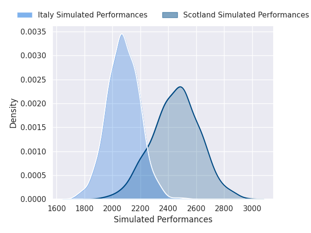

#### France V Wales on 2027/02/05

Average Margin: France by 15.9

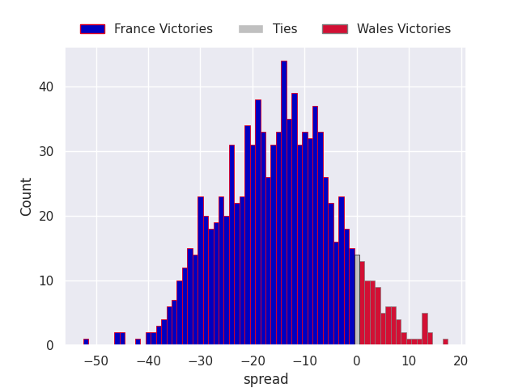

### Week 2
#### Scotland V Wales on 2027/02/12

Average Margin: Scotland by 7.4

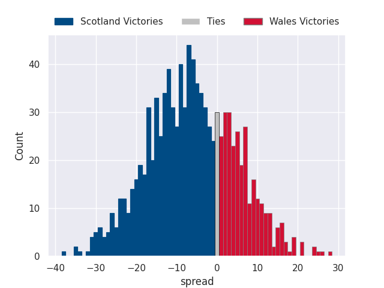

#### England V France on 2027/02/12

Average Margin: England by 6.2

#### Italy V Ireland on 2027/02/12

Average Margin: Ireland by 15.8

### Week 3
#### France V Scotland on 2027/02/19

Average Margin: France by 13.5

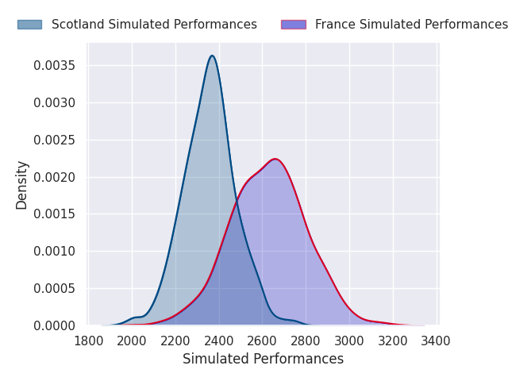
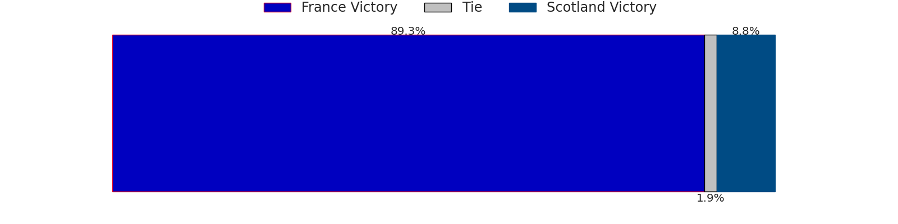

#### Wales V Ireland on 2027/02/19

Average Margin: Ireland by 5.3

#### England V Italy on 2027/02/19

Average Margin: England by 29.1

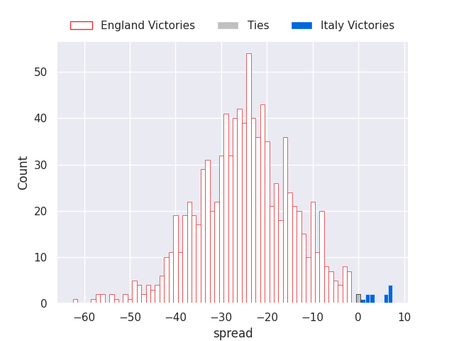

### Week 4
#### Italy V France on 2027/03/05

Average Margin: France by 17.0

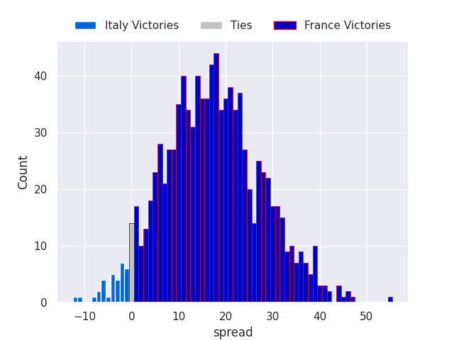

#### Scotland V Ireland on 2027/03/05

Average Margin: Ireland by 0.9

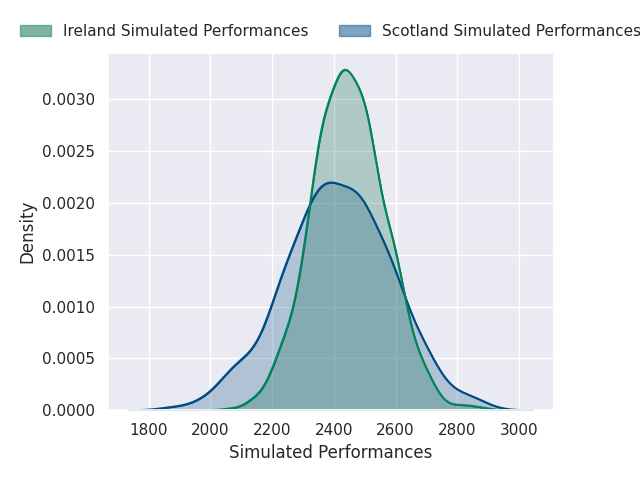

#### Wales V England on 2027/03/05

Average Margin: England by 7.8

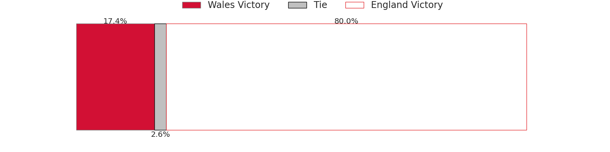

### Week 5
#### England V Scotland on 2027/03/12

Average Margin: England by 14.8

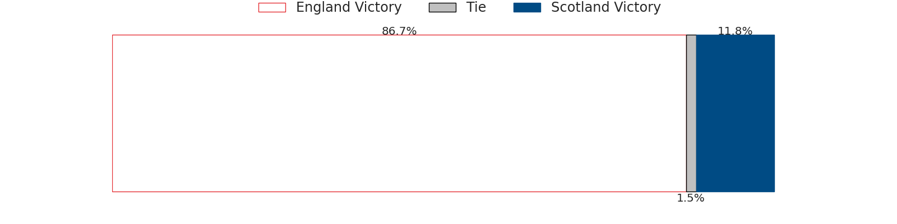

#### Italy V Wales on 2027/03/12

Average Margin: Wales by 6.7

#### Ireland V France on 2027/03/12

Average Margin: Ireland by 2.0

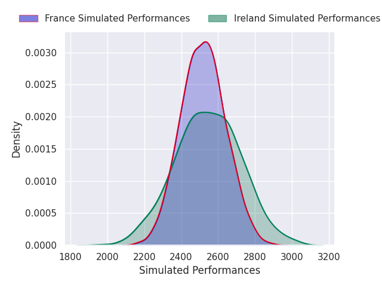

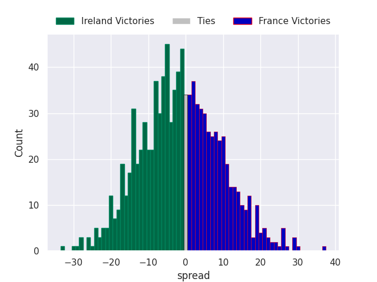

