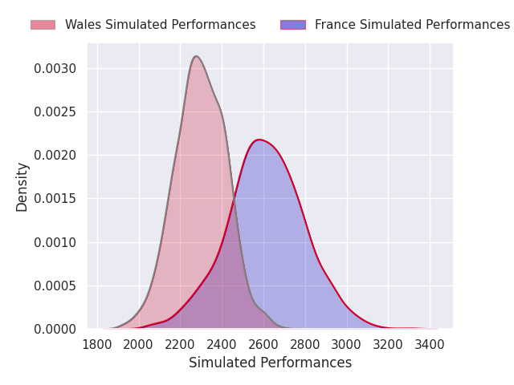
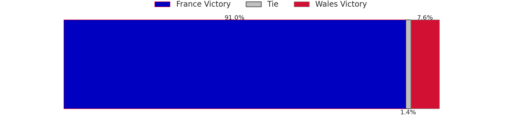
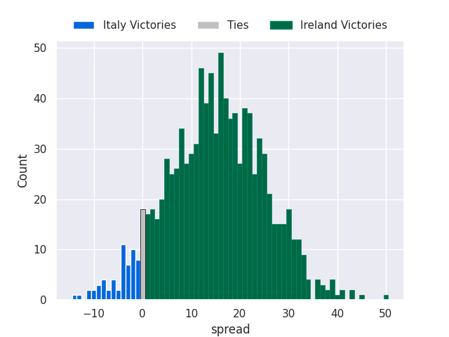
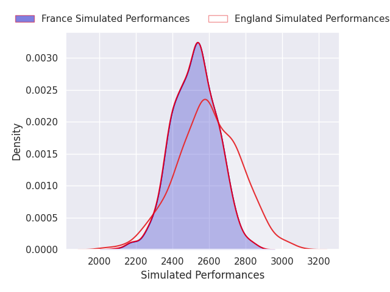
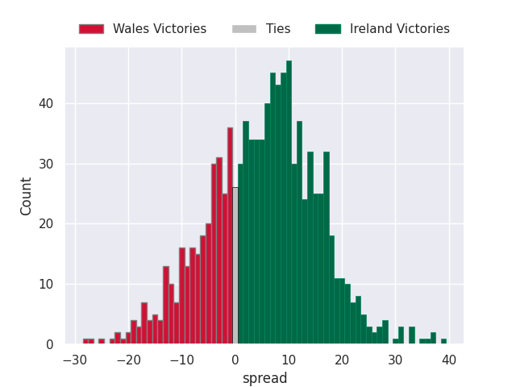
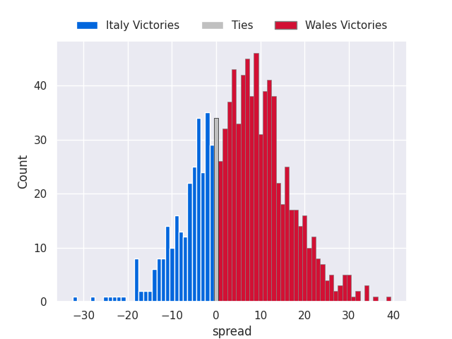

## Team Rankings

## Standings
### Projected Remaining Table

| Club     |   To Play |   Projected Wins |   Projected Differential |   Projected Losing Bonus Points | Projected Try Bonus Points   |   Projected Competition Points |
|:---------|----------:|-----------------:|-------------------------:|--------------------------------:|:-----------------------------|-------------------------------:|
| England  |         5 |            3.533 |                   43.168 |                           0.718 |                              |                         15.114 |
| France   |         5 |            3.456 |                   37.435 |                           0.682 |                              |                         14.79  |
| Ireland  |         5 |            3.174 |                   22.931 |                           0.957 |                              |                         13.959 |
| Scotland |         5 |            2.261 |                   -6.979 |                           0.807 |                              |                         10.037 |
| Wales    |         5 |            1.724 |                  -22.232 |                           1.102 |                              |                          8.302 |
| Italy    |         5 |            0.482 |                  -74.323 |                           0.803 |                              |                          2.867 |

### Projected Total Table

| Club     |   Played |   Wins |   Point Differential |   Losing Bonus Points | Try Bonus Points   |   Competition Points |
|:---------|---------:|-------:|---------------------:|----------------------:|:-------------------|---------------------:|
| England  |        5 |  3.533 |               43.168 |                 0.718 |                    |               15.114 |
| France   |        5 |  3.456 |               37.435 |                 0.682 |                    |               14.79  |
| Ireland  |        5 |  3.174 |               22.931 |                 0.957 |                    |               13.959 |
| Scotland |        5 |  2.261 |               -6.979 |                 0.807 |                    |               10.037 |
| Wales    |        5 |  1.724 |              -22.232 |                 1.102 |                    |                8.302 |
| Italy    |        5 |  0.482 |              -74.323 |                 0.803 |                    |                2.867 |

## Future Predictions
### Week 1
#### Scotland V Italy on 2027/02/05

Average Margin: Scotland by 15.8

#### France V Wales on 2027/02/05

Average Margin: France by 14.7

### Week 2
#### Scotland V Wales on 2027/02/12

Average Margin: Scotland by 5.4

#### Italy V Ireland on 2027/02/12

Average Margin: Ireland by 13.6

#### England V France on 2027/02/12

Average Margin: England by 3.7

### Week 3
#### England V Italy on 2027/02/19

Average Margin: England by 24.4

#### Wales V Ireland on 2027/02/19

Average Margin: Ireland by 3.3

#### France V Scotland on 2027/02/19

Average Margin: France by 13.8

### Week 4
#### Wales V England on 2027/03/05

Average Margin: England by 4.7

#### Italy V France on 2027/03/05

Average Margin: France by 14.6

### Week 5
#### England V Scotland on 2027/03/12

Average Margin: England by 12.9

#### Italy V Wales on 2027/03/12

Average Margin: Wales by 5.9

#### Ireland V France on 2027/03/12

Average Margin: Ireland by 2.0

