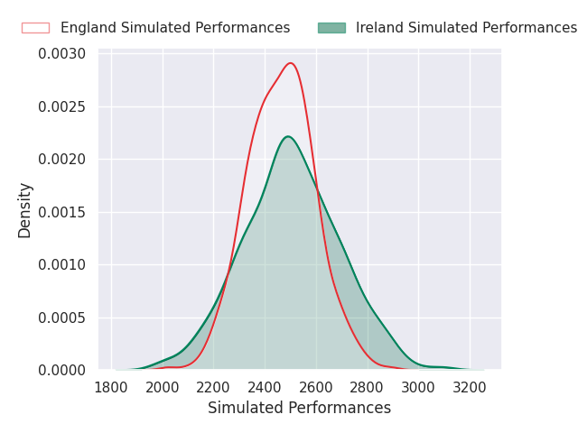
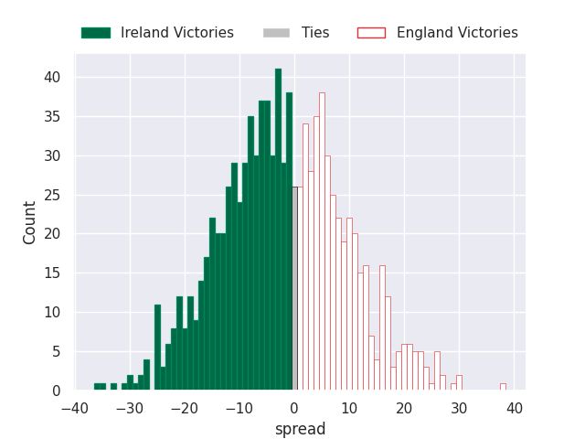
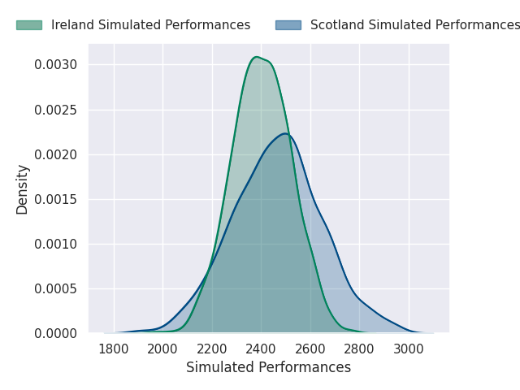
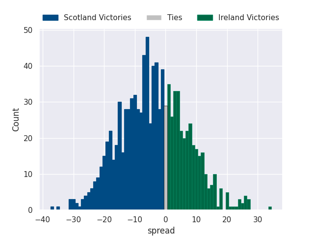

## Team Rankings

## Standings
### Projected Remaining Table

| Club     |   To Play |   Projected Wins |   Projected Differential |   Projected Losing Bonus Points | Projected Try Bonus Points   |   Projected Competition Points |
|:---------|----------:|-----------------:|-------------------------:|--------------------------------:|:-----------------------------|-------------------------------:|
| France   |         5 |            3.484 |                   38.046 |                           0.72  |                              |                         14.936 |
| England  |         5 |            3.311 |                   33.5   |                           0.832 |                              |                         14.326 |
| Ireland  |         5 |            2.851 |                   14.19  |                           0.971 |                              |                         12.717 |
| Scotland |         5 |            2.828 |                   16.548 |                           0.762 |                              |                         12.306 |
| Wales    |         5 |            1.371 |                  -37.605 |                           0.996 |                              |                          6.744 |
| Italy    |         5 |            0.762 |                  -64.679 |                           0.81  |                              |                          4.062 |

### Projected Total Table

| Club     |   Played |   Wins |   Point Differential |   Losing Bonus Points | Try Bonus Points   |   Competition Points |
|:---------|---------:|-------:|---------------------:|----------------------:|:-------------------|---------------------:|
| France   |        5 |  3.484 |               38.046 |                 0.72  |                    |               14.936 |
| England  |        5 |  3.311 |               33.5   |                 0.832 |                    |               14.326 |
| Ireland  |        5 |  2.851 |               14.19  |                 0.971 |                    |               12.717 |
| Scotland |        5 |  2.828 |               16.548 |                 0.762 |                    |               12.306 |
| Wales    |        5 |  1.371 |              -37.605 |                 0.996 |                    |                6.744 |
| Italy    |        5 |  0.762 |              -64.679 |                 0.81  |                    |                4.062 |

## Future Predictions
### Week 1
#### Ireland V England on 2027/02/05

Average Margin: Ireland by 2.2

#### France V Wales on 2027/02/05

Average Margin: France by 17.4

#### Scotland V Italy on 2027/02/05

Average Margin: Scotland by 17.8

### Week 2
#### Scotland V Wales on 2027/02/12

Average Margin: Scotland by 12.2

#### Italy V Ireland on 2027/02/12

Average Margin: Ireland by 10.6

#### England V France on 2027/02/12

Average Margin: England by 1.8

### Week 3
#### England V Italy on 2027/02/19

Average Margin: England by 21.3

#### Wales V Ireland on 2027/02/19

Average Margin: Ireland by 4.6

#### France V Scotland on 2027/02/19

Average Margin: France by 9.6

### Week 4
#### Scotland V Ireland on 2027/03/05

Average Margin: Scotland by 3.5

#### Wales V England on 2027/03/05

Average Margin: England by 5.2

#### Italy V France on 2027/03/05

Average Margin: France by 13.1

### Week 5
#### England V Scotland on 2027/03/12

Average Margin: England by 7.4

#### Italy V Wales on 2027/03/12

Average Margin: Wales by 1.8

#### Ireland V France on 2027/03/12

Average Margin: Ireland by 0.3

